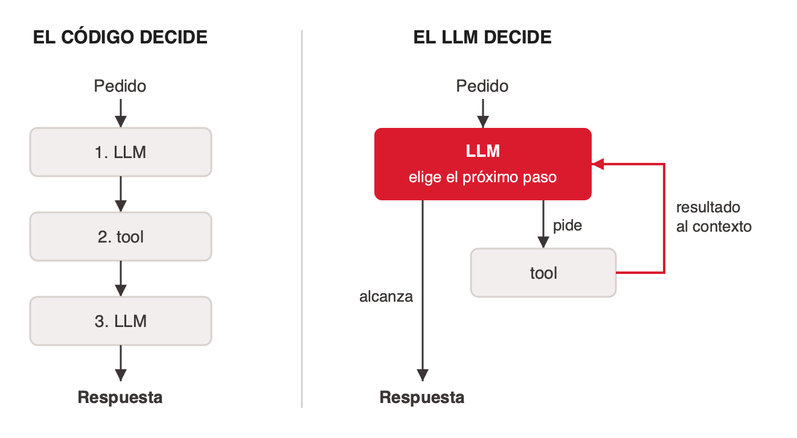

# El agente basado en LLM

Un agente basado en LLM es un loop en el que el modelo elige su próxima acción según lo que observó. Leído con la definición clásica (ver [que-es-un-agente](../que-es-un-agente/index.md)), las tools son sus actuadores y lo que devuelven entra al contexto como percepciones nuevas.

## Los componentes, según Weng

Lilian Weng (junio de 2023) describe al LLM como el cerebro del agente y le suma tres componentes ([lilianweng-llm-powered-agents](../../talks/agentes-y-multiagentes/research/corpus/lilianweng-llm-powered-agents.web.md)):

- **Planificación.** Descomponer la tarea en subobjetivos, y reflexionar sobre acciones pasadas para corregirlas. Weng ubica ahí a ReAct y a Reflexion (ver [tipos-de-agente-llm](../tipos-de-agente-llm/index.md)).
- **Memoria.** Corto y largo plazo.
- **Uso de tools.** Llamar APIs externas para obtener lo que no está en los pesos: información actual, ejecución de código, fuentes propietarias (ver [tools-para-agentes](../tools-para-agentes/index.md)).

Anthropic dice algo parecido con otro nombre: su bloque básico es el *augmented LLM*, un LLM con retrieval, tools y memoria ([anthropic-building-effective-agents](../../talks/agentes-y-multiagentes/research/corpus/anthropic-building-effective-agents.web.md)).

Los ejemplos del post de Weng (AutoGPT, BabyAGI) son la primera ola de agentes; el marco de componentes sigue vigente.

## Dos formas de conectar un LLM con tools

Con el mismo LLM y las mismas tools, el próximo paso lo puede decidir el código o el modelo.

Anthropic llama *agentic systems* a las dos y les pone nombre:

| | Workflow | Agente |
|---|---|---|
| Definición | "systems where LLMs and tools are orchestrated through predefined code paths" | "systems where LLMs dynamically direct their own processes and tool usage" |
| Conviene para | Tareas bien definidas que piden previsibilidad | Tareas que piden flexibilidad y decisiones del modelo |
| Patrones | Prompt chaining, routing, paralelización, orchestrator-workers, evaluator-optimizer | Un LLM que usa tools según el feedback del ambiente, en un loop |

> "Agents … are typically just LLMs using tools based on environmental feedback in a loop." — Anthropic, *Building effective agents* (dic-2024, versión revisada)

Notas:

- Un sistema real mezcla las dos columnas: un routing determinista entre agentes que por dentro son autónomos.
- Anthropic clasifica **orchestrator-workers** como workflow. Cuando cada worker tiene su propio loop de tools, el conjunto es un sistema multiagente (ver [sistemas-multiagente](../sistemas-multiagente/index.md)).
- La diferencia entre paralelización y orchestrator-workers: en la primera las subtareas están escritas en el código; en la segunda el orquestador las decide para cada pedido.
- El deck del curso (slide 33) dibuja un espectro de tres puntos: workflows deterministas (prompt chaining, paralelización), workflows dirigidos por LLM (routing, orchestrator-worker, evaluator-optimizer) y agentes autónomos.

## Cuándo vale la pena un agente

Anthropic recomienda "finding the simplest solution possible, and only increasing complexity when needed. This might mean not building agentic systems at all." Para muchas aplicaciones alcanza con optimizar una sola llamada al LLM con retrieval y ejemplos en el prompt.

Un agente se justifica cuando ([deck del curso, slide 15](../../talks/agentes-y-multiagentes/research/corpus/AIG4B-Clase-6-Agent.pptx.md) y Anthropic):

- **Varias tools en orden variable.** El orden cambia según el caso.
- **Resultados que hay que interpretar.** El paso siguiente depende de leer lo que devolvió el anterior.
- **Reglas fijas insuficientes.** El espacio de posibilidades es demasiado grande o dinámico.
- **Éxito verificable.** Hay un criterio claro de éxito y feedback en cada paso, como los tests en un agente de código.

Costos: un agente cambia latencia y dinero por desempeño. Además, la autonomía permite que los errores se acumulen; Anthropic recomienda probar en sandbox y poner condiciones de parada, como un máximo de iteraciones.

Un recordatorio de que el workflow puede ganarle al agente: Agentless, un pipeline fijo sin agente que decida el próximo paso, resolvió el 32% de SWE-bench Lite a 0,70 dólares por problema, más que todos los agentes de código abierto de ese momento ([agentless-2024](../../talks/agentes-y-multiagentes/research/corpus/agentless-2024.web.md)).

## Árbol de decisión

El cierre de la clase resume el criterio como una secuencia de preguntas, cada una de las cuales descarta la opción más compleja si la simple alcanza. El árbol completo, con la rama multiagente, está en [sistemas-multiagente](../sistemas-multiagente/index.md#cómo-elegir-la-arquitectura).

1. ¿Alcanza una llamada al LLM, con RAG o ejemplos? Sí → una llamada, sin agente.
2. ¿Los pasos se conocen de antemano? Sí → workflow, pasos fijos en código.
3. Si no: un agente con buenas tools (ReAct; planificar o reflexionar si la tarea lo pide).
4. Recién si la información no entra en un contexto, hay equipos dueños de dominios distintos o el trabajo se reparte en lecturas paralelas que valen ~15× tokens: multiagente.

## References

- [anthropic-building-effective-agents](../../talks/agentes-y-multiagentes/research/corpus/anthropic-building-effective-agents.web.md): definiciones de workflow y agente, los cinco patrones de workflow, el augmented LLM, cuándo no construir un agente. La lectura más recomendable si hay que elegir una sola. URL: https://www.anthropic.com/engineering/building-effective-agents
- [lilianweng-llm-powered-agents](../../talks/agentes-y-multiagentes/research/corpus/lilianweng-llm-powered-agents.web.md): la descomposición en planificación, memoria y tools. URL: https://lilianweng.github.io/posts/2023-06-23-agent/
- [AIG4B-Clase-6-Agent.pptx](../../talks/agentes-y-multiagentes/research/corpus/AIG4B-Clase-6-Agent.pptx.md): criterios del curso para usar agentes y el espectro workflow/agente.
- [agentless-2024](../../talks/agentes-y-multiagentes/research/corpus/agentless-2024.web.md): pipeline fijo contra agentes de código.
- [langchain-memory](../../talks/agentes-y-multiagentes/research/corpus/langchain-memory.web.md), [langgraph-persistence-memory](../../talks/agentes-y-multiagentes/research/corpus/langgraph-persistence-memory.web.md), [mem0-paper-2025](../../talks/agentes-y-multiagentes/research/corpus/mem0-paper-2025.web.md), [zep-paper-2025](../../talks/agentes-y-multiagentes/research/corpus/zep-paper-2025.web.md): memoria de agentes; capturados pero fuera del alcance de la clase, sin curar acá.
