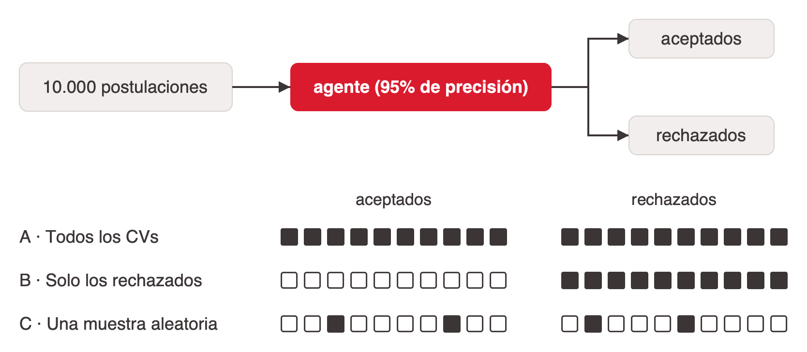

# Humano en el circuito

En el marco de seguridad, el humano en el circuito es la última defensa: aprobación explícita para acciones irreversibles como enviar, borrar o pagar (ver [seguridad-de-llms-y-agentes](../seguridad-de-llms-y-agentes/index.md#defensa-en-profundidad)). La evidencia muestra que no alcanza con ponerlo: **hay que diseñar para que siga despierto.**

## El centauro

En 1997 Deep Blue le ganó a Kasparov. Después, Kasparov propuso el ajedrez "centauro" (*advanced chess*): humano y máquina juegan juntos (verificado). La idea traducida a sistemas: todo resultado clave de IA pasa por revisión, verificación y edición humana, y el humano aporta intuición, empatía, conocimiento tácito y responsabilidad, que es lo que convierte un borrador en una decisión. La IA es una extensión, no un reemplazo, pero ese equilibrio hay que diseñarlo ([clase-cierre](../../talks/cierre-magnifica-humanitas/research/corpus/IA_Generativa_Clase_Cierre_v2_Magnifica_Humanitas.pptx.md), slide 33).

## La evidencia: «dormido al volante»

F. Dell'Acqua, "Falling asleep at the wheel: Human/AI Collaboration in a Field Experiment on HR Recruiters" (2022). Versión verificada: **181 reclutadores evaluaron 44 CVs cada uno (cerca de 8.000 evaluaciones)** para un puesto de ingeniería de software, con recomendaciones de IA de distinta calidad.

| Recomendación | Qué pasó con el humano |
|---|---|
| IA de alta calidad | Menos esfuerzo y menos precisión: confían a ciegas y se desconectan |
| IA de menor calidad | Más compromiso y mejores evaluaciones: la duda los mantiene despiertos |

Corrección del fact-check: el mejor resultado conjunto se dio con la IA de **menor** calidad (la condición "Bad", ~75% de precisión), no con una "de calidad media" como decía el deck original. Contraintuitivo: mejor IA, peor resultado conjunto (slide 34).

**Implicancias de diseño** (notas de la cátedra): interfaces que pidan justificación antes de aceptar, muestreo de casos para revisión y mostrar la incertidumbre del modelo.

## El riesgo del deskilling

Datos del Stanford HAI AI Index 2026 (verificados):

- **4 de 5** estudiantes universitarios usa IA generativa.
- **88%** de las organizaciones adoptó IA.
- **−20%** de empleo de desarrolladores de 22 a 25 años desde 2024 en EE.UU. *El informe no nombra la fuente de esta cifra; probablemente son los datos de ADP de Brynjolfsson et al.*

Si se usa el piloto automático todo el tiempo, uno se olvida de manejar, y cuando el sistema falle el juicio no va a estar listo. La pregunta que deja la cátedra: ¿qué habilidad no van a delegar nunca? Respuestas típicas: debugging, diseño de sistemas, escribir, razonar matemáticamente (slide 35).

## Ejercicio: el agente de RR.HH.

Una empresa usa un agente que filtra CVs con 95% de precisión y procesa 10.000 postulaciones por mes. ¿Qué revisión humana exigir?

| Opción | A favor | La objeción |
|---|---|---|
| A · Todos los CVs | Máxima garantía | Anula la eficiencia |
| B · Solo los rechazados | Protege a los candidatos | ¿Y el sesgo en los aceptados? |
| C · Una muestra aleatoria | Auditoría estadística | ¿Quién responde por el caso 501? |

El dilema cruza seguridad y ética. Preguntas para tensionar (slide 36):

- ¿Y si un candidato pone instrucciones ocultas en su CV? Es la inyección indirecta del caso del bot reclutador ([seguridad-de-llms-y-agentes](../seguridad-de-llms-y-agentes/index.md#un-caso-el-bot-reclutador)).
- ¿Qué dice el AI Act? La selección de personal es alto riesgo (Anexo III), con obligaciones desde el 2 de diciembre de 2027 ([etica-y-regulacion-de-la-ia](../etica-y-regulacion-de-la-ia/index.md#regulación-el-ai-act-y-argentina)).
- ¿Qué derecho tiene el candidato a que decida un humano?

Dato para el cálculo: con 95% de precisión y 10.000 postulaciones, el agente se equivoca en unas 500 por mes.

## Qué no delegar

La encíclica *Magnifica Humanitas* lo lleva al extremo: las decisiones letales o irreversibles no deben confiarse a sistemas artificiales (n. 198), y la cadena de responsabilidades tiene que seguir siendo identificable y verificable (n. 199). Ver [etica-y-regulacion-de-la-ia](../etica-y-regulacion-de-la-ia/index.md).

## References

- [clase-cierre](../../talks/cierre-magnifica-humanitas/research/corpus/IA_Generativa_Clase_Cierre_v2_Magnifica_Humanitas.pptx.md): slides 22, 33–36 y §Fact-check.
- Dell'Acqua (2022), resumen en el Digital Data Design Institute de Harvard: https://aiinstitute.hbs.edu/?p=30560
- Stanford HAI, AI Index 2026: https://hai.stanford.edu/ai-index/2026-ai-index-report
- Advanced chess: https://en.wikipedia.org/wiki/Advanced_chess
