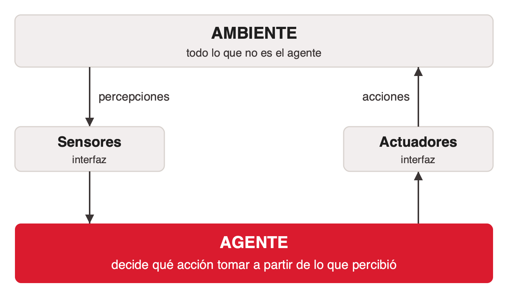
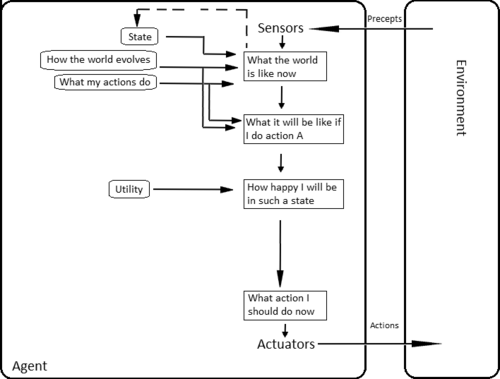
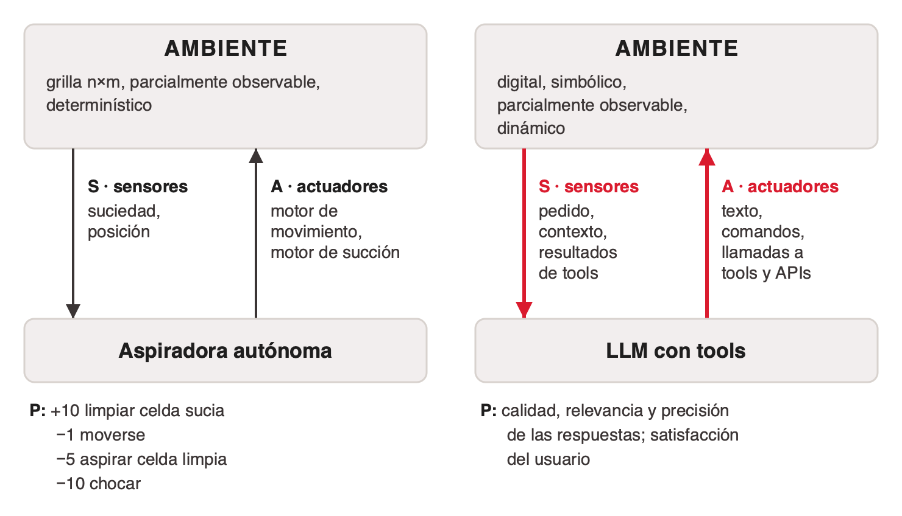

# Qué es un agente

En el uso diario se llama "agente" a cualquier LLM o sistema basado en LLM. La definición clásica es más amplia y más exigente a la vez: un LLM no es un agente por sí solo, y existen muchísimos agentes que no usan modelos de lenguaje ([deck del curso, slide 3](../../talks/agentes-y-multiagentes/research/corpus/AIG4B-Clase-6-Agent.pptx.md)).

## La definición

> "An agent is anything that can be viewed as perceiving its environment through sensors and acting upon that environment through actuators."
> — Russell & Norvig, *Artificial Intelligence: A Modern Approach*

En español: un agente es cualquier entidad que percibe su entorno mediante sensores y actúa sobre él mediante actuadores (traducción del deck del curso, no de una edición en español).

El agente es el único punto de decisión. Sensores y actuadores son interfaces, y el ambiente es todo lo que no es el agente. Cada acción cambia el ambiente y la vuelta siguiente parte de percepciones nuevas.

La definición es amplia a propósito:

- **No nombra ML ni LLMs.** Machine learning, deep learning, LLMs, tools o RAG son implementaciones posibles, no requisitos.
- **No exige software.** Un sistema mecánico o electrónico también encaja.
- **Incluye sistemas biológicos.** Células, insectos, animales y personas son agentes bajo esta definición.

Consecuencia práctica para diseño: cuando alguien dice "agente", conviene preguntar qué percibe, qué puede hacer y en qué ambiente. La descripción PEAS (más abajo) ordena esas preguntas.

## Racionalidad

Russell y Norvig evalúan a un agente con una **medida de performance**. Un agente racional elige la acción que se espera que maximice esa medida, dada la secuencia de percepciones, el conocimiento previo y las acciones disponibles ([Wikipedia, que resume Russell & Norvig 2021](../../talks/agentes-y-multiagentes/research/corpus/wikipedia-intelligent-agent.web.md)). Racional no significa omnisciente ni infalible: la racionalidad juzga el resultado *esperado* con la información disponible.

Qué es racional en cada momento depende de cuatro factores:

| Factor | Qué es |
|---|---|
| Medida de performance | El criterio que define el éxito |
| Conocimiento previo | Lo que el agente sabe del ambiente antes de actuar |
| Acciones disponibles | Lo que puede hacer en su entorno |
| Secuencia de percepciones | Todo lo que observó hasta ahora |

Dos lecturas útiles:

- **La medida es parte del diseño.** Un agente perfectamente racional puede hacer algo indeseable si el criterio de éxito está mal especificado. Si la medida de una aspiradora solo premiara aspirar, aspiraría sin parar, también las celdas limpias; por eso la medida del ejemplo PEAS resta puntos por esa acción.
- **Omnisciencia.** Un auto autónomo que frena bien ante lo que ve y recibe el choque de un auto que no podía ver actuó racionalmente (ejemplo ilustrativo de la cátedra).

En un agente basado en LLM, la secuencia de percepciones tiene otro nombre: el **contexto** (ver [tools-para-agentes](../tools-para-agentes/index.md)).

## Función de agente y programa de agente

| | Qué es |
|---|---|
| **Función de agente** `f: P* → A` | Asigna una acción a cada secuencia de percepciones posible. P* es el conjunto de todas esas secuencias (cero o más percepciones). Es una descripción matemática: nadie la ejecuta, y escrita como tabla sería infinita para casi cualquier agente. |
| **Programa de agente** | El código que corre. Recibe la percepción *actual* y devuelve una acción. Si necesita la historia, la tiene que guardar él. |

Un termostato tiene un programa de una regla: si la temperatura bajó del umbral, encender; si no, apagar. (Wikipedia cita este ejemplo a un blog y a IBM, no a Russell & Norvig.)

En un agente LLM, el modelo cumple el papel de la función: elige la acción a partir de todo lo que vio hasta ese paso. El programa es el código que junta esa historia en un texto, llama al modelo y ejecuta las tools.

## Arquitecturas clásicas

Russell & Norvig ordenan los agentes según lo que hay entre la percepción y la acción. Cada tipo agrega una pieza al anterior ([Wikipedia, "Classic taxonomy"](../../talks/agentes-y-multiagentes/research/corpus/wikipedia-intelligent-agent.web.md)).

- **Reflejo simple.** Regla "si condición, entonces acción" sobre la percepción actual. Solo funciona si el ambiente es completamente observable.
- **Reflejo con modelo.** Guarda un estado interno con la parte del mundo que no ve.
- **Basado en objetivos.** Predice qué produce cada acción y elige la que lleva a un estado meta.
- **Basado en utilidad.** Puntúa los estados con una función de utilidad y elige la acción de mayor utilidad esperada.
- **Que aprende.** Un crítico le dice cómo le va, un elemento de aprendizaje mejora al resto, y un generador de problemas propone experiencias nuevas. Le permite superar lo que su diseñador le cargó.

Algunas ediciones presentan cuatro programas más el agente que aprende; Wikipedia habla de cinco clases.

### Un auto autónomo en cada arquitectura

El auto percibe con cámaras, LiDAR, GPS y velocímetro, y actúa con acelerador, freno y dirección. Cada fila resuelve la limitación de la anterior (recorrido construido por la cátedra; Wikipedia usa el auto para definir percepción, acción y la función objetivo que balancea seguridad, velocidad y comodidad).

| Arquitectura | Qué hace el auto | Dónde se queda corto |
|---|---|---|
| Reflejo simple | Frena cuando el de adelante enciende las luces de freno | Un auto tapado por un camión no existe para él |
| Reflejo con modelo | Recuerda el auto del punto ciego aunque la cámara ya no lo vea | Reglas fijas, sin destino |
| Basado en objetivos | En cada esquina elige el giro que lo acerca al destino | Le da lo mismo la ruta rápida o la peligrosa |
| Basado en utilidad | Pondera seguridad, velocidad y comodidad en cada maniobra | Necesita un modelo del ambiente y una utilidad escrita por el diseñador |
| Que aprende | Un crítico marca cada frenada brusca y el auto corrige | Probar maniobras nuevas en la calle cuesta caro |

Relación con los agentes LLM (lectura de la cátedra): Reflexion se parece al agente que aprende, con un evaluador que hace de crítico, pero lo aprendido queda escrito en el contexto y los pesos no cambian (ver [tipos-de-agente-llm](../tipos-de-agente-llm/index.md)).

BDI (creencias, deseos, intenciones) es otro modelo clásico de un agente individual; separa elegir un plan de ejecutarlo y no describe la interacción entre agentes ([bdi-agents](../../talks/agentes-y-multiagentes/research/corpus/bdi-agents.web.md)).

## La descripción PEAS

Un agente se describe con cuatro elementos: medida de **P**erformance, ambiente (**E**nvironment), **A**ctuadores y **S**ensores. La misma descripción vale para una aspiradora y para un agente LLM.

| | Aspiradora autónoma | LLM con tools |
|---|---|---|
| Ambiente | Grilla n×m, parcialmente observable, determinístico | Digital, simbólico, parcialmente observable, dinámico |
| Sensores | Suciedad, posición | Pedido, contexto, resultados de tools |
| Actuadores | Motor de movimiento, motor de succión | Texto, comandos, llamadas a tools y APIs |
| Performance | +10 limpiar celda sucia, −1 moverse, −5 aspirar celda limpia, −10 chocar | Calidad, relevancia y precisión de las respuestas; satisfacción del usuario |

Fuente: slides 8 y 18 del [deck del curso](../../talks/agentes-y-multiagentes/research/corpus/AIG4B-Clase-6-Agent.pptx.md); formulaciones "PEAS-like" en [aig4b-clase-6-agentes-biomedica](../../talks/agentes-y-multiagentes/research/corpus/aig4b-clase-6-agentes-biomedica.pdf.md).

Lo que esta tabla enseña:

- **Un LLM se vuelve agente cuando tiene sensores y actuadores.** Sensores: lo que entra a su contexto, incluidos los resultados de tools. Actuadores: llamar APIs, ejecutar comandos. Sin tools, su único actuador es generar texto.
- **Ambiente y performance son los dos elementos que se olvidan** al diseñar un agente.
- **El ambiente de un agente LLM es parcialmente observable y dinámico.** Por eso tiene que observar después de cada acción: una base de datos cambia mientras el agente piensa, y una búsqueda devuelve solo una parte del mundo.
- Entre las dimensiones del ambiente, una separa la teoría de un agente de la de varios: si en el ambiente actúa un solo agente o muchos (ver [sistemas-multiagente](../sistemas-multiagente/index.md)).

## Huecos conocidos

- La sigla PEAS, la fórmula textual del agente racional ("for each possible percept sequence…") y el capítulo 2 de Russell & Norvig no están en el corpus; [russell-norvig-aima](../../talks/agentes-y-multiagentes/research/corpus/russell-norvig-aima.web.md) es solo el índice. Capturar el capítulo si se quiere citar textual.

## References

- [AIG4B-Clase-6-Agent.pptx](../../talks/agentes-y-multiagentes/research/corpus/AIG4B-Clase-6-Agent.pptx.md): deck original del curso. Definición, comentarios, racionalidad, PEAS de la aspiradora y del agente LLM, dimensiones del ambiente.
- [wikipedia-intelligent-agent](../../talks/agentes-y-multiagentes/research/corpus/wikipedia-intelligent-agent.web.md): función y programa de agente, taxonomía clásica, ejemplo del auto autónomo; es la fuente más completa del corpus sobre Russell & Norvig.
- [aig4b-clase-6-agentes-biomedica](../../talks/agentes-y-multiagentes/research/corpus/aig4b-clase-6-agentes-biomedica.pdf.md): formulaciones PEAS de aspiradora, robot móvil y AlphaGo; definición de sistema multiagente.
- [bdi-agents](../../talks/agentes-y-multiagentes/research/corpus/bdi-agents.web.md): modelo BDI.
- Russell & Norvig, *Artificial Intelligence: A Modern Approach*, 4.ª ed., Pearson, 2020 (no capturado).
