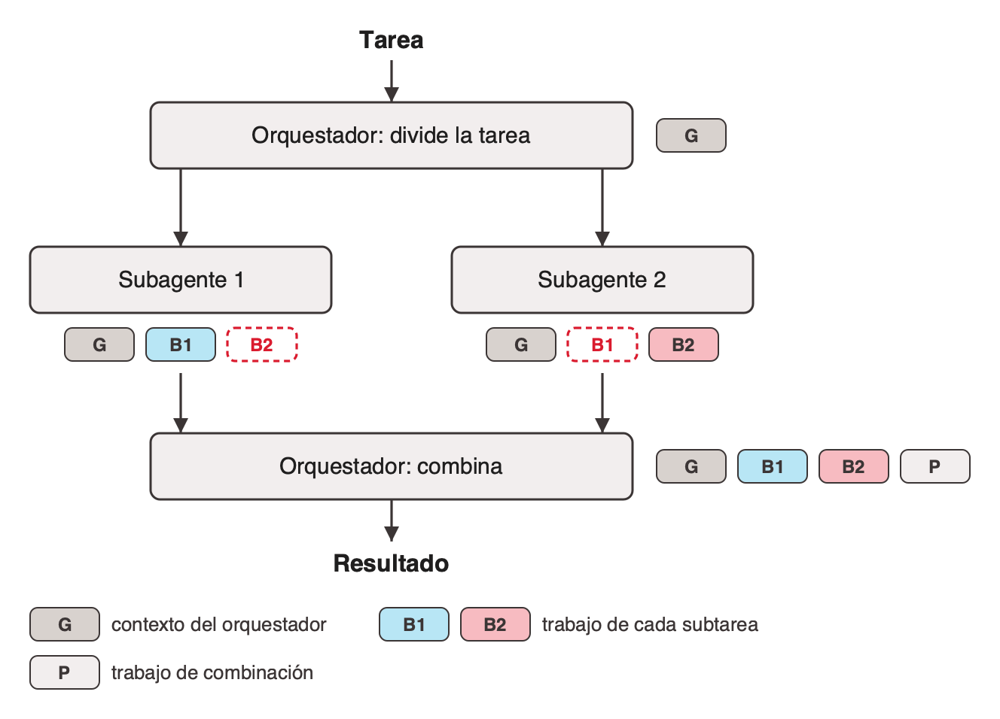
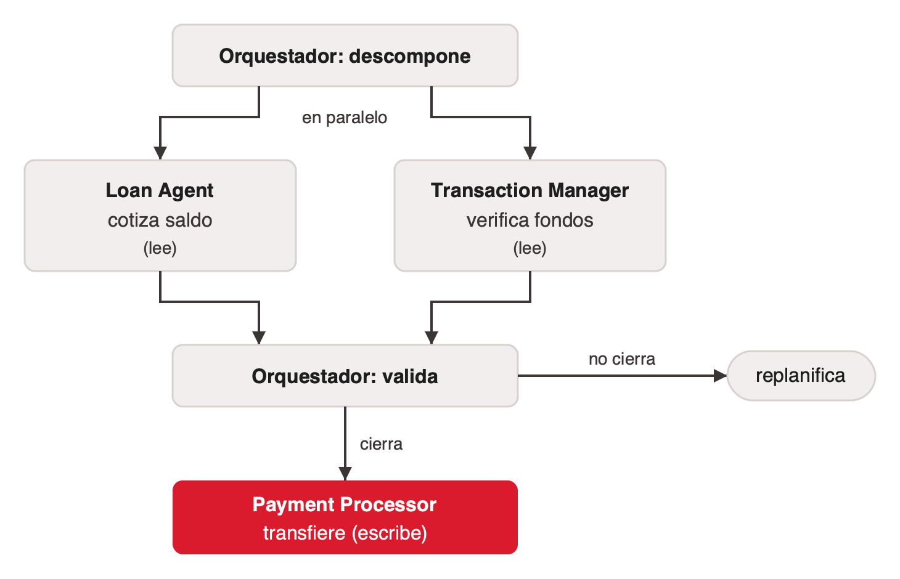

# Cuándo repartir

Volver a [index.md](index.md).

## El precio de paralelizar

Cifras internas de Anthropic sobre su propio sistema, sin metodología publicada ([anthropic-multi-agent-research-system](../../talks/agentes-y-multiagentes/research/corpus/anthropic-multi-agent-research-system.web.md), jun-2025):

- **~4×** los tokens de un chat para un agente.
- **~15×** los tokens de un chat para un sistema multiagente.
- En BrowseComp (que mide si un agente que navega la web encuentra información difícil de hallar), tres factores explican el 95% de la varianza de desempeño: uso de tokens, cantidad de llamadas a tools y elección de modelo. El uso de tokens solo explica el 80%.

Anthropic lo dice en su propio post: "Multi-agent systems work mainly because they help spend enough tokens to solve the problem", y concluye que "multi-agent systems require tasks where the value of the task is high enough to pay for the increased performance".

Ejercicio útil: tomar el costo de la tarea como chat, multiplicarlo por 15 y preguntarse si la tarea lo vale (con el precio por millón de tokens vigente ese día).

## Cómo fallan: MAST

Cemri et al. (UC Berkeley, mar-2025) anotaron a mano 1.642 trazas de 7 sistemas multiagente abiertos (entre ellos ChatDev, MetaGPT y Magentic-One) y encontraron tasas de falla de entre 41% y 86,7%. Armaron una taxonomía de 14 modos en 3 categorías ([mast-why-mas-fail-2025](../../talks/agentes-y-multiagentes/research/corpus/mast-why-mas-fail-2025.web.md), §4):

| Categoría | Parte de las fallas | Modos más frecuentes |
|---|---|---|
| Diseño del sistema | 44,2% | repetir pasos (15,7%), no saber cuándo terminar (12,4%), desobedecer la tarea (11,8%) |
| Desalineación entre agentes | 32,35% | razonamiento que no coincide con la acción (13,2%), desviarse de la tarea (7,4%), no pedir aclaración (6,8%) |
| Verificación | 23,5% | verificación incorrecta (9,1%), ausente o incompleta (8,2%), terminar antes de tiempo (6,2%) |

Los totales por categoría son sumas de los modos y dan 100,05% por redondeo. El rango 41%–86,7% está en el texto pero viene de la Figura 5, que no se capturó. La miniatura de la taxonomía en la Figura 2 muestra porcentajes distintos (parece una versión anterior); citar los de §4.

Ejemplo de desalineación (Figura 3, modo *information withholding*): el agente del teléfono lee que el usuario es el número de teléfono, falla el login y le pide credenciales nuevas al supervisor sin contarle lo que aprendió. El supervisor tampoco pregunta. Repiten logins fallidos.

Dos conclusiones del paper:

- Las fallas entre agentes no se arreglan con un protocolo de mensajes común: los agentes no modelan qué necesita saber el otro.
- Un verificador ayuda pero no alcanza si verifica cosas superficiales, como que el código compile.

## El aislamiento hay que configurarlo

Cuando un agente le pasa el control o el trabajo a otro, el que recibe suele heredar la conversación. La palanca de aislamiento no viene de fábrica. Tres valores por defecto, de tres frameworks (documentación capturada el 2026-10-04; cambian entre versiones):

| Mecanismo | Valor por defecto | Para aislar | Fuente |
|---|---|---|---|
| Handoff | El agente que toma el control "gets to see the entire previous conversation history" | Un filtro explícito (`input_filter`) | [openai-agents-sdk-handoffs](../../talks/agentes-y-multiagentes/research/corpus/openai-agents-sdk-handoffs.web.md) |
| Historial compartido | `create_handoff_tool` pasa el historial **completo**; los mensajes de todos los agentes van a una sola lista | Un esquema de estado propio por agente | [langgraph-swarm](../../talks/agentes-y-multiagentes/research/corpus/langgraph-swarm.web.md) |
| Copia del agente (fork) | Un subagente nuevo "starts with a fresh, isolated context window"; un fork "inherits the entire conversation so far … This drops the input isolation" | Usar un subagente nuevo en vez de un fork | [claude-code-subagents](../../talks/agentes-y-multiagentes/research/corpus/claude-code-subagents.web.md) |

Para verificarlo en un sistema propio: revisar en los logs qué contexto recibe cada agente. Si ve el historial de todos, no está aislado aunque tenga su propio prompt. El fork es más barato que un subagente nuevo porque comparte el caché del prompt, y por eso mismo hereda todo.

## Compartir el contexto no alcanza

Aun con todo el contexto del orquestador, cada subagente sigue sin ver el trabajo de su hermano. Los dos toman decisiones que el otro no conoce, y el choque aparece al combinar.

Ejemplo de Cognition ([cognition-dont-build-multi-agents](../../talks/agentes-y-multiagentes/research/corpus/cognition-dont-build-multi-agents.web.md)): clonar Flappy Bird. Un subagente hace el fondo con los caños, el otro el pájaro. Sin contexto compartido, el primero hace un fondo estilo Super Mario Bros y el segundo un pájaro que no se mueve como el de Flappy Bird. Con todo el contexto compartido, igual salen en "completely different visual styles", porque ninguno vio lo que decidía el otro.

## El debate: ¿construir multiagentes?

Dos equipos serios publicaron con un día de diferencia conclusiones opuestas, sin responderse:

| | Cognition | Anthropic |
|---|---|---|
| Publicación | 12 jun 2025 (Walden Yan) | 13 jun 2025 |
| Posición | "Don't Build Multi-Agents": un solo hilo con contexto continuo | A favor del multiagente, para investigación |
| Argumento | "Share context, and share full agent traces, not just individual messages"; "Actions carry implicit decisions, and conflicting decisions carry bad results" | Cada subagente comprime en su propia ventana; repartir permite gastar los tokens que el problema pide |
| Evidencia | Principios y un ejemplo, sin números | Eval interna: "outperformed single-agent Claude Opus 4 by 90.2%" |
| Dominio | Agentes de código (Devin) | Claude Research |

Matices:

- El 90,2% no aclara si es mejora relativa o en puntos, ni el tamaño de la eval. Citarlo textual, no como "90% más preciso". La configuración era Claude Opus 4 como orquestador y Claude Sonnet 4 como subagentes (modelos de mediados de 2025).
- La alternativa de Cognition para tareas muy largas es un LLM que comprime el historial, y admite que es difícil hacerlo bien.
- Las dos son empresas que venden lo que describen. LangChain, siete meses después, toma una posición intermedia: empezar con un agente y repartir solo ante un límite claro.

## ¿El trabajo lee o escribe?

El debate se resuelve con una variable concreta: si los hermanos necesitan verse.

- **El trabajo lee** (investigación, búsqueda, lectura de fuentes). Dos subagentes que leen cosas distintas no se pisan y devuelven un hallazgo. Repartir paga. Es el dominio de Anthropic.
- **El trabajo escribe sobre algo compartido** (código, un mismo documento, una misma base). Cada acción cambia el terreno del otro: un solo hilo, o límites explícitos entre quienes escriben. Es el dominio de Cognition.

> "most coding tasks involve fewer truly parallelizable tasks than research, and LLM agents are not yet great at coordinating and delegating to other agents in real time" — Anthropic, jun-2025

Según Anthropic, encajan bien las tareas "that involve heavy parallelization, information that exceeds single context windows, and interfacing with numerous complex tools", y mal los dominios donde todos los agentes necesitan el mismo contexto o hay muchas dependencias entre ellos.

Caso intermedio, escritura repartida sobre archivos distintos: funciona mientras los límites estén escritos de antemano y nadie los cruce. Anthropic sugiere además que cada subagente escriba su salida en un archivo y devuelva solo una referencia liviana.

Reglas de esfuerzo que Anthropic le enseña a su orquestador:

| Tarea | Agentes | Llamadas a tools |
|---|---|---|
| Búsqueda simple | 1 agente | 3 a 10 |
| Comparación directa | 2 a 4 subagentes | 10 a 15 cada uno |
| Investigación compleja | más de 10 subagentes | |

Un error temprano de su sistema fue crear 50 subagentes para preguntas simples.

## Un caso: cómo se descompone

Pedido: "Pay off my car loan using my savings account" ([koreai-orchestration-patterns](../../talks/agentes-y-multiagentes/research/corpus/koreai-orchestration-patterns.web.md), oct-2025, act. jul-2026).

- El orquestador (una estrella) descompone el pedido en cuatro acciones: cotizar el saldo, verificar los fondos, transferir y confirmar.
- **Loan Agent** cotiza saldo, interés y penalidades; **Transaction Manager** verifica saldo, límites diarios y umbrales de fraude. Son lecturas y corren en paralelo.
- El orquestador valida; si algo no cierra, replanifica.
- **Payment Processor** transfiere: la única escritura, sola y al final.
- Cada agente recibe solo los datos que necesita, enmascarados o seudonimizados, y la transacción queda registrada para auditoría.

Es la regla de lectura/escritura aplicada. Material de proveedor, sin implementación ni cliente citado: sirve como ejercicio de descomposición.

## References

- [anthropic-multi-agent-research-system](../../talks/agentes-y-multiagentes/research/corpus/anthropic-multi-agent-research-system.web.md): 4×/15× tokens, BrowseComp, 90,2%, límites del dominio, reglas de esfuerzo.
- [cognition-dont-build-multi-agents](../../talks/agentes-y-multiagentes/research/corpus/cognition-dont-build-multi-agents.web.md): los dos principios y Flappy Bird. URL: https://cognition.com/blog/dont-build-multi-agents
- [mast-why-mas-fail-2025](../../talks/agentes-y-multiagentes/research/corpus/mast-why-mas-fail-2025.web.md): taxonomía de fallas. arXiv 2503.13657.
- [openai-agents-sdk-handoffs](../../talks/agentes-y-multiagentes/research/corpus/openai-agents-sdk-handoffs.web.md), [langgraph-swarm](../../talks/agentes-y-multiagentes/research/corpus/langgraph-swarm.web.md), [claude-code-subagents](../../talks/agentes-y-multiagentes/research/corpus/claude-code-subagents.web.md): valores por defecto de aislamiento.
- [claude-code-agent-teams](../../talks/agentes-y-multiagentes/research/corpus/claude-code-agent-teams.web.md), [claude-code-cross-session-messaging](../../talks/agentes-y-multiagentes/research/corpus/claude-code-cross-session-messaging.web.md): equipos de agentes y mensajes entre sesiones en Claude Code; capturados, no curados acá.
- [koreai-orchestration-patterns](../../talks/agentes-y-multiagentes/research/corpus/koreai-orchestration-patterns.web.md): el caso del crédito.
- [orquestacion-de-agentes-clase](../../talks/agentes-y-multiagentes/research/corpus/orquestacion-de-agentes-clase.md.md): deck hermano con el diagrama de fichas y la regla "cuándo repartir, y cuándo no".
