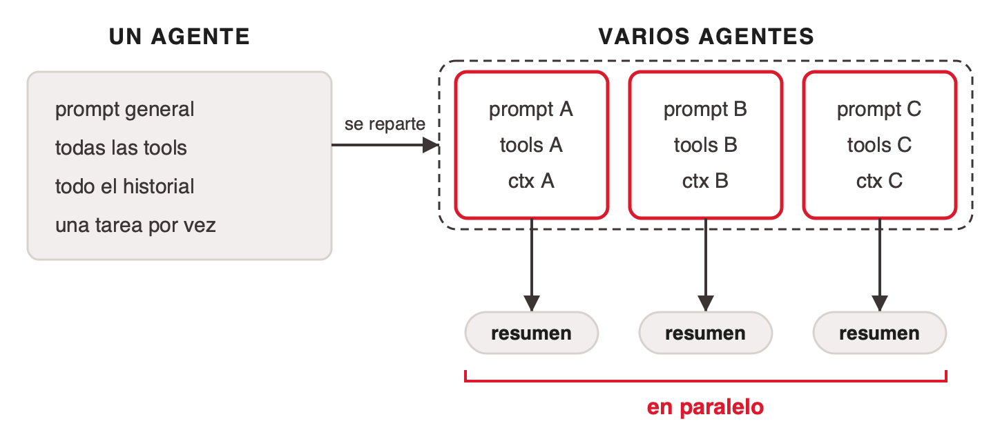
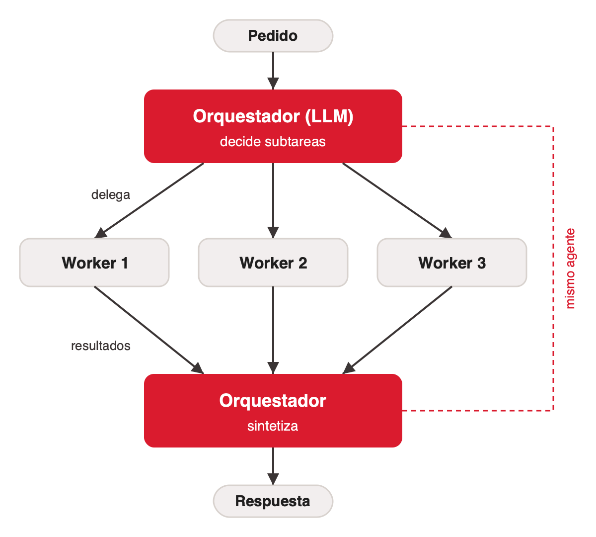
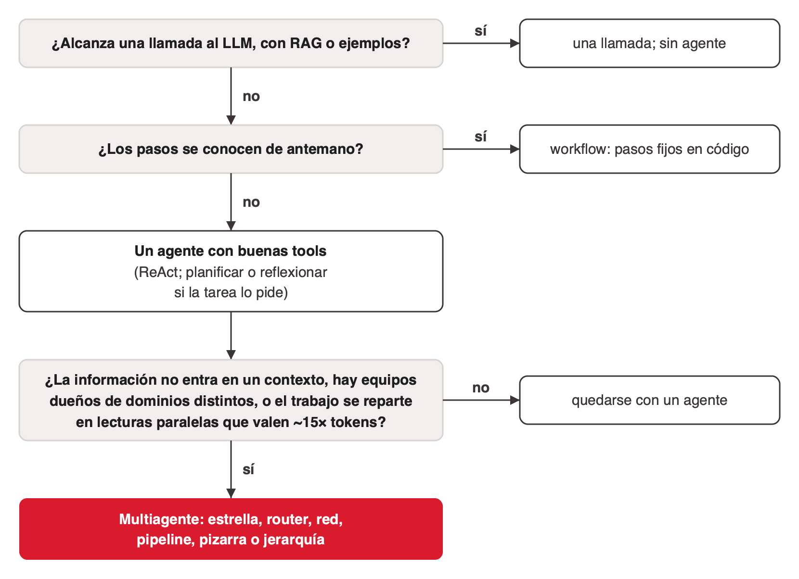

# Sistemas multiagente

Un agente basado en LLM es un loop (ver [agente-basado-en-llm](../agente-basado-en-llm/index.md)). Las arquitecturas multiagente cambian quién le habla a quién, quién tiene el control y por dónde circula el contexto entre varios loops. Cada una de esas decisiones se paga en llamadas al LLM, tokens, latencia y confiabilidad.

Este tema está repartido en cuatro archivos:

- **index.md** (este): el límite de un agente, la definición, las tres palancas, la forma básica y cómo elegir.
- **[topologias.md](topologias.md)**: estrella, router, red, pizarra, pipeline y jerarquía, con una tabla comparativa.
- **[cuando-repartir.md](cuando-repartir.md)**: el costo en tokens, cómo fallan (MAST), el aislamiento, el debate Cognition/Anthropic y la regla de lectura/escritura.
- **[sistemas-publicados.md](sistemas-publicados.md)**: MetaGPT, ChatDev, AutoGen, Magentic-One, Generative Agents, debate, Mixture-of-Agents y sistemas multiagente anteriores a los LLM.

## El límite de un agente: el contexto se degrada

El contexto de un agente crece en cada vuelta, y cuanto más largo es, peor recuerda el modelo lo que tiene adentro. Anthropic lo llama *context rot* ([anthropic-context-engineering](../../talks/agentes-y-multiagentes/research/corpus/anthropic-context-engineering.web.md), 29 sep 2025):

- **Presupuesto de atención.** El contexto es "a finite resource with diminishing marginal returns".
- **Degradación gradual.** "a performance gradient rather than a hard cliff".
- **Contexto mínimo como objetivo.** "find the *smallest* *possible* set of high-signal tokens that maximize the likelihood of some desired outcome".
- **Acumulación.** Un agente que trabaja mucho junta resultados de búsqueda, logs y archivos leídos que no vuelve a usar; justo lo que un subagente evita ([claude-code-subagents](../../talks/agentes-y-multiagentes/research/corpus/claude-code-subagents.web.md)).

Anthropic atribuye parte de la degradación a la atención (n² relaciones entre tokens) y a que los modelos se entrenan sobre todo con secuencias más cortas. El post no da cifras; remite a un estudio de Chroma que no está en el corpus. La ventana además tiene techo: en el sistema Research de Anthropic, la del orquestador se trunca pasados los 200.000 tokens.

Tres técnicas contra esto: compactar la conversación, tomar notas fuera del contexto y repartir el trabajo entre subagentes. La tercera lleva al multiagente.

## Qué es un sistema multiagente

Varios agentes que interactúan, de forma colaborativa, competitiva o ambas, para resolver un problema que excede a uno solo ([aig4b-clase-6-agentes-biomedica](../../talks/agentes-y-multiagentes/research/corpus/aig4b-clase-6-agentes-biomedica.pdf.md)). Versiones con LLM:

- Anthropic: "A multi-agent system consists of multiple agents (LLMs autonomously using tools in a loop) working together" ([anthropic-multi-agent-research-system](../../talks/agentes-y-multiagentes/research/corpus/anthropic-multi-agent-research-system.web.md)).
- MAST: "a collection of agents designed to interact through orchestration", que habilita "task decomposition, performance parallelization, context isolation, specialized model ensembling" ([mast-why-mas-fail-2025](../../talks/agentes-y-multiagentes/research/corpus/mast-why-mas-fail-2025.web.md)).

Con esta definición, varias llamadas a LLMs sin tools sobre una misma pregunta (debate, Mixture-of-Agents) no forman un sistema multiagente: ninguna instancia actúa sobre un ambiente (ver [sistemas-publicados.md](sistemas-publicados.md#varios-llm-sobre-una-misma-pregunta)).

### Las tres palancas

| Palanca | Qué significa |
|---|---|
| Especialización | Cada agente tiene su system prompt, sus tools y, si conviene, su modelo |
| Aislamiento de contexto | Cada agente trabaja en su ventana y devuelve un resumen. Un subagente puede gastar decenas de miles de tokens y devolver a menudo entre 1.000 y 2.000 |
| Paralelismo | Las subtareas independientes corren a la vez: más tokens en menos tiempo |

Las palancas sirven para leer cada topología. Un pipeline especializa y no paraleliza. Una red con handoffs especializa y, por defecto, no aísla. El orquestador con workers mueve las tres.

LangChain agrega un motivo no técnico: el **desarrollo distribuido**, con equipos distintos dueños de agentes distintos ([langchain-multi-agent-architectures](../../talks/agentes-y-multiagentes/research/corpus/langchain-multi-agent-architectures.web.md)).

## La forma básica: orquestador y workers

El orquestador descompone la tarea en tiempo de ejecución, delega cada subtarea en un worker y sintetiza los resultados: "a central LLM dynamically breaks down tasks, delegates them to worker LLMs, and synthesizes their results" ([anthropic-building-effective-agents](../../talks/agentes-y-multiagentes/research/corpus/anthropic-building-effective-agents.web.md)). Cuando cada worker es un agente con su propio loop de tools, el worker es un **subagente**.

Dónde aparece:

- **Código en muchos archivos.** Un agente de código reparte los cambios según el pedido.
- **Búsqueda en muchas fuentes.** Investigación que junta y analiza información de fuentes distintas.
- **Claude Research.** Un orquestador planifica la investigación y crea subagentes que buscan en paralelo, cada uno con su ventana.

Anthropic clasifica orchestrator-workers como *workflow*; la lectura de esta clase es que, cuando cada worker tiene su propio loop, el sistema entero es un conjunto de agentes. Comparación con Reflexion: ahí tres roles se turnan sobre una misma tarea; acá el orquestador parte la tarea y cada worker trabaja en su pedazo.

Visto como comunicación, el orquestador con workers es una estrella (ver [topologias.md](topologias.md#estrella-orquestador-y-subagentes)).

## Primero, un solo agente

LangChain recomienda empezar con un agente y buenas tools: "Many agentic tasks are best handled by a single agent with well-designed tools. You should start here" ([langchain-multi-agent-architectures](../../talks/agentes-y-multiagentes/research/corpus/langchain-multi-agent-architectures.web.md), Sydney Runkle, 14 ene 2026). Dos restricciones empujan a repartir cuando las capacidades crecen:

- **Manejo del contexto** (técnica). El conocimiento especializado de cada capacidad no entra cómodo en un solo prompt.
- **Desarrollo distribuido** (organizacional). Equipos distintos mantienen capacidades distintas, y un prompt monolítico se vuelve inmanejable. Es la más parecida a una decisión de arquitectura de software clásica: separar módulos por equipo dueño.

> "Start with a single agent and good prompt engineering. Add tools before adding agents. Graduate to multi-agent patterns only when you hit clear limits." — LangChain, ene-2026

La documentación de LangGraph lo refuerza: "a single agent with the right (sometimes dynamic) tools and prompt can often achieve similar results" ([langgraph-multi-agent](../../talks/agentes-y-multiagentes/research/corpus/langgraph-multi-agent.web.md)). La carga de la prueba la tiene el multiagente.

## Cómo elegir la arquitectura

1. ¿Alcanza una llamada al LLM, con RAG o ejemplos? Sí → una llamada, sin agente ("optimizing single LLM calls with retrieval and in-context examples is usually enough", Anthropic).
2. ¿Los pasos se conocen de antemano? Sí → workflow con pasos fijos en código.
3. Si no → un agente con buenas tools (ReAct; planificar o reflexionar si la tarea lo pide; ver [tipos-de-agente-llm](../tipos-de-agente-llm/index.md)).
4. ¿La información no entra en un contexto, hay equipos dueños de dominios distintos, o el trabajo se reparte en lecturas paralelas que valen ~15× tokens? No → quedarse con un agente. Sí → multiagente: elegir topología con la tabla de [topologias.md](topologias.md#las-topologías-comparadas) y verificar con [cuando-repartir.md](cuando-repartir.md#el-trabajo-lee-o-escribe) que los agentes no se pisen.

La cuarta pregunta junta las dos restricciones de LangChain con el criterio de Anthropic. Anthropic, LangChain y, desde la otra vereda, Cognition coinciden en empezar por lo más simple que alcanza.

## Código de referencia

El repositorio de la materia tiene `samples/multiagente-langgraph/`: una estrella en LangGraph donde el orquestador tiene una sola tool, `delegar_investigacion`, y cada llamada corre un subagente ReAct con contexto vacío que devuelve solo su respuesta; dos pedidos en el mismo turno corren en paralelo. No es un registro del corpus.

## References

- [anthropic-context-engineering](../../talks/agentes-y-multiagentes/research/corpus/anthropic-context-engineering.web.md): context rot, presupuesto de atención, subagentes que devuelven 1.000–2.000 tokens. URL: https://www.anthropic.com/engineering/effective-context-engineering-for-ai-agents
- [anthropic-multi-agent-research-system](../../talks/agentes-y-multiagentes/research/corpus/anthropic-multi-agent-research-system.web.md): definición, patrón orchestrator-worker en Claude Research. URL: https://www.anthropic.com/engineering/multi-agent-research-system
- [anthropic-building-effective-agents](../../talks/agentes-y-multiagentes/research/corpus/anthropic-building-effective-agents.web.md): orchestrator-workers y sus ejemplos.
- [langchain-multi-agent-architectures](../../talks/agentes-y-multiagentes/research/corpus/langchain-multi-agent-architectures.web.md): empezar con un agente, las dos restricciones, cuatro patrones de LangChain (subagents, skills, handoffs, router).
- [langgraph-multi-agent](../../talks/agentes-y-multiagentes/research/corpus/langgraph-multi-agent.web.md): documentación de LangGraph sobre multiagente.
- [mast-why-mas-fail-2025](../../talks/agentes-y-multiagentes/research/corpus/mast-why-mas-fail-2025.web.md): definición de MAS y sus motivos.
- [aig4b-clase-6-agentes-biomedica](../../talks/agentes-y-multiagentes/research/corpus/aig4b-clase-6-agentes-biomedica.pdf.md): definición del curso.
- [sistemas-multiagente-clase](../../talks/agentes-y-multiagentes/research/corpus/sistemas-multiagente-clase.md.md) y [orquestacion-de-agentes-clase](../../talks/agentes-y-multiagentes/research/corpus/orquestacion-de-agentes-clase.md.md): decks hermanos sobre multiagente y orquestación; sus cifras remiten a los registros de arriba.
