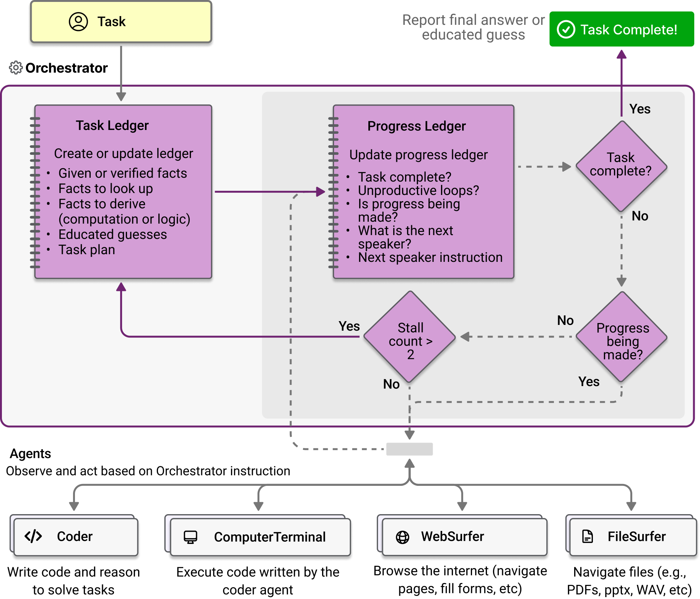

# Sistemas multiagente publicados

Volver a [index.md](index.md). Cada sistema es una topología de [topologias.md](topologias.md) llevada a la práctica. Los resultados son de 2023–2024, con modelos de entonces, y cada paper mide sobre su propio benchmark; no se comparan entre sí.

## Resumen

| Sistema | Topología | Idea propia | Resultado que reporta |
|---|---|---|---|
| MetaGPT (2023) | Pipeline de cinco roles sobre una pizarra | Los agentes publican documentos con formato fijo en vez de conversar | pass@1 de 85,9% en HumanEval y 87,7% en MBPP |
| ChatDev (2023) | Fases en cadena | Cada fase es un diálogo instructor-asistente; entre fases pasa solo la solución | Calidad 0,3953 contra 0,1523 de MetaGPT, en su propio dataset (SRDD) |
| AutoGen (2023) | Agentes que conversan; en el chat grupal un `GroupChatManager` elige quién habla | Sumar un agente corrige fallas del resto | ALFWorld de 54% a 69% con un tercer agente |
| Magentic-One (2024) | Estrella: orquestador con cuatro workers, uno sin LLM | Dos registros: el del plan y el del avance | 38% en GAIA y 32,8% en WebArena (configuraciones distintas) |
| Generative Agents (2023) | Red sin orquestador ni pizarra | 25 agentes que se pasan información conversando | La invitación a una fiesta llega de 1 a 13 agentes en dos días simulados |

## MetaGPT (2023)

Simula una empresa de software con cinco roles (Product Manager, Architect, Project Manager, Engineer, QA Engineer) en un "assembly-line paradigm". Publican en un pool compartido el PRD, el diseño, las tareas, el código y los tests, y se comunican con "structured communication interfaces" en lugar de diálogo. La suscripción por rol filtra lo irrelevante, y un agente se activa "only after receiving all its prerequisite dependencies" ([metagpt-2023](../../talks/agentes-y-multiagentes/research/corpus/metagpt-2023.web.md)). Ver la figura del pool en [topologias.md](topologias.md#pizarra-publicar-y-leer).

Resultados: pass@1 85,9% (HumanEval) y 87,7% (MBPP); en su SoftwareDev, ejecutabilidad 3,75 sobre 4 contra 2,25 de ChatDev.

## ChatDev (2023)

Un *chat chain* por fases (diseño, código, pruebas). Adentro de cada fase, un par instructor-asistente dialoga; entre fases pasa "only the solutions of each subtask rather than the entire communication history" ([chatdev-2023](../../talks/agentes-y-multiagentes/research/corpus/chatdev-2023.web.md)). MAST lo clasifica como "Hierarchical Workflow".

Table 1, sobre su dataset SRDD: Quality 0,3953 (ChatDev), 0,1523 (MetaGPT), 0,1419 (GPT-Engineer). La ablación que más pesa: quitar las descripciones de rol de los system prompts baja la calidad de 0,3953 a 0,2212.

MetaGPT y ChatDev se contradicen: cada uno le gana al otro en su propio dataset.

## AutoGen (2023)

Agentes conversables; en el *dynamic group chat*, un `GroupChatManager` elige quién habla ([autogen-2023](../../talks/agentes-y-multiagentes/research/corpus/autogen-2023.web.md)). Resultados que muestran el valor de separar roles:

- **ALFWorld** (134 tareas, éxito promedio con GPT-3.5-turbo): ReAct 54%, dos agentes 54%, tres agentes 69% con un agente que inyecta reglas de sentido común (mejor de 3: 66 / 63 / 77). El ReAct de esa tabla corre con text-davinci-003; no se compara con el 71% de ReAct del paper original (PaLM-540B, mejor de 6).
- **OptiGuide**: separar al que escribe código del que revisa su seguridad (Safeguard) sube el F1 de detección de código inseguro 8% con GPT-4 y 35% con GPT-3.5-turbo. La ganancia de repartir roles es mayor con el modelo más débil.
- **MATH**: 69,48% en el test completo contra 55,18% de GPT-4.
- En ajedrez, un agente tablero valida las jugadas; el prompting solo seguía produciendo jugadas ilegales.

## Magentic-One (2024)

Un Orchestrator con cuatro workers divididos por herramienta, no por rol humano: WebSurfer, FileSurfer, Coder y ComputerTerminal, que "deterministically executes code and shell commands, no LLM" ([magentic-one-2024](../../talks/agentes-y-multiagentes/research/corpus/magentic-one-2024.web.md)).

- **Loop externo, task ledger**: hechos dados o verificados, hechos a buscar, hechos a derivar, conjeturas y plan. Después de cada actualización del plan, todos los agentes limpian su contexto.
- **Loop interno, progress ledger**: en cada iteración el orquestador responde cinco preguntas: ¿está resuelto?, ¿el equipo está en loop?, ¿hay progreso?, ¿quién habla después?, ¿qué instrucción le doy?
- **Contador de estancamiento**: si no hay progreso más de 2 veces, vuelve al loop externo y replanifica.

Ablaciones en GAIA: reemplazar el orquestador por el GroupChat simple de AutoGen baja el desempeño 31%; quitar un worker cuesta entre 21% y 39%. Resultados: 38% en GAIA (GPT-4o + o1) y 32,8% en WebArena (solo GPT-4o). Costo reconocido por los autores: varios dólares y decenas de minutos por tarea; los agentes que no hacen falta distraen al orquestador.

Criterio que deja el ComputerTerminal (de la cátedra): si la respuesta correcta se puede escribir como regla y verificar, ese agente no necesita modelo.

## Generative Agents (2023)

25 agentes en un pueblo simulado (Smallville) que se pasan información conversando, sin pizarra ni orquestador. En dos días simulados, la invitación a una fiesta pasó de 1 agente (4%) a 13 (52%), y 5 de los 12 invitados fueron ([generative-agents-2023](../../talks/agentes-y-multiagentes/research/corpus/generative-agents-2023.web.md)).

## Varios LLM sobre una misma pregunta

Debate y Mixture-of-Agents ponen varios LLM sobre la misma pregunta, sin tools. Los papers llaman agente a cada instancia; con la definición de agente de Russell & Norvig (ver [que-es-un-agente](../que-es-un-agente/index.md)), ninguna actúa sobre un ambiente, así que no forman un sistema multiagente en sentido estricto. Mejoran la respuesta gastando más llamadas.

- **Debate** (Du et al., 2023; [multiagent-debate-2023](../../talks/agentes-y-multiagentes/research/corpus/multiagent-debate-2023.web.md)). Varias instancias del mismo modelo responden, leen las respuestas de las otras y corrigen la suya durante varias rondas. Con 3 instancias y 2 rondas (gpt-3.5-turbo-0301, 100 problemas por tarea): aritmética 67,0% → 81,8%, GSM8K 77,0% → 85,0%. Hay debates que convergen con confianza a una respuesta incorrecta. En vocabulario de topologías, es una red donde todos leen a todos en cada ronda.
- **Mixture-of-Agents** (Wang et al., 2024; [mixture-of-agents-2024](../../talks/agentes-y-multiagentes/research/corpus/mixture-of-agents-2024.web.md)). Capas de modelos que proponen respuestas; cada capa lee todas las de la anterior y un agregador escribe la final. Solo con modelos abiertos llega a 65,1% de LC win rate en AlpacaEval 2.0 contra 57,5% de GPT-4o (Table 2(a); el §1 dice 65,8%, valor que no aparece en ninguna tabla). Es un pipeline de capas, y no empieza a responder hasta que terminan todas. El mismo paper cita un trabajo según el cual un agente con un prompt fuerte alcanza calidad comparable.

## Multiagente antes de los LLM

La idea es anterior a los modelos de lenguaje:

- **Contract Net (1980).** Un manager anuncia una tarea, los contratistas ofertan y el manager adjudica; un contratista puede subcontratar, y así se arman jerarquías ([contract-net-protocol](../../talks/agentes-y-multiagentes/research/corpus/contract-net-protocol.web.md)).
- **Kiva (2006–2008).** Robots autónomos que llevan las estanterías al operario. Una instalación grande puede usar 500 robots o más, con productividad "by a factor of two or more" ([kiva-warehouse-wurman-2008](../../talks/agentes-y-multiagentes/research/corpus/kiva-warehouse-wurman-2008.web.md)). El registro no trae datos de coordinación.
- **OpenAI Five (2019).** Primer sistema que le ganó a los campeones mundiales de un esport (Dota 2, 2-0 a OG). Cinco copias de la misma red con parámetros compartidos; las compras de ítems y las habilidades estaban programadas a mano ([openai-five-2019](../../talks/agentes-y-multiagentes/research/corpus/openai-five-2019.web.md)).
- **AlphaStar (2019).** Le ganó 5-0 a un profesional de StarCraft II. Lo multiagente está en el entrenamiento, una liga de agentes que juegan entre sí; en la partida juega uno solo ([alphastar-deepmind-2019](../../talks/agentes-y-multiagentes/research/corpus/alphastar-deepmind-2019.web.md)).

Un sistema con LLM también puede tener agentes sin LLM, como el ComputerTerminal de Magentic-One.

## References

- [metagpt-2023](../../talks/agentes-y-multiagentes/research/corpus/metagpt-2023.web.md): arXiv 2308.00352.
- [chatdev-2023](../../talks/agentes-y-multiagentes/research/corpus/chatdev-2023.web.md)
- [autogen-2023](../../talks/agentes-y-multiagentes/research/corpus/autogen-2023.web.md)
- [magentic-one-2024](../../talks/agentes-y-multiagentes/research/corpus/magentic-one-2024.web.md): arXiv 2411.04468; la descripción más explícita del corpus sobre cómo un orquestador guarda estado y detecta loops.
- [generative-agents-2023](../../talks/agentes-y-multiagentes/research/corpus/generative-agents-2023.web.md)
- [multiagent-debate-2023](../../talks/agentes-y-multiagentes/research/corpus/multiagent-debate-2023.web.md), [mixture-of-agents-2024](../../talks/agentes-y-multiagentes/research/corpus/mixture-of-agents-2024.web.md)
- [mast-why-mas-fail-2025](../../talks/agentes-y-multiagentes/research/corpus/mast-why-mas-fail-2025.web.md): Table 3 clasifica los sistemas analizados.
- [contract-net-protocol](../../talks/agentes-y-multiagentes/research/corpus/contract-net-protocol.web.md), [kiva-warehouse-wurman-2008](../../talks/agentes-y-multiagentes/research/corpus/kiva-warehouse-wurman-2008.web.md), [openai-five-2019](../../talks/agentes-y-multiagentes/research/corpus/openai-five-2019.web.md), [alphastar-deepmind-2019](../../talks/agentes-y-multiagentes/research/corpus/alphastar-deepmind-2019.web.md): precursores sin LLM.
- [sistemas-multiagente-clase](../../talks/agentes-y-multiagentes/research/corpus/sistemas-multiagente-clase.md.md): deck hermano, láminas 4.1 a 4.4 (selección de sistemas).
