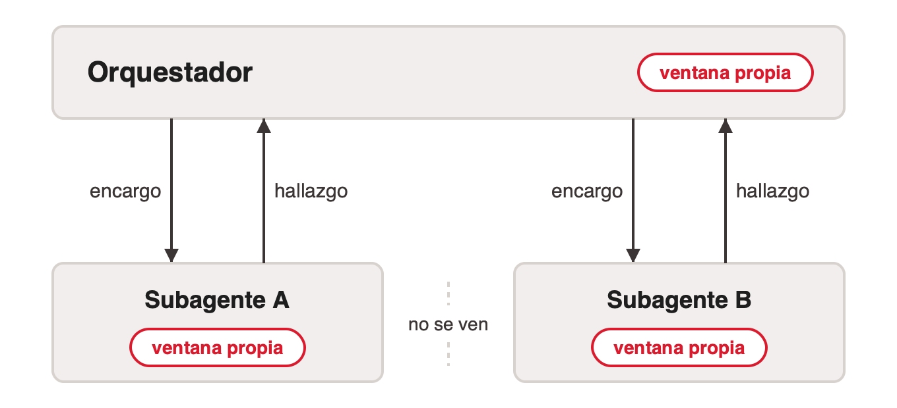
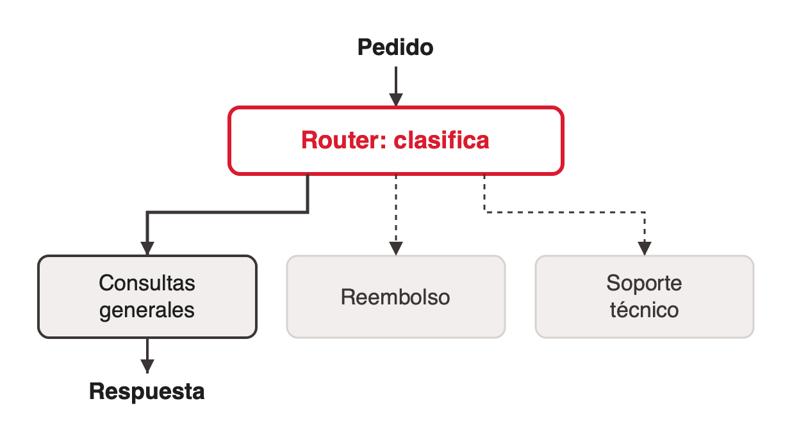
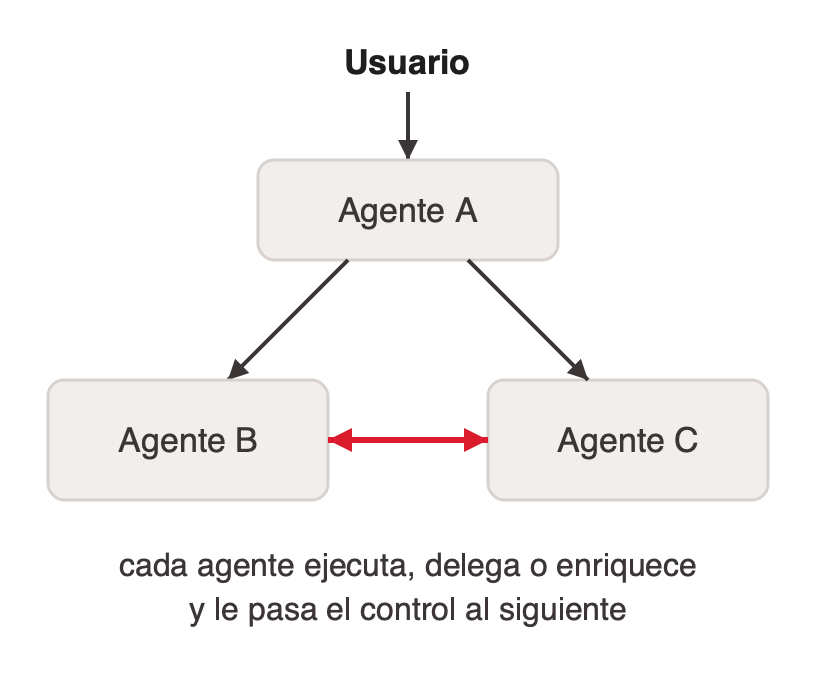
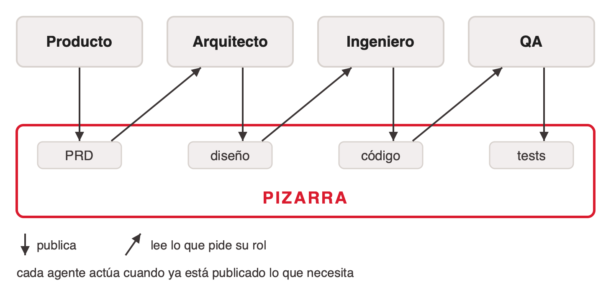
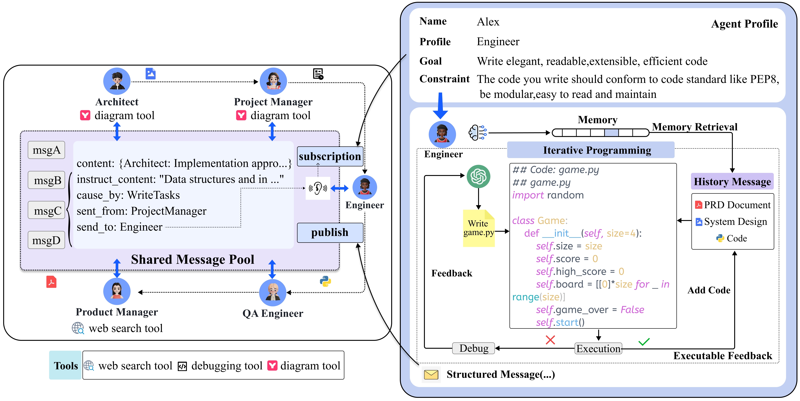
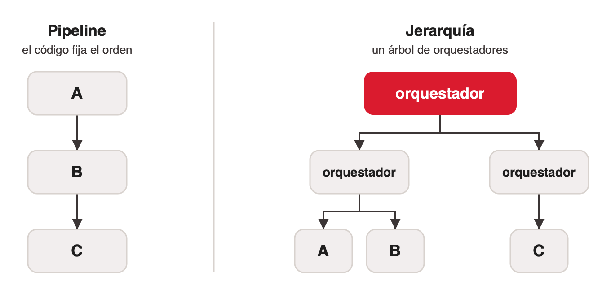

# Topologías multiagente

Volver a [index.md](index.md). Las topologías se describen acá al nivel de la comunicación: quién le habla a quién, quién tiene el control y por dónde circula el contexto. Los frameworks implementan estas formas con nombres propios (LangChain: subagents, skills, handoffs, router; [langchain-multi-agent-architectures](../../talks/agentes-y-multiagentes/research/corpus/langchain-multi-agent-architectures.web.md)).

## Estrella: orquestador y subagentes

El orquestador con workers, visto como comunicación: cada subagente habla solo con el orquestador.

- **Encargo.** El orquestador decide qué entra en la ventana de cada subagente, desde un pedido de dos líneas hasta todo lo que sabía.
- **Hermanos.** Mientras trabaja, un subagente no ve lo que hace otro.
- **Decisión.** Una tool se ejecuta y devuelve; un subagente decide qué hacer con su encargo ([orquestacion-de-agentes-clase](../../talks/agentes-y-multiagentes/research/corpus/orquestacion-de-agentes-clase.md.md)).

> "The essence of search is compression" — Anthropic, jun-2025

La confusión habitual: ¿los subagentes comparten el contexto? Cada uno tiene su propia ventana, siempre. Lo que cambia es cuánto pone adentro el agente que lo crea, y ni pasarle todo alcanza (ver [cuando-repartir.md](cuando-repartir.md#compartir-el-contexto-no-alcanza)).

Ejemplo publicado: Magentic-One, un orquestador con cuatro workers (ver [sistemas-publicados.md](sistemas-publicados.md#magentic-one-2024)).

## Router: despacho

Un router clasifica el pedido y lo despacha al especialista que corresponde, o a varios en paralelo. Decide una vez, al inicio, y no vuelve a razonar sobre lo que devuelven.

Es el *routing* de Anthropic con un agente en cada salida: "classifies an input and directs it to a specialized followup task". Su ejemplo es atención al cliente con consultas generales, reembolsos y soporte técnico ([anthropic-building-effective-agents](../../talks/agentes-y-multiagentes/research/corpus/anthropic-building-effective-agents.web.md)). Conviene con "distinct categories that are better handled separately, and where classification can be handled accurately". Si clasifica mal, el pedido llega al especialista equivocado y nadie lo corrige.

Diferencia con la estrella: el router decide una vez; el orquestador puede leer lo que devolvió un subagente y decidir a quién llamar después.

## Red: el control pasa de agente en agente

No hay un nodo que coordine. Cada agente atiende su parte y, cuando el pedido sale de su dominio, le transfiere el control a otro con un **handoff**, una acción más del agente, como llamar a una tool. El que recibe pasa a ser el agente activo y sigue la conversación con el usuario.

- Kore.ai (*adaptive agent network*): "eliminates centralized control, enabling agents to collaborate and transfer tasks directly based on expertise and context"; cada agente decide "whether to execute, delegate, or enrich the task before passing it forward" ([koreai-orchestration-patterns](../../talks/agentes-y-multiagentes/research/corpus/koreai-orchestration-patterns.web.md)).
- Ejemplo de Kore.ai: un empleado no puede ver su recibo de sueldo. Un agente de bienvenida lo pasa a IT con el contexto armado; IT encuentra que falló la sincronización con la base de nómina y le pasa el caso a finanzas. Nadie le vuelve a preguntar al usuario.
- El handoff es una tool que, en vez de traer datos, mueve el control ([openai-agents-sdk-handoffs](../../talks/agentes-y-multiagentes/research/corpus/openai-agents-sdk-handoffs.web.md)). Puede ser cambiar de agente o cambiar el system prompt y las tools del actual. Qué historial recibe el que toma el control es una decisión de diseño; el valor por defecto suele ser *todo* (ver [cuando-repartir.md](cuando-repartir.md#el-aislamiento-hay-que-configurarlo)).

Juntar la red de Kore.ai con el handoff es lectura de la cátedra. El deck del curso describe la red como "más flexible pero menos predecible". Otro ejemplo sin pizarra ni orquestador es Generative Agents (ver [sistemas-publicados.md](sistemas-publicados.md#generative-agents-2023)).

## Pizarra: publicar y leer

Cada agente publica su resultado en un espacio compartido y lee de ahí lo que necesita. Los agentes no se mandan mensajes entre sí.

- **Publicar.** Cada agente deja un documento con formato fijo: un requerimiento, un diseño, código o tests.
- **Suscribirse.** Cada rol declara qué le interesa y lee solo eso; lo demás no entra en su contexto.
- **Activarse.** Un agente actúa cuando está publicado todo lo que necesita, sin un orquestador que le asigne el trabajo.

El ejemplo es MetaGPT ([metagpt-2023](../../talks/agentes-y-multiagentes/research/corpus/metagpt-2023.web.md), §3.2): "Any agent can directly retrieve required information from the shared pool, eliminating the need to inquire about other agents and await their responses". La suscripción por rol evita lo que el paper llama *information overload*, el problema del context rot ahora en un espacio compartido. Eligieron documentos con formato fijo por el teléfono descompuesto: en lenguaje libre, después de varias rondas, el mensaje llega deformado.

El panel izquierdo de la figura es la pizarra; el derecho (el loop de ejecución y debug del Engineer) es otro tema.

El corpus no trae el origen de la arquitectura de pizarra anterior a los LLM ni la variante con un controlador que elige qué agente escribe.

## Pipeline y jerarquía

- **Pipeline.** El código fija el orden, y la salida de un agente es la entrada del siguiente. Es un workflow: el *prompt chaining* de Anthropic con un agente en cada paso. Ejemplo: ChatDev encadena fases de diseño, código y pruebas, y entre fases pasa "only the solutions of each subtask rather than the entire communication history" ([chatdev-2023](../../talks/agentes-y-multiagentes/research/corpus/chatdev-2023.web.md)).
- **Jerarquía.** Un orquestador coordina a otros orquestadores, y cada uno a su equipo. Contract Net (Reid G. Smith, 1980) ya lo permitía: un manager anuncia una tarea, los contratistas ofertan y el manager adjudica; un contratista puede subdividir la tarea y subcontratar ([contract-net-protocol](../../talks/agentes-y-multiagentes/research/corpus/contract-net-protocol.web.md); el registro deja abierto si el origen es 1980 o el trabajo de Smith de 1977–1978).

## Las topologías, comparadas

| Topología | Quién tiene el control | Cómo circula el contexto | Costo y latencia | Trazabilidad |
|---|---|---|---|---|
| Estrella | El orquestador, en cada vuelta | Encargo de ida, hallazgo comprimido de vuelta | Un salto por el centro en cada delegación | Todo pasa por un lugar |
| Router | El router, una vez al inicio | El pedido va al especialista elegido | Una clasificación antes de empezar | Una decisión por pedido |
| Red | El agente activo, que lo transfiere | Viaja con el control: historial entero o resumen | Sin saltos por un centro | Nadie tiene la foto completa |
| Pizarra | Ninguno: cada agente reacciona a lo publicado, y hay que decidir quién termina | Un espacio común que todos leen y escriben | Leer todo satura; se filtra por rol | Lo publicado queda en el espacio común |
| Pipeline | El código | La salida de uno es la entrada del siguiente | Etapas en serie | Orden fijo; un error temprano se arrastra |
| Jerarquía | Un árbol de orquestadores | Resúmenes que suben nivel por nivel | Cada nivel suma llamadas y latencia | Cada resumen pierde información |

Las celdas de trazabilidad de Router y Pizarra y la de costo de Router son lectura de la cátedra; el resto sale de Kore.ai, Anthropic, MetaGPT y el deck hermano [sistemas-multiagente-clase](../../talks/agentes-y-multiagentes/research/corpus/sistemas-multiagente-clase.md.md). La tabla no tiene cifras: el costo depende del caso.

Qué dice Kore.ai de las dos formas que describe:

- **Con orquestador central (Supervisor).** Da "reasoning transparency, quality assurance, and traceability"; el control centralizado agrega "milliseconds or seconds of delay". La desaconseja en voz, con mucha escala o con presupuesto de tokens ajustado.
- **Red.** Para "low-latency, high-interactivity environments": asistentes conversacionales, soporte, voz. La desaconseja cuando "traceability/debugging is paramount" o no está claro qué agente es dueño de la tarea.

Otros trade-offs, del deck hermano: la pizarra permite agregar un agente sin tocar a los demás, pero hay que decidir quién termina y quién resuelve dos escrituras contradictorias. La jerarquía escala a decenas de agentes y con pocos sobra. En un pipeline, la vuelta atrás hay que programarla a mano.

Las topologías se combinan: un router puede despachar a orquestadores, y MetaGPT ordena sus cinco roles como un pipeline sobre una pizarra.

## References

- [koreai-orchestration-patterns](../../talks/agentes-y-multiagentes/research/corpus/koreai-orchestration-patterns.web.md): Supervisor contra red adaptativa, cuándo usar y evitar cada una. Material de proveedor.
- [anthropic-building-effective-agents](../../talks/agentes-y-multiagentes/research/corpus/anthropic-building-effective-agents.web.md): routing, orchestrator-workers, prompt chaining.
- [openai-agents-sdk-handoffs](../../talks/agentes-y-multiagentes/research/corpus/openai-agents-sdk-handoffs.web.md), [openai-agents-sdk-multi-agent](../../talks/agentes-y-multiagentes/research/corpus/openai-agents-sdk-multi-agent.web.md), [openai-swarm](../../talks/agentes-y-multiagentes/research/corpus/openai-swarm.web.md), [langgraph-swarm](../../talks/agentes-y-multiagentes/research/corpus/langgraph-swarm.web.md): handoffs en frameworks.
- [metagpt-2023](../../talks/agentes-y-multiagentes/research/corpus/metagpt-2023.web.md): pool de mensajes con publish/subscribe.
- [chatdev-2023](../../talks/agentes-y-multiagentes/research/corpus/chatdev-2023.web.md): chat chain por fases.
- [contract-net-protocol](../../talks/agentes-y-multiagentes/research/corpus/contract-net-protocol.web.md): jerarquía por subcontratación, 1980.
- [orquestacion-de-agentes-clase](../../talks/agentes-y-multiagentes/research/corpus/orquestacion-de-agentes-clase.md.md): qué es un subagente.
- [langchain-multi-agent-architectures](../../talks/agentes-y-multiagentes/research/corpus/langchain-multi-agent-architectures.web.md): router con despacho paralelo; los cuatro patrones de LangChain.
