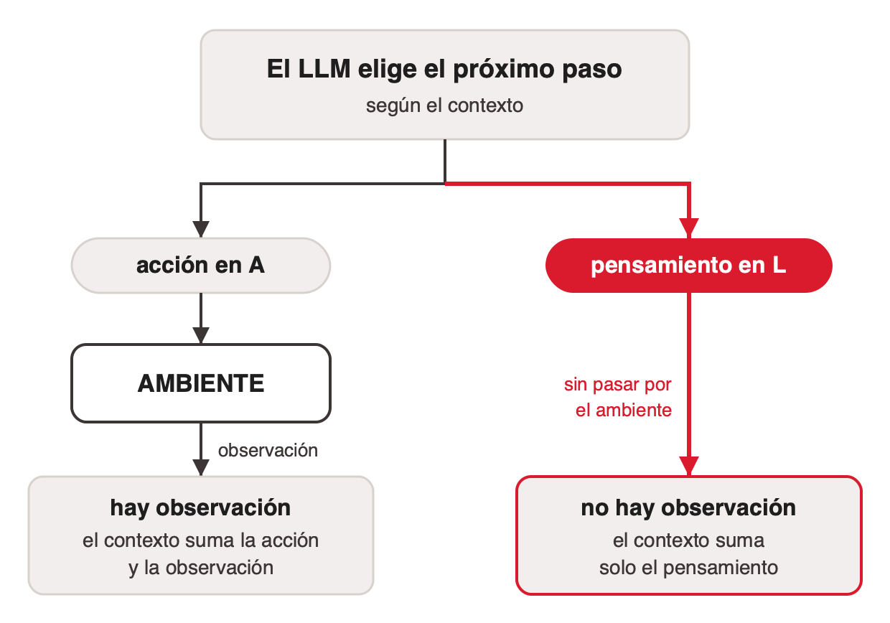
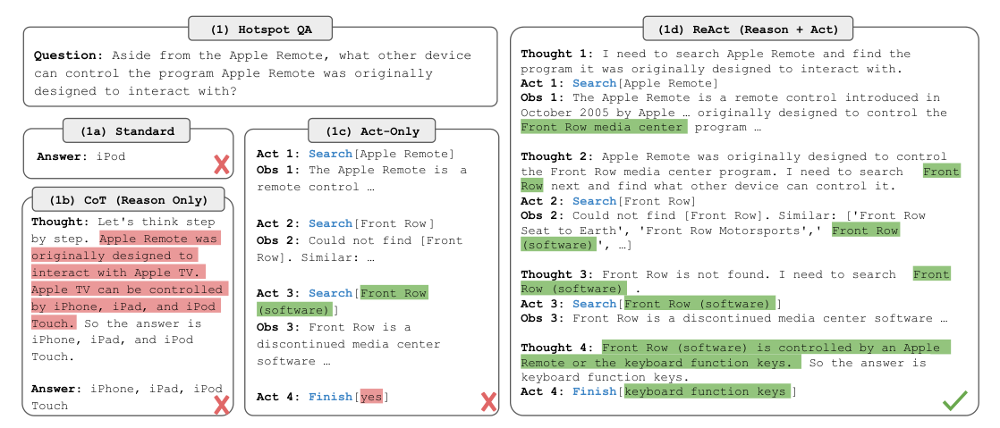
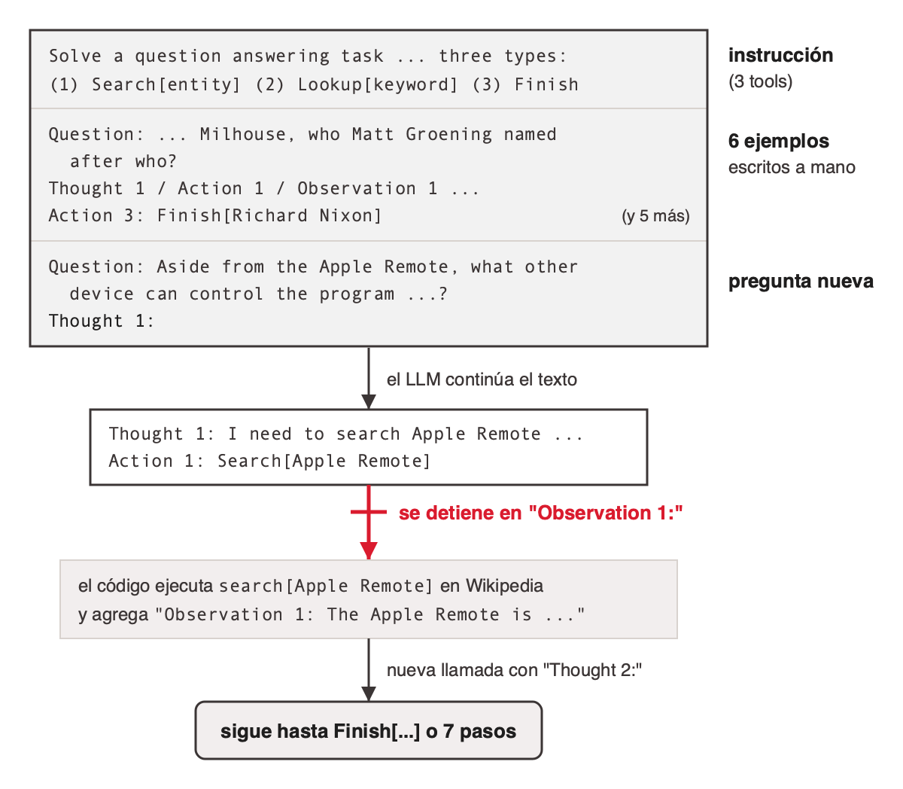
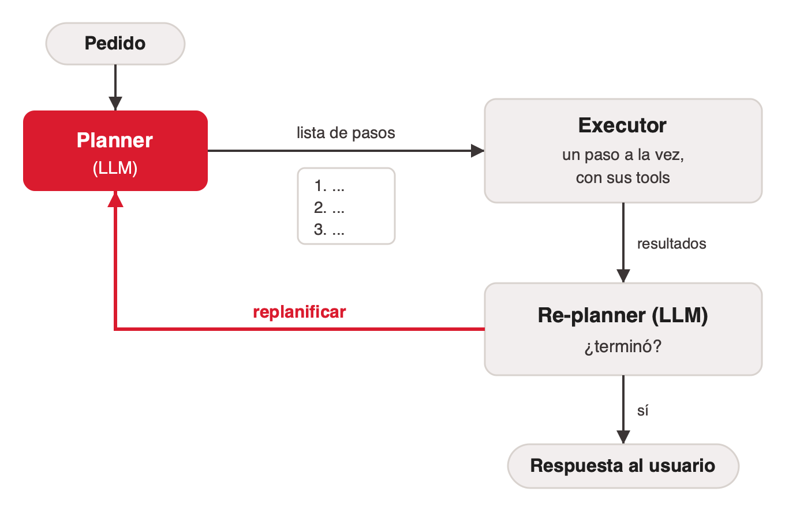
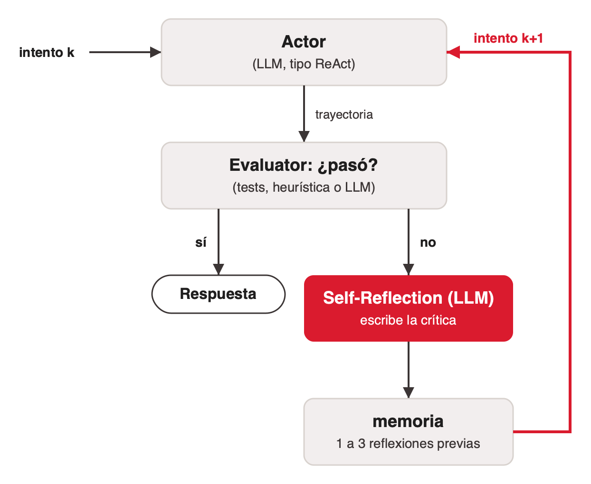
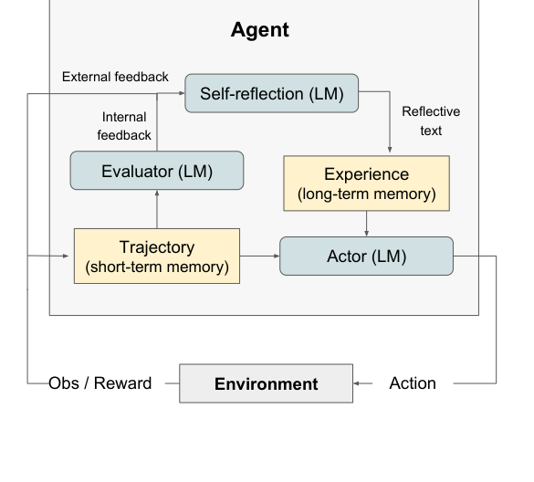
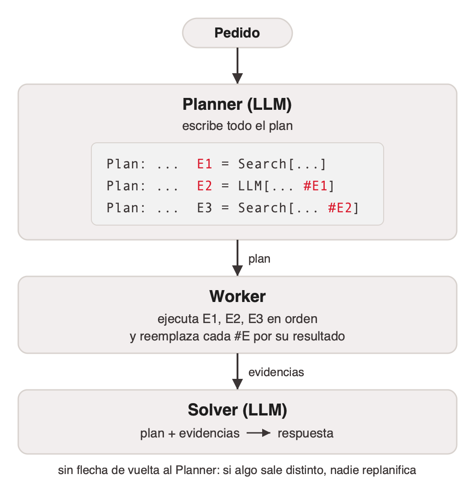

# Tipos de agente LLM

Los tipos de agente de un solo LLM se diferencian por dos preguntas ([langchain-planning-agents](../../talks/agentes-y-multiagentes/research/corpus/langchain-planning-agents.web.md)):

1. **¿Cuándo se planifica?** Nunca de antemano, al inicio, o entre intentos completos.
2. **¿Cuántas veces vuelve a razonar el LLM?** En cada paso, al replanificar o solo al final.

| Tipo | Cómo funciona | Cuándo planifica | Cuántas veces razona | Cuándo conviene | Un caso |
|---|---|---|---|---|---|
| ReAct | Loop pensar → actuar → observar, un paso a la vez | Nunca de antemano | En cada paso | Tareas exploratorias, donde el siguiente paso depende del resultado anterior | La pregunta del Apple Remote: cada búsqueda depende de la anterior |
| Plan-and-Execute | Planifica todo al inicio, luego ejecuta | Al inicio | Al replanificar | Tareas largas y predecibles; menos llamadas al LLM | Actualizar un proyecto a una versión nueva de una biblioteca (caso de la cátedra) |
| Reflexion | Ejecuta, se autoevalúa y reintenta con la crítica como memoria | Entre intentos | Después de cada intento fallido | Cuando hay un criterio claro de éxito (tests, validaciones) | Una función que tiene que pasar tests |
| ReWOO | Planifica con variables y ejecuta las tools sin volver a razonar | Al inicio | Solo al final | Optimizar costo y latencia | Estadísticas de quarterbacks: todas las búsquedas se escriben antes de ejecutar |

Regla inversa, dada una tarea: si el próximo paso depende de lo que aparezca, ReAct. Si los pasos se conocen y alguno puede salir mal, Plan-and-Execute. Si hay un test que dice si salió bien, Reflexion. Si todas las consultas se pueden escribir antes de ver un resultado, ReWOO.

Los tipos se combinan: el executor de Plan-and-Execute es un pequeño ReAct, y el Actor de Reflexion también.

## ReAct

ReAct (Yao et al., arXiv oct-2022, ICLR 2023) suma el lenguaje al espacio de acciones del agente, `Â = A ∪ L`, e intercala pensamientos y acciones hasta tener lo necesario para responder ([yao-2022-react](../../talks/agentes-y-multiagentes/research/corpus/yao-2022-react.pdf.md)).

- **Acción en A.** Toca el ambiente (por ejemplo `search[entity]`) y vuelve una observación.
- **Pensamiento en L.** Texto que escribe el modelo. "does not affect the external environment, thus leading to no observation feedback": solo se suma al contexto.



El paper lo resume en dos direcciones: razonar para actuar y actuar para razonar. Usos del pensamiento: descomponer la tarea, extraer lo importante de una observación, seguir el progreso, manejar excepciones, ajustar el plan. En tareas de razonamiento cada paso lleva su pensamiento ("dense thought"); en tareas de decisión con muchas acciones, el modelo piensa solo donde hace falta.

Vocabulario: el paper nunca usa la palabra "tool". Habla de acciones en A; en HotpotQA son tres sobre una API de Wikipedia (`search`, `lookup`, `finish`). Hoy a cada una se la llamaría tool.

### Una trayectoria

Pregunta de HotpotQA (preguntas multi-salto sobre Wikipedia): además del Apple Remote, ¿qué otro dispositivo controla el programa para el que se diseñó el Apple Remote?

```text
Thought 1: I need to search Apple Remote and find the program it was
           originally designed to interact with.
Act 1:     Search[Apple Remote]
Obs 1:     The Apple Remote is a remote control introduced in October 2005
           by Apple … originally designed to control the Front Row media
           center program …
Thought 2: … I need to search Front Row next and find what other device
           can control it.
Act 2:     Search[Front Row]
Obs 2:     Could not find [Front Row]. Similar: ['Front Row Seat to Earth',
           'Front Row Motorsports', 'Front Row (software)', …]
Thought 3: Front Row is not found. I need to search Front Row (software).
Act 3:     Search[Front Row (software)]
Obs 3:     Front Row is a discontinued media center software …
Thought 4: Front Row (software) is controlled by an Apple Remote or the
           keyboard function keys. So the answer is keyboard function keys.
Act 4:     Finish[keyboard function keys]
```

Cada pensamiento cumple un uso distinto: descomponer, extraer, manejar la excepción (la búsqueda falló y reformula), sintetizar.



La misma figura compara métodos sobre la misma pregunta. Sin razonamiento ni acciones, el modelo responde "iPod" (mal). Con chain-of-thought solo, alucina que el Apple Remote controla Apple TV (mal). Con acciones sin pensamientos busca lo mismo que ReAct y responde "yes" (mal): las búsquedas eran correctas, pero sin pensamientos no pudo razonar sobre lo observado. Solo ReAct llega a "keyboard function keys".

### El prompt de completado y el corte

La trayectoria no usa un system prompt. PaLM-540B y text-davinci-002 son modelos de completado: reciben un texto y lo continúan. Según el notebook `hotpotqa.ipynb` de github.com/ysymyth/ReAct ([react-repo-hotpotqa-prompt](../../talks/agentes-y-multiagentes/research/corpus/react-repo-hotpotqa-prompt.md.md)), el texto abre con esta instrucción, que define las tres acciones:

```text
Solve a question answering task with interleaving Thought, Action,
Observation steps. Thought can reason about the current situation,
and Action can be three types:
(1) Search[entity], which searches the exact entity on Wikipedia and
    returns the first paragraph if it exists. If not, it will return
    some similar entities to search.
(2) Lookup[keyword], which returns the next sentence containing
    keyword in the current passage.
(3) Finish[answer], which returns the answer and finishes the task.
Here are some examples.
```

Siguen 6 trayectorias de ejemplo escritas a mano (el paper dice que más ejemplos no mejoran) y la pregunta nueva. Cada paso es una llamada de completado:



- `llm(prompt + f"Thought {i}:", stop=[f"\nObservation {i}:"])`: el modelo escribe Thought y Action y la API corta antes de Observation.
- El código parsea la acción, la ejecuta contra Wikipedia y pega `Observation i: …` al final del prompt.
- `for i in range(1, 8)`: a lo sumo 7 pasos; si no terminó, fuerza `finish[]`.
- El notebook usa text-davinci-002, temperatura 0, hasta 100 tokens por paso.

Sin el stop, el modelo seguiría el formato de los ejemplos y escribiría él mismo la observación. El prompt crece en cada vuelta: es el contexto.

Quedan abiertos en el registro el texto exacto que devuelve `env.reset()` y si el repositorio es el código oficial (el paper apunta a react-lm.github.io). La instrucción no aparece en el PDF del paper.

### ReAct en LangGraph

Dos nodos y una arista condicional: si el último mensaje del LLM no pide tools, el grafo termina; si pide, las ejecuta y vuelve al LLM ([medium-react-langgraph-agent](../../talks/agentes-y-multiagentes/research/corpus/medium-react-langgraph-agent.web.md), con dos correcciones: el original anota `is_done -> bool` y devuelve strings, y le faltan imports).

```python
def is_done(state: AgentState):
    messages = state['messages']
    last_message = messages[-1]
    if not last_message.tool_calls:
        return "end"
    return "continue"

builder = StateGraph(AgentState)
builder.add_node("agent", agent_node)
tool_node = ToolNode(tools=tools)
builder.add_node("tools", tool_node)
builder.set_entry_point("agent")
builder.add_conditional_edges(
    "agent",
    is_done,
    {"end": END, "continue": "tools"}
)
builder.add_edge("tools", "agent")
agent = builder.compile()
```

El loop de ReAct es la arista `tools → agent`. La salida la decide el modelo cuando responde sin pedir tools. Falta una condición de parada por máximo de iteraciones. Las tools que usa están en [tools-para-agentes](../tools-para-agentes/index.md#una-tool-en-código).

### Dos sentidos de «agente ReAct»

- **Estricto.** El método del paper: modelo de completado, un solo texto con instrucción y ejemplos escritos a mano, Thought y Action como texto, stop antes de Observation.
- **Laxo.** Cualquier agente que llama tools en un loop hasta poder responder: modelo de chat, system prompt, esquema de cada tool, tools pedidas como mensajes estructurados (`tool_calls`).

La plantilla oficial `langchain-ai/react-agent` cita el paper y describe el sentido laxo ([langchain-react-agent-template](../../talks/agentes-y-multiagentes/research/corpus/langchain-react-agent-template.web.md); que use tool calling nativo es probable, pero el README no lo dice). Muchos tutoriales mezclan los dos: explican Thought/Action/Observation y programan el loop de tool calling.

En el sentido laxo se puede perder el pensamiento escrito, salvo que el prompt lo pida. El paper midió lo que eso cuesta: en ALFWorld (un juego de texto con tareas domésticas), el mismo agente sin pensamientos logró 45% contra 71% de ReAct, mejor de 6 corridas con PaLM-540B (Table 3).

### Límites de ReAct

LangChain le marca dos ([langchain-planning-agents](../../talks/agentes-y-multiagentes/research/corpus/langchain-planning-agents.web.md)): una llamada al LLM por cada tool, y un subproblema planificado por vez, sin razonar la tarea entera. Los tres tipos siguientes responden a eso.

## Plan-and-Execute

Un **planner** escribe el plan completo al inicio. Un **executor** resuelve cada paso con sus tools, y un **re-planner** decide si termina o planifica de nuevo (LangChain, 13 feb 2024; basado en Plan-and-Solve de Wang et al. y en BabyAGI).



ReAct piensa antes de cada acción; Plan-and-Execute piensa al inicio y al replanificar. Cada executor es un agente de una sola tarea con su propio loop de tools: adentro hay pequeños ReAct.

Ejemplo ilustrativo (construido por la cátedra; el corpus no trae una traza publicada), sobre la misma pregunta de HotpotQA:

```text
Planner:     1. Buscar Apple Remote y anotar el programa para el que se diseñó.
             2. Buscar ese programa y anotar qué otros dispositivos lo controlan.

Executor 1:  Search[Apple Remote]
             -> Front Row media center program
Executor 2:  Search[Front Row]  -> no encontrado
             Search[Front Row (software)]
             -> controlled by an Apple Remote or the keyboard function keys

Re-planner:  ¿terminó? Sí. Respuesta: keyboard function keys
```

La búsqueda fallida la resuelve el executor dentro de su loop, sin volver al planner. El LLM que planifica interviene dos veces, contra cuatro pensamientos en ReAct.

| Ventajas (según LangChain, sin benchmark) | Límites |
|---|---|
| Más rápido: el modelo que planifica no se consulta después de cada acción | Ejecución en serie: las tools se llaman de a una |
| Más barato: los pasos pueden ir a modelos más chicos | Un LLM por paso, y no hay variables que conecten el resultado de un paso con el siguiente |
| Mejor resultado: el planner piensa todos los pasos antes de empezar | |

## Reflexion

Reflexion (Shinn et al., 2023) ejecuta, evalúa el resultado y, si falló, escribe una crítica en lenguaje natural que guarda como memoria para el intento siguiente. No toca los pesos: "not by updating weights, but instead through linguistic feedback" ([shinn-2023-reflexion](../../talks/agentes-y-multiagentes/research/corpus/shinn-2023-reflexion.pdf.md)).



Tres roles de LLM con tres trabajos distintos:

- **Actor.** Produce la trayectoria; en decisión y preguntas es un agente ReAct (o CoT).
- **Evaluator.** Decide si salió bien: tests, una heurística o un LLM.
- **Self-Reflection.** Convierte el veredicto en una crítica escrita. La memoria de largo plazo guarda las últimas Ω reflexiones ("usually set to 1-3").

Los autores lo llaman refuerzo verbal; el paper lo describe como un gradiente semántico. El Evaluator hace de crítico, como en el agente que aprende de Russell & Norvig (ver [que-es-un-agente](../que-es-un-agente/index.md#arquitecturas-clásicas)).



Detalle para quien lea el paper: el pseudocódigo del Algorithm 1 dice "while not pass or t < max trials", que como está escrito no termina bien; la prosa aclara que el loop sigue mientras no pase *y* queden intentos.

Ejemplo de la Figura 1 (programación): decidir si dos strings de paréntesis se pueden concatenar en un orden balanceado.

```text
(b) Trayectoria:  def match_parens(lst):
                      if s1.count('(') + s2.count('(') ==
                         s1.count(')') + s2.count(')'): [...]
                      return 'No'
(c) Evaluación:   Self-generated unit tests fail: assert match_parens(...)
(d) Reflexión:    [...] wrong because it only checks if the total count
                  of open and close parentheses is equal [...] order of
                  the parentheses [...]
(e) Nuevo intento: [...]
                      return 'Yes' if check(S1) or check(S2) else 'No'
```

Los tests los genera el mismo agente; por eso el paper puede reportar pass@1 sin que la solución haya visto los tests ocultos del benchmark.

| Ventajas | Límites |
|---|---|
| Aprende sin reentrenar | Depende del evaluador: sin tests autogenerados, la ablación en Rust cae a 52% de pass@1, por debajo del modelo base (60%); Reflexion completo llega a 68% |
| Brilla cuando hay cómo evaluar: HumanEval Python 91,0% de pass@1 contra 80,1% de GPT-4 (2023); ALFWorld 130 de 134 tareas en 12 intentos | Pide un modelo capaz: starchat-beta queda en 26% antes y después |
| Se apoya en ReAct: le suma un evaluador y la autocrítica | No ayuda a explorar: en WebShop no mejoró y se cortó a los 4 intentos |
| | Cada intento es otra corrida completa |

Cifras de 2023, a fechar cuando se citen.

## ReWOO

ReWOO (Reasoning WithOut Observations; Xu et al., arXiv 2305.18323) escribe el plan completo con **variables** y ejecuta todas las tools sin volver a razonar entre medio ([langchain-planning-agents](../../talks/agentes-y-multiagentes/research/corpus/langchain-planning-agents.web.md)).



- **Planner (LLM).** Escribe líneas `Plan:` y `E#`, que referencian resultados previos (`#E1`).
- **Worker.** Ejecuta en orden y reemplaza cada `#E` por su resultado. Trata `LLM[...]` como una tool más.
- **Solver (LLM).** Integra plan y evidencias en la respuesta.

Plan verbatim del post de LangChain (con su typo "Quarter back"):

```text
Plan: I need to know the teams playing in the superbowl this year
E1: Search[Who is competing in the superbowl?]
Plan: I need to know the quarterbacks for each team
E2: LLM[Quarterback for the first team of #E1]
Plan: I need to know the quarterbacks for each team
E3: LLM[Quarter back for the second team of #E1]
Plan: I need to look up stats for the first quarterback
E4: Search[Stats for #E2]
Plan: I need to look up stats for the second quarterback
E5: Search[Stats for #E3]
```

La diferencia con Plan-and-Execute es la variable: el plan ya dice de dónde sale cada dato, así que el worker solo reemplaza y ejecuta. El plan es un pequeño script que el modelo escribe y el código interpreta.

| Ventajas | Límites |
|---|---|
| Dos llamadas al LLM (planificar y resolver) en vez de una por paso | No se adapta: el plan no cambia según lo encontrado |
| No reenvía la trayectoria acumulada en cada paso; en ReAct, N pasos son N llamadas con un prefijo que se repite | Frágil ante sorpresas: si una búsqueda no devuelve nada, nadie replanifica |
| Pasos independientes pueden correr en paralelo | Pide tareas predecibles |
| Como no ve observaciones, el planner se puede pasar a un modelo más chico | |

LangChain afirma las ventajas de velocidad y costo sin medirlas. El paper de Xu et al. reporta un ahorro grande de tokens en HotpotQA y un planner destilado a un modelo chico, pero no fue capturado: verificar cifras antes de citarlas.

**LLMCompiler** (Kim et al.) lleva la idea más lejos: el planner emite un DAG de tareas y un scheduler ejecuta cada una apenas sus dependencias están listas, en paralelo. LangChain menciona una aceleración de 3,6× atribuida al paper, no verificada en el corpus.

## References

- [yao-2022-react](../../talks/agentes-y-multiagentes/research/corpus/yao-2022-react.pdf.md): paper de ReAct; sección 2 (Â = A ∪ L), Figure 1, Table 3 (ALFWorld). arXiv 2210.03629. Su sección 2 entra en una página y es la base del resto.
- [react-repo-hotpotqa-prompt](../../talks/agentes-y-multiagentes/research/corpus/react-repo-hotpotqa-prompt.md.md): instrucción, ejemplos y loop de `hotpotqa.ipynb` con el stop.
- [langchain-react-agent-template](../../talks/agentes-y-multiagentes/research/corpus/langchain-react-agent-template.web.md): la plantilla de LangGraph, sentido laxo.
- [medium-react-langgraph-agent](../../talks/agentes-y-multiagentes/research/corpus/medium-react-langgraph-agent.web.md): tutorial con tools y grafo; mezcla los dos sentidos.
- [langchain-planning-agents](../../talks/agentes-y-multiagentes/research/corpus/langchain-planning-agents.web.md): crítica de ReAct, Plan-and-Execute, ReWOO y LLMCompiler. URL: https://www.langchain.com/blog/planning-agents
- [shinn-2023-reflexion](../../talks/agentes-y-multiagentes/research/corpus/shinn-2023-reflexion.pdf.md): paper de Reflexion; sección 3, Figure 1, Tables 1, 3 y 4. arXiv 2303.11366.
- [AIG4B-Clase-6-Agent.pptx](../../talks/agentes-y-multiagentes/research/corpus/AIG4B-Clase-6-Agent.pptx.md): slide 20, ReAct como la arquitectura más simple para agentes basados en LLM.
- [lilianweng-llm-powered-agents](../../talks/agentes-y-multiagentes/research/corpus/lilianweng-llm-powered-agents.web.md): ReAct y Reflexion bajo planificación y autorreflexión.
