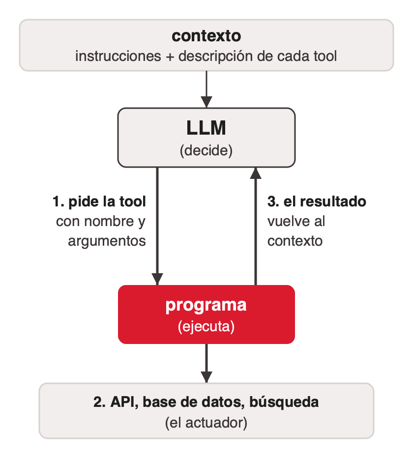

# Tools para agentes

## Qué es una tool

Una tool es una función que el agente puede pedir. Su nombre, su descripción y sus parámetros están en el **contexto**, el texto que el modelo recibe en cada llamada. El LLM decide cuándo llamarla y el programa la ejecuta.

Con la definición de Russell & Norvig (ver [que-es-un-agente](../que-es-un-agente/index.md)), cada tool es un actuador del agente LLM, y lo que devuelve entra al contexto como una percepción nueva.



La aclaración que más ordena el tema: **el LLM no ejecuta nada.** Genera un pedido estructurado (nombre de la tool y argumentos), y es el programa que lo rodea el que llama a la API, corre la consulta o lee el archivo. El resultado vuelve como texto al contexto y el LLM decide de nuevo ([langchain-planning-agents](../../talks/agentes-y-multiagentes/research/corpus/langchain-planning-agents.web.md)).

Por eso la descripción importa tanto: es lo único que el modelo sabe de la tool. Una tool mal descripta es una tool que el modelo usa mal o no usa.

### El contexto

El contexto es todo lo que el modelo tiene a la vista en una corrida: instrucciones, descripciones de tools, lo que devolvieron las tools y la conversación hasta ahí ([orquestacion-de-agentes-clase](../../talks/agentes-y-multiagentes/research/corpus/orquestacion-de-agentes-clase.md.md)). Es la secuencia de percepciones de Russell & Norvig con otro nombre; en el paper de ReAct es `c_t = (o_1, a_1, …, o_{t−1}, a_{t−1}, o_t)` ([yao-2022-react](../../talks/agentes-y-multiagentes/research/corpus/yao-2022-react.pdf.md)). Crece en cada vuelta, tiene un tamaño máximo, se paga por token y se degrada al crecer (ver *context rot* en [sistemas-multiagente](../sistemas-multiagente/index.md)).

MCP es una forma estándar de exponer tools; lo dicho acá vale para cualquier tool, venga o no de un servidor MCP ([mcp-spec](../../talks/agentes-y-multiagentes/research/corpus/mcp-spec.web.md), [langchain-mcp-adapters](../../talks/agentes-y-multiagentes/research/corpus/langchain-mcp-adapters.web.md)).

## Un contrato con un sistema no determinístico

> "tools are a new kind of software which reflects a contract between deterministic systems and non-deterministic agents"
> — Anthropic, *Writing effective tools for agents*, sep-2025

Una función tradicional es un contrato entre dos sistemas determinísticos: misma entrada, misma salida, y quien la llama sabe cuándo llamarla. Con un agente, el que llama no es determinístico. Ante "¿Llevo paraguas hoy?", puede llamar a la tool del clima, contestar con lo que sabe, pedir una aclaración, alucinar o usar mal la tool. Puede llamarla cuando no corresponde, no llamarla cuando sí, o pasarle argumentos que un programador nunca pasaría.

La conclusión es de diseño: una tool se escribe para un agente que la llama, con otros criterios que una API para desarrolladores. Según Anthropic, las tools más cómodas para un agente suelen ser también las más fáciles de entender para una persona.

## Una tool en código

Ejemplo de un tutorial de LangGraph (Medium, julio de 2025; [medium-react-langgraph-agent](../../talks/agentes-y-multiagentes/research/corpus/medium-react-langgraph-agent.web.md)). El docstring es la descripción que lee el modelo; `bind_tools` le pasa el esquema de cada tool.

```python
from langchain.tools import tool

@tool
def calculator(expression: str) -> str:
    """Evaluates a math expression."""
    try:
        return str(eval(expression))
    except Exception as e:
        return f"Error: {e}"

@tool
def search_wikipedia(query: str) -> str:
    """Simulates a Wikipedia lookup."""
    import wikipedia
    return wikipedia.summary(query, sentences=2)

tools = [calculator, search_wikipedia]
model = ChatOpenAI(model="gpt-4o-mini").bind_tools(tools)
```

Lo que ve el modelo de cada tool es el nombre, los parámetros con sus tipos y el docstring. El cuerpo no le llega nunca. El ejemplo tiene dos defectos que sirven para enseñar:

- **`eval()` sobre texto del modelo.** Ejecuta código arbitrario. Sirve para una demo y es inaceptable en producción.
- **Un docstring que miente.** Dice que *simula* una búsqueda y llama a la biblioteca real. Para el modelo, la descripción es la verdad.

El grafo que convierte estas tools en un agente ReAct está en [tipos-de-agente-llm](../tipos-de-agente-llm/index.md#react-en-langgraph).

## Principios para diseñar tools

De [anthropic-writing-tools-for-agents](../../talks/agentes-y-multiagentes/research/corpus/anthropic-writing-tools-for-agents.web.md) (11 sep 2025):

| Principio | Qué dice | Ejemplo |
|---|---|---|
| Pocas y consolidadas | Más tools no garantizan mejores resultados ("More tools don't always lead to better outcomes"); una tool que resuelve la tarea entera evita encadenar varias | `schedule_event` en vez de `list_users` + `list_events` + `create_event` |
| Espacio de nombres | Un prefijo por servicio o recurso separa tools parecidas | `asana_search`, `jira_search` |
| Contexto con significado | Traducir identificadores a nombres reduce alucinaciones | devolver `name` en vez de `uuid` |
| Respuestas que cuidan tokens | Cada respuesta trae solo lo que el agente necesita | `search_contacts` en vez de `list_contacts`; en Slack, la respuesta concisa ocupó 72 tokens y la detallada 206 |
| Descripciones para alguien nuevo | Escribir cada descripción como para alguien que recién llega al equipo | pequeños ajustes en la descripción producen mejoras grandes en las evaluaciones |

El hilo común: el contexto de un agente es limitado y la memoria de la computadora es barata. Consolidar resuelve además un problema de decisión: con tres tools separadas el agente tiene que acertar el orden; con una que agenda, el orden queda en el código.

Detalle del dato de Slack: la versión concisa omite `thread_ts`, `channel_id` y `user_id`. Anthropic propone exponer un parámetro `response_format` para que el agente elija entre respuesta concisa y detallada.

## References

- [anthropic-writing-tools-for-agents](../../talks/agentes-y-multiagentes/research/corpus/anthropic-writing-tools-for-agents.web.md): el contrato determinístico/no determinístico y los principios de diseño. URL: https://www.anthropic.com/engineering/writing-tools-for-agents
- [langchain-planning-agents](../../talks/agentes-y-multiagentes/research/corpus/langchain-planning-agents.web.md): el loop genérico, en el que el LLM propone la acción y "your code" la ejecuta.
- [medium-react-langgraph-agent](../../talks/agentes-y-multiagentes/research/corpus/medium-react-langgraph-agent.web.md): tools con `@tool` y `bind_tools`; el registro marca los dos defectos del ejemplo.
- [AIG4B-Clase-6-Agent.pptx](../../talks/agentes-y-multiagentes/research/corpus/AIG4B-Clase-6-Agent.pptx.md): slide 22, tools "descriptas en el contexto".
- [orquestacion-de-agentes-clase](../../talks/agentes-y-multiagentes/research/corpus/orquestacion-de-agentes-clase.md.md): definición del contexto de un modelo.
- [mcp-spec](../../talks/agentes-y-multiagentes/research/corpus/mcp-spec.web.md): el protocolo estándar para exponer tools (fuera del alcance de esta clase).
