# Thesis

**Claim:**

**Why it matters:**

**Presenter feedback:**

- [open] 2026-08-14 — "Restaurado 1:1 desde `AIG4B-Clase-8-GANs.pptx`. La tesis no estaba explícita en el deck original: falta escribirla."

---

# Agenda

**Narrative arc:**

**Sections (in delivery order):**

- 1. IA generativa de visión
- 2. Introducción a las GANs
- 3. Slanted Land
- 4. Tipos y aplicaciones
- 5. Limitaciones y cierre

**Presenter feedback:**

---

# 1. IA generativa de visión

**Goal of this section:**

**Presenter feedback:**

- [closed] 2026-10-20 — "Borrar el slide «¿Por qué importa en ingeniería?». No es más relevante."
  Resolution: Slide 1.3 borrada y entera en Cut material; las slides 1.4–1.6 pasan a 1.3–1.5; las notas de 4.8 ya no citan la slide 1.3; la open question de «Los modelos que veremos» pasa a 1.4.

---

## 1. IA Generativa de Visión

<!-- slide 3 del pptx original, convertida en la definición -->

### Content

**IA generativa de visión:** modelos que aprenden la distribución de un conjunto de imágenes, o sea su estructura interna, y con ella crean imágenes nuevas: no estaban en los datos, pero podrían haber estado.

### Sources

- `AIG4B-Clase-8-GANs.md.md` (slide 4: «Crea contenido nuevo que no existía»; aprende la estructura interna de los datos)
- `gan-goodfellow-2014.web.md` (el generador «captura la distribución de los datos»)

### Speaker notes

Esta es la definición que vamos a usar toda la clase. Dos palabras para retener: distribución, que es lo que aprende, e imágenes nuevas, que es lo que produce. La próxima slide la contrasta con la IA visual que ya conocen, la discriminativa.

### Presenter feedback

- [closed] 2026-10-17 — "Revisá y reformulá en el draft que la audiencia no es biomédica sino ingenieros. Revisá si los ejemplos son relevantes todavía."
  Resolution: Columna 02 «¿Por qué importa en Biomedicina?» → «¿Por qué importa en ingeniería?», con subtítulo sobre los problemas de datos al construir sistemas con modelos de visión.
- [closed] 2026-10-20 — "Convirtamos IA Generativa de Visión en un slide que sea la definición."
  Resolution: Las tres columnas (anticipo de la sección) → la definición de IA generativa de visión, con fuente en la slide 4 del pptx y en Goodfellow et al. (2014); notas nuevas. Texto original en Cut material.

---

## 2. ¿Qué es la IA Generativa de Visión?

<!-- slide 4 del pptx original -->

### Content

- **La IA visual se diseñó primero para analizar imágenes que ya existen: clasificarlas, detectar objetos o medir estructuras. Eso es la IA discriminativa, que aprende a distinguir entre categorías. La IA generativa aprende a crear contenido visual que no existía antes.**

| Aspecto | IA Discriminativa | IA Generativa |
|---|---|---|
| ¿Qué hace? | Analiza y clasifica lo que ya existe | Crea contenido nuevo que no existía |
| Pregunta típica | "¿Este dígito es un 7?" | "Genera un 7" |
| Lo que aprende | A distinguir entre categorías | La estructura interna de los datos |
| Salida | Una etiqueta o un número | Una imagen, un sonido, un texto |
| Ejemplo | Clasificador de dígitos de MNIST | cGAN que genera el dígito pedido |

### Sources

- `AIG4B-Clase-8-GANs.md.md` (slide 4)
- `cgan-mirza-osindero-2014.web.md` (generación de dígitos MNIST condicionada por etiqueta de clase)

### Speaker notes

### Presenter feedback

- [closed] 2026-10-17 — "Revisá y reformulá en el draft que la audiencia no es biomédica sino ingenieros. Revisá si los ejemplos son relevantes todavía."
  Resolution: Lead: «clasificar radiografías, detectar tumores» → «clasificarlas, detectar objetos o medir estructuras», sin em-dash. La tabla con el ejemplo médico queda para decisión del presentador.
- [closed] 2026-10-17 — "Aplicar los reemplazos ★ del editor solo con fuentes del corpus (Salimans 2016 en 1.3 y 4.8; en 4.7 solo la TC de baja dosis); corregir el crédito de Slanted Land y día→noche (Pix2Pix); deepfakes a Open questions."
  Resolution: Tabla: «¿Esto es un tumor maligno o benigno?» / «Genera una imagen de un tumor maligno» → «¿Este dígito es un 7?» / «Genera un 7»; fila de ejemplo → clasificador de dígitos de MNIST y cGAN que genera el dígito pedido (cgan-mirza-osindero-2014). Texto original en Cut material.

---

## 3. Línea de tiempo: el camino hasta hoy

<!-- slide 6 del pptx original -->

### Content

- Un campo en aceleración constante. Este curso arranca con el hito más influyente de la era de las GANs.

**1**

- **Era Estadística · 1950s–2000s**

- Redes neuronales, backpropagation. Resultados prometedores en teoría, pero muy limitados visualmente en la práctica.

**2**

- **Redes convolucionales (CNN) · 2012–hoy**

- Redes que aprenden filtros para analizar imágenes y dominan la visión supervisada. También entran en la IA generativa: con CNN más rápidas y profundas, la super-resolución aumenta la resolución de una imagen, y DCGAN (2015) las usa para generar.

**3**

- **Era de las GANs · 2014–2020**

- Ian Goodfellow publica la GAN original. Primera generación fotorrealista de imágenes. El campo explota en variantes y aplicaciones.

**4**

- **Era de la Difusión · 2020–hoy**

- DALL·E, Stable Diffusion, Midjourney. Control por texto, generación de vídeo, modelos de base masivos.

**5**

- **SAM & Modelos de Segmentación · 2023–hoy**

- Meta lanza Segment Anything Model (SAM). Segmentación interactiva de cualquier objeto en cualquier imagen. Prompteable con puntos, cajas o máscaras — sin reentrenamiento.

- Este curso empieza con el hito más influyente de la era de las GANs: las Generative Adversarial Networks.

### Sources

- `AIG4B-Clase-8-GANs.md.md` (slide 6)
- `srgan-ledig-2017.web.md` (la super-resolución con «CNN más rápidas y profundas», antes de SRGAN)
- `dcgan-radford-2015.web.md` (DCGAN lleva las CNN del aprendizaje supervisado a la generación)
- 2012 como inicio de la era de las CNN (AlexNet gana ImageNet): conocimiento general, no está en el corpus

### Speaker notes

### Presenter feedback

- [closed] 2026-10-20 — "Falta en «Línea de tiempo: el camino hasta hoy» CNN, confirma pero entra en generativa como una forma de aumentar resolución etc."
  Resolution: Confirmado con el corpus (abstracts de SRGAN y DCGAN). Hito nuevo «Redes convolucionales (CNN) · 2012–hoy» entre la era estadística y la de las GANs; marcadores 1–5; lead y cierre ya no dicen «segunda era». Para que no se contradiga: en 1.4 la columna CNN ya no dice «No generan imágenes», y en 1.5 la columna CNN suma super-resolución y DCGAN.

---

## 4. Los modelos que veremos en el curso

<!-- slide 7 del pptx original -->

### Content

- Tres familias de redes — tres bloques temáticos dedicados. Cada modelo responde una pregunta diferente: al final del curso, sabremos cuándo usar cada uno.

<!-- original vectorial: research/corpus/AIG4B-Clase-8-GANs.md/images/slide-07-1.svg -->

<!-- original vectorial: research/corpus/AIG4B-Clase-8-GANs.md/images/slide-07-2.svg -->

<!-- original vectorial: research/corpus/AIG4B-Clase-8-GANs.md/images/slide-07-3.svg -->

**GANs — Generative Adversarial Networks**

- Dos redes que compiten: una genera, la otra evalúa.
- Casos:
  - Deepfakes
  - StyleGAN
  - Generación de datos sintéticos (imágenes médicas, entre otras)
- Pregunta: ¿Cómo generar imágenes realistas que "engañen" a un evaluador?

**Diffusion Networks**

- Aprenden a reconstruir una imagen desde el ruido, paso a paso.
- Casos:
  - Stable Diffusion
  - DALL·E
  - Midjourney
- Pregunta: ¿Cómo generar imágenes diversas y controlables a partir de una descripción?

**CNN — Redes neuronales convolucionales**

- Aprenden filtros que detectan bordes, texturas y formas, y los combinan capa a capa. Nacieron para analizar imágenes, y en la IA generativa son la pieza de base.
- Casos:
  - Clasificar imágenes, y detectar y segmentar objetos
  - Super-resolución: aumentar la resolución de una imagen (SRGAN le suma una GAN para el detalle fino)
  - El Generador y el Discriminador de DCGAN: el Generador sube de resolución con convoluciones transpuestas
- Pregunta: ¿Cómo ve una red una imagen, para reconocer qué hay o para mejorarla?

### Sources

- `srgan-ledig-2017.web.md` (super-resolución con CNN)
- `AIG4B-Clase-8-GANs.md.md` (slide 7)
- `aws-que-es-una-gan.web.md` (DCGAN: el generador usa convoluciones transpuestas)
- `dcgan-radford-2015.web.md` (las CNN en visión supervisada y como base de DCGAN). El resto de la descripción de CNN es redacción de la cátedra (reemplaza a SAM a pedido del presentador, 2026-10-17: el curso ve CNN en la clase 12).

### Speaker notes

### Presenter feedback

- [closed] 2026-10-17 — "Revisá y reformulá en el draft que la audiencia no es biomédica sino ingenieros. Revisá si los ejemplos son relevantes todavía."
  Resolution: GANs: «la síntesis de imágenes médicas» → «la generación de datos sintéticos (imágenes médicas, entre otras)»; la pregunta de SAM pasa a «aislar cualquier objeto de una imagen» (sam-kirillov-2023).
- [closed] 2026-10-20 — "Fijate también en el slide «CNN — Redes neuronales convolucionales». Y agregá los casos."
  Resolution: Cada columna pasa a definición + «Casos» + pregunta. CNN: casos de análisis (clasificar, detectar, segmentar) y generativos (super-resolución con SRGAN; Generador y Discriminador de DCGAN, con convoluciones transpuestas); pregunta → «¿Cómo ve una red una imagen, para reconocer qué hay o para mejorarla?». GANs y Difusión: el «Motor de …» de cada una pasa a la lista de casos, mismas palabras.

---

## 5. Tabla comparativa rápida

<!-- slide 8 del pptx original -->

### Content

- Esta tabla no es para memorizar — es para consultar cuando tengas un problema real y necesites decidir qué herramienta usar.

| Criterio | GANs | Diffusion Networks | CNN |
|---|---|---|---|
| ¿Para qué sirve? | Generar imágenes realistas, transformar modalidades, aumentar datos | Generar imágenes desde texto o guías visuales con alta diversidad | Reconocer qué hay en una imagen (clasificar, detectar, segmentar) y transformarla, por ejemplo aumentar su resolución |
| Velocidad | Muy rápida (una pasada) | Lenta (muchos pasos iterativos) | Muy rápida |
| Control | Moderado | Alto (guiado por texto) | Bajo: la misma entrada da siempre la misma salida |
| Fortaleza | Velocidad + realismo | Diversidad + controlabilidad | Detectar patrones locales con pocos parámetros (filtros compartidos) |
| Limitación | Inestabilidad, mode collapse | Lento, costoso computacionalmente | Sola no inventa detalle: al aumentar la resolución minimizando el error cuadrático, la imagen sale sin detalle fino (por eso SRGAN le suma una GAN) |
| Caso de uso típico | Super-resolución (SRGAN), traducción de imágenes (Pix2Pix, CycleGAN) | Imágenes desde texto (Stable Diffusion, DALL·E, Midjourney) | Clasificación de imágenes, detección de objetos, super-resolución; Generador y Discriminador de DCGAN |

### Sources

- `AIG4B-Clase-8-GANs.md.md` (slide 8; Stable Diffusion, DALL·E y Midjourney como motores de difusión, slides 6–7)
- `srgan-ledig-2017.web.md`, `pix2pix-isola-2017.web.md`, `cyclegan-zhu-2017.web.md` (casos de las GANs)
- `dcgan-radford-2015.web.md` (CNN como base de DCGAN). Columna CNN redactada por la cátedra (reemplaza a SAM a pedido del presentador, 2026-10-17).

### Speaker notes

### Presenter feedback

- [closed] 2026-10-17 — "Aplicar los reemplazos ★ del editor solo con fuentes del corpus (Salimans 2016 en 1.3 y 4.8; en 4.7 solo la TC de baja dosis); corregir el crédito de Slanted Land y día→noche (Pix2Pix); deepfakes a Open questions."
  Resolution: Fila «Caso en biomedicina» → «Caso de uso típico»: SRGAN y Pix2Pix/CycleGAN; Stable Diffusion, DALL·E y Midjourney; SAM para segmentar cualquier objeto y asistir el etiquetado (SA-1B). Texto original en Cut material.

---

# 2. Introducción a las GANs

**Goal of this section:**

**Presenter feedback:**

---

## 1. Generative Adversarial Networks (GANs)

<!-- slide 10 del pptx original -->

### Content

### Sources

- `AIG4B-Clase-8-GANs.md.md` (slide 10)

### Speaker notes

### Presenter feedback

---

## 2. Punto de partida

<!-- slide 11 del pptx original -->

### Content

- **"¿Cómo enseñarle a una máquina a crear algo que nunca ha visto?"**

- **Esta es la pregunta que Ian Goodfellow se hizo en 2014. La respuesta que encontró cambió el campo de la inteligencia artificial para siempre y puso en marcha una de las líneas de investigación más prolíficas de la historia de la IA.**

| La idea central | El recorrido de este capítulo |
|---|---|
| En lugar de enseñarle a una red a crear directamente, haz que compita contra otra red que aprende a detectar sus errores. La presión de la competencia hace que ambas mejoren continuamente. | De dónde vienen las GANs y cómo evolucionaron<br>Cómo funcionan por dentro — sin fórmulas, con intuición<br>Para qué sirven y dónde tienen límites<br>Dónde se aplican: productos visuales, datos sintéticos e imágenes médicas |

### Sources

- `AIG4B-Clase-8-GANs.md.md` (slide 11)

### Speaker notes

### Presenter feedback

- [closed] 2026-10-17 — "Revisá y reformulá en el draft que la audiencia no es biomédica sino ingenieros. Revisá si los ejemplos son relevantes todavía."
  Resolution: Último ítem del recorrido: «Cómo se aplican concretamente en Biomedicina» → «Dónde se aplican: productos visuales, datos sintéticos e imágenes médicas».

---

## 3. El origen: una noche en un bar (2014)

<!-- slide 12 del pptx original -->

### Content

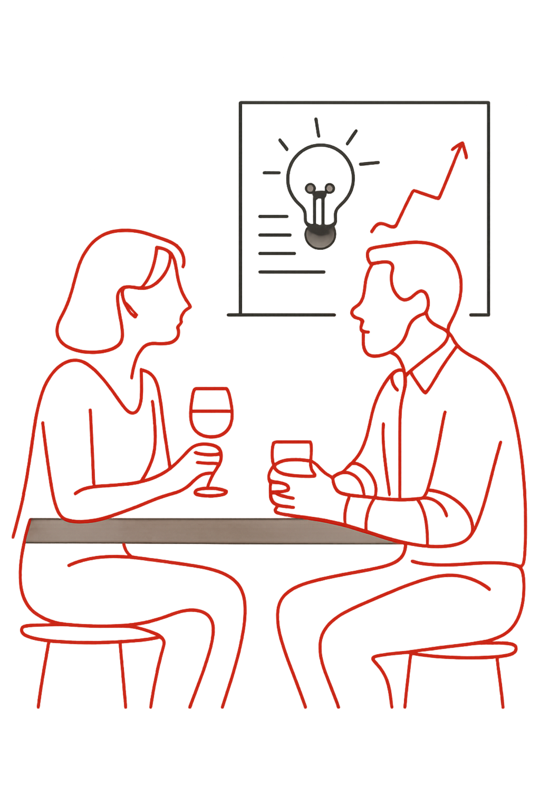

- Montreal, junio de 2014. Ian Goodfellow, 27 años, propone en una conversación de bar una idea aparentemente simple: ¿y si en lugar de una sola red, usamos dos? Una que genera, otra que evalúa. Que compitan.
- Sus colegas son escépticos. Esa misma noche implementa el prototipo. Funciona en el primer intento.

**70K+**

**Citas del paper original**

- "La idea más interesante en machine learning en los últimos 20 años." — Yann LeCun

### Sources

- `AIG4B-Clase-8-GANs.md.md` (slide 12)

### Speaker notes

### Presenter feedback

---

## 4. Modelo Mental Para Entenderlo

<!-- slide 13 del pptx original -->

### Content

- **Un experimento mental: el mundo de los rostros. Imaginad una sociedad donde existen miles de rostros reales con características reconocibles. En esa sociedad aparecen dos personajes con objetivos opuestos:**

| El Falsificador | El Detective |
|---|---|
| Objetivo: crear rostros que parezcan pertenecer a ese mundo.<br>Método: prueba y error. Genera un rostro, recibe feedback, ajusta, repite. Puede estudiar todos los rostros reales que quiera, pero no sabe cómo se fabrican. | Objetivo: distinguir los rostros reales de los falsos.<br>Ventaja: ve ambos tipos — los reales del dataset y los que produce el falsificador. Como el falsificador mejora constantemente, él también tiene que mejorar. |

- **¿Qué pasa cuando estos dos compiten durante miles — o millones — de rondas? Los dos se vuelven extraordinariamente buenos en lo suyo.**

### Sources

- `AIG4B-Clase-8-GANs.md.md` (slide 13)

### Speaker notes

### Presenter feedback

---

## 5. (sin título)

<!-- slide 14 del pptx original -->

### Content

**Arquitectura de una GAN**

- Lo que acabamos de describir con el falsificador y el detective tiene una arquitectura técnica precisa. Cada elemento de la analogía corresponde a un componente real de la red:

| Analogía | Componente técnico | Función |
|---|---|---|
| El Falsificador | Generador (G) | Transforma ruido aleatorio en imágenes sintéticas |
| Los rostros falsos | Imágenes generadas | Output del Generador — al principio, puro ruido visual |
| El Detective | Discriminador (D) | Clasifica cada imagen como "real" o "falsa" con un score entre 0 y 1 |
| El veredicto | Señal de pérdida (loss) | Número que mide el error de cada red y guía su aprendizaje |
| Las rondas de competencia | Épocas de entrenamiento | Ciclos en los que ambas redes actualizan sus parámetros internos |


<!-- diagrama redibujado como SVG desde slide-14-1.png (fondo del pptx sin textos); las etiquetas de los cuadros de texto del pptx ahora están dentro del SVG -->

### Sources

- `AIG4B-Clase-8-GANs.md.md` (slide 14). Diagrama redibujado como SVG (images/arquitectura-gan.svg) a partir de la imagen del pptx (slide-14-1.png, que solo tenía el fondo) y de sus cuadros de texto: Arquitectura GAN, Clasificación / Salida: real o falso, Generador / Recibe ruido aleatorio, Discriminador / Recibe reales y generadas, Salida sintética / Imágenes generadas.

### Speaker notes

### Presenter feedback

---

## 6. Arquitectura de una "Vanilla" GAN

<!-- slide 15 del pptx original -->

### Content


<!-- images/vanilla-gan-arquitectura.svg está dibujado a mano y es la fuente de verdad: no se modifica ni se regenera desde este bloque ASCII, que solo documenta el diagrama. La animación vive aparte, en images/vanilla-gan-arquitectura.anim.svg, y se rehace desde ese SVG base con la sección animation: de la nota. -->
<!-- ascii-render: documentation-only -->
```ascii
Ruido z ──▶ Generador (G) ──▶ Muestra falsa ──┐
                                              ├──▶ Discriminador (D) ──▶ Veredicto · P(real)
Datos reales ───────────────▶ Muestra real ───┘                              │
                                               ┌─────────────────────────────┤
                                               ▼                             ▼
                                         Pérdida de G                  Pérdida de D
                                               ┆ actualiza G                 ┆ actualiza D
                                               ▼                             ▼
                                         Generador (G)              Discriminador (D)
```
<!-- ascii-note:
intent: el ciclo de una GAN: el Generador falsifica, el Discriminador juzga muestras reales y falsas, y cada pérdida vuelve a actualizar su red.
animation:
  1. «Ruido z» entra al «Generador (G)», que produce la «Muestra falsa».
  2. De «Datos reales» sale la «Muestra real».
  3. Las dos muestras llegan al «Discriminador (D)».
  4. D da su «Veredicto · P(real) · entre 0 y 1».
  5. Los veredictos van a «Pérdida de G» («veredictos sobre generadas») y a «Pérdida de D» («veredictos sobre reales y generadas»).
  6. Las flechas punteadas «actualiza G» y «actualiza D» vuelven a cada red, y el diagrama queda completo.
-->

<!-- enlace de la forma: https://aws.amazon.com/es/what-is/gan/ -->
- **[¿Qué es una GAN? - Explicación sobre las redes generativas antagónicas - AWS](https://aws.amazon.com/es/what-is/gan/)**

### Sources

- `AIG4B-Clase-8-GANs.md.md` (slide 15). Diagrama redibujado como SVG (images/vanilla-gan-arquitectura.svg) a partir de la imagen del pptx (slide-15-1.jpg): mismas piezas y conexiones, etiquetas en español (Generador (G), Discriminador (D)), lazos de pérdida rotulados "actualiza G" / "actualiza D".

### Speaker notes

### Presenter feedback

- [closed] 2026-10-21 — "Imágenes que usa: reales y generadas / solo generadas. Etiquetas: reales = 1, generadas = 0 / generadas = 1 (las etiqueta como «reales»). Eso es lo que quiero mostrar. La flecha que agregamos lo hace más confuso."
  Resolution: Revertida la flecha que atravesaba D (y los cambios de 2.7, notas y fuentes que la acompañaban). Al diagrama original se le suma, a la derecha de cada pérdida, qué imágenes usa y con qué etiquetas: Pérdida de G «solo generadas · etiqueta: generadas = 1 (las hace pasar por reales)»; Pérdida de D «reales y generadas · etiquetas: reales = 1, generadas = 0». Lienzo de 990 a 1225 de ancho.
  Follow-up 2026-10-21 (presentador: «Sí, rotulemos las flechas»): el rombo «¿Real o falsa?» se leía como una bifurcación (como si a cada pérdida le tocara un tipo de imagen). Pasa a una caja de salida «Veredicto · P(real) · entre 0 y 1»; las flechas a las pérdidas, en codo, rotuladas «veredictos sobre generadas» y «veredictos sobre reales y generadas»; las notas de la derecha quedan solo con las etiquetas.
  Follow-up 2026-10-21 (presentador: «el texto de etiquetas es redundante»): salen las notas de la derecha; el lienzo vuelve a 990 de ancho.

---

## 7. Entrenamiento paso a paso

<!-- slide 16 del pptx original -->

### Content

- Cuatro pasos que se repiten miles de veces — así es como una GAN aprende a engañar.


- Paso 3 — El Discriminador emite su veredicto

- Paso 2 — El Discriminador evalúa

- Paso 1 — El Generador produce su primer intento

- Recibe dos tipos de inputs en cada ronda: imágenes reales del dataset de entrenamiento e imágenes falsas producidas por el Generador en el Paso 1. Su tarea: asignar a cada imagen una probabilidad de ser real (entre 0 y 1).
- Al principio tiene la tarea fácil — las imágenes del Generador son obviamente falsas.

- Produce un número entre 0 y 1: cerca de 1 → "Esto es real"; cerca de 0 → "Esto es claramente falso"; cerca de 0.5 → "No tengo idea". Cuando el Generador logra que el Discriminador dé 0.5 de forma consistente, es el éxito.

- Recibe como entrada un vector de ruido aleatorio — números al azar que representan un punto en un espacio de posibilidades. Con ese ruido como semilla, produce una imagen. Al principio del entrenamiento, esa imagen es literalmente ruido visual — manchas sin forma ni sentido.
- Analogía: el falsificador en su primer día. No sabe nada de los rostros reales — produce garabatos.


- Paso 5 — El ciclo se repite miles de veces

- Paso 4 — Ambos aprenden del resultado

- Generar → evaluar → aprender. Este loop puede repetirse cientos de miles de veces. Con cada iteración, el Generador produce imágenes más convincentes y el Discriminador se vuelve más exigente. Al final, el ojo humano no puede distinguir lo real de lo generado.

- El veredicto se convierte en señal de aprendizaje: el Generador ajusta sus parámetros para engañar mejor la próxima vez; el Discriminador ajusta los suyos para detectar mejor. Ambos actualizan simultáneamente — cada uno aprende del error del otro.

### Sources

- `AIG4B-Clase-8-GANs.md.md` (slide 16)

### Speaker notes

### Presenter feedback

---

# 3. Slanted Land

**Goal of this section:**

**Presenter feedback:**

- [closed] 2026-10-21 — "Borrá el slide «Backpropagation: del error al ajuste de pesos»."
  Resolution: 3.17 borrada, entera en Cut material; 3.18–3.22 pasan a 3.17–3.21. Las notas de 3.13 («backpropagation, a partir de 3.17») siguen apuntando bien. images/backprop-red.svg solo la usaba esa slide y se borra.

---

## 1. El Problema: ¡Bienvenidos a Slanted Land! 🌀

<!-- slide 18 del pptx original -->

### Content

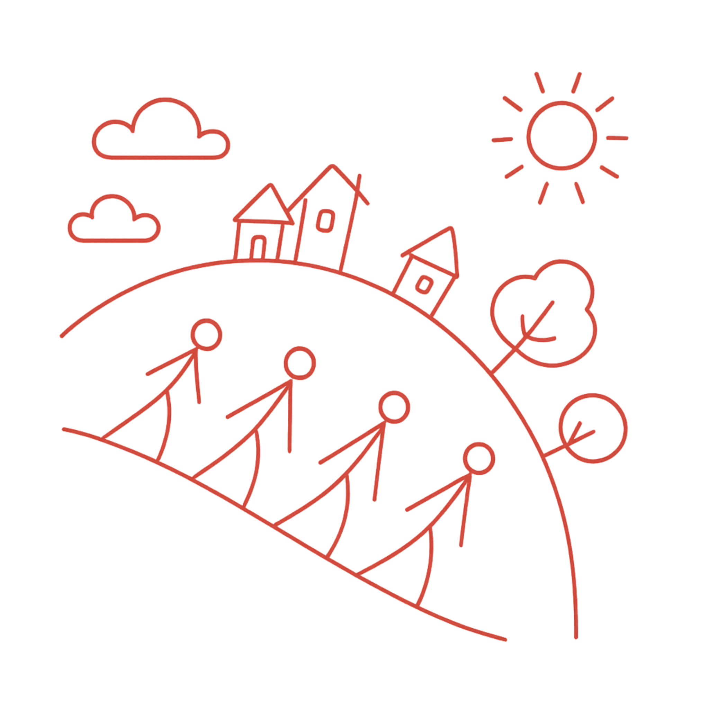

- Imagina un mundo peculiar llamado Slanted Land, donde absolutamente todo se inclina: los árboles, las casas, las personas e incluso la pizza que comen los gatos. En este universo, la norma es la inclinación.
- Los habitantes de Slanted Land solo conocen rostros con una ligera inclinación. Para ellos, un rostro completamente recto sería una anomalía, algo totalmente extraño e incomprensible.

| Universo Inclinado | Rostros "Normales" |
|---|---|
| Todo, desde la gravedad hasta las cejas de sus habitantes, está en un ángulo distintivo. | Solo existen los rostros inclinados; un rostro recto les resulta completamente alienígena. |


### Sources

- `AIG4B-Clase-8-GANs.md.md` (slide 18). Crédito corregido: el video enlazado es de Luis Serrano, como acredita la slide 37 original (corpus, inconsistencia #1).
- `serrano-gans-lab.web.md` (Slanted Land es el mundo didáctico de Serrano)

### Speaker notes

### Presenter feedback

- [closed] 2026-10-17 — "Aplicar los reemplazos ★ del editor solo con fuentes del corpus (Salimans 2016 en 1.3 y 4.8; en 4.7 solo la TC de baja dosis); corregir el crédito de Slanted Land y día→noche (Pix2Pix); deepfakes a Open questions."
  Resolution: Crédito corregido: el tutorial y el video son de Luis Serrano («A Friendly Introduction to Generative Adversarial Networks»), no de Rowel Atienza (inconsistencia #1). Fuente serrano-gans-lab agregada.

---
## 2. El problema urgente

<!-- slide 18 del pptx original (segunda mitad; partida a pedido del presentador, 2026-10-17) -->

### Content

- La app de citas de Slanted Land, TiltedTinder, necesita generar fotos de perfil para sus usuarios. Pero solo tienen 4 fotos reales en toda su base de datos. Con tan pocos datos, nadie encuentra pareja. ¡La supervivencia romántica de toda una civilización inclinada depende de nuestra GAN! 💘

<!-- enlace de la forma: https://www.youtube.com/watch?v=8L11aMN5KY8&t=16s -->
- [Basado en «A Friendly Introduction to Generative Adversarial Networks», de Luis Serrano (ver video)](https://www.youtube.com/watch?v=8L11aMN5KY8&t=16s)

### Sources

- `AIG4B-Clase-8-GANs.md.md` (slide 18). Párrafo «El problema urgente» del slide original, separado en su propia lámina para descargar la anterior; el rótulo pasa a ser el título.
- `serrano-gans-lab.web.md` (Slanted Land es el mundo didáctico de Serrano)

### Speaker notes

### Presenter feedback

- [closed] 2026-10-17 — "Hace un split del sdlide \"El Problema: ¡Bienvenidos a Slanted Land! 🌀 en 2 para que no quede tan cargao"
  Resolution: Partida en dos: 3.1 conserva el mundo, los habitantes, las dos tarjetas y la ilustración; 3.2 «El problema urgente» lleva TiltedTinder y el crédito a Serrano. Texto sin cambios.

---

## 3. El mundo de Slanted Land

<!-- slide 19 del pptx original -->

### Content

| Imágenes 2×2 píxeles | Dataset real | Red de una sola capa |
|---|---|---|
| Cada imagen se representa como una pantalla con 4 celdas — cada celda tiene un valor entre 0 (blanco) y 1 (negro). | Son imágenes de personas inclinadas. El Generador va a aprender a producir imágenes que se parezcan a esas personas. | La arquitectura más simple posible — ideal para entender los fundamentos sin complejidad adicional. |

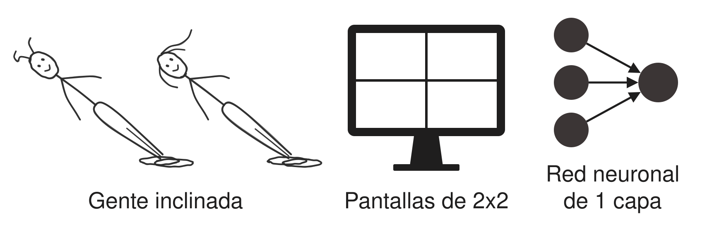

### Sources

- `AIG4B-Clase-8-GANs.md.md` (slide 19). Imagen redibujada como SVG (images/slanted-mundo.svg).

### Speaker notes

### Presenter feedback

---

## 4. (sin título)

<!-- slide 20 del pptx original -->

### Content

**Los datos reales: caras con patrón**

- Las "caras" de Slanted Land, codificadas como píxeles, tienen un patrón consistente:

- Esquinas oscuras en la diagonal principal (arriba-izquierda y abajo-derecha): valor alto
- Esquinas claras en la diagonal secundaria (arriba-derecha y abajo-izquierda): valor bajo

- Ese patrón diagonal es la "firma" de una cara real. El Discriminador tiene que aprenderlo para poder distinguirla del ruido.


### Sources

- `AIG4B-Clase-8-GANs.md.md` (slide 20). Imagen redibujada como SVG (images/caras-patron.svg): caras a mano y grillas 2×2 con los valores de la tabla «Faces» del pptx (slide 21).

### Speaker notes

### Presenter feedback

---

## 5. Caras vs. ruido: los dos tipos de imágenes

<!-- slide 21 del pptx original -->

### Content

| Caras (imágenes reales) | Ruido (imágenes falsas) |
|---|---|
| Valores altos en la diagonal principal, bajos en la secundaria. Patrón estructurado y reconocible. | Valores sin patrón, distribuidos aleatoriamente. Sin estructura diagonal. El Discriminador debe aprender a distinguirlos a partir de esos valores numéricos. |

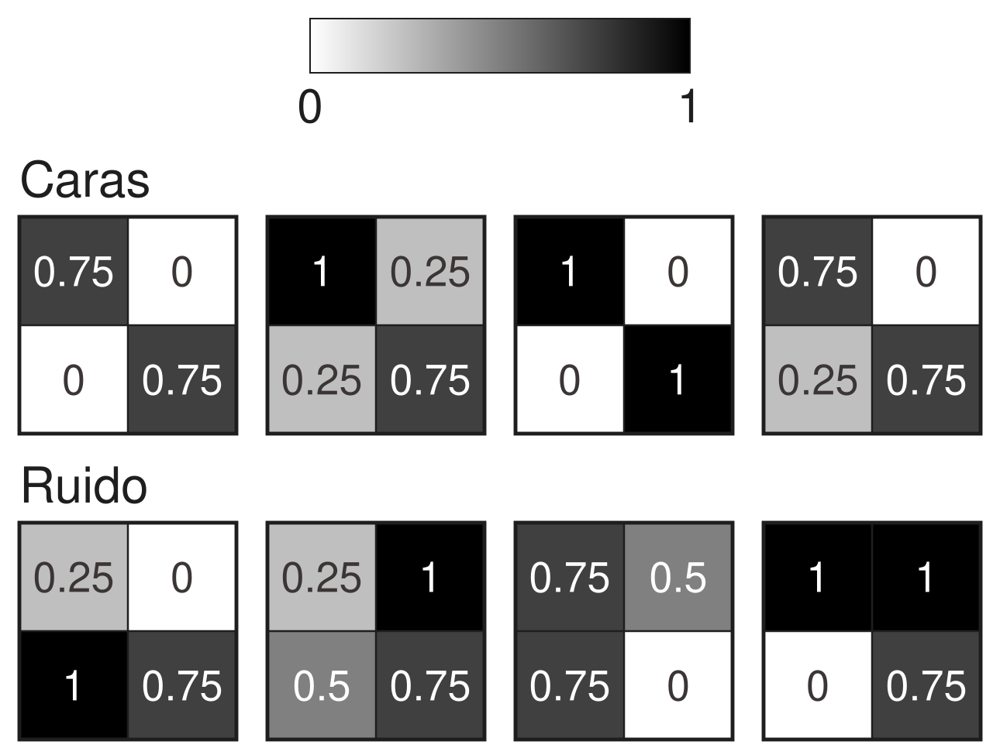

### Sources

- `AIG4B-Clase-8-GANs.md.md` (slide 21). Imagen redibujada como SVG (images/caras-vs-ruido.svg).

### Speaker notes

### Presenter feedback

---

## 6. (sin título)

<!-- slide 22 del pptx original -->

### Content

**Construyendo el Discriminador**

**¿qué píxeles importan?**

- El Discriminador aprende que en las caras de Slanted Land:

- Los píxeles de la diagonal principal son grandes → reciben peso positivo (+1)
- Los píxeles de la diagonal secundaria son pequeños → reciben peso negativo (−1)

- Asigna estos pesos a cada posición: +1 para las que caracterizan una cara, −1 para las que no la caracterizan.

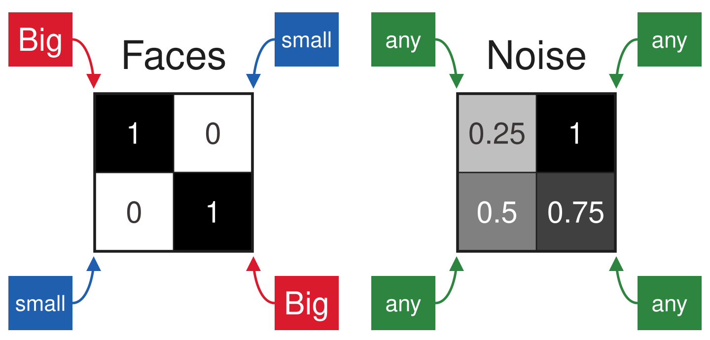

### Sources

- `AIG4B-Clase-8-GANs.md.md` (slide 22). Imagen redibujada como SVG (images/pesos-big-small.svg).

### Speaker notes

### Presenter feedback

---

## 7. Construyendo el Discriminador

<!-- slide 23 del pptx original -->

### Content

**Calculo del Score**

- El score de una imagen = suma ponderada de sus valores de píxel × pesos aprendidos:

| Cara prototipo | Imagen de ruido |
|---|---|
| 1×(+1) + 0×(−1) + 0×(−1) + 1×(+1) = 2 | 0.25×(+1) + 1×(−1) + 0.5×(−1) + 0.75×(+1) = −0.5 |
| Score > 1 → Real ✓ | Score < 1 → Falsa ✓ |

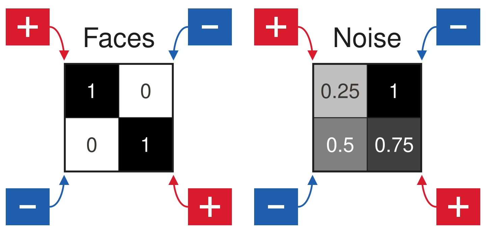

### Sources

- `AIG4B-Clase-8-GANs.md.md` (slide 23). Imagen redibujada como SVG (images/pesos-mas-menos.svg).

### Speaker notes

El umbral 1 de esta slide es el que en la siguiente entra a la neurona como sesgo: restarle 1 al score (b = −1) y comparar σ con 0,5 es lo mismo que preguntar si el score supera 1.

### Presenter feedback

---

## 8. (sin título)

<!-- slide 24 del pptx original -->

### Content

- **Discriminador Como red neuronal**

- La entrada no calcula: x₁…x₄ son los píxeles. El cálculo lo hace la primera capa, que acá es una sola neurona. Para la cara prototipo: σ(1×(+1) + 0×(−1) + 0×(−1) + 1×(+1) − 1) = σ(1)

| Entradas (x) | Pesos (w) | Sesgo (b) |
|---|---|---|
| x₁=1, x₂=0, x₃=0, x₄=1 | w₁=+1, w₂=−1, w₃=−1, w₄=+1 | b = −1, parte de la neurona de salida |

| Suma ponderada | Sigmoid |
|---|---|
| 1(+1)+0(−1)+0(−1)+1(+1) + b = 2 − 1 = 1 | σ(1) ≈ 0.73 → imagen real |

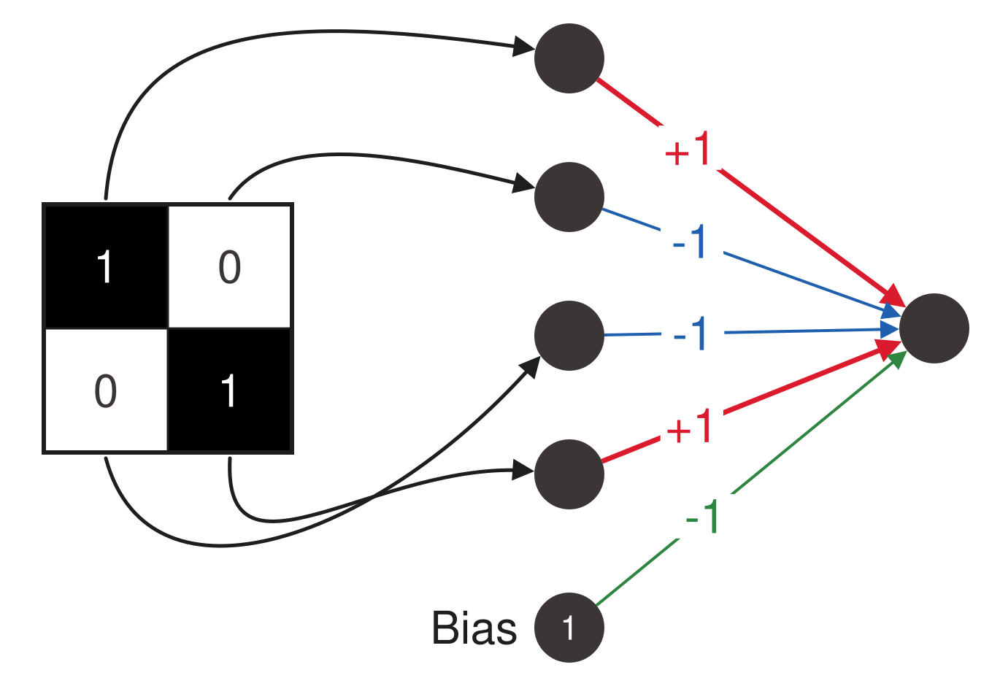

<!-- images/discriminador-red.svg está dibujado a mano y es la fuente de verdad: no se modifica ni se regenera desde este bloque ASCII, que solo documenta el diagrama. No tiene animación publicada. -->
<!-- ascii-render: documentation-only -->
```ascii
IMAGEN 2×2      ENTRADA          OCULTA       SALIDA (1 neurona)
┌───┬───┐       x₁ ── +1 ──┐
│ 1 │ 0 │       x₂ ── −1 ──┤
├───┼───┤       x₃ ── −1 ──┼── (ninguna) ──▶ ( σ )   w·x + b
│ 0 │ 1 │       x₄ ── +1 ──┘                         b = −1
└───┴───┘   (sin cálculo)
```
<!-- ascii-note:
intent: el Discriminador como red de una sola neurona: la imagen entra píxel a píxel y la neurona de salida hace todo el cálculo.
animation:
  1. «IMAGEN 2×2 píxeles»: la cara prototipo (1, 0 / 0, 1).
  2. Cada píxel pasa a su entrada x₁…x₄ («sin cálculo»).
  3. Los pesos +1, −1, −1, +1 llegan a la neurona σ («SALIDA, 1 neurona»).
  4. La neurona σ se ilumina y aparecen «w·x + b» y «b = −1», y el diagrama queda completo.
-->

### Sources

- `AIG4B-Clase-8-GANs.md.md` (slide 24). Imagen redibujada como SVG (images/discriminador-red.svg).

### Speaker notes

Es el mismo dibujo de la clase de MLP: la entrada no calcula, x₁…x₄ son los píxeles; la primera capa hace w·x + b y la activación. Acá esa capa es una sola neurona, así que no es un MLP: no tiene capa oculta. Ojo con la letra: en GANs z es el ruido que entra al Generador, no la pre-activación de la clase de MLP.

### Presenter feedback

- [closed] 2026-10-17 — "Check with the editor how can this be improved (notación: z reservado para el ruido del Generador)"
  Resolution: Píxeles de entrada renombrados z₁…z₄ → x₁…x₄ y encabezado «Entradas (z)» → «Entradas (x)». z queda solo para el ruido latente (3.10, 3.11) y coincide con xᵢ de 3.17. La figura slide-24-1.png es del video y no se puede editar.

- [closed] 2026-10-20 — "El gráfico de la red neuronal «Discriminador como red neuronal» sería bueno que se alinee con la clase de MLP. Dividiendo entre input, hidden layer, output."
  Resolution: discriminador-red.svg con encabezados IMAGEN / ENTRADA / OCULTA / SALIDA como en la clase de MLP; la capa oculta va como columna vacía y punteada («ninguna»), porque esta red no tiene: la cuenta σ(1) = 0,73 de la slide sigue valiendo. σ dentro de la neurona de salida. Texto alternativo actualizado.
  Follow-up 2026-10-20 (presentador: «sí»): la misma fila de capas en discriminador-cara, discriminador-ruido, generador-red, generador-y-discriminador, error-discriminador y derivada-error. Banda punteada de la capa oculta solo en los dos discriminadores con la sigmoide; en los otros, «OCULTA · ninguna» va como encabezado, porque entre las capas se cruzan conexiones y rótulos de pesos.
- [closed] 2026-10-20 — "Revisá el talk de MLP y los diagramas. Creo que el alineamiento es que las entradas en general no tienen cálculo y la primera capa es la que presenta el cálculo."
  Resolution: Siete SVG (discriminador-red/cara/ruido, generador-red, generador-y-discriminador, error-discriminador, derivada-error) con la convención de la clase de MLP: entrada como círculo hueco sin cálculo (x₁…x₄, z); sin nodo «Bias»: el sesgo b va en la neurona que calcula (D: «w·x + b, b = −1»; G: σ(0.7 + 1), σ(−0.7 − 1)). Tabla de 3.8 con «Sesgo (b)» y la suma 2 − 1 = 1; notas en 3.7 y 3.8. Corrige el ruido de 3.10: con el sesgo da σ(−1.5) = 0.18, no σ(−0.5) = 0.37. Celda rota de 3.7 arreglada.

---

## 9. Función Sigmoid: la activación del Discriminador

<!-- slide 25 del pptx original -->

### Content

- **La función sigmoid convierte cualquier número real en una probabilidad entre 0 y 1. Es la función de activación que usa el Discriminador para emitir su veredicto.**


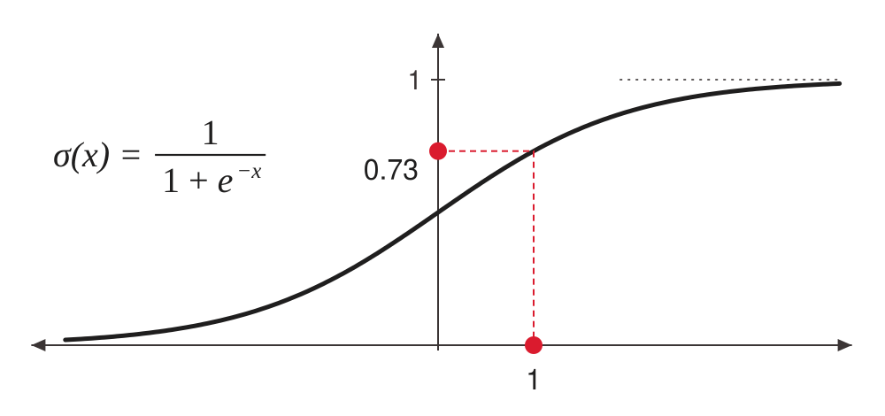

| Rango acotado | Diferenciable | Monótona creciente | Punto medio en 0 |
|---|---|---|---|
| Devuelve valores entre 0 y 1; se lee como probabilidad. | Es suave en todo punto; permite backpropagation. | Si sube la entrada, sube la salida; conserva el orden. | σ(0) = 0.5; umbral natural de decisión. |

### Sources

- `AIG4B-Clase-8-GANs.md.md` (slide 25)
- Imagen redibujada como SVG (images/sigmoide.svg).

### Speaker notes

### Presenter feedback

---

## 10. Pongamos todo junto del Discriminador

<!-- slide 26 del pptx original -->

### Content

- **Cuando la cara prototipo pasa por la red completa:**
- **σ(1) = 0.73 → "Estoy un 73% seguro de que esto es real"**
- **Como 0.73 > 0.5, clasifica correctamente la imagen como real ✓**

- **Cuando la imagen de ruido pasa por la misma red:**
- **σ(−1.5) = 0.18 → "Estoy solo un 18% seguro de que esto sea real"**
- **Como 0.18 < 0.5, clasifica correctamente la imagen como falsa ✓**

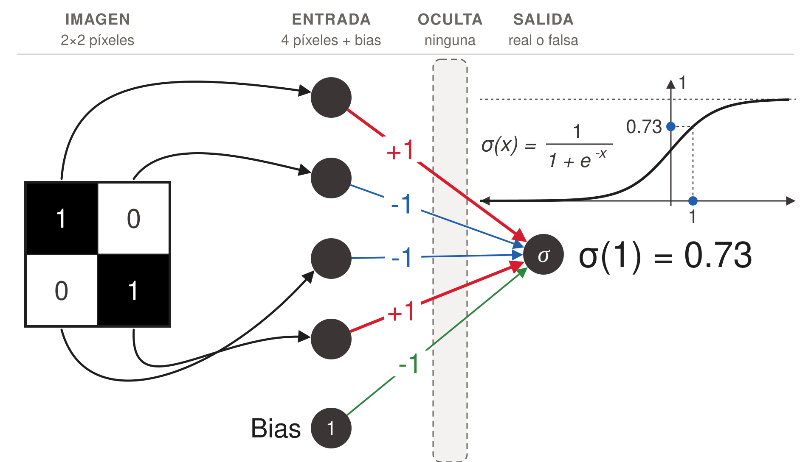

<!-- images/discriminador-cara.svg está dibujado a mano y es la fuente de verdad: no se modifica ni se regenera desde este bloque ASCII, que solo documenta el diagrama. No tiene animación publicada. -->
<!-- ascii-render: documentation-only -->
```ascii
┌───┬───┐       x₁ ── +1 ──┐
│ 1 │ 0 │       x₂ ── −1 ──┤
├───┼───┤       x₃ ── −1 ──┼──▶ ( σ )  w·x + b,  b = −1 ──▶ σ(1) = 0.73
│ 0 │ 1 │       x₄ ── +1 ──┘                                   │
└───┴───┘                                                       ▼
                                              curva σ(x) = 1/(1 + e^−x): punto (1, 0.73)
```
<!-- ascii-note:
intent: la pasada hacia adelante de la cara prototipo por el Discriminador, hasta su veredicto en la curva sigmoide.
animation:
  1. La imagen 2×2 (1, 0 / 0, 1).
  2. Los píxeles entran como x₁…x₄.
  3. Los pesos +1, −1, −1, +1 llevan cada entrada a σ, que calcula «w·x + b» con «b = −1».
  4. Sale «σ(1) = 0.73».
  5. El punto 0.73 se marca en la curva «σ(x) = 1/(1 + e^−x)», y el diagrama queda completo.
-->

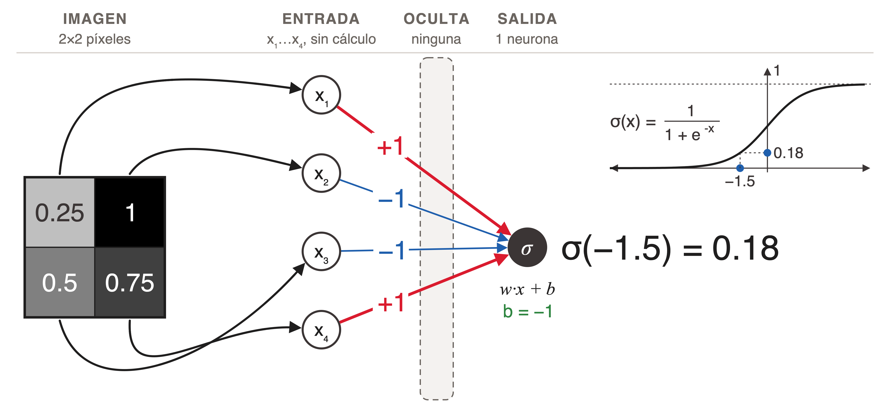

<!-- images/discriminador-ruido.svg está dibujado a mano y es la fuente de verdad: no se modifica ni se regenera desde este bloque ASCII, que solo documenta el diagrama. La animación vive aparte, en images/discriminador-ruido.anim.svg, y se rehace desde ese SVG base con la sección animation: de la nota. -->
<!-- ascii-render: documentation-only -->
```ascii
┌──────┬──────┐   x₁ ── +1 ──┐
│ 0.25 │  1   │   x₂ ── −1 ──┤
├──────┼──────┤   x₃ ── −1 ──┼──▶ ( σ )  w·x + b,  b = −1 ──▶ σ(−1.5) = 0.18
│ 0.5  │ 0.75 │   x₄ ── +1 ──┘                                    │
└──────┴──────┘                                                    ▼
                                            curva σ(x) = 1/(1 + e^−x): punto (−1.5, 0.18)
```
<!-- ascii-note:
intent: la misma pasada hacia adelante con la imagen de ruido, hasta su veredicto en la curva sigmoide.
animation:
  1. La imagen 2×2 (0.25, 1 / 0.5, 0.75).
  2. Los píxeles entran como x₁…x₄.
  3. Los pesos +1, −1, −1, +1 llevan cada entrada a σ, que calcula «w·x + b» con «b = −1».
  4. Sale «σ(−1.5) = 0.18».
  5. El punto 0.18 se marca en la curva «σ(x) = 1/(1 + e^−x)», y el diagrama queda completo.
-->

### Sources

- `AIG4B-Clase-8-GANs.md.md` (slide 26). Imagen redibujada como SVG (images/discriminador-cara.svg). Imagen redibujada como SVG (images/discriminador-ruido.svg).

### Speaker notes

### Presenter feedback

- [closed] 2026-10-20 — "Revisá «Pongamos todo junto del Discriminador»: las gráficas de las funciones se pisan casi con el gráfico."
  Resolution: En discriminador-cara.svg el gráfico de la sigmoide pasa a un grupo más chico (×0.85) arriba a la derecha, separado de las conexiones y de «σ(1) = 0.73»; lienzo de 1910 a 2160 de ancho. discriminador-ruido.svg suma el mismo gráfico con el punto (−1.5, 0.18), para que las dos imágenes de la slide queden parejas.

---

## 11. El Generador: el objetivo opuesto

<!-- template: value-columns -->

<!-- slide 27 del pptx original -->

### Content

Las dos redes leen el mismo número, D(·), pero quieren resultados contrarios.

| Factor | Discriminador (D) | Generador (G) |
|---|---|---|
| Entrada | Una imagen x de 4 píxeles | Un número aleatorio z, entre 0 y 1 |
| Salida | Un número, D(x) | Una imagen G(z) de 2×2 |
| Quiere | D(x) → 1 si la imagen es real; D(G(z)) → 0 si es falsa | D(G(z)) → 1 |

- **En redes reales**, G sube de resolución con capas de upsampling y convoluciones transpuestas.

### Sources

- `AIG4B-Clase-8-GANs.md.md` (slide 27)
- `gan-goodfellow-2014.web.md` (G se entrena para maximizar la probabilidad de que D se equivoque)
- `aws-que-es-una-gan.web.md` (convoluciones transpuestas en el generador)

### Speaker notes

El Generador nunca ve una cara real. Aprende solo a través del gradiente que le devuelve el Discriminador por D(G(z)), y por eso su objetivo se define sobre la salida de D. El paper original lo formula así: G se entrena para maximizar la probabilidad de que D se equivoque (Goodfellow et al., 2014).

El número z es aleatorio para que cada valor produzca una imagen distinta. El conjunto de valores posibles de z forma el espacio latente. Más adelante en la clase, StyleGAN transforma z en un vector de estilo w para controlar los rasgos de la imagen generada.

En Slanted Land la arquitectura es mínima: entra 1 número y salen 4 píxeles. Es la estructura inversa del Discriminador, que recibe 4 píxeles y devuelve 1 número. En una GAN de imágenes reales el esquema es el mismo, pero parte de un vector de ruido y llega a imágenes de hasta 1024×1024 (StyleGAN) con capas de upsampling y convoluciones transpuestas.

### Presenter feedback

- [closed] 2026-10-17 — "Check with the editor how can this be improved (eligió la opción A)"
  Resolution: Título «El Generador: el objetivo opuesto»; lead + tabla value-columns Factor · D · G (entrada, salida, qué quiere cada red); convoluciones transpuestas como takeaway; quitada slide-27-1.png (figura del Discriminador, inconsistencia #4); notas nuevas. Texto original en Cut material.

---

## 12. Construyendo el Generador

<!-- slide 28 del pptx original -->

### Content

**El Generador en acción: z = 0.7 → imagen**

- Con z = 0.7 como entrada y los pesos aprendidos, el Generador produce una imagen que reproduce el patrón diagonal de las caras reales. El Generador aprendió a engañar al Discriminador.
- El resultado muestra el patrón diagonal característico de las caras de Slanted Land: valores altos en la diagonal principal, bajos en la secundaria. El Generador internalizó la estructura del dataset real.

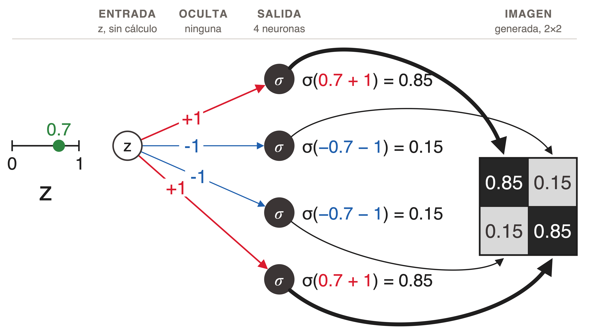

<!-- images/generador-red.svg está dibujado a mano y es la fuente de verdad: no se modifica ni se regenera desde este bloque ASCII, que solo documenta el diagrama. La animación vive aparte, en images/generador-red.anim.svg, y se rehace desde ese SVG base con la sección animation: de la nota. -->
<!-- ascii-render: documentation-only -->
```ascii
ENTRADA                OCULTA / SALIDA                  IMAGEN generada, 2×2
z = 0.7 ──┬── +1 ──▶ σ ──▶ 0.85 ──┐
0 ──●── 1 ├── −1 ──▶ σ ──▶ 0.15 ──┤               ┌──────┬──────┐
(sin      ├── −1 ──▶ σ ──▶ 0.15 ──┼─────────────▶ │ 0.85 │ 0.15 │
 cálculo) └── +1 ──▶ σ ──▶ 0.85 ──┘               ├──────┼──────┤
                                                   │ 0.15 │ 0.85 │
                                                   └──────┴──────┘
```
<!-- ascii-note:
intent: la pasada hacia adelante del Generador: un solo número z se convierte en una imagen 2×2 con el patrón de las caras.
animation:
  1. «z = 0.7» en el deslizador de 0 a 1.
  2. z entra «sin cálculo».
  3. Los pesos +1, −1, −1, +1 llegan a las cuatro σ.
  4. Las σ dan 0.85, 0.15, 0.15, 0.85: la «IMAGEN generada, 2×2», y el diagrama queda completo.
-->

### Sources

- `AIG4B-Clase-8-GANs.md.md` (slide 28). Imagen redibujada como SVG (images/generador-red.svg).

### Speaker notes

### Presenter feedback

- [closed] 2026-10-21 — "En slide «Construyendo el Generador», el texto Generador en el SVG no dice nada."
  Resolution: Sale el título «Generador» de generador-red.svg (repetía el título de la slide); la fila ENTRADA / OCULTA / SALIDA / IMAGEN sube a la parte de arriba y el lienzo baja de 1200 a 1100 de alto.

---

## 13. Proceso de Entrenamiento

<!-- slide 29 del pptx original -->

### Content

Hasta acá pusimos los pesos a mano (+1 y −1, y los sesgos). En la práctica, cada red los aprende sola, repitiendo tres pasos:

1. **Predecir.** El Discriminador mira una imagen y da un score entre 0 y 1.
2. **Medir el error.** Compara el score con el objetivo: 1 si la imagen es real, 0 si es falsa. La función que mide cuánto se equivocó se llama binary cross-entropy.
3. **Ajustar los pesos.** Backpropagation mueve cada peso en la dirección que baja el error. El Generador hace lo mismo con el objetivo contrario: que el Discriminador se equivoque.

### Sources

- `AIG4B-Clase-8-GANs.md.md` (slide 29)

### Speaker notes

Es la bisagra entre los pesos puestos a mano y el entrenamiento. Las dos fórmulas de binary cross-entropy, −ln(D(x)) con imagen real y −ln(1 − D(G(z))) con imagen falsa, están en la slide siguiente con números; las curvas, en las dos que siguen; backpropagation, a partir de 3.17.

### Presenter feedback

- [closed] 2026-10-21 — "Revisar cómo mejorar la distribución de «Proceso de Entrenamiento». Tal vez explicar lo mismo de otra manera."
  Resolution: Contada como proceso de tres pasos (predecir → medir el error con log-loss → ajustar los pesos), que es lo que dice el título. Salen los dos párrafos que repetían la misma idea y la tabla de fórmulas, que ya está con números en 3.14. Notas nuevas. Texto anterior en Cut material.

- [closed] 2026-10-17 (editor) — "Quitar el takeaway duplicado: queda solo en 3.13 (opción A de 3.13)"
  Resolution: Borrado el bullet «La propiedad clave: el error es grande…», idéntico al de 3.13, donde se conserva.

---

## 14. Binary cross-entropy: los dos casos del Discriminador

<!-- slide 30 del pptx original -->

### Content


- **La propiedad clave: el error es grande cuando la predicción está lejos del objetivo, y pequeño cuando está cerca. Esto guía el aprendizaje en la dirección correcta.**

### Sources

- `AIG4B-Clase-8-GANs.md.md` (slide 30). Los valores de la tabla del pptx, dibujados como diagrama nuevo (images/bce-dos-casos.svg).
- Cálculos: −ln(0.9) = 0.105 ≈ 0.1; −ln(0.1) = 2.303 ≈ 2.3 (mismos valores que la slide 30 original)
- `gan-goodfellow-2014.web.md` (juego minimax entre G y D)

### Speaker notes

La binary cross-entropy (en algunos textos, log-loss) es la misma de la clase de diseño de redes. Para una etiqueta y (1 = real, 0 = falsa) y una predicción p, el error vale −[y·ln(p) + (1 − y)·ln(1 − p)]. Con y = 1 sobrevive solo el primer término, −ln(p). Con y = 0 sobrevive solo el segundo, −ln(1 − p). Los dos paneles de la slide son esos dos términos.

El logaritmo castiga sin tope la confianza equivocada, porque −ln(p) crece hacia infinito cuando p se acerca a 0. Por eso pasar de una predicción de 0.9 a una de 0.1 lleva el error de 0.1 a 2.3. Su derivada también es grande justo cuando el modelo se equivoca, así que el ajuste de pesos es más fuerte donde más hace falta. Un error lineal como 1 − p no tiene ninguna de las dos propiedades.

Los dos paneles son el error del Discriminador. D minimiza −ln(D(x)) con imágenes reales y −ln(1 − D(G(z))) con imágenes falsas. El Generador se entrena con el objetivo contrario, que D se equivoque: en la práctica minimiza −ln(D(G(z))), que crece cuando D detecta la falsificación. El paper original formaliza esta tensión como un juego minimax entre G y D (Goodfellow et al., 2014).

### Presenter feedback

- [closed] 2026-10-21 — "Creo que el slide «Log-loss: los dos casos del Discriminador» se podría mostrar mejor con un diagrama simple."
  Resolution: La tabla Factor / real / falsa pasa a un diagrama nuevo (bce-dos-casos.svg): una recta de 0 a 1 por caso, con el objetivo marcado, las dos predicciones de la tabla (0.9 y 0.1) y una barra con el error de cada una (≈ 0.1 verde, ≈ 2.3 roja). Mismos números y fórmulas; se ve que el error crece con la distancia al objetivo. Takeaway igual; notas: «columnas» → «paneles». Tabla en Cut material.

- [closed] 2026-10-21 — "Unifiquemos en binary cross-entropy."
  Resolution: «log-loss» → «binary cross-entropy» en 3.13, 3.14 (título y notas), 3.18 y el cierre, como en la clase de diseño de redes. «log-loss» queda una sola vez, como sinónimo, en las notas de 3.14. Cut material y feedback anterior sin tocar.

- [closed] 2026-10-17 — "Check with the editor how can this be improved (eligió la opción A)"
  Resolution: Título «Log-loss: los dos casos del Discriminador»; tabla value-columns con fórmulas en texto en notación D(x) / D(G(z)) y el paso 1 − p explícito; corregido «Generador entrenando» (la columna de imagen falsa es el Discriminador); quitadas slide-30-1.png y slide-30-2.png (el rótulo Error_G contradecía 3.19); takeaway solo acá; notas nuevas. Texto original en Cut material.

---

## 15. (sin título)

<!-- slide 31 del pptx original, mitad izquierda -->

### Content

- **Loss Function: Discriminador — imagen real**

- Predicción = 1 (imagen real).
- Error = −ln(predicción).
- Predicción baja → alto error. Predicción alta → bajo error.
- El Discriminador quiere acercarse a 1 cuando ve imágenes reales.

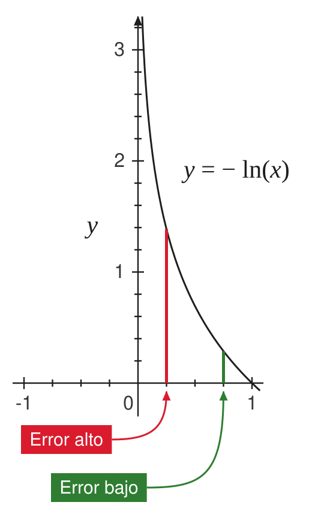

### Sources

- `AIG4B-Clase-8-GANs.md.md` (slide 31), mitad izquierda. Imagen redibujada como SVG (images/loss-curva-real.svg).

### Speaker notes

### Presenter feedback

- [closed] 2026-10-20 — "El slide Loss Function Visualmente conviene partirlo en 2 y que se lleve la parte que explica."
  Resolution: 3.15 queda solo con el gráfico y dos rótulos que dicen qué curva es cada una (izquierda −ln(x), derecha −ln(1 − x)). La explicación pasa a la slide nueva 3.16, «Loss Function: qué dice cada curva», como tabla de dos columnas, mismas palabras. 3.16–3.21 pasan a 3.17–3.22.
  Follow-up 2026-10-20 (presentador): mejor partir por curva. 3.15 «Loss Function: Discriminador — imagen real» con su curva (loss-curva-real.svg, −ln(x)) y su texto; 3.16 «Loss Function: Generador — imagen falsa» con la suya (loss-curva-falsa.svg, −ln(1 − x)) y su texto. Sin los íconos 🔍 y 🎨. loss-curvas.svg queda partida en dos y se borra.
  Íconos: también salen 🔀 y 🎨 de las tarjetas Mapping / Synthesis Network de «StyleGAN: arquitectura» (4.3); quedan los ✓/✗, que son veredictos.

---

## 16. (sin título)

<!-- slide 31 del pptx original, mitad derecha -->

### Content

- **Loss Function: Generador — imagen falsa**

- Predicción = 0 (imagen falsa).
- Error = −ln(1−predicción).
- Predicción alta → alto error.
- El Generador quiere que el Discriminador le asigne score alto (cercano a 1) — lo opuesto al objetivo del Discriminador.

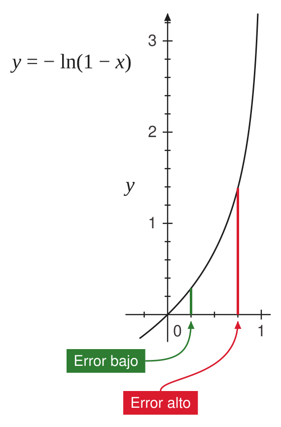

### Sources

- `AIG4B-Clase-8-GANs.md.md` (slide 31), mitad derecha. Imagen redibujada como SVG (images/loss-curva-falsa.svg).

### Speaker notes

### Presenter feedback

---

## 17. Backpropagation: el procedimiento paso a paso

<!-- slide 33 del pptx original -->

### Content

| 01 | 02 | 03 |
|---|---|---|
| Calcular el error | Derivar la sensibilidad de cada peso | Actualizar en la dirección opuesta al gradiente |

- **La binary cross-entropy da un número que mide qué tan lejos estuvo la red de la respuesta correcta.**

- **Con la regla de la cadena se calcula ∂E/∂w para cada peso: si subo este peso un poco, ¿el error sube o baja?**

- **w_nuevo = w_actual − α · (∂E/∂w) — α (learning rate) controla el tamaño del paso.**

- **04**

**Repetir para todos los pesos, en ambas redes**

- **El cálculo se ejecuta para cada peso del Discriminador y del Generador de forma simultánea.**

### Sources

- `AIG4B-Clase-8-GANs.md.md` (slide 33)

### Speaker notes

### Presenter feedback

---

## 18. Backpropagation: ejemplo con Slanted Land

<!-- slide 34 del pptx original -->

### Content

- **Con el error del Discriminador = 1.14 y output D(G(z)) = 0.68, calculamos el ajuste concreto usando la derivada ∂E/∂wᵢ = −[1 − D(x)] · xᵢ:**

| Píxel | Valor xᵢ | ∂E/∂w | α = 0.1 | w_nuevo |
|---|---|---|---|---|
| Arriba-izq (diagonal) | 0.25 | −0.32 × 0.25 = −0.08 | −0.1 × (−0.08) | 1 + 0.008 = 1.008 ↑ |
| Arriba-der | 1.00 | −0.32 × 1.00 = −0.32 | −0.1 × (−0.32) | −1 + 0.032 = −0.968 ↑ |

- **Los pesos se mueven en la dirección que hace al Discriminador más exigente: en la próxima iteración dará un score más bajo a imágenes similares.**

### Sources

- `AIG4B-Clase-8-GANs.md.md` (slide 34)

### Speaker notes

### Presenter feedback

---

## 19. (sin título)

<!-- slide 35 del pptx original -->

### Content

**El ciclo completo: Generador y Discriminador juntos**

- En cada vuelta entra un lote: m imágenes reales y m generadas. El Discriminador da un veredicto por imagen, y con esos veredictos se hacen dos pasos de backpropagation, uno por red: el del Discriminador usa los errores de las reales y de las generadas; el del Generador, solo los de las generadas.


<!-- images/ciclo-lote.svg está dibujado a mano y es la fuente de verdad: no se modifica ni se regenera desde este bloque ASCII, que solo documenta el diagrama. La animación vive aparte, en images/ciclo-lote.anim.svg, y se rehace desde ese SVG base con la sección animation: de la nota. -->
<!-- ascii-render: documentation-only -->
```ascii
Paso del Discriminador
  lote: 3 reales (del dataset, objetivo 1) + 3 generadas por G (objetivo 0)
  Discriminador ──▶ veredicto por imagen: 0.9  0.8  0.7  0.68  0.4  0.55
  error por imagen:                       0.11 0.22 0.36 1.14  0.51 0.80
     └── se promedian ──▶ error del lote (6 imágenes) 0.52 ──▶ un paso de backpropagation ──▶ actualiza solo el D

Paso del Generador   (las reales no entran)
  3 generadas (objetivo 1) ──▶ Discriminador (no cambia) ──▶ errores 0.39  0.92  0.60
     └── se promedian ──▶ error del lote (3 imágenes) 0.63 ──▶ un paso de backpropagation ──▶ actualiza solo el G

  ┄┄ siguiente lote… ┄┄▶ (vuelve al comienzo)
```
<!-- ascii-note:
intent: un lote de entrenamiento: un error por imagen, un promedio por paso y un paso de backpropagation que actualiza una sola red.
animation:
  1. El lote: 3 «reales (del dataset)» con objetivo 1 y 3 «generadas por G con 3 ruidos z» con objetivo 0.
  2. El «Discriminador» da un veredicto por imagen (0.9, 0.8, 0.7, 0.68, 0.4, 0.55).
  3. Cada imagen tiene su error (0.11, 0.22, 0.36, 1.14, 0.51, 0.80).
  4. «se promedian» → «error del lote (6 imágenes)» 0.52 → «un paso de backpropagation» → «actualiza solo el D».
  5. «Paso del Generador»: solo las 3 generadas, con objetivo 1 («las reales no entran»); «Discriminador (no cambia)»; errores 0.39, 0.92, 0.60.
  6. «se promedian» → «error del lote (3 imágenes)» 0.63 → «un paso de backpropagation» → «actualiza solo el G».
  7. La flecha punteada «siguiente lote…» vuelve al comienzo, y el diagrama queda completo.
-->

### Sources

- `AIG4B-Clase-8-GANs.md.md` (slide 35), reemplazada por un diagrama nuevo (images/ciclo-lote.svg).
- Google for Developers, *GAN Training* y *The Generator* (developers.google.com/machine-learning/gan): entrenamiento alternado y qué pesos actualiza cada paso. Fuente web, no está en el corpus.
- PyTorch, *DCGAN Tutorial*: lotes de reales y generadas, etiquetas real = 1 / generada = 0, y etiqueta real para el paso del Generador. Fuente web, no está en el corpus.

### Speaker notes

Las cuentas de las slides anteriores eran con una sola imagen para que se vieran los números. En el entrenamiento real entra un lote: varias imágenes reales y varias generadas a la vez, y el error que se propaga es el promedio del lote. Con esos veredictos hay dos pasos. En el del Discriminador, las reales tienen objetivo 1 y las generadas objetivo 0, y se actualiza solo el Discriminador. En el del Generador se usan solo las generadas, ahora con objetivo 1, porque el Generador quiere que el Discriminador se las crea; el error vuelve atravesando al Discriminador sin cambiarlo y se actualiza solo el Generador. Los veredictos del dibujo son ilustrativos; los errores sí están calculados: −ln(veredicto) si el objetivo es 1 y −ln(1 − veredicto) si es 0. Lo que hay que mirar es la forma: un error por imagen, un solo promedio por lote y un solo paso de backpropagation con ese promedio. En la práctica los lotes son de decenas de imágenes, no de seis.

### Presenter feedback

- [closed] 2026-10-21 — "Este slide «El ciclo completo» es muy naif. Deberíamos mostrar que hay lotes de entrenamiento, y que en cada uno de los dos backpropagation uno se queda con los errores de las reales y otro de las generadas. Hagamos una imagen."
  Resolution: Diagrama nuevo ciclo-lote.svg: 1) el lote (m reales, m ruidos → Generador → m generadas); 2) un veredicto por imagen (D(x) sobre reales, D(G(z)) sobre generadas); 3) paso del Discriminador (errores de reales y de generadas, promedio, actualiza solo D) y paso del Generador (solo generadas, objetivo 1, actualiza solo G); 4) siguiente lote. Matiz: el paso del D usa reales y generadas, no solo reales. Lead y notas nuevos; fuentes Google y PyTorch. Tabla y ejemplo de un solo veredicto (0.68) a Cut material; generador-y-discriminador.svg queda sin uso y se borra.
  Follow-up 2026-10-21 (presentador: «no se ve claramente que son lotes para luego calcular el promedio»): ciclo-lote.svg rehecho por filas (un paso por fila) y columnas (una imagen del lote por columna): imagen → objetivo → veredicto → su error como barra → «se promedian» → error del lote (0.52 / 0.63) → un paso de backpropagation → actualiza una sola red. En la fila del Generador las reales aparecen apagadas («las reales no entran»). Errores calculados con −ln; veredictos ilustrativos.

---

## 20. El error del Discriminador

<!-- slide 36 del pptx original -->

### Content

- El Discriminador recibió una imagen falsa pero le asignó un score de 0.68 (quería dar 0):

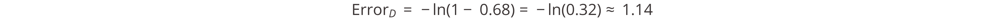

- Un error considerable. El Discriminador va a ajustar sus pesos para clasificar mejor estas imágenes en la próxima iteración — volviéndose más exigente y difícil de engañar.

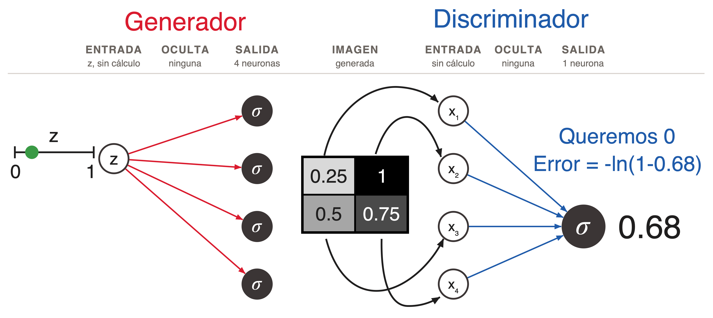

<!-- images/error-discriminador.svg está dibujado a mano y es la fuente de verdad: no se modifica ni se regenera desde este bloque ASCII, que solo documenta el diagrama. La animación vive aparte, en images/error-discriminador.anim.svg, y se rehace desde ese SVG base con la sección animation: de la nota. -->
<!-- ascii-render: documentation-only -->
```ascii
GENERADOR                                  DISCRIMINADOR
z ──▶ 4 σ ──▶ IMAGEN generada        ──▶   x₁…x₄ ──▶ ( σ ) ──▶ 0.68
(sin          ┌──────┬──────┐                                   Queremos 0
 cálculo)     │ 0.25 │  1   │                                   Error = −ln(1 − 0.68)
              ├──────┼──────┤
              │ 0.5  │ 0.75 │
              └──────┴──────┘
```
<!-- ascii-note:
intent: Generador y Discriminador encadenados: la imagen falsa recibe 0.68 cuando el objetivo era 0, y de ahí sale el error.
animation:
  1. «Generador»: z entra «sin cálculo» y sus pesos llegan a las cuatro σ.
  2. Sale la «IMAGEN generada» 0.25, 1 / 0.5, 0.75.
  3. Al «Discriminador»: cada píxel entra como x₁…x₄ y va a su σ.
  4. Sale «0.68».
  5. «Queremos 0» y «Error = -ln(1-0.68)», y el diagrama queda completo.
-->

### Sources

- `AIG4B-Clase-8-GANs.md.md` (slide 36)
- Imagen redibujada como SVG (images/error-discriminador.svg).

### Speaker notes

### Presenter feedback

---

## 21. (sin título)

<!-- slide 37 del pptx original -->

### Content

**Para los curiosos: la derivada del error**

- La derivada del error del Discriminador respecto a sus pesos permite calcular exactamente cuánto ajustar cada uno:


- Este cálculo es lo que backpropagation ejecuta automáticamente en cada iteración, para todas las capas y todos los pesos de la red. La regla de la cadena lo hace computacionalmente eficiente incluso con millones de parámetros.

- Slide opcional — para quien quiera profundizar en la matemática. Fuente: A Friendly Introduction to Generative Adversarial Networks — Luis Serrano Academy.

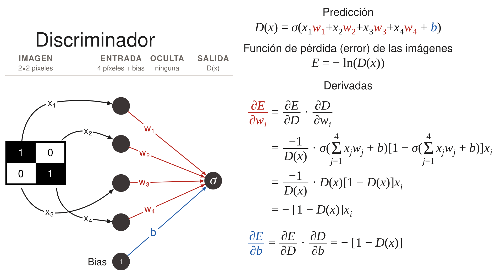

### Sources

- `AIG4B-Clase-8-GANs.md.md` (slide 37)
- Imagen redibujada como SVG (images/derivada-error.svg).

### Speaker notes

### Presenter feedback

---

# 4. Tipos y aplicaciones

**Goal of this section:**

**Presenter feedback:**

- [closed] 2026-10-21 — "Borrá «Fortaleza 4: Generación de datos sintéticos para entrenamiento»."
  Resolution: Slide borrada, entera en Cut material (incluye el caso de Salimans et al. 2016 y sus notas); 4.12 pasa a 4.11. No tenía imágenes ni referencias desde otras slides.

- [closed] 2026-10-17 — "Revisá y reformulá en el draft que la audiencia no es biomédica sino ingenieros. Revisá si los ejemplos son relevantes todavía."
  Resolution: Sección y agenda renombradas «Tipos de GANs y aplicaciones» (antes «Tipos de gans y aplicaciones en biomedicina»).

---

## 1. Tipos de GANs: el punto de partida

<!-- slide 39 del pptx original -->

### Content

- Todo lo que describimos corresponde a la Vanilla GAN — el modelo original de Goodfellow (2014). Pero ese modelo base tiene limitaciones importantes, y surgieron variantes especializadas que resuelven problemas concretos.

<!-- original vectorial: research/corpus/AIG4B-Clase-8-GANs.md/images/slide-39-1.svg -->

<!-- original vectorial: research/corpus/AIG4B-Clase-8-GANs.md/images/slide-39-2.svg -->

**Vanilla GAN · Goodfellow et al. 2014**

**Conditional GAN (cGAN) · Mirza & Osindero, 2014**

- Generador produce imágenes desde ruido aleatorio. Sin control sobre el resultado. Inestable y de baja calidad visual. Uso: punto de partida teórico.

- Generador y Discriminador reciben etiquetas de clase como condición. "Genera un 7" (dígitos de MNIST en el paper original). Uso: síntesis por clase y aumentación controlada.

<!-- original vectorial: research/corpus/AIG4B-Clase-8-GANs.md/images/slide-39-3.svg -->

<!-- original vectorial: research/corpus/AIG4B-Clase-8-GANs.md/images/slide-39-4.svg -->

| DCGAN · Radford et al., 2015 | SRGAN · Ledig et al., 2017 |
|---|---|
| Reemplaza capas densas con redes convolucionales. Entrenamiento estable, imágenes nítidas. Uso: base estándar para generación de imágenes de calidad. | Especializado en ampliar imágenes de baja a alta resolución. Infiere detalles finos que no estaban en la imagen original. Uso: ampliar fotos e imágenes de menor calidad, médicas incluidas (factor 4× en el paper original). |

### Sources

- `AIG4B-Clase-8-GANs.md.md` (slide 39)
- `srgan-ledig-2017.web.md` (imágenes naturales foto-realistas con factores de ampliación 4×)
- `cgan-mirza-osindero-2014.web.md` (generación de dígitos MNIST condicionada por etiqueta de clase; la condición entra al Generador y al Discriminador)

### Speaker notes

### Presenter feedback

- [closed] 2026-10-17 — "Revisá y reformulá en el draft que la audiencia no es biomédica sino ingenieros. Revisá si los ejemplos son relevantes todavía."
  Resolution: cGAN: «Uso: síntesis por clase (por ejemplo, por patología) y aumentación controlada»; SRGAN: uso ampliado a fotos e imágenes de menor calidad, médicas incluidas, con el factor 4× de Ledig et al. (srgan-ledig-2017). El ejemplo «carcinoma ductal» queda para decisión del presentador.
- [closed] 2026-10-17 — "Aplicar los reemplazos ★ del editor solo con fuentes del corpus (Salimans 2016 en 1.3 y 4.8; en 4.7 solo la TC de baja dosis); corregir el crédito de Slanted Land y día→noche (Pix2Pix); deepfakes a Open questions."
  Resolution: cGAN: «Genera una imagen histológica de carcinoma ductal» → «Genera un 7» (MNIST, Mirza & Osindero, 2014). Texto original en Cut material.

---

## 2. Tipos de GANs: cómo se ven sus imágenes

<!-- slide nueva, no está en el pptx: pedido del presentador (2026-10-21) -->

### Content

Las imágenes con que cada paper mostró su modelo:

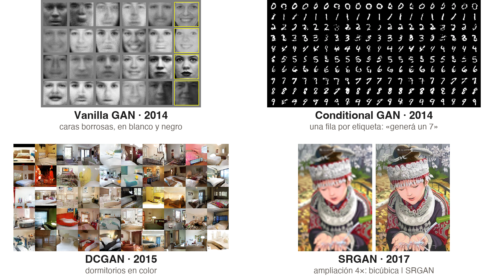

### Sources

- Goodfellow et al. (2014), *Generative Adversarial Nets*, figura 2b (arxiv.org/abs/1406.2661), vía ar5iv.
- Mirza y Osindero (2014), *Conditional Generative Adversarial Nets*, figura 2 (arxiv.org/abs/1411.1784), vía ar5iv.
- Radford, Metz y Chintala (2015), *Unsupervised Representation Learning with DCGANs*, figura 3 (arxiv.org/abs/1511.06434), vía ar5iv.
- Ledig et al. (2017), *Photo-Realistic Single Image Super-Resolution Using a GAN*, figura 2: bicúbica y SRGAN lado a lado (arxiv.org/abs/1609.04802), vía ar5iv.
- Los cuatro papers están en el corpus (`gan-goodfellow-2014`, `cgan-mirza-osindero-2014`, `dcgan-radford-2015`, `srgan-ledig-2017`), pero solo el abstract; las figuras se bajaron de ar5iv.

### Speaker notes

Los cuatro papers: Vanilla GAN, Goodfellow et al., 2014; Conditional GAN, Mirza y Osindero, 2014; DCGAN, Radford et al., 2015; SRGAN, Ledig et al., 2017. Es la misma lista de la slide anterior, ahora con lo que cada uno produce. Qué muestra cada imagen. Vanilla GAN: Caras generadas en blanco y negro y a baja resolución. La columna de la derecha, en amarillo, es la foto real más parecida del entrenamiento: no la copió. Conditional GAN: Dígitos de MNIST generados con una etiqueta: cada fila es un «generá un 0», «generá un 1»… hasta el 9. DCGAN: Dormitorios generados con capas convolucionales (dataset LSUN): ya son imágenes en color y con escenas reconocibles. SRGAN: La misma ilustración ampliada 4×: a la izquierda con interpolación bicúbica, a la derecha con SRGAN, que inventa el detalle fino. Conviene recorrerla como una línea de tiempo: de caras grises y borrosas en 2014 a dormitorios en color en 2015, y después a usos concretos, como pedir una clase o ampliar una imagen. En la de la Vanilla GAN, la columna amarilla es la forma en que el paper muestra que el modelo no memorizó: pone al lado la foto real más parecida. En la de SRGAN, mirar el detalle del pelo y de las plumas: la bicúbica lo pierde y la SRGAN lo inventa.

### Presenter feedback

- [closed] 2026-10-21 (editor, pedido del presentador) — Aun con textos cortos, el template de figuras dejaba las imágenes como miniaturas: las cuatro pasan a una sola imagen de 2×2 con nombre y año adentro (tipos-gan-grilla.png), a todo el ancho; autores y explicaciones en las notas. Las cuatro imágenes sueltas se borran.

- [closed] 2026-10-21 (editor, pedido del presentador) — Las imágenes quedaban chicas por el texto de cada celda: cuerpos acortados a una línea; las explicaciones completas, textuales, en las notas.

- [closed] 2026-10-21 — "Agreguemos otro slide luego de «Tipos de GANs: el punto de partida» que tenga para cada tipo imágenes típicas de internet."
  Resolution: Slide nueva 4.2 con una figura por tipo, tomada del paper original vía ar5iv: Vanilla GAN (caras TFD, Goodfellow 2014), cGAN (dígitos MNIST por etiqueta, Mirza y Osindero 2014), DCGAN (dormitorios LSUN, Radford 2015) y SRGAN (bicúbica y SRGAN lado a lado, Ledig 2017). Template figures, 2×2. 4.2–4.10 pasan a 4.3–4.11.

---

## 3. El salto que lo cambió todo: StyleGAN (2018)

<!-- slide 40 del pptx original -->

### Content

- El problema que nadie había resuelto en cuatro años: las GANs generaban imágenes, pero no podías pedirle "genera una cara joven, con pelo castaño y expresión neutral". El Generador mezclaba todos los atributos juntos sin control.
- ¿Qué cambió exactamente en StyleGAN? En una GAN clásica, el ruido entra directamente y todo (forma, color, textura) sale del mismo vector mezclado. StyleGAN lo separa en capas independientes:

| Componente | Qué hace | Qué controla |
|---|---|---|
| Red de mapeo (mapping network) | Transforma el ruido en un vector de estilo (w) | Define las características globales de la imagen |
| Síntesis por capas (AdaIN) | Inyecta el estilo en distintas capas de la red | Cada capa controla una escala diferente de detalle |
| Ruido estocástico por capa | Añade variación aleatoria capa a capa | Controla variaciones finas: poros, pelo suelto, arrugas |

- Style mixing: StyleGAN permite tomar la estructura de una cara (pose, forma) y el estilo de otra (color de pelo, edad) para generar una cara completamente nueva con coherencia total. Esto no era posible en ninguna GAN anterior.

### Sources

- `AIG4B-Clase-8-GANs.md.md` (slide 40)

### Speaker notes

Durante cuatro años las GANs generaron imágenes cada vez mejores, pero no se les podía pedir "una cara joven, con pelo castaño y expresión neutral": el Generador mezclaba todos los atributos y no había forma de tocar uno sin mover los demás.

La causa está en cómo entra el ruido. En una GAN clásica el vector de ruido entra directamente en la primera capa, y todo (forma, color, textura) sale de ese mismo vector entrelazado. StyleGAN lo separa en capas independientes: la red de mapeo convierte el ruido en un vector de estilo w, ese estilo se inyecta en cada capa de síntesis mediante AdaIN, y un ruido aleatorio por capa aporta los detalles finos. Las capas de baja resolución deciden la pose y la forma; las de alta resolución, la textura y el color.

Esa separación es lo que hace posible el *style mixing*: tomar la estructura de una cara (pose, forma) y el estilo de otra (color de pelo, edad) para generar una cara completamente nueva y coherente. Ninguna GAN anterior podía hacerlo.

### Presenter feedback

---

## 4. StyleGAN: arquitectura

<!-- slide 41 del pptx original -->

### Content

Dos redes en lugar de una: la red de mapeo convierte el ruido z en un estilo w, y la red de síntesis arma la imagen de 4×4 a 1024×1024 inyectando ese estilo en cada bloque.


<!-- images/stylegan-simple.svg está dibujado a mano y es la fuente de verdad: no se modifica ni se regenera desde este bloque ASCII, que solo documenta el diagrama. La animación vive aparte, en images/stylegan-simple.anim.svg, y se rehace desde ese SVG base con la sección animation: de la nota. -->
<!-- ascii-render: documentation-only -->
```ascii
1 · RED DE MAPEO
ruido z (512 números) ──▶ 8 capas ──▶ estilo w (512 números)
                                            │ el estilo w entra en cada bloque (AdaIN)
2 · RED DE SÍNTESIS                         ▼
   4×4 ──▶ 8×8 ──▶ 16×16 ──▶ … ──▶ 1024×1024 ──▶ la cara final
    ▲        ▲        ▲               ▲
    └── ruido por bloque: detalles finos ──┘
   capas bajas: pose y forma          capas altas: textura y color
```
<!-- ascii-note:
intent: el recorrido de StyleGAN: el ruido se vuelve estilo y el estilo entra en cada bloque de la red de síntesis, de 4×4 a 1024×1024.
animation:
  1. «ruido z» (512 números) entra a «1 · RED DE MAPEO» (8 capas).
  2. Sale el «estilo w» (512 números).
  3. «2 · RED DE SÍNTESIS» arma bloques 4×4, 8×8, 16×16, …, 1024×1024.
  4. «el estilo w entra en cada bloque (AdaIN)» y cada bloque recibe su «ruido por bloque».
  5. «capas bajas: pose y forma» / «capas altas: textura y color» → «la cara final», y el diagrama queda completo.
-->

### Sources

- `AIG4B-Clase-8-GANs.md.md` (slide 41)
- Diagrama nuevo y simplificado (images/stylegan-simple.svg), con las piezas que describe la slide; el redibujo fiel de la figura del paper (stylegan-arquitectura.svg) pasó a Cut material.
- Karras, Laine y Aila (2019), arxiv.org/abs/1812.04948: red de mapeo de 8 capas, w de 512 dimensiones, síntesis desde una constante de 4×4, AdaIN y ruido por capa. Fuente web, no está en el corpus.

### Speaker notes

La clave: el estilo se inyecta en cada capa mediante AdaIN (Adaptive Instance Normalization), no solo al inicio. Esto da control granular sobre cada aspecto visual. En una GAN clásica el ruido entra una sola vez, en la primera capa, y todo sale mezclado de ahí. StyleGAN lo separa: la red de mapeo, 8 capas densas, convierte el ruido z en un vector de estilo w de 512 números, y la red de síntesis arranca de un bloque constante de 4×4 y lo va agrandando hasta 1024×1024. En cada bloque el estilo w entra por AdaIN, que reescala las activaciones con valores que salen de w, y se suma un ruido propio del bloque que pone los detalles finos. Por eso los bloques chicos deciden la pose y la forma de la cara y los grandes la textura y el color: se puede tomar la estructura de una cara y el estilo de otra. El diagrama del paper tiene más piezas (las capas convolucionales 3×3, el sobremuestreo, las transformaciones A y B y el Discriminador de ProGAN con que se entrena); está en Cut material.

### Presenter feedback

- [closed] 2026-10-21 — "Rediseñá el slide «StyleGAN: arquitectura», no se puede leer."
  Resolution: El redibujo fiel de la figura del paper (8 FC, Conv 3×3, Upsample, A/B, Discriminador de ProGAN) quedaba con letra de ~8 px a media pantalla. Diagrama nuevo stylegan-simple.svg a todo el ancho: ruido z → 8 capas → estilo w; síntesis de 4×4 a 1024×1024 con el estilo entrando en cada bloque por AdaIN y ruido por bloque; capas bajas = pose y forma, altas = textura y color. Texto: subtítulo + una oración + «La clave». Salen las tarjetas (están en el diagrama) y el epígrafe huérfano «Caras fotorrealistas generadas por StyleGAN». Detalle y diagrama original en notas y Cut material.
  Follow-up 2026-10-21: en el deck, el formato con banda achicaba el diagrama a medio ancho; pasa a imagen a todo el ancho (image-full) con una sola línea de lead, y letra del diagrama más grande. «La clave» (AdaIN en cada capa) va a las notas: el diagrama ya lo dice («el estilo w entra en cada bloque (AdaIN)»). Revisado con captura del deck.

---

## 5. StyleGAN: Innovaciones Clave (Resumen)

<!-- slide 42 del pptx original -->

### Content

- StyleGAN (NVIDIA) redefine la generación de imágenes al modificar únicamente el Generador, manteniendo el Discriminador estándar. Sus tres innovaciones arquitectónicas permiten control fino sobre el estilo y alta calidad visual.


| Progressive Growing | Bi-linear Sampling | Mapping Network + AdaIN |
|---|---|---|
| Entrena comenzando con imágenes de 4×4 píxeles y agrega capas progresivamente hasta 1024×1024. Mejora la estabilidad del entrenamiento y la calidad final. | Reemplaza el muestreo nearest-neighbor por bi-linear sampling en up/downsampling, reduciendo artefactos y logrando transiciones más suaves. | Una red de 8 capas transforma el vector latente z en un vector intermedio w, que modula las características vía AdaIN. Permite controlar textura, iluminación y estilo de forma independiente por nivel. |

- Fuente: GeeksforGeeks — StyleGAN: Style Generative Adversarial Networks

### Sources

- `AIG4B-Clase-8-GANs.md.md` (slide 42)

### Speaker notes

### Presenter feedback

---

## 6. ThisPersonDoesNotExist.com en números

<!-- slide nueva, no está en el pptx: pedido del presentador (2026-10-21) -->

### Content

Cada vez que se recarga thispersondoesnotexist.com (Phillip Wang, febrero de 2019), StyleGAN de NVIDIA genera una cara nueva a partir de un vector de 512 números. Lo que hay detrás:

| 70.000 | 26,2 millones | 25 millones | ≈ USD 1.000 |
|---|---|---|---|
| fotos de caras reales de Flickr (dataset FFHQ), de 1024 × 1024 píxeles | de parámetros en el Generador de StyleGAN | de imágenes vistas por el Discriminador durante el entrenamiento: cada foto pasa cientos de veces | para entrenarla hoy: una semana en 8 GPUs V100 alquiladas (entre USD 200 y 3.900 según dónde) |

- **En Slanted Land el Discriminador tenía 5 números: 4 pesos y un sesgo.**

### Sources

- Karras, Laine y Aila, *A Style-Based Generator Architecture for GANs* (2019), arxiv.org/abs/1812.04948: 26,2 M de parámetros en el Generador, FFHQ de 70.000 imágenes, 25 M de imágenes de entrenamiento, una semana en un DGX-1 con 8 V100, FID 4,40. Fuente web, no está en el corpus.
- NVlabs/stylegan (github.com/NVlabs/stylegan): tiempos de entrenamiento a 1024 × 1024 (6 días 14 horas con 8 GPUs; 41 días 4 horas con una). Fuente web.
- NVlabs/ffhq-dataset (github.com/NVlabs/ffhq-dataset): 70.000 PNG de 1024 × 1024 tomados de Flickr. Fuente web.
- Karras et al., *Analyzing and Improving the Image Quality of StyleGAN* (2020), arxiv.org/abs/1912.04958: FID 2,84, lotes de 32, 9 días de entrenamiento, 132 MWh para todo el proyecto. Fuente web.
- TechXplore, *The highly realistic nobody* (febrero de 2019): el sitio es de Phillip Wang y usa StyleGAN de NVIDIA; genera cada cara a partir de un vector de 512 dimensiones. Fuente web.

- Precios de GPU en la nube, octubre de 2026: AWS p3.16xlarge a USD 24,48 la hora en us-east-1 (instances.vantage.sh/aws/ec2/p3.16xlarge); V100 a USD 0,79 por GPU por hora en Lambda y entre USD 0,08 y 0,19 en Vast.ai y RunPod (computeprices.com/gpus/v100, gpus.io/en/gpus/teslav100). Fuentes web de agregadores, no del corpus.

### Speaker notes

La comparación que importa es con Slanted Land: allá el Discriminador tenía 5 números y el Generador 8; acá el Generador tiene 26,2 millones. La idea es la misma, el lote, el veredicto, el promedio y los dos pasos; lo que cambia es la escala. Una métrica para tener a mano es el FID, que compara la distribución de las imágenes generadas con la de las reales (más bajo es mejor): StyleGAN llegó a 4,40 en FFHQ y StyleGAN2 a 2,84. StyleGAN2 entrenó con lotes de 32 imágenes, así que 25 millones de imágenes son unos 780.000 pasos de entrenamiento; le llevó 9 días en las mismas 8 GPUs, y el proyecto entero, con todos los experimentos, consumió 132 MWh de electricidad. El sitio arrancó en 2019 con StyleGAN; no encontré una fuente confiable sobre qué versión usa hoy. Cuánto costaría hoy: la corrida final fueron 6 días y 14 horas en 8 V100, o sea unas 1.264 horas de GPU. En AWS (p3.16xlarge, USD 24,48 la hora por las 8 GPUs) son unos USD 3.900; en Lambda (USD 0,79 por GPU por hora), unos USD 1.000; en los mercados de GPUs usadas como Vast.ai o RunPod (USD 0,08 a 0,19 por GPU por hora), entre USD 100 y 240. Es solo la corrida final: el proyecto entero, con todos los experimentos, cuesta muchas veces más (StyleGAN2 informa 132 MWh para todo el proyecto, contra 0,68 MWh de su modelo final). Precios de octubre de 2026.

### Presenter feedback

- [closed] 2026-10-21 — "Poné en el slide cuánto sería el costo de entrenar a dinero de hoy."
  Resolution: El cuarto número pasa de «~1 semana» a «≈ USD 1.000 para entrenarla hoy: una semana en 8 GPUs V100 alquiladas (entre USD 200 y 3.900 según dónde)». Cuenta: 6 d 14 h × 8 GPUs ≈ 1.264 horas de GPU, con precios de octubre de 2026 (AWS p3.16xlarge, Lambda, Vast.ai/RunPod). Detalle y aclaración de que es solo la corrida final, en las notas; precios en Sources.

- [closed] 2026-10-21 — "Agregar un slide que dé una idea de qué tan compleja es en números la red de ThisPersonDoesNotExist.com: cuántas imágenes se usan para entrenar, ciclos, algo de métricas."
  Resolution: Slide nueva después de «StyleGAN: Innovaciones Clave», con cuatro números verificados en el paper de StyleGAN, el repo de NVlabs y el dataset FFHQ (70.000 fotos, 26,2 M de parámetros, 25 M de imágenes vistas, ~1 semana en 8 V100) y el contraste con Slanted Land. FID, lotes de 32, ~780.000 pasos y 132 MWh van en las notas. Fuentes web, no del corpus. 4.5–4.9 pasan a 4.6–4.10.

---

## 7. Fortaleza 1: Generación de imágenes realistas

<!-- slide 43 del pptx original -->

### Content


- El resultado más sorprendente de las GANs: imágenes que el ojo humano no puede distinguir de las reales. Después de millones de rondas de entrenamiento, el Generador aprendió la estructura profunda de cómo lucen esas imágenes — proporciones, distribución de luz, imperfecciones que hacen que algo parezca real.


**ThisPersonDoesNotExist.com**

- Cada recarga genera un rostro humano completamente inventado con StyleGAN. Ninguno existe en el mundo real.


**Test de Turing visual (Salimans et al., 2016)**

- Jueces humanos no distinguen las muestras de MNIST de los dígitos reales. Con CIFAR-10 se equivocan en el 21,3 % de los casos.


**Videojuegos y entretenimiento**

- Las GANs generan texturas, escenarios y personajes con un nivel de detalle que antes requería artistas trabajando manualmente durante días.

### Sources

- `AIG4B-Clase-8-GANs.md.md` (slide 43)
- `inception-score-salimans-2016.web.md` (test de Turing visual: MNIST indistinguible; tasa de error humana del 21,3 % en CIFAR-10)

### Speaker notes

El 21,3 % es la tasa de error de los jueces humanos, y no un porcentaje de realismo del modelo. Si las muestras fueran indistinguibles, los jueces acertarían al azar y el error llegaría al 50 %. Con CIFAR-10 los jueces se equivocaron una de cada cinco veces, así que todavía detectaban la mayoría de las falsificaciones. Con MNIST, en cambio, no las distinguían.

Es el único estudio ciego con jueces humanos y un número publicado en el corpus de la clase, junto con el MOS de SRGAN. Sirve como modelo de cómo validar el realismo de un generador: jueces ciegos, una tarea definida y una tasa de error reportada.

### Presenter feedback

- [closed] 2026-10-17 — "Aplicar los reemplazos ★ del editor solo con fuentes del corpus (Salimans 2016 en 1.3 y 4.8; en 4.7 solo la TC de baja dosis); corregir el crédito de Slanted Land y día→noche (Pix2Pix); deepfakes a Open questions."
  Resolution: Tarjeta «Imágenes médicas sintéticas» (neurorradiólogos, sin fuente) → «Test de Turing visual (Salimans et al., 2016)»: MNIST indistinguible, 21,3 % de error humano en CIFAR-10. Notas sobre cómo leer la tasa de error. Texto original en Cut material.

---

## 8. Fortaleza 2: Transformación de imágenes (Image Translation)

<!-- slide 44 del pptx original -->

### Content

Las GANs pueden transformar una imagen en otra y conservar la estructura subyacente.

**Pix2Pix: aprende de pares de imágenes alineadas**

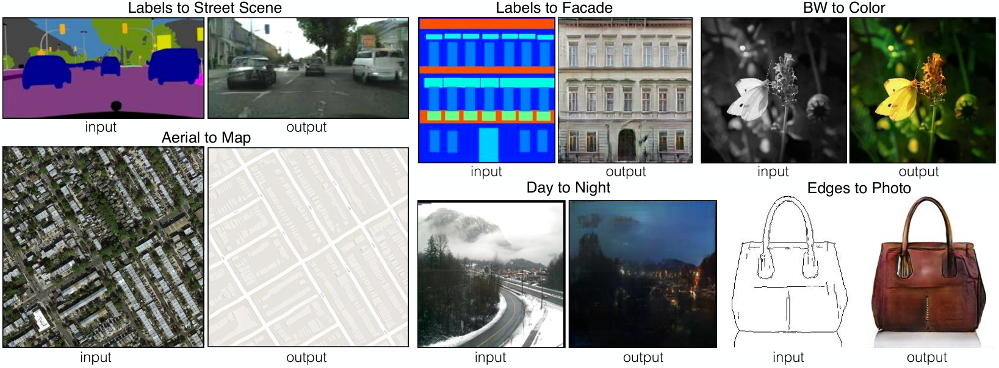

- El mismo modelo, entrenado con distintos datos: de etiquetas a una calle, de foto aérea a mapa, de día a noche, de boceto a foto, de blanco y negro a color.

**CycleGAN: aprende sin pares, y para muchas tareas no hay pares disponibles**

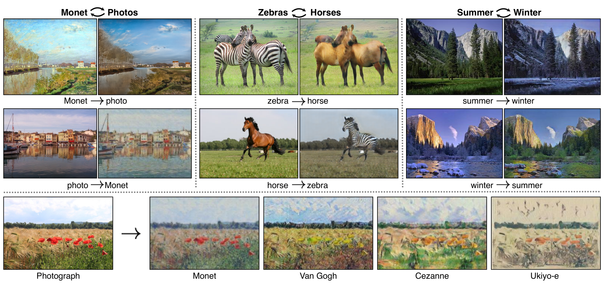

- De caballo a cebra y de cebra a caballo, de foto a pintura de Monet, de verano a invierno, a partir de dos colecciones de imágenes sueltas.


### Sources

- Isola et al. (2017), figura 1 (arxiv.org/abs/1611.07004), y Zhu et al. (2017), figura 1 (arxiv.org/abs/1703.10593), vía ar5iv.
- `AIG4B-Clase-8-GANs.md.md` (slide 44)
- `cyclegan-zhu-2017.web.md` (la traducción imagen a imagen usa pares alineados; para muchas tareas no hay datos apareados)
- `pix2pix-isola-2017.web.md` (cGAN de propósito general para traducción imagen a imagen)

### Speaker notes

### Presenter feedback

- [closed] 2026-10-21 — "Partilo en 2. Introducí y poné imágenes de qué son esas transformaciones para explicar. La tabla va en otro slide y poné links a las librerías."
  Resolution: 4.8 queda con la introducción y dos figuras de los papers (Pix2Pix, figura 1: pares alineados; CycleGAN, figura 1: sin pares), mismas frases del lead repartidas entre las dos. 4.9 nueva «Image Translation: modelos y librerías»: la tabla con una columna de links verificados (pytorch-CycleGAN-and-pix2pix, Real-ESRGAN, DeOldify archivado, paper de Wolterink 2017) y la frase de MRI → CT. 4.9–4.11 pasan a 4.10–4.12.

- [closed] 2026-10-17 — "Revisá y reformulá en el draft que la audiencia no es biomédica sino ingenieros. Revisá si los ejemplos son relevantes todavía."
  Resolution: Lead reescrito: la traducción imagen a imagen como técnica general, con el criterio Pix2Pix (pares alineados) frente a CycleGAN (sin pares); MRI→CT queda como el ejemplo médico, con los mismos hechos. Fuentes: cyclegan-zhu-2017, pix2pix-isola-2017.
- [closed] 2026-10-17 — "Aplicar los reemplazos ★ del editor solo con fuentes del corpus (Salimans 2016 en 1.3 y 4.8; en 4.7 solo la TC de baja dosis); corregir el crédito de Slanted Land y día→noche (Pix2Pix); deepfakes a Open questions."
  Resolution: Fila «Foto de día → noche»: el modelo pasa de CycleGAN a Pix2Pix.

---

## 9. Image Translation: modelos y librerías

<!-- segunda mitad de la slide 44 del pptx: la tabla, con links -->

### Content

En medicina, la misma técnica convierte MRI en CT sin escanear dos veces al paciente, lo que reduce costes, tiempo y exposición a radiación.

| Input | Output | Modelo | Librería o referencia |
|---|---|---|---|
| Boceto de un edificio | Foto del edificio terminado | Pix2Pix | [pytorch-CycleGAN-and-pix2pix](https://github.com/junyanz/pytorch-CycleGAN-and-pix2pix) |
| Foto de día | La misma foto de noche | Pix2Pix | [pytorch-CycleGAN-and-pix2pix](https://github.com/junyanz/pytorch-CycleGAN-and-pix2pix) |
| Imagen de un caballo | La misma imagen con una cebra | CycleGAN | [pytorch-CycleGAN-and-pix2pix](https://github.com/junyanz/pytorch-CycleGAN-and-pix2pix) |
| Imagen de baja resolución | Alta resolución (super-resolución) | SRGAN | [Real-ESRGAN](https://github.com/xinntao/Real-ESRGAN), sucesor práctico de SRGAN |
| Imagen en blanco y negro | La misma imagen en color | DeOldify / CycleGAN | [DeOldify](https://github.com/jantic/DeOldify) (archivado en 2024) |
| MRI de cerebro | Imagen equivalente de CT | CycleGAN médico | [Wolterink et al., 2017](https://arxiv.org/abs/1708.01155) (paper) |

### Sources

- `AIG4B-Clase-8-GANs.md.md` (slide 44): la tabla.
- `cyclegan-zhu-2017.web.md` (repositorio de código: github.com/junyanz/pytorch-CycleGAN-and-pix2pix, el mismo para Pix2Pix y CycleGAN)
- Repositorios verificados el 2026-10-21: Real-ESRGAN (github.com/xinntao/Real-ESRGAN, extiende ESRGAN) y DeOldify (github.com/jantic/DeOldify, archivado el 19 de octubre de 2024). Fuentes web.
- Wolterink et al. (2017), *Deep MR to CT Synthesis using Unpaired Data* (arxiv.org/abs/1708.01155): GAN con consistencia de ciclo, sin pares. Fuente web.

### Speaker notes

Los links son para que los alumnos lo prueben: el repositorio de Pix2Pix y CycleGAN trae datasets y modelos preentrenados (caballo ↔ cebra, día ↔ noche). Real-ESRGAN es lo que se usa hoy para ampliar fotos; DeOldify sigue funcionando pero ya no se mantiene.

### Presenter feedback

---

## 10. Fortaleza 3: Completado de imágenes (Image Inpainting)

<!-- slide 45 del pptx original -->

### Content

- Las GANs pueden reconstruir regiones faltantes de forma coherente con el contexto. La red recibe una imagen con una región enmascarada e infiere el contenido más probable basándose en colores, texturas y estructuras adyacentes. No copia píxeles cercanos — entiende el contenido semántico de la escena completa.

- **En la imagen:** a la izquierda, la foto con zonas borradas en blanco; a la derecha, lo que completó la GAN, sin retoques (DeepFill, Yu et al., 2018).

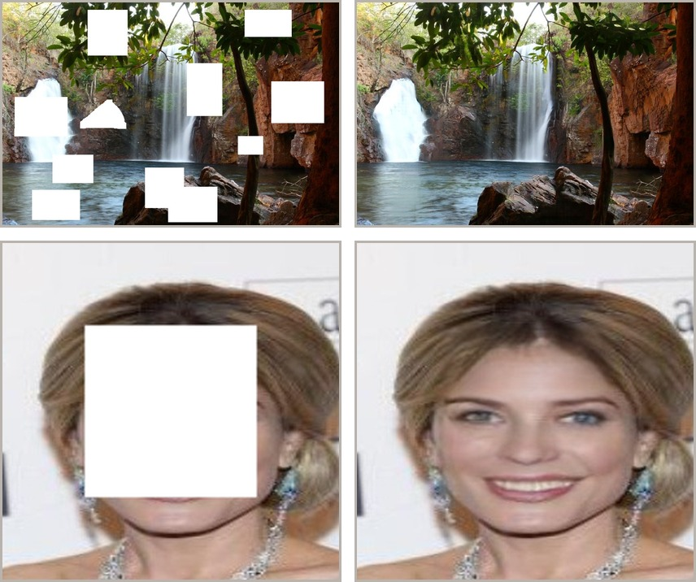

- **Tomografías con dosis reducida**

- Recupera la información sacrificada en protocolos de baja radiación, protegiendo al paciente sin perder calidad diagnóstica.

### Sources

- Yu et al. (2018), *Generative Image Inpainting with Contextual Attention* (DeepFill), figura 1 (arxiv.org/abs/1801.07892), vía ar5iv: se entrena con dos discriminadores WGAN, uno para la imagen entera y otro para la zona completada. Fuente web, no está en el corpus.
- `AIG4B-Clase-8-GANs.md.md` (slide 45)

### Speaker notes

### Presenter feedback

- [closed] 2026-10-21 — "En Fortaleza 3 cambiá la imagen del costado por un ejemplo que muestre esto."
  Resolution: La cruz médica decorativa (slide-45-1.png) sale; entra inpainting-deepfill.jpg, armada con dos pares de la figura 1 de DeepFill (Yu et al., 2018): paisaje y retrato con zonas borradas y el resultado de la GAN. Línea nueva «En la imagen: …»; diseño split-right para que se vea grande.

- [closed] 2026-10-17 — "Aplicar los reemplazos ★ del editor solo con fuentes del corpus (Salimans 2016 en 1.3 y 4.8; en 4.7 solo la TC de baja dosis); corregir el crédito de Slanted Land y día→noche (Pix2Pix); deepfakes a Open questions."
  Resolution: Quitada la tabla de artefactos de MRI y biopsias; queda solo el caso de tomografías con dosis reducida. Texto original en Cut material.

---

## 11. El dataset importa: lo que le das es lo que obtenés

<!-- slide 47 del pptx original -->

### Content

- Una GAN solo puede generar lo que aprendió. Si el dataset mezcla clases sin etiquetas, el Generador produce híbridos incoherentes, inútiles para entrenar clasificadores. Cada clase del dataset tiene que ser homogénea, o hace falta una Conditional GAN.

| Tipo de dataset | Lo que genera la GAN |
|---|---|
| Solo imágenes de gatos | Gatos variados y realistas ✓ |
| Solo imágenes de perros | Perros variados y realistas ✓ |
| Gatos + perros sin etiqueta | Híbridos incoherentes ✗ |
| Gatos + perros con etiqueta (cGAN) | Puede generar cada clase por separado ✓ |

- Antes de entrenar hay que validar el dataset como cualquier entrada de un pipeline de datos: limpio, bien etiquetado y homogéneo dentro de cada clase.

### Sources

- `AIG4B-Clase-8-GANs.md.md` (slide 47)

### Speaker notes

### Presenter feedback

- [closed] 2026-10-17 — "Revisá y reformulá en el draft que la audiencia no es biomédica sino ingenieros. Revisá si los ejemplos son relevantes todavía."
  Resolution: Quitados «En Biomedicina» y «En aplicaciones médicas reales»: la regla de homogeneidad por clase vale para cualquier dataset, y el consejo final queda impersonal, como validación de una entrada de un pipeline de datos. Tabla gatos/perros sin cambios.

---

# 5. Limitaciones y cierre

**Goal of this section:**

**Presenter feedback:**

- [closed] 2026-10-21 (editor, pedido del presentador) — Cierre: «Cuatro capacidades concretas (generar, traducir y completar imágenes, y ampliar datasets)» → «Tres capacidades concretas (generar, traducir y completar imágenes)», porque la Fortaleza 4 (datos sintéticos) se borró.

---

## 1. Limitaciones (1 de 2): los problemas de entrenamiento

<!-- slide 49 del pptx original -->

### Content


<!-- original vectorial: research/corpus/AIG4B-Clase-8-GANs.md/images/slide-49-2.svg -->

<!-- original vectorial: research/corpus/AIG4B-Clase-8-GANs.md/images/slide-49-3.svg -->

| Mode Collapse — el más común y frustrante | Inestabilidad en el entrenamiento |
|---|---|
| El Generador descubre un "truco": produce siempre el mismo tipo de imagen que engaña al Discriminador, en lugar de aprender toda la variedad posible.<br>Analogía: el falsificador que solo falsifica un tipo de billete. Con MNIST, una GAN colapsada genera siempre el mismo dígito, y ese dataset sintético no sirve para entrenar un clasificador de los diez. | El balance entre Generador y Discriminador es frágil. Si el Discriminador es demasiado bueno, el Generador no recibe señal útil y el gradiente "desaparece". Si el Discriminador es demasiado malo, el Generador aprende trucos baratos en lugar de aprender la distribución real. |

### Sources

- `AIG4B-Clase-8-GANs.md.md` (slide 49)
- Ejemplo de MNIST: conocimiento general (el corpus no define mode collapse; ver `inception-score-salimans-2016.web.md` → *Inconsistencies*)

### Speaker notes

### Presenter feedback

- [closed] 2026-10-17 — "Aplicar los reemplazos ★ del editor solo con fuentes del corpus (Salimans 2016 en 1.3 y 4.8; en 4.7 solo la TC de baja dosis); corregir el crédito de Slanted Land y día→noche (Pix2Pix); deepfakes a Open questions."
  Resolution: Mode collapse: el ejemplo de tumores pasa a una GAN de MNIST que genera siempre el mismo dígito y no sirve como dataset para un clasificador de diez clases (conocimiento general). Texto original en Cut material.

---

## 2. Limitaciones (2 de 2): evaluación, coste y sesgo

<!-- slide 50 del pptx original -->

### Content


| Dificultad para evaluar la calidad | Alta demanda computacional | Sesgo heredado del dataset |
|---|---|---|
| No existe una métrica universal. Las más usadas — FID e Inception Score (IS) — son aproximaciones imperfectas que no reemplazan la evaluación humana experta. | Entrenar una GAN de calidad requiere GPUs potentes, datasets grandes y horas o días de entrenamiento. Una barrera real para equipos con recursos limitados. | Si los datos tienen sesgos — subrepresentación de grupos demográficos o patologías concretas — las imágenes generadas van a heredar y amplificar esos sesgos. |

### Sources

- `AIG4B-Clase-8-GANs.md.md` (slide 50)

### Speaker notes

### Presenter feedback

---

## 3. Cierre: lo que aprendimos y lo que sigue

<!-- slide 51 del pptx original -->

### Content

- **En este capítulo construimos la comprensión de las GANs desde cero, siguiendo una narrativa completa:**

| 01 | 02 | 03 |
|---|---|---|
| La intuición | La arquitectura | El entrenamiento |
| El falsificador y el detective, compitiendo para mejorar mutuamente. | Generador y Discriminador como implementación técnica de esa intuición. | El ciclo de cinco pasos que hace converger al sistema, con el ejemplo de Slanted Land. |

| 04 | 05 |
|---|---|
| La lógica matemática | Fortalezas y limitaciones |
| El juego minimax como marco conceptual, binary cross-entropy y backpropagation. | Tres capacidades concretas (generar, traducir y completar imágenes) y los problemas a resolver antes de usar GANs en producción. |

### Sources

- `AIG4B-Clase-8-GANs.md.md` (slide 51)

### Speaker notes

### Presenter feedback

- [closed] 2026-10-17 — "Revisá y reformulá en el draft que la audiencia no es biomédica sino ingenieros. Revisá si los ejemplos son relevantes todavía."
  Resolution: Celda 05 sin «en Biomedicina»: nombra las cuatro capacidades (generar, traducir y completar imágenes, y ampliar datasets); «los problemas reales» pasa a «los problemas a resolver».

---

## 4. Práctica: entrenar una GAN

<!-- slide nueva, no está en el pptx: pedido del presentador (2026-10-21) -->

### Content

El repositorio pytorch-gans implementa en PyTorch las tres GANs de la clase. Escaneen el QR y sigan la sección Training:

- **Vanilla GAN:** python train_vanilla_gan.py: entrena con MNIST, que se descarga solo.
- **Conditional GAN:** python train_cgan.py: genera el dígito que le piden, del 0 al 9.
- **DCGAN:** python train_dcgan.py: entrena con caras de CelebA.
- **Link:** github.com/gordicaleksa/pytorch-gans#training

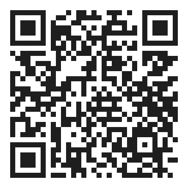

### Sources

- Gordić, *pytorch-gans* (github.com/gordicaleksa/pytorch-gans), sección Training: Vanilla GAN, cGAN y DCGAN en PyTorch, licencia MIT. Verificado el 2026-10-21. Fuente web, no está en el corpus.
- Código QR generado con segno (images/qr-pytorch-gans.svg).

### Speaker notes

Es la práctica de la clase. El repositorio es de Aleksa Gordić, con licencia MIT. Cada script guarda checkpoints en models/checkpoints, el modelo final en models/binaries, imágenes de prueba en data/debug_imagery y los logs de TensorBoard en runs, así que se puede ver cómo mejora el Generador durante el entrenamiento. El tamaño del lote se ajusta con --batch_size según la memoria de la GPU. La Vanilla GAN con MNIST es la que arranca más rápido y la más parecida a Slanted Land.

### Presenter feedback

- [closed] 2026-10-21 — "Agregar como último slide, con un código QR: https://github.com/gordicaleksa/pytorch-gans#training. Práctica."
  Resolution: Slide nueva al final, después del cierre: los tres scripts de entrenamiento del repo (Vanilla GAN, cGAN, DCGAN) y un QR al link (segno). Repo verificado: implementa las tres, licencia MIT.

---

# Open questions

- Tesis y objetivo de cada sección quedaron vacíos: el deck original no los declara.
- Ver `research/corpus/AIG4B-Clase-8-GANs.md.md` → *Inconsistencies / open questions* para los problemas detectados en el material original.
- Idea pendiente (2026-10-17): una tarjeta sobre deepfakes como riesgo de seguridad y su detección (p. ej. FaceForensics++, Rössler et al., 2019). No está en el corpus, así que necesita una captura antes de entrar al deck.
- 1.4 «Los modelos que veremos en el curso» describe el plan del curso original (GANs, Diffusion, SAM). Confirmar si esta materia cubre SAM.

# Cut material

#### 4.11 Fortaleza 4: Generación de datos sintéticos para entrenamiento (slide 46 del pptx)

Motivo: el presentador la sacó (2026-10-21).

<!-- slide 46 del pptx original -->

### Content

**El cuello de botella: los datos de entrenamiento**

**La solución con GANs**

- **Entrenar con las pocas imágenes reales disponibles y generar miles de imágenes sintéticas adicionales para ampliar el dataset.**

- **Casos raros → pocos ejemplos documentados. Datos personales o de pacientes → protegidos por regulaciones estrictas. Etiquetado → requiere especialistas, es caro y lento.**

- **Salimans et al. (2016) entrenaron una GAN junto con un clasificador que tenía pocas etiquetas. Con ese método alcanzaron el estado del arte en clasificación semi-supervisada en MNIST, CIFAR-10 y SVHN.**

### Sources

- `AIG4B-Clase-8-GANs.md.md` (slide 46)
- `inception-score-salimans-2016.web.md` (aprendizaje semi-supervisado con GANs: estado del arte en MNIST, CIFAR-10 y SVHN)

### Speaker notes

Aprendizaje semi-supervisado significa entrenar con pocas etiquetas y muchos datos sin etiquetar. Ataca el costo de etiquetar: etiquetar cuesta horas de especialistas, y las imágenes sin etiquetar sobran. Salimans et al. (2016) lo atacaron con una GAN y lograron el estado del arte en MNIST, CIFAR-10 y SVHN.

En el paper, el Discriminador funciona también como clasificador: además de las clases del dataset, aprende una clase extra para las imágenes que produce el Generador. Así, las imágenes generadas entran al entrenamiento del clasificador. Este mecanismo está en el cuerpo del paper (sección de aprendizaje semi-supervisado) y no en la captura del corpus, que solo tiene el abstract.


#### 4.4 StyleGAN: arquitectura (slide 41 del pptx) — versión anterior

Motivo: no se podía leer (2026-10-21). La imagen images/stylegan-arquitectura.svg, redibujo fiel de la figura del paper, se borró del deck.

**Dos redes en lugar de una**

- Caras fotorrealistas generadas por StyleGAN (NVIDIA, 2019)

- StyleGAN separa el proceso en dos redes:

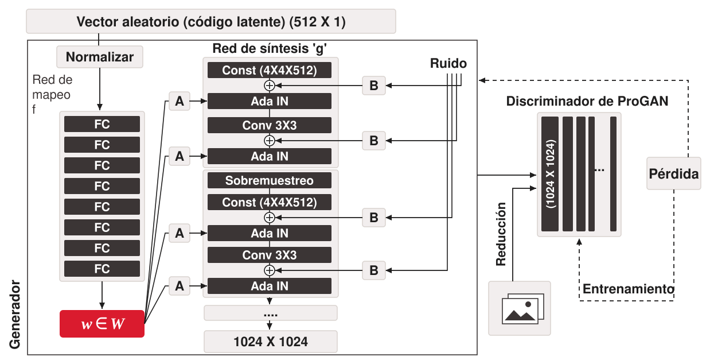

- Mapping Network: transforma el ruido z en un vector de estilo w (512 dimensiones)
- Synthesis Network: genera la imagen progresivamente, inyectando el estilo w en cada capa

- Esto permite controlar atributos separados en cada nivel de resolución: pose y forma en capas bajas, textura y color en capas altas.

- La clave: el estilo se inyecta en cada capa mediante AdaIN (Adaptive Instance Normalization), no solo al inicio. Esto da control granular sobre cada aspecto visual.


#### 3.19 El ciclo completo (slide 35 del pptx) — versión de un solo veredicto

Motivo: el presentador la encontró muy simplificada (2026-10-21); reemplazada por el diagrama de lotes. La imagen images/generador-y-discriminador.svg se borró.

**El ciclo completo: Generador y Discriminador juntos**

- Con z = 0.7, el Generador produce una imagen → el Discriminador la evalúa → output: 0.68. Este único número conecta los dos errores:

| Error del Discriminador | Error del Generador |
|---|---|
| Recibió 0.68 cuando quería dar 0 → se equivocó. Debe ajustar sus pesos para detectar mejor. | Recibió 0.68 cuando quería que diera 1 → casi lo engañó, pero no del todo. Debe ajustar para engañar más. |

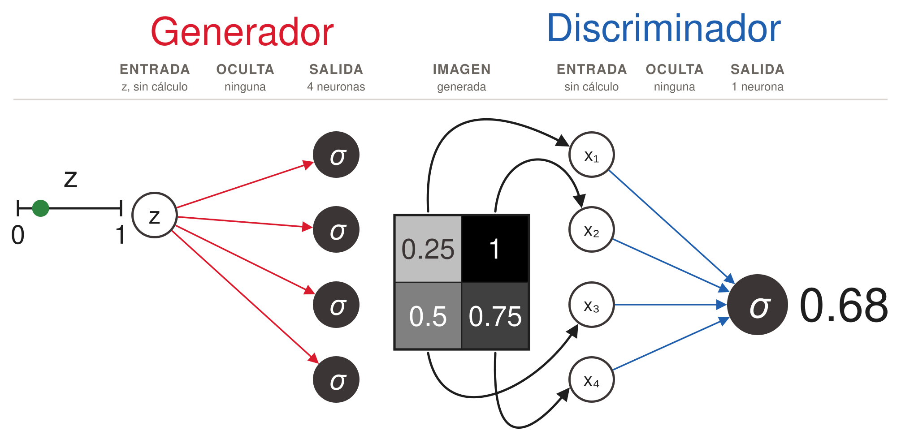


#### 3.17 Backpropagation: del error al ajuste de pesos (slide 32 del pptx)

Motivo: el presentador la sacó (2026-10-21). La imagen images/backprop-red.svg también se borró.

<!-- slide 32 del pptx original -->

### Content

- Una vez calculado el error, la red lo "propaga hacia atrás" para ajustar cada peso:


- Pesos con alta contribución al error → se ajustan más


- Pesos con baja contribución al error → se ajustan poco


- La dirección del ajuste apunta siempre a reducir el error

- Este proceso ocurre simultáneamente en el Generador y el Discriminador en cada iteración.

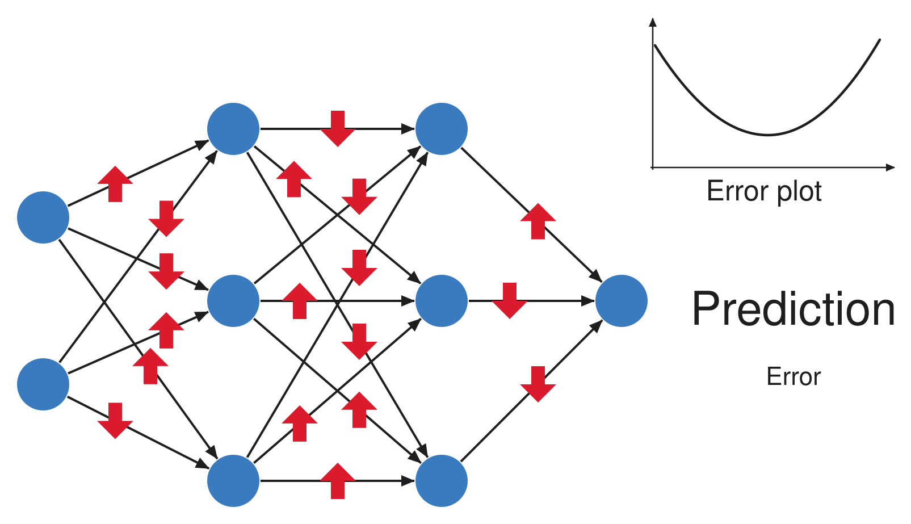

### Sources

- `AIG4B-Clase-8-GANs.md.md` (slide 32)
- Imagen redibujada como SVG (images/backprop-red.svg).

### Speaker notes

### Presenter feedback


#### 3.14 Binary cross-entropy: los dos casos (slide 30 del pptx) — tabla reemplazada por diagrama

Motivo: el presentador pidió mostrarlo con un diagrama simple (2026-10-21); los números están en images/bce-dos-casos.svg.

| Factor | Imagen real (objetivo 1) | Imagen falsa (objetivo 0) |
|---|---|---|
| Error | −ln(D(x)) | −ln(1 − D(G(z))) |
| Acierta | D = 0.9 → −ln(0.9) ≈ 0.1 | D = 0.1 → −ln(1 − 0.1) = −ln(0.9) ≈ 0.1 |
| Falla | D = 0.1 → −ln(0.1) ≈ 2.3 | D = 0.9 → −ln(1 − 0.9) = −ln(0.1) ≈ 2.3 |


#### 3.13 Proceso de Entrenamiento (slide 29 del pptx) — versión anterior

Motivo: los dos párrafos de arriba repetían la misma idea y la tabla repetía las fórmulas de 3.14; el presentador pidió explicarlo de otra manera (2026-10-21).

- En los slides anteriores definimos los pesos del Discriminador y el Generador a mano (pesos +1 y −1, y sesgos). En la práctica, la red debe aprender esos pesos sola. Para eso necesitamos una forma de medir cuánto se equivocó — esa es la función de error.
- Para que ambas redes aprendan, necesitamos medir exactamente cuánto se equivocaron. La función que hace eso en las GANs se llama log-loss (binary cross-entropy):

| Cuando queremos que la predicción sea 1 | Cuando queremos que la predicción sea 0 |
|---|---|
| Error = −ln(predicción)<br>Se usa cuando la imagen es real y el Discriminador debe acercarse a 1. | Error = −ln(1 − predicción)<br>Se usa cuando la imagen es falsa y el Discriminador debe acercarse a 0. |


### Importación (2026-10-17): slides del PPTX que el render regenera — portada (slide 1) y agenda repetida (slides 2, 9, 17, 38, 48); más el placeholder vacío de Conclusions

#### [sección] 0. Portada

**Goal of this section:** Apertura del deck original — portada y material previo a la primera sección.

**Presenter feedback:**

---

#### 1. Inteligencia Artificial Generativa Aplicada en Biomedicina

<!-- slide 1 del pptx original -->

### Content

**Clase 8: Vision Generativa /**

**Generative Adversarial Networks (GANs)**

- Autor: Paulo Veiga/Marcos Sanchez Sorondo
- Última Modificación: Abril, 2026

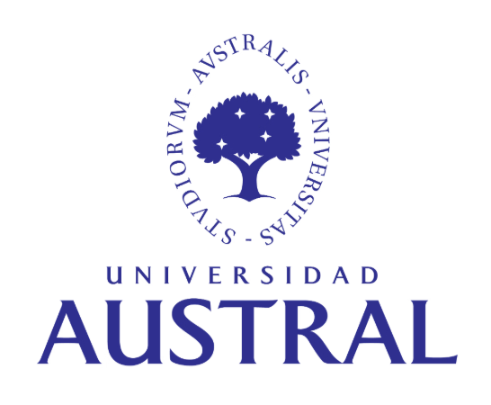

### Sources

- `AIG4B-Clase-8-GANs.md.md` (slide 1)

### Speaker notes

### Presenter feedback

---

#### 1. Panorama de la IA Generativa de Visión

<!-- slide 2 del pptx original -->

### Content

**1**

- **Panorama de la IA Generativa de Visión**

- IA discriminativa vs. generativa, línea de tiempo histórica y modelos del curso

**2**

- **Introducción a las GANs**

- Origen (Goodfellow 2014), intuición del falsificador y el detective, arquitectura básica

**3**

- **El Ejemplo de Slanted Land**

- De la intuición a los números: Discriminador, Generador y sus pesos

**4**

- **Tipos de GANs y Aplicaciones en Biomedicina**

- Vanilla GAN, StyleGAN, fortalezas clínicas y generación de datos sintéticos

**5**

- **Limitaciones y Cierre**

- Problemas de entrenamiento, evaluación, sesgo y próximos pasos

### Sources

- `AIG4B-Clase-8-GANs.md.md` (slide 2)

### Speaker notes

### Presenter feedback

---

#### 1. Introducción a las GANs

<!-- slide 9 del pptx original -->

### Content

**1**

**Panorama de la IA Generativa de Visión**

- IA discriminativa vs. generativa, línea de tiempo histórica y modelos del curso

**2**

**Introducción a las GANs**

- Origen (Goodfellow 2014), intuición del falsificador y el detective, arquitectura básica

**3**

**El Ejemplo de Slanted Land**

- De la intuición a los números: Discriminador, Generador y sus pesos

**4**

**Tipos de GANs y Aplicaciones en Biomedicina**

- Vanilla GAN, StyleGAN, fortalezas clínicas y generación de datos sintéticos

**5**

**Limitaciones y Cierre**

- Problemas de entrenamiento, evaluación, sesgo y próximos pasos

### Sources

- `AIG4B-Clase-8-GANs.md.md` (slide 9)

### Speaker notes

### Presenter feedback

---

#### 1. El Ejemplo de Slanted Land

<!-- slide 17 del pptx original -->

### Content

**1**

**Panorama de la IA Generativa de Visión**

- IA discriminativa vs. generativa, línea de tiempo histórica y modelos del curso

**2**

**Introducción a las GANs**

- Origen (Goodfellow 2014), intuición del falsificador y el detective, arquitectura básica

**3**

**El Ejemplo de Slanted Land**

- De la intuición a los números: Discriminador, Generador y sus pesos

**4**

**Tipos de GANs y Aplicaciones en Biomedicina**

- Vanilla GAN, StyleGAN, fortalezas clínicas y generación de datos sintéticos

**5**

**Limitaciones y Cierre**

- Problemas de entrenamiento, evaluación, sesgo y próximos pasos

### Sources

- `AIG4B-Clase-8-GANs.md.md` (slide 17)

### Speaker notes

### Presenter feedback

---

#### 1. Tipos de GANs y Aplicaciones en Biomedicina

<!-- slide 38 del pptx original -->

### Content

**1**

- **Panorama de la IA Generativa de Visión**

- IA discriminativa vs. generativa, línea de tiempo histórica y modelos del curso

**2**

- **Introducción a las GANs**

- Origen (Goodfellow 2014), intuición del falsificador y el detective, arquitectura básica

**3**

- **El Ejemplo de Slanted Land**

- De la intuición a los números: Discriminador, Generador y sus pesos

**4**

- **Tipos de GANs y Aplicaciones en Biomedicina**

- Vanilla GAN, StyleGAN, fortalezas clínicas y generación de datos sintéticos

**5**

- **Limitaciones y Cierre**

- Problemas de entrenamiento, evaluación, sesgo y próximos pasos

### Sources

- `AIG4B-Clase-8-GANs.md.md` (slide 38)

### Speaker notes

### Presenter feedback

---

#### 1. Limitaciones y Cierre

<!-- slide 48 del pptx original -->

### Content

**1**

**Panorama de la IA Generativa de Visión**

- IA discriminativa vs. generativa, línea de tiempo histórica y modelos del curso

**2**

**Introducción a las GANs**

- Origen (Goodfellow 2014), intuición del falsificador y el detective, arquitectura básica

**3**

**El Ejemplo de Slanted Land**

- De la intuición a los números: Discriminador, Generador y sus pesos

**4**

**Tipos de GANs y Aplicaciones en Biomedicina**

- Vanilla GAN, StyleGAN, fortalezas clínicas y generación de datos sintéticos

**5**

**Limitaciones y Cierre**

- Problemas de entrenamiento, evaluación, sesgo y próximos pasos

### Sources

- `AIG4B-Clase-8-GANs.md.md` (slide 48)

### Speaker notes

### Presenter feedback

---

#### [sección] Conclusions

#### 1. Key takeaways

### Content

### Sources

- `AIG4B-Clase-8-GANs.md.md`

### Speaker notes

### Presenter feedback

- [open] 2026-08-14 — "El deck original no tiene slide de cierre; hay que escribirla."

---

### Revisión (2026-10-17): texto original de 3.10 y 3.13 reemplazado por la opción A del editor

#### 3.10 (sin título) — Construyendo el Generador / El objetivo opuesto (slide 27 del pptx)

Motivo: reescrita como tabla D vs G; la figura era del Discriminador (inconsistencia #4 del corpus).

**Construyendo el Generador**

**El objetivo opuesto**

- El Generador recibe un número aleatorio z (entre 0 y 1 — el "ruido latente") y tiene que producir una imagen de 2×2 píxeles. Su objetivo: producir imágenes que el Discriminador clasifique como reales (output cercano a 1).
- La estructura es la inversa del Discriminador: de 1 número → 4 píxeles. En redes reales, esto se implementa con capas de upsampling y convoluciones transpuestas.

Imagen quitada: `research/corpus/AIG4B-Clase-8-GANs.md/images/slide-27-1.png`

#### 3.13 Log-loss: los dos casos (slide 30 del pptx)

Motivo: la columna «Label = 0» atribuía el caso al Generador; las imágenes de fórmula rotulaban Error_G lo que 3.19 llama Error_D. Reescrita con fórmulas en texto.

| Label = 1 — Imagen Real | Label = 0 — Imagen Falsa |
|---|---|
| 🔍 Discriminador entrenando con imagen real. Debe acercarse a 1.<br>✅ Predicción = 0.9 → −ln(0.9) ≈ 0.1 → Error pequeño<br>❌ Predicción = 0.1 → −ln(0.1) ≈ 2.3 → Error enorme | 🎨 Generador entrenando: el Discriminador debe acercarse a 0 (detectar la imagen como falsa).<br>✅ Predicción = 0.1 → −ln(0.9) ≈ 0.1 → Error pequeño<br>❌ Predicción = 0.9 → −ln(0.1) ≈ 2.3 → Error enorme |

Imágenes quitadas: `research/corpus/AIG4B-Clase-8-GANs.md/images/slide-30-1.png` (Error_D = −ln(predicción)) y `research/corpus/AIG4B-Clase-8-GANs.md/images/slide-30-2.png` (Error_G = −ln(1 − predicción))

#### 3.12 Proceso de Entrenamiento — bullet duplicado (slide 29 del pptx)

Motivo: idéntico al takeaway de 3.13, que se conserva.

- La propiedad clave: el error es grande cuando la predicción está lejos del objetivo, y pequeño cuando está cerca. Esto guía el aprendizaje en la dirección correcta.

---
### Revisión (2026-10-17): ejemplos biomédicos reemplazados por ejemplos con fuente en el corpus

Motivo: la audiencia es de Ingeniería de Software. El presentador eligió los reemplazos ★ del editor, solo con fuentes del corpus. Varias cifras quitadas no tenían estudio citado (corpus, inconsistencias #5 y #24).

#### 1.1 IA Generativa de Visión (slide 3 del pptx)

Motivo: la slide pasó a ser la definición; el anticipo de la sección en tres columnas sale.

| 01 | 02 | 03 |
|---|---|---|
| ¿Qué hace diferente a la IA generativa? | ¿Por qué importa en ingeniería? | ¿Qué modelos existen? |
| En qué se distingue conceptualmente de otros tipos de IA visual. | Qué problemas de datos resuelve al construir sistemas con modelos de visión. | Un mapa de GANs, Diffusion Networks y CNN — y cuándo usar cada uno. |

#### 1.2 ¿Qué es la IA Generativa de Visión? (slide 4 del pptx)

| Pregunta típica | "¿Esto es un tumor maligno o benigno?" | "Genera una imagen de un tumor maligno" |
| Ejemplo en medicina | Clasificador de histología | Generador de imágenes histológicas sintéticas |

#### 1.3 ¿Por qué importa en ingeniería? (slide entera, slide 5 del pptx)

Motivo: el presentador la sacó por no ser más relevante (2026-10-20).

<!-- slide 5 del pptx original -->

### Content

- **Entrenar un buen modelo de visión requiere miles, a veces decenas de miles, de imágenes etiquetadas. Conseguirlas choca con tres barreras que suelen aparecer juntas:**


| Escasez | Privacidad | Coste |
|---|---|---|
| Los casos raros (una enfermedad poco frecuente, una pieza defectuosa en una línea de producción) tienen tan pocos ejemplos documentados que no alcanzan para entrenar un modelo robusto. | Los datos de usuarios y de pacientes están protegidos por regulaciones estrictas: GDPR, HIPAA en salud y legislaciones locales limitan el acceso y la distribución. | Etiquetar imágenes requiere horas de especialistas del dominio, un recurso escaso y caro. |

- **Lo que la IA Generativa hace posible: aumentación de datos sintéticos, síntesis de casos raros, traducción entre modalidades (MRI→CT), anonimización que conserva el realismo de la imagen y restauración de imágenes con artefactos. Con una GAN, Salimans et al. (2016) entrenaron clasificadores con pocas etiquetas y alcanzaron el estado del arte semi-supervisado en MNIST, CIFAR-10 y SVHN.**

### Sources

- `AIG4B-Clase-8-GANs.md.md` (slide 5)
- `aws-que-es-una-gan.web.md` (casos de uso: generar datos de entrenamiento para otros modelos, completar información faltante)
- `inception-score-salimans-2016.web.md` (estado del arte en clasificación semi-supervisada en MNIST, CIFAR-10 y SVHN)

### Speaker notes

Las tres barreras son el problema de datos de cualquier modelo de visión que llega a producción. Un detector de defectos tiene miles de fotos de piezas buenas y muy pocas de piezas falladas. Un sistema que procesa fotos de usuarios carga con el GDPR. El etiquetado necesita gente que entienda el dominio, y esas horas cuestan. Una GAN ataca las tres barreras con el mismo recurso: genera datos de entrenamiento para otros modelos (aumento de datos) y completa información faltante, dos de los casos de uso que lista AWS.

El ejemplo de Salimans et al. muestra dónde se mide el beneficio de los datos generados: en el clasificador que se entrena con ellos. Su problema es el de la barrera de coste. Hay muchas imágenes sin etiquetar y pocas etiquetadas, y la GAN permite aprovechar las primeras. El detalle del mecanismo está en la sección 4, en la fortaleza de datos sintéticos.


#### 1.3 ¿Por qué importa en ingeniería? (slide 5 del pptx)

- Una U-Net entrenada combinando imágenes reales y sintéticas de MRI logró un Dice score de 0.9524 frente a 0.9459 entrenando solo con datos reales.

#### 1.6 Tabla comparativa rápida (slide 8 del pptx)

| Caso en biomedicina | Síntesis histológica, MRI→CT | Generación desde descripciones clínicas | Segmentación de tumores, órganos, células |

#### 3.1 El Problema: ¡Bienvenidos a Slanted Land! (slide 18 del pptx)

Motivo: atribución equivocada; el video es de Luis Serrano (corpus, inconsistencia #1).

- [Basado en el tutorial de Rowel Atienza — ver video:](https://www.youtube.com/watch?v=8L11aMN5KY8&t=16s)

#### 4.1 Tipos de GANs: el punto de partida (slide 39 del pptx)

- "Genera una imagen histológica de carcinoma ductal." Uso: síntesis por clase (por ejemplo, por patología) y aumentación controlada.

#### 4.5 Fortaleza 1 (slide 43 del pptx)

**Imágenes médicas sintéticas**

- GANs entrenadas con resonancias magnéticas generan imágenes de cerebro que neurorradiólogos no pueden distinguir de las reales en estudios ciegos.

#### 4.6 Fortaleza 2 (slide 44 del pptx)

| Foto de día | La misma foto de noche | CycleGAN |

#### 4.7 Fortaleza 3 (slide 45 del pptx)

| Artefactos de movimiento en MRI | Biopsias con burbujas o pliegues |
|---|---|
| Reconstruye la imagen original estimada eliminando las distorsiones causadas por el movimiento del paciente durante la adquisición. | Completa el tejido faltante en preparaciones histológicas con defectos de proceso o manipulación. |

#### 4.8 Fortaleza 4 (slide 46 del pptx)

Motivo adicional del bonus: sin respaldo en el corpus y discutible, porque una GAN puede memorizar muestras del entrenamiento.

- **Una GAN entrenada con biopsias histológicas de tumores de mama generó imágenes indistinguibles de las reales para patólogos. Combinando datos reales y sintéticos, la precisión del clasificador mejoró un 30%.**
- **Bonus: los datos sintéticos no corresponden a ningún paciente real → no están sujetos a restricciones de privacidad (HIPAA, GDPR).**

#### 5.1 Limitaciones (1 de 2) (slide 49 del pptx)

- En medicina: una GAN para síntesis de tumores que solo genera un tipo de morfología produce datos sintéticos inútiles.

---
