# Thesis

**Claim:**

**Why it matters:**

---

# Agenda

**Narrative arc:**

**Sections (in delivery order):**

- 1. IA generativa de visión
- 2. Introducción a las GANs
- 3. Slanted Land
- 4. Tipos y aplicaciones
- 5. Limitaciones y cierre

---

# 1. IA generativa de visión

**Goal of this section:**

---

## 1. IA Generativa de Visión

<!-- slide 3 del pptx original -->

### Content

| 01 | 02 | 03 |
|---|---|---|
| ¿Qué hace diferente a la IA generativa? | ¿Por qué importa en ingeniería? | ¿Qué modelos existen? |
| En qué se distingue conceptualmente de otros tipos de IA visual. | Qué problemas de datos resuelve al construir sistemas con modelos de visión. | Un mapa de GANs, Diffusion Networks y CNN — y cuándo usar cada uno. |

### Sources

- `AIG4B-Clase-8-GANs.md.md` (slide 3)

### Speaker notes

---

## 2. ¿Qué es la IA Generativa de Visión?

<!-- slide 4 del pptx original -->

### Content

- **La IA visual se diseñó primero para analizar imágenes que ya existen: clasificarlas, detectar objetos o medir estructuras. Eso es la IA discriminativa, que aprende a distinguir entre categorías. La IA generativa aprende a crear contenido visual que no existía antes.**

| Aspecto | IA Discriminativa | IA Generativa |
|---|---|---|
| ¿Qué hace? | Analiza y clasifica lo que ya existe | Crea contenido nuevo que no existía |
| Pregunta típica | "¿Este dígito es un 7?" | "Genera un 7" |
| Lo que aprende | A distinguir entre categorías | La estructura interna de los datos |
| Salida | Una etiqueta o un número | Una imagen, un sonido, un texto |
| Ejemplo | Clasificador de dígitos de MNIST | cGAN que genera el dígito pedido |

### Sources

- `AIG4B-Clase-8-GANs.md.md` (slide 4)
- `cgan-mirza-osindero-2014.web.md` (generación de dígitos MNIST condicionada por etiqueta de clase)

### Speaker notes

---

## 3. ¿Por qué importa en ingeniería?

<!-- slide 5 del pptx original -->

### Content

- **Entrenar un buen modelo de visión requiere miles, a veces decenas de miles, de imágenes etiquetadas. Conseguirlas choca con tres barreras que suelen aparecer juntas:**

| Escasez | Privacidad | Coste |
|---|---|---|
| Los casos raros (una enfermedad poco frecuente, una pieza defectuosa en una línea de producción) tienen tan pocos ejemplos documentados que no alcanzan para entrenar un modelo robusto. | Los datos de usuarios y de pacientes están protegidos por regulaciones estrictas: GDPR, HIPAA en salud y legislaciones locales limitan el acceso y la distribución. | Etiquetar imágenes requiere horas de especialistas del dominio, un recurso escaso y caro. |

- **Lo que la IA Generativa hace posible: aumentación de datos sintéticos, síntesis de casos raros, traducción entre modalidades (MRI→CT), anonimización que conserva el realismo de la imagen y restauración de imágenes con artefactos. Con una GAN, Salimans et al. (2016) entrenaron clasificadores con pocas etiquetas y alcanzaron el estado del arte semi-supervisado en MNIST, CIFAR-10 y SVHN.**

### Sources

- `AIG4B-Clase-8-GANs.md.md` (slide 5)
- `aws-que-es-una-gan.web.md` (casos de uso: generar datos de entrenamiento para otros modelos, completar información faltante)
- `inception-score-salimans-2016.web.md` (estado del arte en clasificación semi-supervisada en MNIST, CIFAR-10 y SVHN)

### Speaker notes

Las tres barreras son el problema de datos de cualquier modelo de visión que llega a producción. Un detector de defectos tiene miles de fotos de piezas buenas y muy pocas de piezas falladas. Un sistema que procesa fotos de usuarios carga con el GDPR. El etiquetado necesita gente que entienda el dominio, y esas horas cuestan. Una GAN ataca las tres barreras con el mismo recurso: genera datos de entrenamiento para otros modelos (aumento de datos) y completa información faltante, dos de los casos de uso que lista AWS.

El ejemplo de Salimans et al. muestra dónde se mide el beneficio de los datos generados: en el clasificador que se entrena con ellos. Su problema es el de la barrera de coste. Hay muchas imágenes sin etiquetar y pocas etiquetadas, y la GAN permite aprovechar las primeras. El detalle del mecanismo está en la sección 4, en la fortaleza de datos sintéticos.

---

## 4. Línea de tiempo: el camino hasta hoy

<!-- slide 6 del pptx original -->

### Content

- Tres eras, un campo en aceleración constante. Este curso arranca con el hito más influyente de la segunda era.

**1**

- **Era Estadística · 1950s–2000s**

- Redes neuronales, backpropagation. Resultados prometedores en teoría, pero muy limitados visualmente en la práctica.

**2**

- **Era de las GANs · 2014–2020**

- Ian Goodfellow publica la GAN original. Primera generación fotorrealista de imágenes. El campo explota en variantes y aplicaciones.

- **Era de la Difusión · 2020–hoy**

**3**

- DALL·E, Stable Diffusion, Midjourney. Control por texto, generación de vídeo, modelos de base masivos.

**4**

- **SAM & Modelos de Segmentación · 2023–hoy**

- Meta lanza Segment Anything Model (SAM). Segmentación interactiva de cualquier objeto en cualquier imagen. Prompteable con puntos, cajas o máscaras — sin reentrenamiento.

- Este curso empieza con el hito más influyente de la segunda era: las Generative Adversarial Networks.

### Sources

- `AIG4B-Clase-8-GANs.md.md` (slide 6)

### Speaker notes

---

## 5. Los modelos que veremos en el curso

<!-- slide 7 del pptx original -->

### Content

- Tres familias de redes — tres bloques temáticos dedicados. Cada modelo responde una pregunta diferente: al final del curso, sabremos cuándo usar cada uno.

<!-- original vectorial: research/corpus/AIG4B-Clase-8-GANs.md/images/slide-07-1.svg -->

<!-- original vectorial: research/corpus/AIG4B-Clase-8-GANs.md/images/slide-07-2.svg -->

<!-- original vectorial: research/corpus/AIG4B-Clase-8-GANs.md/images/slide-07-3.svg -->

**GANs — Generative Adversarial Networks**

**Diffusion Networks**

**CNN — Redes neuronales convolucionales**

- Aprenden a reconstruir una imagen desde el ruido, paso a paso. Motor de Stable Diffusion, DALL·E y Midjourney.
- Pregunta: ¿Cómo generar imágenes diversas y controlables a partir de una descripción?

- Dos redes que compiten: una genera, la otra evalúa. Motor de los deepfakes, de StyleGAN y de la generación de datos sintéticos (imágenes médicas, entre otras).
- Pregunta: ¿Cómo generar imágenes realistas que "engañen" a un evaluador?

- No generan imágenes — las analizan. Aprenden filtros que detectan bordes, texturas y formas, y los combinan capa a capa. Son la base del Discriminador de una GAN como DCGAN.
- Pregunta: ¿Cómo reconoce una red qué hay en una imagen?

### Sources

- `AIG4B-Clase-8-GANs.md.md` (slide 7)
- `dcgan-radford-2015.web.md` (las CNN en visión supervisada y como base de DCGAN). El resto de la descripción de CNN es redacción de la cátedra (reemplaza a SAM a pedido del presentador, 2026-10-17: el curso ve CNN en la clase 12).

### Speaker notes

---

## 6. Tabla comparativa rápida

<!-- slide 8 del pptx original -->

### Content

- Esta tabla no es para memorizar — es para consultar cuando tengas un problema real y necesites decidir qué herramienta usar.

| Criterio | GANs | Diffusion Networks | CNN |
|---|---|---|---|
| ¿Para qué sirve? | Generar imágenes realistas, transformar modalidades, aumentar datos | Generar imágenes desde texto o guías visuales con alta diversidad | Reconocer qué hay en una imagen: clasificar, detectar y segmentar |
| Velocidad | Muy rápida (una pasada) | Lenta (muchos pasos iterativos) | Muy rápida |
| Control | Moderado | Alto (guiado por texto) | No aplica (no genera contenido) |
| Fortaleza | Velocidad + realismo | Diversidad + controlabilidad | Detectar patrones locales con pocos parámetros (filtros compartidos) |
| Limitación | Inestabilidad, mode collapse | Lento, costoso computacionalmente | No genera contenido nuevo |
| Caso de uso típico | Super-resolución (SRGAN), traducción de imágenes (Pix2Pix, CycleGAN) | Imágenes desde texto (Stable Diffusion, DALL·E, Midjourney) | Clasificación de imágenes, detección de objetos; Discriminador de DCGAN |

### Sources

- `AIG4B-Clase-8-GANs.md.md` (slide 8; Stable Diffusion, DALL·E y Midjourney como motores de difusión, slides 6–7)
- `srgan-ledig-2017.web.md`, `pix2pix-isola-2017.web.md`, `cyclegan-zhu-2017.web.md` (casos de las GANs)
- `dcgan-radford-2015.web.md` (CNN como base de DCGAN). Columna CNN redactada por la cátedra (reemplaza a SAM a pedido del presentador, 2026-10-17).

### Speaker notes

---

# 2. Introducción a las GANs

**Goal of this section:**

---

## 1. Generative Adversarial Networks (GANs)

<!-- slide 10 del pptx original -->

### Content

### Sources

- `AIG4B-Clase-8-GANs.md.md` (slide 10)

### Speaker notes

---

## 2. Punto de partida

<!-- slide 11 del pptx original -->

### Content

- **"¿Cómo enseñarle a una máquina a crear algo que nunca ha visto?"**

- **Esta es la pregunta que Ian Goodfellow se hizo en 2014. La respuesta que encontró cambió el campo de la inteligencia artificial para siempre y puso en marcha una de las líneas de investigación más prolíficas de la historia de la IA.**

| La idea central | El recorrido de este capítulo |
|---|---|
| En lugar de enseñarle a una red a crear directamente, haz que compita contra otra red que aprende a detectar sus errores. La presión de la competencia hace que ambas mejoren continuamente. | De dónde vienen las GANs y cómo evolucionaron Cómo funcionan por dentro — sin fórmulas, con intuición Para qué sirven y dónde tienen límites Dónde se aplican: productos visuales, datos sintéticos e imágenes médicas |

### Sources

- `AIG4B-Clase-8-GANs.md.md` (slide 11)

### Speaker notes

---

## 3. El origen: una noche en un bar (2014)

<!-- slide 12 del pptx original -->

### Content

- Montreal, junio de 2014. Ian Goodfellow, 27 años, propone en una conversación de bar una idea aparentemente simple: ¿y si en lugar de una sola red, usamos dos? Una que genera, otra que evalúa. Que compitan.
- Sus colegas son escépticos. Esa misma noche implementa el prototipo. Funciona en el primer intento.

**70K+**

**Citas del paper original**

- "La idea más interesante en machine learning en los últimos 20 años." — Yann LeCun

### Sources

- `AIG4B-Clase-8-GANs.md.md` (slide 12)

### Speaker notes

---

## 4. Modelo Mental Para Entenderlo

<!-- slide 13 del pptx original -->

### Content

- **Un experimento mental: el mundo de los rostros. Imaginad una sociedad donde existen miles de rostros reales con características reconocibles. En esa sociedad aparecen dos personajes con objetivos opuestos:**

| El Falsificador | El Detective |
|---|---|
| Objetivo: crear rostros que parezcan pertenecer a ese mundo. Método: prueba y error. Genera un rostro, recibe feedback, ajusta, repite. Puede estudiar todos los rostros reales que quiera, pero no sabe cómo se fabrican. | Objetivo: distinguir los rostros reales de los falsos. Ventaja: ve ambos tipos — los reales del dataset y los que produce el falsificador. Como el falsificador mejora constantemente, él también tiene que mejorar. |

- **¿Qué pasa cuando estos dos compiten durante miles — o millones — de rondas? Los dos se vuelven extraordinariamente buenos en lo suyo.**

### Sources

- `AIG4B-Clase-8-GANs.md.md` (slide 13)

### Speaker notes

---

## 5. (sin título)

<!-- slide 14 del pptx original -->

### Content

**Arquitectura de una GAN**

- Lo que acabamos de describir con el falsificador y el detective tiene una arquitectura técnica precisa. Cada elemento de la analogía corresponde a un componente real de la red:

| Analogía | Componente técnico | Función |
|---|---|---|
| El Falsificador | Generador (G) | Transforma ruido aleatorio en imágenes sintéticas |
| Los rostros falsos | Imágenes generadas | Output del Generador — al principio, puro ruido visual |
| El Detective | Discriminador (D) | Clasifica cada imagen como "real" o "falsa" con un score entre 0 y 1 |
| El veredicto | Señal de pérdida (loss) | Número que mide el error de cada red y guía su aprendizaje |
| Las rondas de competencia | Épocas de entrenamiento | Ciclos en los que ambas redes actualizan sus parámetros internos |

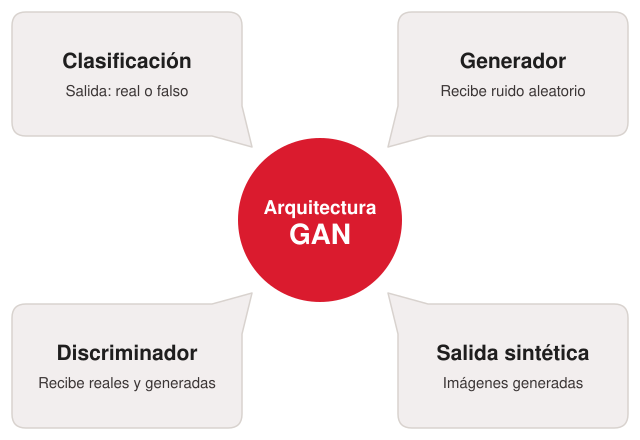

<!-- diagrama redibujado como SVG desde slide-14-1.png (fondo del pptx sin textos); las etiquetas de los cuadros de texto del pptx ahora están dentro del SVG -->

### Sources

- `AIG4B-Clase-8-GANs.md.md` (slide 14). Diagrama redibujado como SVG (images/arquitectura-gan.svg) a partir de la imagen del pptx (slide-14-1.png, que solo tenía el fondo) y de sus cuadros de texto: Arquitectura GAN, Clasificación / Salida: real o falso, Generador / Recibe ruido aleatorio, Discriminador / Recibe reales y generadas, Salida sintética / Imágenes generadas.

### Speaker notes

---

## 6. Arquitectura de una "Vanilla" GAN

<!-- slide 15 del pptx original -->

### Content

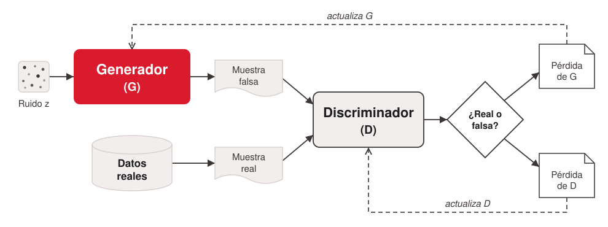

<!-- enlace de la forma: https://aws.amazon.com/es/what-is/gan/ -->
- **[¿Qué es una GAN? - Explicación sobre las redes generativas antagónicas - AWS](https://aws.amazon.com/es/what-is/gan/)**

### Sources

- `AIG4B-Clase-8-GANs.md.md` (slide 15). Diagrama redibujado como SVG (images/vanilla-gan-arquitectura.svg) a partir de la imagen del pptx (slide-15-1.jpg): mismas piezas y conexiones, etiquetas en español (Generador (G), Discriminador (D)), lazos de pérdida rotulados "actualiza G" / "actualiza D".

### Speaker notes

---

## 7. Entrenamiento paso a paso

<!-- slide 16 del pptx original -->

### Content

- Cuatro pasos que se repiten miles de veces — así es como una GAN aprende a engañar.

- Paso 3 — El Discriminador emite su veredicto

- Paso 2 — El Discriminador evalúa

- Paso 1 — El Generador produce su primer intento

- Recibe dos tipos de inputs en cada ronda: imágenes reales del dataset de entrenamiento e imágenes falsas producidas por el Generador en el Paso 1. Su tarea: asignar a cada imagen una probabilidad de ser real (entre 0 y 1).
- Al principio tiene la tarea fácil — las imágenes del Generador son obviamente falsas.

- Produce un número entre 0 y 1: cerca de 1 → "Esto es real"; cerca de 0 → "Esto es claramente falso"; cerca de 0.5 → "No tengo idea". Cuando el Generador logra que el Discriminador dé 0.5 de forma consistente, es el éxito.

- Recibe como entrada un vector de ruido aleatorio — números al azar que representan un punto en un espacio de posibilidades. Con ese ruido como semilla, produce una imagen. Al principio del entrenamiento, esa imagen es literalmente ruido visual — manchas sin forma ni sentido.
- Analogía: el falsificador en su primer día. No sabe nada de los rostros reales — produce garabatos.

- Paso 5 — El ciclo se repite miles de veces

- Paso 4 — Ambos aprenden del resultado

- Generar → evaluar → aprender. Este loop puede repetirse cientos de miles de veces. Con cada iteración, el Generador produce imágenes más convincentes y el Discriminador se vuelve más exigente. Al final, el ojo humano no puede distinguir lo real de lo generado.

- El veredicto se convierte en señal de aprendizaje: el Generador ajusta sus parámetros para engañar mejor la próxima vez; el Discriminador ajusta los suyos para detectar mejor. Ambos actualizan simultáneamente — cada uno aprende del error del otro.

### Sources

- `AIG4B-Clase-8-GANs.md.md` (slide 16)

### Speaker notes

---

# 3. Slanted Land

**Goal of this section:**

---

## 1. El Problema: ¡Bienvenidos a Slanted Land! 🌀

<!-- slide 18 del pptx original -->

### Content

- Imagina un mundo peculiar llamado Slanted Land, donde absolutamente todo se inclina: los árboles, las casas, las personas e incluso la pizza que comen los gatos. En este universo, la norma es la inclinación.
- Los habitantes de Slanted Land solo conocen rostros con una ligera inclinación. Para ellos, un rostro completamente recto sería una anomalía, algo totalmente extraño e incomprensible.

| Universo Inclinado | Rostros "Normales" |
|---|---|
| Todo, desde la gravedad hasta las cejas de sus habitantes, está en un ángulo distintivo. | Solo existen los rostros inclinados; un rostro recto les resulta completamente alienígena. |

### Sources

- `AIG4B-Clase-8-GANs.md.md` (slide 18). Crédito corregido: el video enlazado es de Luis Serrano, como acredita la slide 37 original (corpus, inconsistencia #1).
- `serrano-gans-lab.web.md` (Slanted Land es el mundo didáctico de Serrano)

### Speaker notes

---
## 2. El problema urgente

<!-- slide 18 del pptx original (segunda mitad; partida a pedido del presentador, 2026-10-17) -->

### Content

- La app de citas de Slanted Land, TiltedTinder, necesita generar fotos de perfil para sus usuarios. Pero solo tienen 4 fotos reales en toda su base de datos. Con tan pocos datos, nadie encuentra pareja. ¡La supervivencia romántica de toda una civilización inclinada depende de nuestra GAN! 💘

<!-- enlace de la forma: https://www.youtube.com/watch?v=8L11aMN5KY8&t=16s -->
- [Basado en «A Friendly Introduction to Generative Adversarial Networks», de Luis Serrano (ver video)](https://www.youtube.com/watch?v=8L11aMN5KY8&t=16s)

### Sources

- `AIG4B-Clase-8-GANs.md.md` (slide 18). Párrafo «El problema urgente» del slide original, separado en su propia lámina para descargar la anterior; el rótulo pasa a ser el título.
- `serrano-gans-lab.web.md` (Slanted Land es el mundo didáctico de Serrano)

### Speaker notes

---

## 3. El mundo de Slanted Land

<!-- slide 19 del pptx original -->

### Content

| Imágenes 2×2 píxeles | Dataset real | Red de una sola capa |
|---|---|---|
| Cada imagen se representa como una pantalla con 4 celdas — cada celda tiene un valor entre 0 (blanco) y 1 (negro). | Son imágenes de personas inclinadas. El Generador va a aprender a producir imágenes que se parezcan a esas personas. | La arquitectura más simple posible — ideal para entender los fundamentos sin complejidad adicional. |

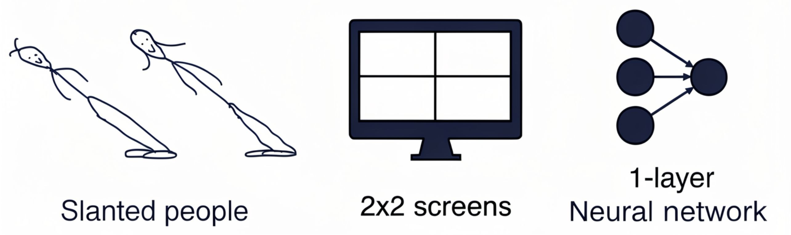

### Sources

- `AIG4B-Clase-8-GANs.md.md` (slide 19)

### Speaker notes

---

## 4. (sin título)

<!-- slide 20 del pptx original -->

### Content

**Los datos reales: caras con patrón**

- Las "caras" de Slanted Land, codificadas como píxeles, tienen un patrón consistente:

- Esquinas oscuras en la diagonal principal (arriba-izquierda y abajo-derecha): valor alto
- Esquinas claras en la diagonal secundaria (arriba-derecha y abajo-izquierda): valor bajo

- Ese patrón diagonal es la "firma" de una cara real. El Discriminador tiene que aprenderlo para poder distinguirla del ruido.

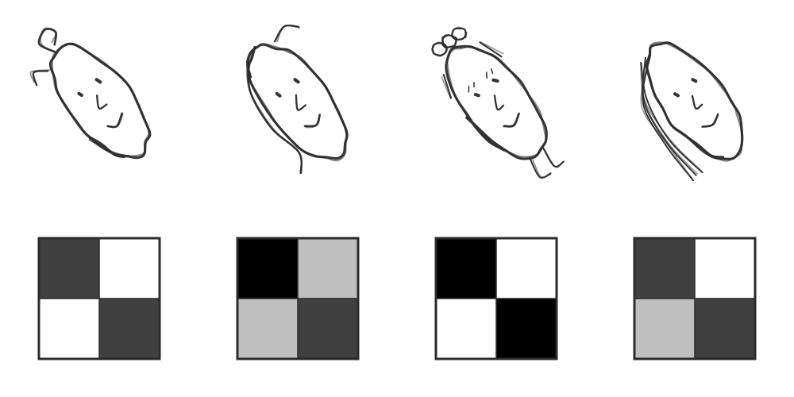

### Sources

- `AIG4B-Clase-8-GANs.md.md` (slide 20). Imagen redibujada como SVG (images/caras-patron.svg, generada con tools/sketch/caras_patron.py): caras a mano y grillas 2×2 con los valores de la tabla «Faces» del pptx (slide 21).

### Speaker notes

---

## 5. Caras vs. ruido: los dos tipos de imágenes

<!-- slide 21 del pptx original -->

### Content

| Caras (imágenes reales) | Ruido (imágenes falsas) |
|---|---|
| Valores altos en la diagonal principal, bajos en la secundaria. Patrón estructurado y reconocible. | Valores sin patrón, distribuidos aleatoriamente. Sin estructura diagonal. El Discriminador debe aprender a distinguirlos a partir de esos valores numéricos. |

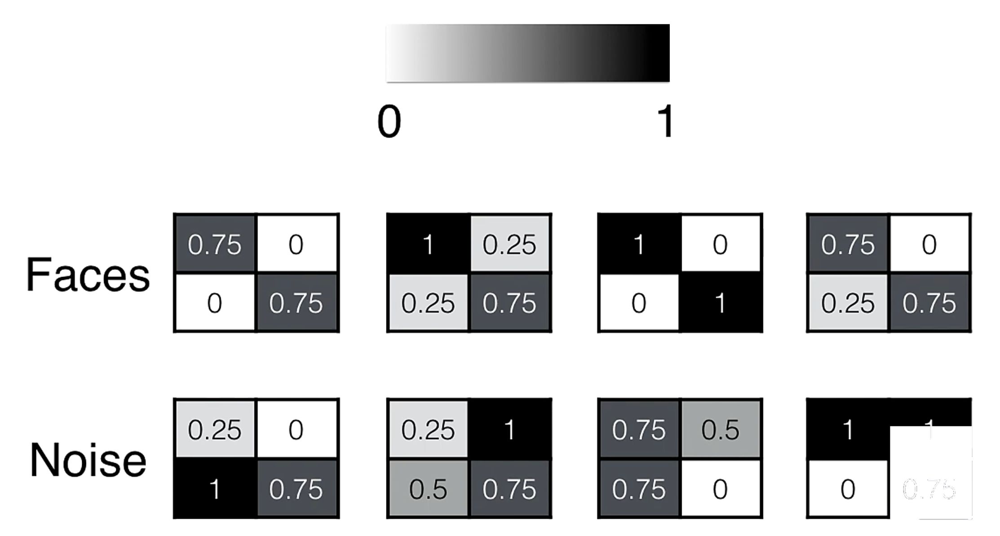

### Sources

- `AIG4B-Clase-8-GANs.md.md` (slide 21)

### Speaker notes

---

## 6. (sin título)

<!-- slide 22 del pptx original -->

### Content

**Construyendo el Discriminador**

**¿qué píxeles importan?**

- El Discriminador aprende que en las caras de Slanted Land:

- Los píxeles de la diagonal principal son grandes → reciben peso positivo (+1)
- Los píxeles de la diagonal secundaria son pequeños → reciben peso negativo (−1)

- Asigna estos pesos a cada posición: +1 para las que caracterizan una cara, −1 para las que no la caracterizan.

### Sources

- `AIG4B-Clase-8-GANs.md.md` (slide 22)

### Speaker notes

---

## 7. Construyendo el Discriminador

<!-- slide 23 del pptx original -->

### Content

**Calculo del Score**

- El score de una imagen = suma ponderada de sus valores de píxel × pesos aprendidos:

| Cara prototipo | Imagen de ruido |
|---|---|
| 1×(+1) + 0×(−1) + 0×(−1) + 1×(+1) = 2 | 0.25×(+1) + 1×(−1) + 0.5×(−1) + 0.75×(+1) = −0.5 |
| Score > 1 → Real ✓ | Score < 1 → Falsa ✓Score > 1 → Real ✓ |

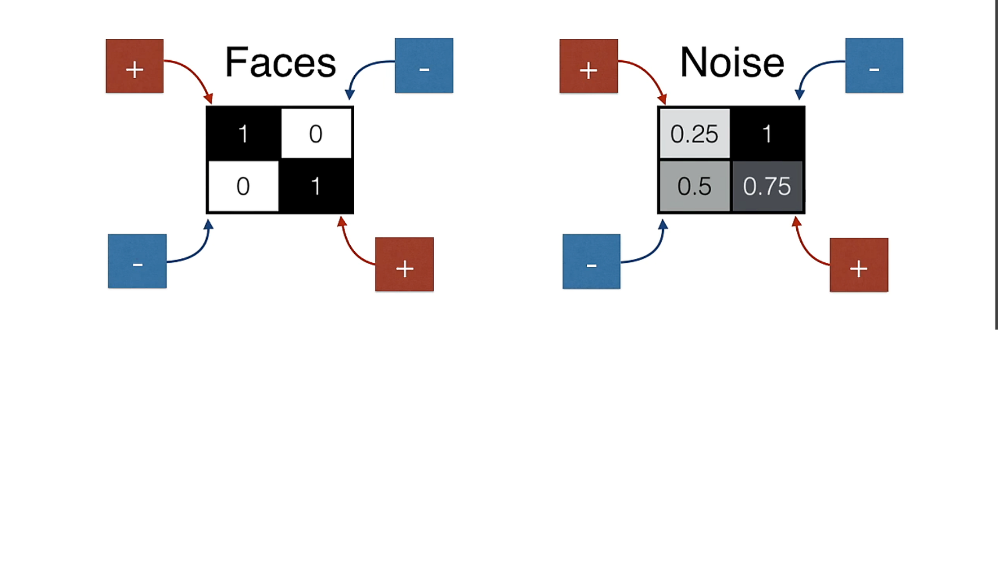

### Sources

- `AIG4B-Clase-8-GANs.md.md` (slide 23)

### Speaker notes

---

## 8. (sin título)

<!-- slide 24 del pptx original -->

### Content

- **Discriminador Como red neuronal**

- Para la cara prototipo: σ(1×(+1) + 0×(−1) + 0×(−1) + 1×(+1) − 1) = σ(1)

| Entradas (x) | Pesos (w) | Bias |
|---|---|---|
| x₁=1, x₂=0, x₃=0, x₄=1 | w₁=+1, w₂=−1, w₃=−1, w₄=+1 | valor fijo = 1, peso = −1 |

| Suma ponderada | Sigmoid |
|---|---|
| 1(+1)+0(−1)+0(−1)+1(+1)+1(−1) = 1 | σ(1) ≈ 0.73 → imagen real |

### Sources

- `AIG4B-Clase-8-GANs.md.md` (slide 24)

### Speaker notes

---

## 9. Función Sigmoid: la activación del Discriminador

<!-- slide 25 del pptx original -->

### Content

- **La función sigmoid convierte cualquier número real en una probabilidad entre 0 y 1. Es la función de activación que usa el Discriminador para emitir su veredicto.**

| Rango acotado | Diferenciable | Monótona creciente | Punto medio en 0 |
|---|---|---|---|
| Devuelve valores entre 0 y 1; se lee como probabilidad. | Es suave en todo punto; permite backpropagation. | Si sube la entrada, sube la salida; conserva el orden. | σ(0) = 0.5; umbral natural de decisión. |

### Sources

- `AIG4B-Clase-8-GANs.md.md` (slide 25)

### Speaker notes

---

## 10. Pongamos todo junto del Discriminador

<!-- slide 26 del pptx original -->

### Content

- **Cuando la cara prototipo pasa por la red completa:**
- **σ(1) = 0.73 → "Estoy un 73% seguro de que esto es real"**
- **Como 0.73 > 0.5, clasifica correctamente la imagen como real ✓**

- **Cuando la imagen de ruido pasa por la misma red:**
- **σ(-0.5) = 0.37 → "Estoy solo un 37% seguro de que esto sea real"**
- **Como 0.37 < 0.5, clasifica correctamente la imagen como falsa ✓**

### Sources

- `AIG4B-Clase-8-GANs.md.md` (slide 26)

### Speaker notes

---

## 11. El Generador: el objetivo opuesto

<!-- template: value-columns -->

<!-- slide 27 del pptx original -->

### Content

Las dos redes leen el mismo número, D(·), pero quieren resultados contrarios.

| Factor | Discriminador (D) | Generador (G) |
|---|---|---|
| Entrada | Una imagen x de 4 píxeles | Un número aleatorio z, entre 0 y 1 |
| Salida | Un número, D(x) | Una imagen G(z) de 2×2 |
| Quiere | D(x) → 1 si la imagen es real; D(G(z)) → 0 si es falsa | D(G(z)) → 1 |

- **En redes reales**, G sube de resolución con capas de upsampling y convoluciones transpuestas.

### Sources

- `AIG4B-Clase-8-GANs.md.md` (slide 27)
- `gan-goodfellow-2014.web.md` (G se entrena para maximizar la probabilidad de que D se equivoque)
- `aws-que-es-una-gan.web.md` (convoluciones transpuestas en el generador)

### Speaker notes

El Generador nunca ve una cara real. Aprende solo a través del gradiente que le devuelve el Discriminador por D(G(z)), y por eso su objetivo se define sobre la salida de D. El paper original lo formula así: G se entrena para maximizar la probabilidad de que D se equivoque (Goodfellow et al., 2014).

El número z es aleatorio para que cada valor produzca una imagen distinta. El conjunto de valores posibles de z forma el espacio latente. Más adelante en la clase, StyleGAN transforma z en un vector de estilo w para controlar los rasgos de la imagen generada.

En Slanted Land la arquitectura es mínima: entra 1 número y salen 4 píxeles. Es la estructura inversa del Discriminador, que recibe 4 píxeles y devuelve 1 número. En una GAN de imágenes reales el esquema es el mismo, pero parte de un vector de ruido y llega a imágenes de hasta 1024×1024 (StyleGAN) con capas de upsampling y convoluciones transpuestas.

---

## 12. Construyendo el Generador

<!-- slide 28 del pptx original -->

### Content

**El Generador en acción: z = 0.7 → imagen**

- Con z = 0.7 como entrada y los pesos aprendidos, el Generador produce una imagen que reproduce el patrón diagonal de las caras reales. El Generador aprendió a engañar al Discriminador.
- El resultado muestra el patrón diagonal característico de las caras de Slanted Land: valores altos en la diagonal principal, bajos en la secundaria. El Generador internalizó la estructura del dataset real.

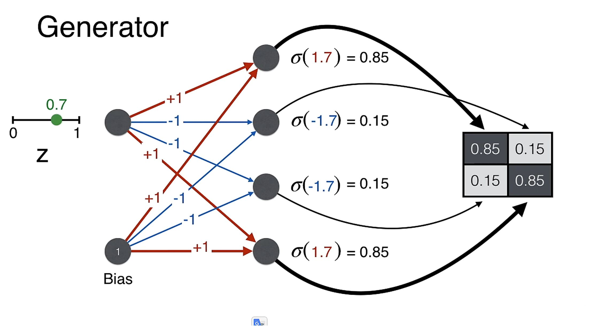

### Sources

- `AIG4B-Clase-8-GANs.md.md` (slide 28)

### Speaker notes

---

## 13. Proceso de Entrenamiento

<!-- slide 29 del pptx original -->

### Content

- En los slides anteriores definimos los pesos del Discriminador y el Generador a mano (+1, −1, Bias). En la práctica, la red debe aprender esos pesos sola. Para eso necesitamos una forma de medir cuánto se equivocó — esa es la función de error.
- Para que ambas redes aprendan, necesitamos medir exactamente cuánto se equivocaron. La función que hace eso en las GANs se llama log-loss (binary cross-entropy):

| Cuando queremos que la predicción sea 1 | Cuando queremos que la predicción sea 0 |
|---|---|
| Error = −ln(predicción) Se usa cuando la imagen es real y el Discriminador debe acercarse a 1. | Error = −ln(1 − predicción) Se usa cuando la imagen es falsa y el Discriminador debe acercarse a 0. |

### Sources

- `AIG4B-Clase-8-GANs.md.md` (slide 29)

### Speaker notes

---

## 14. Log-loss: los dos casos del Discriminador

<!-- template: value-columns -->

<!-- slide 30 del pptx original -->

### Content

| Factor | Imagen real (objetivo 1) | Imagen falsa (objetivo 0) |
|---|---|---|
| Error | −ln(D(x)) | −ln(1 − D(G(z))) |
| Acierta | D = 0.9 → −ln(0.9) ≈ 0.1 | D = 0.1 → −ln(1 − 0.1) = −ln(0.9) ≈ 0.1 |
| Falla | D = 0.1 → −ln(0.1) ≈ 2.3 | D = 0.9 → −ln(1 − 0.9) = −ln(0.1) ≈ 2.3 |

- **La propiedad clave: el error es grande cuando la predicción está lejos del objetivo, y pequeño cuando está cerca. Esto guía el aprendizaje en la dirección correcta.**

### Sources

- `AIG4B-Clase-8-GANs.md.md` (slide 30)
- Cálculos: −ln(0.9) = 0.105 ≈ 0.1; −ln(0.1) = 2.303 ≈ 2.3 (mismos valores que la slide 30 original)
- `gan-goodfellow-2014.web.md` (juego minimax entre G y D)

### Speaker notes

Log-loss es la entropía cruzada binaria. Para una etiqueta y (1 = real, 0 = falsa) y una predicción p, el error vale −[y·ln(p) + (1 − y)·ln(1 − p)]. Con y = 1 sobrevive solo el primer término, −ln(p). Con y = 0 sobrevive solo el segundo, −ln(1 − p). Las dos columnas de la slide son esos dos términos.

El logaritmo castiga sin tope la confianza equivocada, porque −ln(p) crece hacia infinito cuando p se acerca a 0. Por eso pasar de una predicción de 0.9 a una de 0.1 lleva el error de 0.1 a 2.3. Su derivada también es grande justo cuando el modelo se equivoca, así que el ajuste de pesos es más fuerte donde más hace falta. Un error lineal como 1 − p no tiene ninguna de las dos propiedades.

Las dos columnas son el error del Discriminador. D minimiza −ln(D(x)) con imágenes reales y −ln(1 − D(G(z))) con imágenes falsas. El Generador se entrena con el objetivo contrario, que D se equivoque: en la práctica minimiza −ln(D(G(z))), que crece cuando D detecta la falsificación. El paper original formaliza esta tensión como un juego minimax entre G y D (Goodfellow et al., 2014).

---

## 15. (sin título)

<!-- slide 31 del pptx original -->

### Content

**Loss Function Visualmente**

- 🔍 Discriminador — imagen real

- 🎨 Generador — imagen falsa

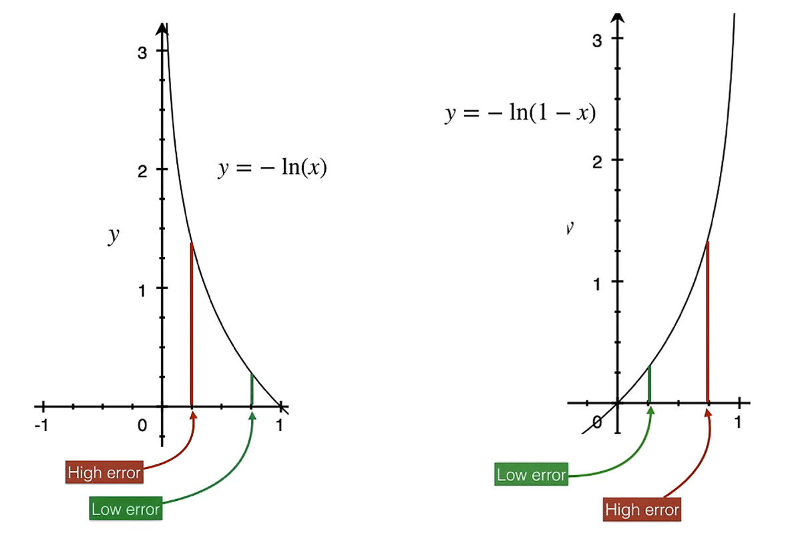

- Predicción = 0 (imagen falsa). Error = −ln(1−predicción). Predicción alta → alto error. El Generador quiere que el Discriminador le asigne score alto (cercano a 1) — lo opuesto al objetivo del Discriminador.

- Predicción = 1 (imagen real). Error = −ln(predicción). Predicción baja → alto error. Predicción alta → bajo error. El Discriminador quiere acercarse a 1 cuando ve imágenes reales.

### Sources

- `AIG4B-Clase-8-GANs.md.md` (slide 31). Los dos gráficos del pptx (slide-31-1.png, slide-31-2.png) recortados a su contenido y unidos lado a lado en images/slide-31-graficos.png.

### Speaker notes

---

## 16. Backpropagation: del error al ajuste de pesos

<!-- slide 32 del pptx original -->

### Content

- Una vez calculado el error, la red lo "propaga hacia atrás" para ajustar cada peso:

- Pesos con alta contribución al error → se ajustan más

- Pesos con baja contribución al error → se ajustan poco

- La dirección del ajuste apunta siempre a reducir el error

- Este proceso ocurre simultáneamente en el Generador y el Discriminador en cada iteración.

### Sources

- `AIG4B-Clase-8-GANs.md.md` (slide 32)

### Speaker notes

---

## 17. Backpropagation: el procedimiento paso a paso

<!-- slide 33 del pptx original -->

### Content

| 01 | 02 | 03 |
|---|---|---|
| Calcular el error | Derivar la sensibilidad de cada peso | Actualizar en la dirección opuesta al gradiente |

- **La función log-loss da un número que mide qué tan lejos estuvo la red de la respuesta correcta.**

- **Con la regla de la cadena se calcula ∂E/∂w para cada peso: si subo este peso un poco, ¿el error sube o baja?**

- **w_nuevo = w_actual − α · (∂E/∂w) — α (learning rate) controla el tamaño del paso.**

- **04**

**Repetir para todos los pesos, en ambas redes**

- **El cálculo se ejecuta para cada peso del Discriminador y del Generador de forma simultánea.**

### Sources

- `AIG4B-Clase-8-GANs.md.md` (slide 33)

### Speaker notes

---

## 18. Backpropagation: ejemplo con Slanted Land

<!-- slide 34 del pptx original -->

### Content

- **Con el error del Discriminador = 1.14 y output D(G(z)) = 0.68, calculamos el ajuste concreto usando la derivada ∂E/∂wᵢ = −[1 − D(x)] · xᵢ:**

| Píxel | Valor xᵢ | ∂E/∂w | α = 0.1 | w_nuevo |
|---|---|---|---|---|
| Arriba-izq (diagonal) | 0.25 | −0.32 × 0.25 = −0.08 | −0.1 × (−0.08) | 1 + 0.008 = 1.008 ↑ |
| Arriba-der | 1.00 | −0.32 × 1.00 = −0.32 | −0.1 × (−0.32) | −1 + 0.032 = −0.968 ↑ |

- **Los pesos se mueven en la dirección que hace al Discriminador más exigente: en la próxima iteración dará un score más bajo a imágenes similares.**

### Sources

- `AIG4B-Clase-8-GANs.md.md` (slide 34)

### Speaker notes

---

## 19. (sin título)

<!-- slide 35 del pptx original -->

### Content

**El ciclo completo: Generador y Discriminador juntos**

- Con z = 0.7, el Generador produce una imagen → el Discriminador la evalúa → output: 0.68. Este único número conecta los dos errores:

| Error del Discriminador | Error del Generador |
|---|---|
| Recibió 0.68 cuando quería dar 0 → se equivocó. Debe ajustar sus pesos para detectar mejor. | Recibió 0.68 cuando quería que diera 1 → casi lo engañó, pero no del todo. Debe ajustar para engañar más. |

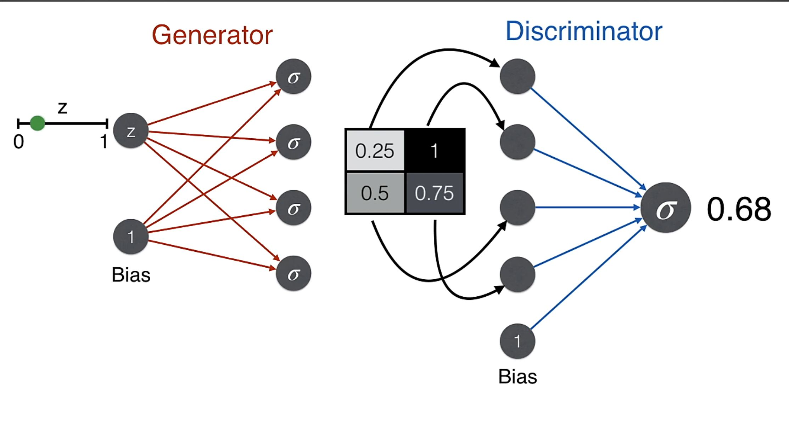

### Sources

- `AIG4B-Clase-8-GANs.md.md` (slide 35)

### Speaker notes

---

## 20. El error del Discriminador

<!-- slide 36 del pptx original -->

### Content

- El Discriminador recibió una imagen falsa pero le asignó un score de 0.68 (quería dar 0):

- Un error considerable. El Discriminador va a ajustar sus pesos para clasificar mejor estas imágenes en la próxima iteración — volviéndose más exigente y difícil de engañar.

### Sources

- `AIG4B-Clase-8-GANs.md.md` (slide 36)

### Speaker notes

---

## 21. (sin título)

<!-- slide 37 del pptx original -->

### Content

**Para los curiosos: la derivada del error**

- La derivada del error del Discriminador respecto a sus pesos permite calcular exactamente cuánto ajustar cada uno:

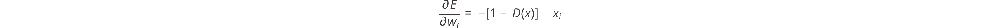

- Este cálculo es lo que backpropagation ejecuta automáticamente en cada iteración, para todas las capas y todos los pesos de la red. La regla de la cadena lo hace computacionalmente eficiente incluso con millones de parámetros.

- Slide opcional — para quien quiera profundizar en la matemática. Fuente: A Friendly Introduction to Generative Adversarial Networks — Luis Serrano Academy.

### Sources

- `AIG4B-Clase-8-GANs.md.md` (slide 37)

### Speaker notes

---

# 4. Tipos y aplicaciones

**Goal of this section:**

---

## 1. Tipos de GANs: el punto de partida

<!-- slide 39 del pptx original -->

### Content

- Todo lo que describimos corresponde a la Vanilla GAN — el modelo original de Goodfellow (2014). Pero ese modelo base tiene limitaciones importantes, y surgieron variantes especializadas que resuelven problemas concretos.

<!-- original vectorial: research/corpus/AIG4B-Clase-8-GANs.md/images/slide-39-1.svg -->

<!-- original vectorial: research/corpus/AIG4B-Clase-8-GANs.md/images/slide-39-2.svg -->

**Vanilla GAN · Goodfellow et al. 2014**

**Conditional GAN (cGAN) · Mirza & Osindero, 2014**

- Generador produce imágenes desde ruido aleatorio. Sin control sobre el resultado. Inestable y de baja calidad visual. Uso: punto de partida teórico.

- Generador y Discriminador reciben etiquetas de clase como condición. "Genera un 7" (dígitos de MNIST en el paper original). Uso: síntesis por clase y aumentación controlada.

<!-- original vectorial: research/corpus/AIG4B-Clase-8-GANs.md/images/slide-39-3.svg -->

<!-- original vectorial: research/corpus/AIG4B-Clase-8-GANs.md/images/slide-39-4.svg -->

| DCGAN · Radford et al., 2015 | SRGAN · Ledig et al., 2017 |
|---|---|
| Reemplaza capas densas con redes convolucionales. Entrenamiento estable, imágenes nítidas. Uso: base estándar para generación de imágenes de calidad. | Especializado en ampliar imágenes de baja a alta resolución. Infiere detalles finos que no estaban en la imagen original. Uso: ampliar fotos e imágenes de menor calidad, médicas incluidas (factor 4× en el paper original). |

### Sources

- `AIG4B-Clase-8-GANs.md.md` (slide 39)
- `srgan-ledig-2017.web.md` (imágenes naturales foto-realistas con factores de ampliación 4×)
- `cgan-mirza-osindero-2014.web.md` (generación de dígitos MNIST condicionada por etiqueta de clase; la condición entra al Generador y al Discriminador)

### Speaker notes

---

## 2. El salto que lo cambió todo: StyleGAN (2018)

<!-- slide 40 del pptx original -->

### Content

- El problema que nadie había resuelto en cuatro años: las GANs generaban imágenes, pero no podías pedirle "genera una cara joven, con pelo castaño y expresión neutral". El Generador mezclaba todos los atributos juntos sin control.
- ¿Qué cambió exactamente en StyleGAN? En una GAN clásica, el ruido entra directamente y todo (forma, color, textura) sale del mismo vector mezclado. StyleGAN lo separa en capas independientes:

| Componente | Qué hace | Qué controla |
|---|---|---|
| Red de mapeo (mapping network) | Transforma el ruido en un vector de estilo (w) | Define las características globales de la imagen |
| Síntesis por capas (AdaIN) | Inyecta el estilo en distintas capas de la red | Cada capa controla una escala diferente de detalle |
| Ruido estocástico por capa | Añade variación aleatoria capa a capa | Controla variaciones finas: poros, pelo suelto, arrugas |

- Style mixing: StyleGAN permite tomar la estructura de una cara (pose, forma) y el estilo de otra (color de pelo, edad) para generar una cara completamente nueva con coherencia total. Esto no era posible en ninguna GAN anterior.

### Sources

- `AIG4B-Clase-8-GANs.md.md` (slide 40)

### Speaker notes

---

## 3. StyleGAN: arquitectura

<!-- slide 41 del pptx original -->

### Content

**Dos redes en lugar de una**

- Caras fotorrealistas generadas por StyleGAN (NVIDIA, 2019)

- StyleGAN separa el proceso en dos redes:

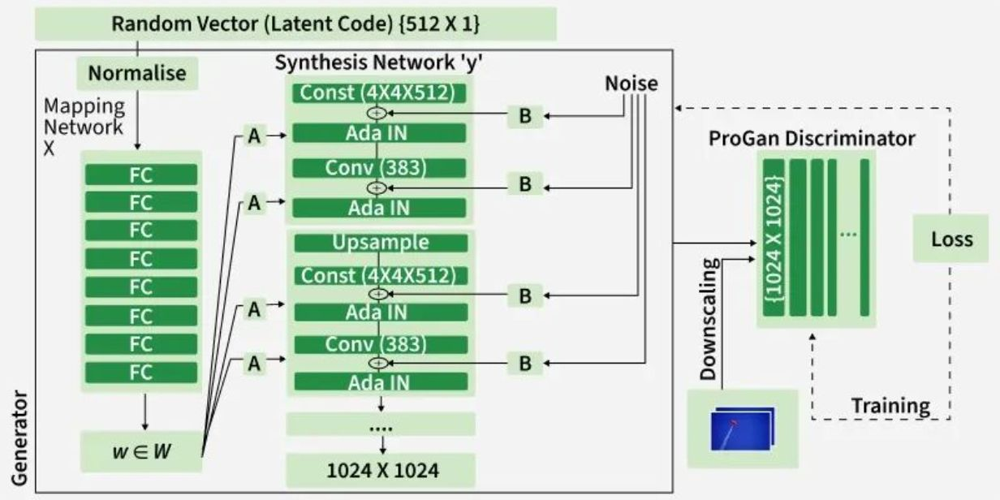

- 🔀 Mapping Network: transforma el ruido z en un vector de estilo w (512 dimensiones)
- 🎨 Synthesis Network: genera la imagen progresivamente, inyectando el estilo w en cada capa

- Esto permite controlar atributos separados en cada nivel de resolución: pose y forma en capas bajas, textura y color en capas altas.

- La clave: el estilo se inyecta en cada capa mediante AdaIN (Adaptive Instance Normalization), no solo al inicio. Esto da control granular sobre cada aspecto visual.

### Sources

- `AIG4B-Clase-8-GANs.md.md` (slide 41)

### Speaker notes

---

## 4. StyleGAN: Innovaciones Clave (Resumen)

<!-- slide 42 del pptx original -->

### Content

- StyleGAN (NVIDIA) redefine la generación de imágenes al modificar únicamente el Generador, manteniendo el Discriminador estándar. Sus tres innovaciones arquitectónicas permiten control fino sobre el estilo y alta calidad visual.

| Progressive Growing | Bi-linear Sampling | Mapping Network + AdaIN |
|---|---|---|
| Entrena comenzando con imágenes de 4×4 píxeles y agrega capas progresivamente hasta 1024×1024. Mejora la estabilidad del entrenamiento y la calidad final. | Reemplaza el muestreo nearest-neighbor por bi-linear sampling en up/downsampling, reduciendo artefactos y logrando transiciones más suaves. | Una red de 8 capas transforma el vector latente z en un vector intermedio w, que modula las características vía AdaIN. Permite controlar textura, iluminación y estilo de forma independiente por nivel. |

- Fuente: GeeksforGeeks — StyleGAN: Style Generative Adversarial Networks

### Sources

- `AIG4B-Clase-8-GANs.md.md` (slide 42)

### Speaker notes

---

## 5. Fortaleza 1: Generación de imágenes realistas

<!-- slide 43 del pptx original -->

### Content

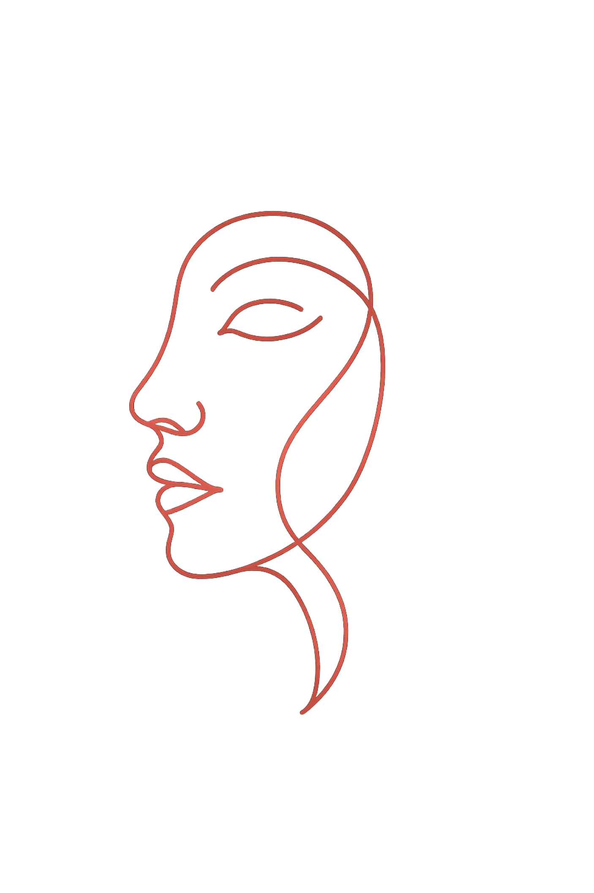

- El resultado más sorprendente de las GANs: imágenes que el ojo humano no puede distinguir de las reales. Después de millones de rondas de entrenamiento, el Generador aprendió la estructura profunda de cómo lucen esas imágenes — proporciones, distribución de luz, imperfecciones que hacen que algo parezca real.

**ThisPersonDoesNotExist.com**

- Cada recarga genera un rostro humano completamente inventado con StyleGAN. Ninguno existe en el mundo real.

**Test de Turing visual (Salimans et al., 2016)**

- Jueces humanos no distinguen las muestras de MNIST de los dígitos reales. Con CIFAR-10 se equivocan en el 21,3 % de los casos.

**Videojuegos y entretenimiento**

- Las GANs generan texturas, escenarios y personajes con un nivel de detalle que antes requería artistas trabajando manualmente durante días.

### Sources

- `AIG4B-Clase-8-GANs.md.md` (slide 43)
- `inception-score-salimans-2016.web.md` (test de Turing visual: MNIST indistinguible; tasa de error humana del 21,3 % en CIFAR-10)

### Speaker notes

El 21,3 % es la tasa de error de los jueces humanos, y no un porcentaje de realismo del modelo. Si las muestras fueran indistinguibles, los jueces acertarían al azar y el error llegaría al 50 %. Con CIFAR-10 los jueces se equivocaron una de cada cinco veces, así que todavía detectaban la mayoría de las falsificaciones. Con MNIST, en cambio, no las distinguían.

Es el único estudio ciego con jueces humanos y un número publicado en el corpus de la clase, junto con el MOS de SRGAN. Sirve como modelo de cómo validar el realismo de un generador: jueces ciegos, una tarea definida y una tasa de error reportada.

---

## 6. Fortaleza 2: Transformación de imágenes (Image Translation)

<!-- slide 44 del pptx original -->

### Content

- Las GANs pueden transformar una imagen en otra y conservar la estructura subyacente. Pix2Pix aprende de pares de imágenes alineadas. CycleGAN aprende sin pares, y para muchas tareas no hay pares disponibles. En medicina, la misma técnica convierte MRI en CT sin escanear dos veces al paciente, lo que reduce costes, tiempo y exposición a radiación.

| Input | Output | Modelo |
|---|---|---|
| Boceto de un edificio | Foto del edificio terminado | Pix2Pix |
| Foto de día | La misma foto de noche | Pix2Pix |
| Imagen de un caballo | La misma imagen con una cebra | CycleGAN |
| Imagen de baja resolución | Alta resolución (super-resolución) | SRGAN |
| Imagen en blanco y negro | La misma imagen en color | DeOldify / CycleGAN |
| MRI de cerebro | Imagen equivalente de CT | CycleGAN médico |

### Sources

- `AIG4B-Clase-8-GANs.md.md` (slide 44)
- `cyclegan-zhu-2017.web.md` (la traducción imagen a imagen usa pares alineados; para muchas tareas no hay datos apareados)
- `pix2pix-isola-2017.web.md` (cGAN de propósito general para traducción imagen a imagen)

### Speaker notes

---

## 7. Fortaleza 3: Completado de imágenes (Image Inpainting)

<!-- slide 45 del pptx original -->

### Content

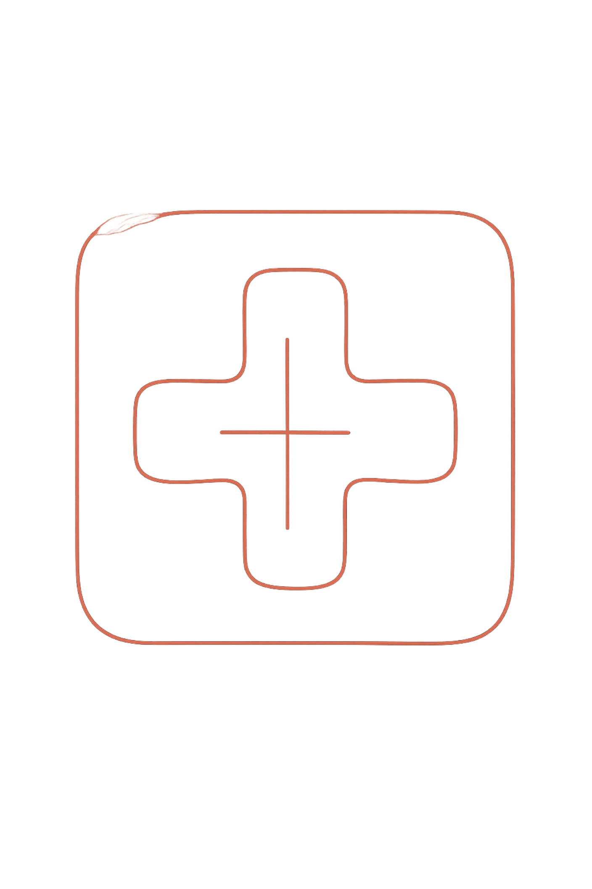

- Las GANs pueden reconstruir regiones faltantes de forma coherente con el contexto. La red recibe una imagen con una región enmascarada e infiere el contenido más probable basándose en colores, texturas y estructuras adyacentes. No copia píxeles cercanos — entiende el contenido semántico de la escena completa.

- **Tomografías con dosis reducida**

- Recupera la información sacrificada en protocolos de baja radiación, protegiendo al paciente sin perder calidad diagnóstica.

### Sources

- `AIG4B-Clase-8-GANs.md.md` (slide 45)

### Speaker notes

---

## 8. Fortaleza 4: Generación de datos sintéticos para entrenamiento

<!-- slide 46 del pptx original -->

### Content

**El cuello de botella: los datos de entrenamiento**

**La solución con GANs**

- **Entrenar con las pocas imágenes reales disponibles y generar miles de imágenes sintéticas adicionales para ampliar el dataset.**

- **Casos raros → pocos ejemplos documentados. Datos personales o de pacientes → protegidos por regulaciones estrictas. Etiquetado → requiere especialistas, es caro y lento.**

- **Salimans et al. (2016) entrenaron una GAN junto con un clasificador que tenía pocas etiquetas. Con ese método alcanzaron el estado del arte en clasificación semi-supervisada en MNIST, CIFAR-10 y SVHN.**

### Sources

- `AIG4B-Clase-8-GANs.md.md` (slide 46)
- `inception-score-salimans-2016.web.md` (aprendizaje semi-supervisado con GANs: estado del arte en MNIST, CIFAR-10 y SVHN)

### Speaker notes

Aprendizaje semi-supervisado significa entrenar con pocas etiquetas y muchos datos sin etiquetar. Es la barrera de coste de la slide 1.3: etiquetar cuesta horas de especialistas, y las imágenes sin etiquetar sobran. Salimans et al. (2016) lo atacaron con una GAN y lograron el estado del arte en MNIST, CIFAR-10 y SVHN.

En el paper, el Discriminador funciona también como clasificador: además de las clases del dataset, aprende una clase extra para las imágenes que produce el Generador. Así, las imágenes generadas entran al entrenamiento del clasificador. Este mecanismo está en el cuerpo del paper (sección de aprendizaje semi-supervisado) y no en la captura del corpus, que solo tiene el abstract.

---

## 9. El dataset importa: lo que le das es lo que obtenés

<!-- slide 47 del pptx original -->

### Content

- Una GAN solo puede generar lo que aprendió. Si el dataset mezcla clases sin etiquetas, el Generador produce híbridos incoherentes, inútiles para entrenar clasificadores. Cada clase del dataset tiene que ser homogénea, o hace falta una Conditional GAN.

| Tipo de dataset | Lo que genera la GAN |
|---|---|
| Solo imágenes de gatos | Gatos variados y realistas ✓ |
| Solo imágenes de perros | Perros variados y realistas ✓ |
| Gatos + perros sin etiqueta | Híbridos incoherentes ✗ |
| Gatos + perros con etiqueta (cGAN) | Puede generar cada clase por separado ✓ |

- Antes de entrenar hay que validar el dataset como cualquier entrada de un pipeline de datos: limpio, bien etiquetado y homogéneo dentro de cada clase.

### Sources

- `AIG4B-Clase-8-GANs.md.md` (slide 47)

### Speaker notes

---

# 5. Limitaciones y cierre

**Goal of this section:**

---

## 1. Limitaciones (1 de 2): los problemas de entrenamiento

<!-- slide 49 del pptx original -->

### Content

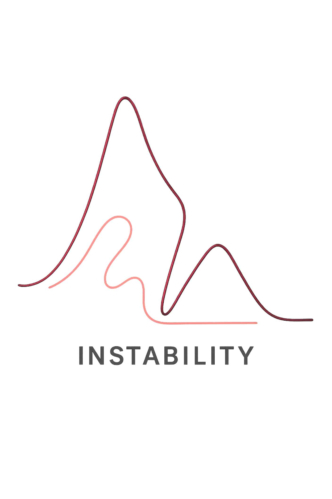

<!-- original vectorial: research/corpus/AIG4B-Clase-8-GANs.md/images/slide-49-2.svg -->

<!-- original vectorial: research/corpus/AIG4B-Clase-8-GANs.md/images/slide-49-3.svg -->

| Mode Collapse — el más común y frustrante | Inestabilidad en el entrenamiento |
|---|---|
| El Generador descubre un "truco": produce siempre el mismo tipo de imagen que engaña al Discriminador, en lugar de aprender toda la variedad posible. Analogía: el falsificador que solo falsifica un tipo de billete. Con MNIST, una GAN colapsada genera siempre el mismo dígito, y ese dataset sintético no sirve para entrenar un clasificador de los diez. | El balance entre Generador y Discriminador es frágil. Si el Discriminador es demasiado bueno, el Generador no recibe señal útil y el gradiente "desaparece". Si el Discriminador es demasiado malo, el Generador aprende trucos baratos en lugar de aprender la distribución real. |

### Sources

- `AIG4B-Clase-8-GANs.md.md` (slide 49)
- Ejemplo de MNIST: conocimiento general (el corpus no define mode collapse; ver `inception-score-salimans-2016.web.md` → *Inconsistencies*)

### Speaker notes

---

## 2. Limitaciones (2 de 2): evaluación, coste y sesgo

<!-- slide 50 del pptx original -->

### Content

| Dificultad para evaluar la calidad | Alta demanda computacional | Sesgo heredado del dataset |
|---|---|---|
| No existe una métrica universal. Las más usadas — FID e Inception Score (IS) — son aproximaciones imperfectas que no reemplazan la evaluación humana experta. | Entrenar una GAN de calidad requiere GPUs potentes, datasets grandes y horas o días de entrenamiento. Una barrera real para equipos con recursos limitados. | Si los datos tienen sesgos — subrepresentación de grupos demográficos o patologías concretas — las imágenes generadas van a heredar y amplificar esos sesgos. |

### Sources

- `AIG4B-Clase-8-GANs.md.md` (slide 50)

### Speaker notes

---

## 3. Cierre: lo que aprendimos y lo que sigue

<!-- slide 51 del pptx original -->

### Content

- **En este capítulo construimos la comprensión de las GANs desde cero, siguiendo una narrativa completa:**

| 01 | 02 | 03 |
|---|---|---|
| La intuición | La arquitectura | El entrenamiento |
| El falsificador y el detective, compitiendo para mejorar mutuamente. | Generador y Discriminador como implementación técnica de esa intuición. | El ciclo de cinco pasos que hace converger al sistema, con el ejemplo de Slanted Land. |

| 04 | 05 |
|---|---|
| La lógica matemática | Fortalezas y limitaciones |
| El juego minimax como marco conceptual, log-loss y backpropagation. | Cuatro capacidades concretas (generar, traducir y completar imágenes, y ampliar datasets) y los problemas a resolver antes de usar GANs en producción. |

### Sources

- `AIG4B-Clase-8-GANs.md.md` (slide 51)

### Speaker notes

---

# Open questions

- Tesis y objetivo de cada sección quedaron vacíos: el deck original no los declara.
- Ver `research/corpus/AIG4B-Clase-8-GANs.md.md` → *Inconsistencies / open questions* para los problemas detectados en el material original.
- Idea pendiente (2026-10-17): una tarjeta sobre deepfakes como riesgo de seguridad y su detección (p. ej. FaceForensics++, Rössler et al., 2019). No está en el corpus, así que necesita una captura antes de entrar al deck.
- 1.5 «Los modelos que veremos en el curso» describe el plan del curso original (GANs, Diffusion, SAM). Confirmar si esta materia cubre SAM.
- Thesis — "Restaurado 1:1 desde `AIG4B-Clase-8-GANs.pptx`. La tesis no estaba explícita en el deck original: falta escribirla."
- Section "Cut material" — "El deck original no tiene slide de cierre; hay que escribirla."

# Cut material

### Importación (2026-10-17): slides del PPTX que el render regenera — portada (slide 1) y agenda repetida (slides 2, 9, 17, 38, 48); más el placeholder vacío de Conclusions

#### [sección] 0. Portada

**Goal of this section:** Apertura del deck original — portada y material previo a la primera sección.

---

#### 1. Inteligencia Artificial Generativa Aplicada en Biomedicina

<!-- slide 1 del pptx original -->

### Content

**Clase 8: Vision Generativa /**

**Generative Adversarial Networks (GANs)**

- Autor: Paulo Veiga/Marcos Sanchez Sorondo
- Última Modificación: Abril, 2026

### Sources

- `AIG4B-Clase-8-GANs.md.md` (slide 1)

### Speaker notes

---

#### 1. Panorama de la IA Generativa de Visión

<!-- slide 2 del pptx original -->

### Content

**1**

- **Panorama de la IA Generativa de Visión**

- IA discriminativa vs. generativa, línea de tiempo histórica y modelos del curso

**2**

- **Introducción a las GANs**

- Origen (Goodfellow 2014), intuición del falsificador y el detective, arquitectura básica

**3**

- **El Ejemplo de Slanted Land**

- De la intuición a los números: Discriminador, Generador y sus pesos

**4**

- **Tipos de GANs y Aplicaciones en Biomedicina**

- Vanilla GAN, StyleGAN, fortalezas clínicas y generación de datos sintéticos

**5**

- **Limitaciones y Cierre**

- Problemas de entrenamiento, evaluación, sesgo y próximos pasos

### Sources

- `AIG4B-Clase-8-GANs.md.md` (slide 2)

### Speaker notes

---

#### 1. Introducción a las GANs

<!-- slide 9 del pptx original -->

### Content

**1**

**Panorama de la IA Generativa de Visión**

- IA discriminativa vs. generativa, línea de tiempo histórica y modelos del curso

**2**

**Introducción a las GANs**

- Origen (Goodfellow 2014), intuición del falsificador y el detective, arquitectura básica

**3**

**El Ejemplo de Slanted Land**

- De la intuición a los números: Discriminador, Generador y sus pesos

**4**

**Tipos de GANs y Aplicaciones en Biomedicina**

- Vanilla GAN, StyleGAN, fortalezas clínicas y generación de datos sintéticos

**5**

**Limitaciones y Cierre**

- Problemas de entrenamiento, evaluación, sesgo y próximos pasos

### Sources

- `AIG4B-Clase-8-GANs.md.md` (slide 9)

### Speaker notes

---

#### 1. El Ejemplo de Slanted Land

<!-- slide 17 del pptx original -->

### Content

**1**

**Panorama de la IA Generativa de Visión**

- IA discriminativa vs. generativa, línea de tiempo histórica y modelos del curso

**2**

**Introducción a las GANs**

- Origen (Goodfellow 2014), intuición del falsificador y el detective, arquitectura básica

**3**

**El Ejemplo de Slanted Land**

- De la intuición a los números: Discriminador, Generador y sus pesos

**4**

**Tipos de GANs y Aplicaciones en Biomedicina**

- Vanilla GAN, StyleGAN, fortalezas clínicas y generación de datos sintéticos

**5**

**Limitaciones y Cierre**

- Problemas de entrenamiento, evaluación, sesgo y próximos pasos

### Sources

- `AIG4B-Clase-8-GANs.md.md` (slide 17)

### Speaker notes

---

#### 1. Tipos de GANs y Aplicaciones en Biomedicina

<!-- slide 38 del pptx original -->

### Content

**1**

- **Panorama de la IA Generativa de Visión**

- IA discriminativa vs. generativa, línea de tiempo histórica y modelos del curso

**2**

- **Introducción a las GANs**

- Origen (Goodfellow 2014), intuición del falsificador y el detective, arquitectura básica

**3**

- **El Ejemplo de Slanted Land**

- De la intuición a los números: Discriminador, Generador y sus pesos

**4**

- **Tipos de GANs y Aplicaciones en Biomedicina**

- Vanilla GAN, StyleGAN, fortalezas clínicas y generación de datos sintéticos

**5**

- **Limitaciones y Cierre**

- Problemas de entrenamiento, evaluación, sesgo y próximos pasos

### Sources

- `AIG4B-Clase-8-GANs.md.md` (slide 38)

### Speaker notes

---

#### 1. Limitaciones y Cierre

<!-- slide 48 del pptx original -->

### Content

**1**

**Panorama de la IA Generativa de Visión**

- IA discriminativa vs. generativa, línea de tiempo histórica y modelos del curso

**2**

**Introducción a las GANs**

- Origen (Goodfellow 2014), intuición del falsificador y el detective, arquitectura básica

**3**

**El Ejemplo de Slanted Land**

- De la intuición a los números: Discriminador, Generador y sus pesos

**4**

**Tipos de GANs y Aplicaciones en Biomedicina**

- Vanilla GAN, StyleGAN, fortalezas clínicas y generación de datos sintéticos

**5**

**Limitaciones y Cierre**

- Problemas de entrenamiento, evaluación, sesgo y próximos pasos

### Sources

- `AIG4B-Clase-8-GANs.md.md` (slide 48)

### Speaker notes

---

#### [sección] Conclusions

#### 1. Key takeaways

### Content

### Sources

- `AIG4B-Clase-8-GANs.md.md`

### Speaker notes

---

### Revisión (2026-10-17): texto original de 3.10 y 3.13 reemplazado por la opción A del editor

#### 3.10 (sin título) — Construyendo el Generador / El objetivo opuesto (slide 27 del pptx)

Motivo: reescrita como tabla D vs G; la figura era del Discriminador (inconsistencia #4 del corpus).

**Construyendo el Generador**

**El objetivo opuesto**

- El Generador recibe un número aleatorio z (entre 0 y 1 — el "ruido latente") y tiene que producir una imagen de 2×2 píxeles. Su objetivo: producir imágenes que el Discriminador clasifique como reales (output cercano a 1).
- La estructura es la inversa del Discriminador: de 1 número → 4 píxeles. En redes reales, esto se implementa con capas de upsampling y convoluciones transpuestas.

Imagen quitada: `research/corpus/AIG4B-Clase-8-GANs.md/images/slide-27-1.png`

#### 3.13 Log-loss: los dos casos (slide 30 del pptx)

Motivo: la columna «Label = 0» atribuía el caso al Generador; las imágenes de fórmula rotulaban Error_G lo que 3.19 llama Error_D. Reescrita con fórmulas en texto.

| Label = 1 — Imagen Real | Label = 0 — Imagen Falsa |
|---|---|
| 🔍 Discriminador entrenando con imagen real. Debe acercarse a 1. ✅ Predicción = 0.9 → −ln(0.9) ≈ 0.1 → Error pequeño ❌ Predicción = 0.1 → −ln(0.1) ≈ 2.3 → Error enorme | 🎨 Generador entrenando: el Discriminador debe acercarse a 0 (detectar la imagen como falsa). ✅ Predicción = 0.1 → −ln(0.9) ≈ 0.1 → Error pequeño ❌ Predicción = 0.9 → −ln(0.1) ≈ 2.3 → Error enorme |

Imágenes quitadas: `research/corpus/AIG4B-Clase-8-GANs.md/images/slide-30-1.png` (Error_D = −ln(predicción)) y `research/corpus/AIG4B-Clase-8-GANs.md/images/slide-30-2.png` (Error_G = −ln(1 − predicción))

#### 3.12 Proceso de Entrenamiento — bullet duplicado (slide 29 del pptx)

Motivo: idéntico al takeaway de 3.13, que se conserva.

- La propiedad clave: el error es grande cuando la predicción está lejos del objetivo, y pequeño cuando está cerca. Esto guía el aprendizaje en la dirección correcta.

---
### Revisión (2026-10-17): ejemplos biomédicos reemplazados por ejemplos con fuente en el corpus

Motivo: la audiencia es de Ingeniería de Software. El presentador eligió los reemplazos ★ del editor, solo con fuentes del corpus. Varias cifras quitadas no tenían estudio citado (corpus, inconsistencias #5 y #24).

#### 1.2 ¿Qué es la IA Generativa de Visión? (slide 4 del pptx)

| Pregunta típica | "¿Esto es un tumor maligno o benigno?" | "Genera una imagen de un tumor maligno" |
| Ejemplo en medicina | Clasificador de histología | Generador de imágenes histológicas sintéticas |

#### 1.3 ¿Por qué importa en ingeniería? (slide 5 del pptx)

- Una U-Net entrenada combinando imágenes reales y sintéticas de MRI logró un Dice score de 0.9524 frente a 0.9459 entrenando solo con datos reales.

#### 1.6 Tabla comparativa rápida (slide 8 del pptx)

| Caso en biomedicina | Síntesis histológica, MRI→CT | Generación desde descripciones clínicas | Segmentación de tumores, órganos, células |

#### 3.1 El Problema: ¡Bienvenidos a Slanted Land! (slide 18 del pptx)

Motivo: atribución equivocada; el video es de Luis Serrano (corpus, inconsistencia #1).

- [Basado en el tutorial de Rowel Atienza — ver video:](https://www.youtube.com/watch?v=8L11aMN5KY8&t=16s)

#### 4.1 Tipos de GANs: el punto de partida (slide 39 del pptx)

- "Genera una imagen histológica de carcinoma ductal." Uso: síntesis por clase (por ejemplo, por patología) y aumentación controlada.

#### 4.5 Fortaleza 1 (slide 43 del pptx)

**Imágenes médicas sintéticas**

- GANs entrenadas con resonancias magnéticas generan imágenes de cerebro que neurorradiólogos no pueden distinguir de las reales en estudios ciegos.

#### 4.6 Fortaleza 2 (slide 44 del pptx)

| Foto de día | La misma foto de noche | CycleGAN |

#### 4.7 Fortaleza 3 (slide 45 del pptx)

| Artefactos de movimiento en MRI | Biopsias con burbujas o pliegues |
|---|---|
| Reconstruye la imagen original estimada eliminando las distorsiones causadas por el movimiento del paciente durante la adquisición. | Completa el tejido faltante en preparaciones histológicas con defectos de proceso o manipulación. |

#### 4.8 Fortaleza 4 (slide 46 del pptx)

Motivo adicional del bonus: sin respaldo en el corpus y discutible, porque una GAN puede memorizar muestras del entrenamiento.

- **Una GAN entrenada con biopsias histológicas de tumores de mama generó imágenes indistinguibles de las reales para patólogos. Combinando datos reales y sintéticos, la precisión del clasificador mejoró un 30%.**
- **Bonus: los datos sintéticos no corresponden a ningún paciente real → no están sujetos a restricciones de privacidad (HIPAA, GDPR).**

#### 5.1 Limitaciones (1 de 2) (slide 49 del pptx)

- En medicina: una GAN para síntesis de tumores que solo genera un tipo de morfología produce datos sintéticos inútiles.

---
