## Slide 1 — Inteligencia Artificial Generativa Aplicada en Biomedicina

**Clase 8: Vision Generativa /**

**Generative Adversarial Networks (GANs)**

- Autor: Paulo Veiga/Marcos Sanchez Sorondo
- Última Modificación: Abril, 2026

---

## Slide 2 — Panorama de la IA Generativa de Visión

*Sección: PANORAMA DE LA IA GENERATIVA DE VISIÓN*

**1**

- **Panorama de la IA Generativa de Visión**

- IA discriminativa vs. generativa, línea de tiempo histórica y modelos del curso

**2**

- **Introducción a las GANs**

- Origen (Goodfellow 2014), intuición del falsificador y el detective, arquitectura básica

**3**

- **El Ejemplo de Slanted Land**

- De la intuición a los números: Discriminador, Generador y sus pesos

**4**

- **Tipos de GANs y Aplicaciones en Biomedicina**

- Vanilla GAN, StyleGAN, fortalezas clínicas y generación de datos sintéticos

**5**

- **Limitaciones y Cierre**

- Problemas de entrenamiento, evaluación, sesgo y próximos pasos

---

## Slide 3 — IA Generativa de Visión

*Sección: PANORAMA DE LA IA GENERATIVA DE VISIÓN*

| 01 | 02 | 03 |
|---|---|---|
| ¿Qué hace diferente a la IA generativa? | ¿Por qué importa en Biomedicina? | ¿Qué modelos existen? |
| En qué se distingue conceptualmente de otros tipos de IA visual. | Qué problemas reales resuelve en el contexto clínico e investigador. | Un mapa de GANs, Diffusion Networks y SAM — y cuándo usar cada uno. |

---

## Slide 4 — ¿Qué es la IA Generativa de Visión?

*Sección: PANORAMA DE LA IA GENERATIVA DE VISIÓN*

- **Todo parte de una distinción fundamental. Históricamente, la IA visual se diseñó para analizar lo que ya existe — clasificar radiografías, detectar tumores, medir estructuras. Eso es la IA discriminativa: aprende a distinguir entre categorías. La IA generativa hace algo cualitativamente distinto: aprende a crear contenido visual nuevo que no existía antes.**

| Aspecto | IA Discriminativa | IA Generativa |
|---|---|---|
| ¿Qué hace? | Analiza y clasifica lo que ya existe | Crea contenido nuevo que no existía |
| Pregunta típica | "¿Esto es un tumor maligno o benigno?" | "Genera una imagen de un tumor maligno" |
| Lo que aprende | A distinguir entre categorías | La estructura interna de los datos |
| Salida | Una etiqueta o un número | Una imagen, un sonido, un texto |
| Ejemplo en medicina | Clasificador de histología | Generador de imágenes histológicas sintéticas |

---

## Slide 5 — ¿Por qué importa en Biomedicina?

*Sección: PANORAMA DE LA IA GENERATIVA DE VISIÓN*

- **Entrenar un buen modelo de diagnóstico por imágenes requiere miles — a veces decenas de miles — de imágenes etiquetadas por expertos. En la práctica, esto enfrenta tres barreras que casi siempre aparecen juntas:**

<!-- original vectorial: AIG4B-Clase-8-GANs-media/slide-05-1.svg -->

<!-- original vectorial: AIG4B-Clase-8-GANs-media/slide-05-2.svg -->

<!-- original vectorial: AIG4B-Clase-8-GANs-media/slide-05-3.svg -->

| Escasez | Privacidad | Coste |
|---|---|---|
| Ciertas patologías son tan raras que simplemente no existen suficientes casos documentados para entrenar modelos robustos. | Los datos de pacientes están protegidos por regulaciones estrictas: HIPAA, GDPR y legislaciones locales limitan el acceso y la distribución. | Etiquetar imágenes médicas requiere tiempo de especialistas altamente cualificados — un recurso escaso y caro. |

- **Lo que la IA Generativa hace posible: aumentación de datos sintéticos, síntesis de casos raros, traducción entre modalidades (MRI→CT), anonimización con realismo clínico y restauración de imágenes con artefactos. Una U-Net entrenada combinando imágenes reales y sintéticas de MRI logró un Dice score de 0.9524 frente a 0.9459 entrenando solo con datos reales.**

---

## Slide 6 — Línea de tiempo: el camino hasta hoy

*Sección: PANORAMA DE LA IA GENERATIVA DE VISIÓN*

- Tres eras, un campo en aceleración constante. Este curso arranca con el hito más influyente de la segunda era.

**1**

- **Era Estadística · 1950s–2000s**

- Redes neuronales, backpropagation. Resultados prometedores en teoría, pero muy limitados visualmente en la práctica.

**2**

- **Era de las GANs · 2014–2020**

- Ian Goodfellow publica la GAN original. Primera generación fotorrealista de imágenes. El campo explota en variantes y aplicaciones.

- **Era de la Difusión · 2020–hoy**

**3**

- DALL·E, Stable Diffusion, Midjourney. Control por texto, generación de vídeo, modelos de base masivos.

**4**

- **SAM & Modelos de Segmentación · 2023–hoy**

- Meta lanza Segment Anything Model (SAM). Segmentación interactiva de cualquier objeto en cualquier imagen. Prompteable con puntos, cajas o máscaras — sin reentrenamiento.

- Este curso empieza con el hito más influyente de la segunda era: las Generative Adversarial Networks.

---

## Slide 7 — Los modelos que veremos en el curso

*Sección: PANORAMA DE LA IA GENERATIVA DE VISIÓN*

- Tres familias de redes generativas — tres bloques temáticos dedicados. Cada modelo responde una pregunta diferente: al final del curso, sabremos cuándo usar cada uno.

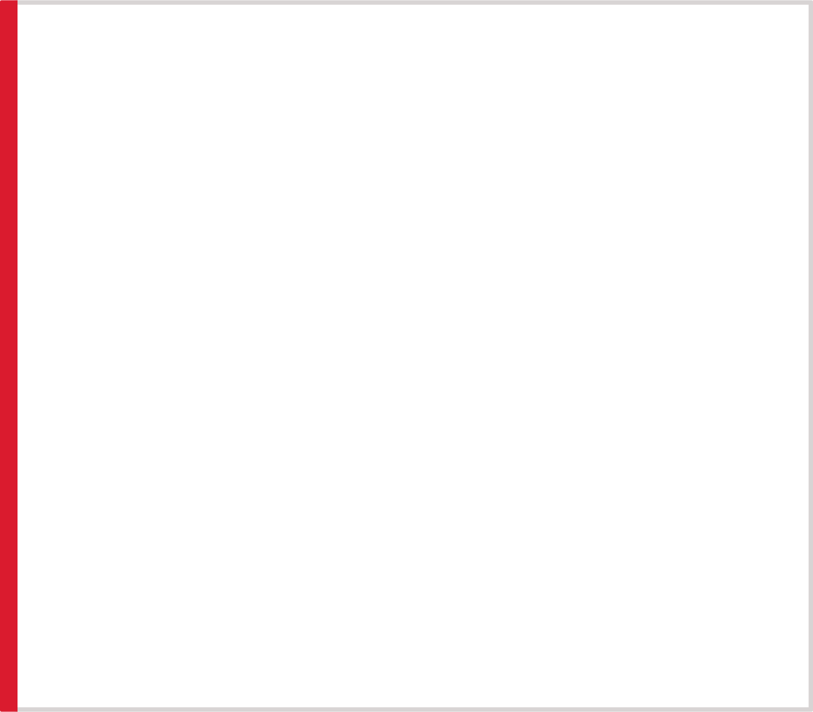
<!-- original vectorial: AIG4B-Clase-8-GANs-media/slide-07-1.svg -->

<!-- original vectorial: AIG4B-Clase-8-GANs-media/slide-07-2.svg -->

<!-- original vectorial: AIG4B-Clase-8-GANs-media/slide-07-3.svg -->

**GANs — Generative Adversarial Networks**

**Diffusion Networks**

**SAM — Segment Anything Model (Meta, 2023)**

- Aprenden a reconstruir una imagen desde el ruido, paso a paso. Motor de Stable Diffusion, DALL·E y Midjourney.
- Pregunta: ¿Cómo generar imágenes diversas y controlables a partir de una descripción?

- Dos redes que compiten: una genera, la otra evalúa. Motor de los deepfakes, StyleGAN y la síntesis de imágenes médicas.
- Pregunta: ¿Cómo generar imágenes realistas que "engañen" a un evaluador?

- No genera imágenes — las entiende. Puede segmentar cualquier objeto en cualquier imagen con precisión quirúrgica. Es prompteable: se guía con puntos, cajas o máscaras.
- Pregunta: ¿Cómo identificar y aislar estructuras en imágenes médicas de forma automatizada e interactiva?

---

## Slide 8 — Tabla comparativa rápida

*Sección: PANORAMA DE LA IA GENERATIVA DE VISIÓN*

- Esta tabla no es para memorizar — es para consultar cuando tengas un problema real y necesites decidir qué herramienta usar.

| Criterio | GANs | Diffusion Networks | SAM |
|---|---|---|---|
| ¿Para qué sirve? | Generar imágenes realistas, transformar modalidades, aumentar datos | Generar imágenes desde texto o guías visuales con alta diversidad | Segmentar y aislar estructuras en imágenes existentes |
| Velocidad | Muy rápida (una pasada) | Lenta (muchos pasos iterativos) | Muy rápida |
| Control | Moderado | Alto (guiado por texto) | Alto (guiado por puntos o cajas) |
| Fortaleza | Velocidad + realismo | Diversidad + controlabilidad | Precisión de segmentación |
| Limitación | Inestabilidad, mode collapse | Lento, costoso computacionalmente | No genera contenido nuevo |
| Caso en biomedicina | Síntesis histológica, MRI→CT | Generación desde descripciones clínicas | Segmentación de tumores, órganos, células |

---

## Slide 9 — Introducción a las GANs

*Sección: INTRODUCCIÓN A LAS GANS*

**1**

**Panorama de la IA Generativa de Visión**

- IA discriminativa vs. generativa, línea de tiempo histórica y modelos del curso

**2**

**Introducción a las GANs**

- Origen (Goodfellow 2014), intuición del falsificador y el detective, arquitectura básica

**3**

**El Ejemplo de Slanted Land**

- De la intuición a los números: Discriminador, Generador y sus pesos

**4**

**Tipos de GANs y Aplicaciones en Biomedicina**

- Vanilla GAN, StyleGAN, fortalezas clínicas y generación de datos sintéticos

**5**

**Limitaciones y Cierre**

- Problemas de entrenamiento, evaluación, sesgo y próximos pasos

---

## Slide 10 — Generative Adversarial Networks (GANs)

*Sección: INTRODUCCIÓN A LAS GANS*

---

## Slide 11 — Punto de partida

*Sección: INTRODUCCIÓN A LAS GANS*

- **"¿Cómo enseñarle a una máquina a crear algo que nunca ha visto?"**

- **Esta es la pregunta que Ian Goodfellow se hizo en 2014. La respuesta que encontró cambió el campo de la inteligencia artificial para siempre y puso en marcha una de las líneas de investigación más prolíficas de la historia de la IA.**

| La idea central | El recorrido de este capítulo |
|---|---|
| En lugar de enseñarle a una red a crear directamente, haz que compita contra otra red que aprende a detectar sus errores. La presión de la competencia hace que ambas mejoren continuamente. | De dónde vienen las GANs y cómo evolucionaron Cómo funcionan por dentro — sin fórmulas, con intuición Para qué sirven y dónde tienen límites Cómo se aplican concretamente en Biomedicina |

---

## Slide 12 — El origen: una noche en un bar (2014)

*Sección: INTRODUCCIÓN A LAS GANS*

- Montreal, junio de 2014. Ian Goodfellow, 27 años, propone en una conversación de bar una idea aparentemente simple: ¿y si en lugar de una sola red, usamos dos? Una que genera, otra que evalúa. Que compitan.
- Sus colegas son escépticos. Esa misma noche implementa el prototipo. Funciona en el primer intento.

**70K+**

**Citas del paper original**

- "La idea más interesante en machine learning en los últimos 20 años." — Yann LeCun

---

## Slide 13 — Modelo Mental Para Entenderlo

*Sección: INTRODUCCIÓN A LAS GANS*

- **Un experimento mental: el mundo de los rostros. Imaginad una sociedad donde existen miles de rostros reales con características reconocibles. En esa sociedad aparecen dos personajes con objetivos opuestos:**

| El Falsificador | El Detective |
|---|---|
| Objetivo: crear rostros que parezcan pertenecer a ese mundo. Método: prueba y error. Genera un rostro, recibe feedback, ajusta, repite. Puede estudiar todos los rostros reales que quiera, pero no sabe cómo se fabrican. | Objetivo: distinguir los rostros reales de los falsos. Ventaja: ve ambos tipos — los reales del dataset y los que produce el falsificador. Como el falsificador mejora constantemente, él también tiene que mejorar. |

- **¿Qué pasa cuando estos dos compiten durante miles — o millones — de rondas? Los dos se vuelven extraordinariamente buenos en lo suyo.**

---

## Slide 14

*Sección: INTRODUCCIÓN A LAS GANS*

**Arquitectura de una GAN**

- Lo que acabamos de describir con el falsificador y el detective tiene una arquitectura técnica precisa. Cada elemento de la analogía corresponde a un componente real de la red:

| Analogía | Componente técnico | Función |
|---|---|---|
| El Falsificador | Generador (G) | Transforma ruido aleatorio en imágenes sintéticas |
| Los rostros falsos | Imágenes generadas | Output del Generador — al principio, puro ruido visual |
| El Detective | Discriminador (D) | Clasifica cada imagen como "real" o "falsa" con un score entre 0 y 1 |
| El veredicto | Señal de pérdida (loss) | Número que mide el error de cada red y guía su aprendizaje |
| Las rondas de competencia | Épocas de entrenamiento | Ciclos en los que ambas redes actualizan sus parámetros internos |

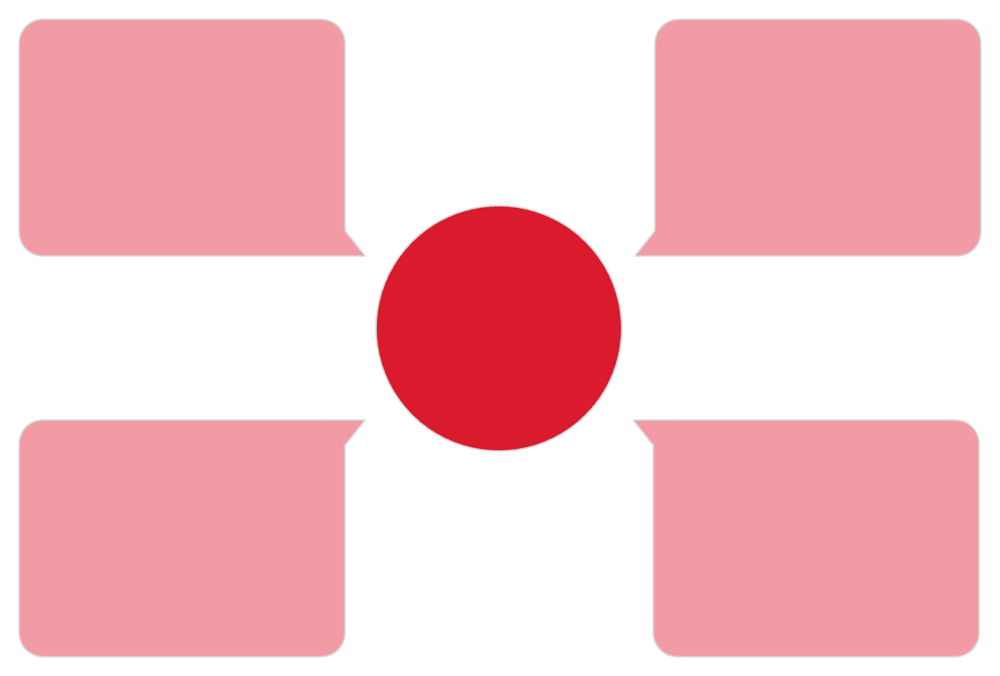

| Clasificación | Generador |
|---|---|
| Salida: real o falso | Recibe ruido aleatorio |

- Arquitectura GAN

- Discriminador

- Salida sintética

- Recibe reales y generadas

- Imágenes generadas

---

## Slide 15 — Arquitectura de una "Vanilla" GAN

*Sección: INTRODUCCIÓN A LAS GANS*

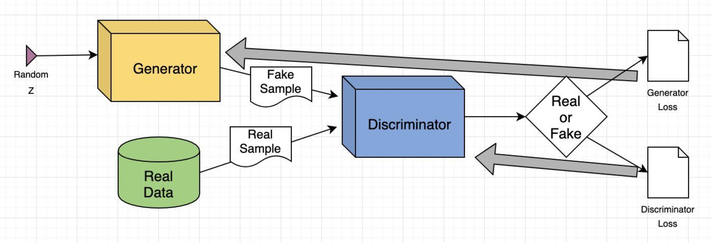

<!-- enlace de la forma: https://aws.amazon.com/es/what-is/gan/ -->
- **[¿Qué es una GAN? - Explicación sobre las redes generativas antagónicas - AWS](https://aws.amazon.com/es/what-is/gan/)**

---

## Slide 16 — Entrenamiento paso a paso

*Sección: INTRODUCCIÓN A LAS GANS*

- Cuatro pasos que se repiten miles de veces — así es como una GAN aprende a engañar.

<!-- original vectorial: AIG4B-Clase-8-GANs-media/slide-16-3.svg -->

<!-- original vectorial: AIG4B-Clase-8-GANs-media/slide-16-2.svg -->

<!-- original vectorial: AIG4B-Clase-8-GANs-media/slide-16-1.svg -->

- Paso 3 — El Discriminador emite su veredicto

- Paso 2 — El Discriminador evalúa

- Paso 1 — El Generador produce su primer intento

- Recibe dos tipos de inputs en cada ronda: imágenes reales del dataset de entrenamiento e imágenes falsas producidas por el Generador en el Paso 1. Su tarea: asignar a cada imagen una probabilidad de ser real (entre 0 y 1).
- Al principio tiene la tarea fácil — las imágenes del Generador son obviamente falsas.

- Produce un número entre 0 y 1: cerca de 1 → "Esto es real"; cerca de 0 → "Esto es claramente falso"; cerca de 0.5 → "No tengo idea". Cuando el Generador logra que el Discriminador dé 0.5 de forma consistente, es el éxito.

- Recibe como entrada un vector de ruido aleatorio — números al azar que representan un punto en un espacio de posibilidades. Con ese ruido como semilla, produce una imagen. Al principio del entrenamiento, esa imagen es literalmente ruido visual — manchas sin forma ni sentido.
- Analogía: el falsificador en su primer día. No sabe nada de los rostros reales — produce garabatos.

<!-- original vectorial: AIG4B-Clase-8-GANs-media/slide-16-5.svg -->

<!-- original vectorial: AIG4B-Clase-8-GANs-media/slide-16-4.svg -->

- Paso 5 — El ciclo se repite miles de veces

- Paso 4 — Ambos aprenden del resultado

- Generar → evaluar → aprender. Este loop puede repetirse cientos de miles de veces. Con cada iteración, el Generador produce imágenes más convincentes y el Discriminador se vuelve más exigente. Al final, el ojo humano no puede distinguir lo real de lo generado.

- El veredicto se convierte en señal de aprendizaje: el Generador ajusta sus parámetros para engañar mejor la próxima vez; el Discriminador ajusta los suyos para detectar mejor. Ambos actualizan simultáneamente — cada uno aprende del error del otro.

---

## Slide 17 — El Ejemplo de Slanted Land

*Sección: EL EJEMPLO DE SLANTED LAND*

**1**

**Panorama de la IA Generativa de Visión**

- IA discriminativa vs. generativa, línea de tiempo histórica y modelos del curso

**2**

**Introducción a las GANs**

- Origen (Goodfellow 2014), intuición del falsificador y el detective, arquitectura básica

**3**

**El Ejemplo de Slanted Land**

- De la intuición a los números: Discriminador, Generador y sus pesos

**4**

**Tipos de GANs y Aplicaciones en Biomedicina**

- Vanilla GAN, StyleGAN, fortalezas clínicas y generación de datos sintéticos

**5**

**Limitaciones y Cierre**

- Problemas de entrenamiento, evaluación, sesgo y próximos pasos

---

## Slide 18 — El Problema: ¡Bienvenidos a Slanted Land! 🌀

*Sección: EL EJEMPLO DE SLANTED LAND*

- Imagina un mundo peculiar llamado Slanted Land, donde absolutamente todo se inclina: los árboles, las casas, las personas e incluso la pizza que comen los gatos. En este universo, la norma es la inclinación.
- Los habitantes de Slanted Land solo conocen rostros con una ligera inclinación. Para ellos, un rostro completamente recto sería una anomalía, algo totalmente extraño e incomprensible.

- El problema urgente: la app de citas de Slanted Land, TiltedTinder, necesita generar fotos de perfil para sus usuarios. Pero solo tienen 4 fotos reales en toda su base de datos. Con tan pocos datos, nadie encuentra pareja. ¡La supervivencia romántica de toda una civilización inclinada depende de nuestra GAN! 💘

| Universo Inclinado | Rostros "Normales" |
|---|---|
| Todo, desde la gravedad hasta las cejas de sus habitantes, está en un ángulo distintivo. | Solo existen los rostros inclinados; un rostro recto les resulta completamente alienígena. |

<!-- enlace de la forma: https://www.youtube.com/watch?v=8L11aMN5KY8&t=16s -->
- [Basado en el tutorial de Rowel Atienza — ver video:](https://www.youtube.com/watch?v=8L11aMN5KY8&t=16s)

---

## Slide 19 — El mundo de Slanted Land

*Sección: EL EJEMPLO DE SLANTED LAND*

| Imágenes 2×2 píxeles | Dataset real | Red de una sola capa |
|---|---|---|
| Cada imagen se representa como una pantalla con 4 celdas — cada celda tiene un valor entre 0 (blanco) y 1 (negro). | Son imágenes de personas inclinadas. El Generador va a aprender a producir imágenes que se parezcan a esas personas. | La arquitectura más simple posible — ideal para entender los fundamentos sin complejidad adicional. |

---

## Slide 20

*Sección: EL EJEMPLO DE SLANTED LAND*

**Los datos reales: caras con patrón**

- Las "caras" de Slanted Land, codificadas como píxeles, tienen un patrón consistente:

- Esquinas oscuras en la diagonal principal (arriba-izquierda y abajo-derecha): valor alto
- Esquinas claras en la diagonal secundaria (arriba-derecha y abajo-izquierda): valor bajo

- Ese patrón diagonal es la "firma" de una cara real. El Discriminador tiene que aprenderlo para poder distinguirla del ruido.

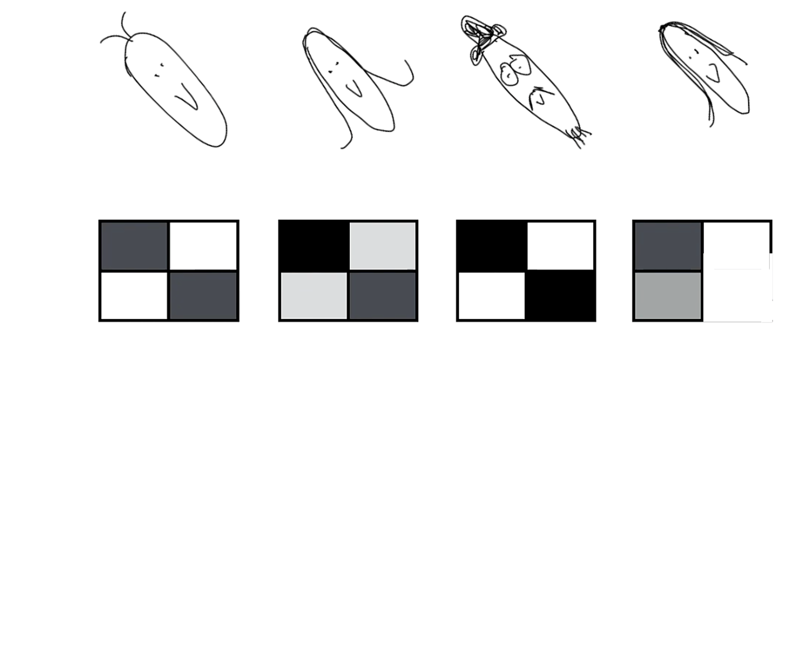

---

## Slide 21 — Caras vs. ruido: los dos tipos de imágenes

*Sección: EL EJEMPLO DE SLANTED LAND*

| Caras (imágenes reales) | Ruido (imágenes falsas) |
|---|---|
| Valores altos en la diagonal principal, bajos en la secundaria. Patrón estructurado y reconocible. | Valores sin patrón, distribuidos aleatoriamente. Sin estructura diagonal. El Discriminador debe aprender a distinguirlos a partir de esos valores numéricos. |

---

## Slide 22

*Sección: EL EJEMPLO DE SLANTED LAND*

**Construyendo el Discriminador**

**¿qué píxeles importan?**

- El Discriminador aprende que en las caras de Slanted Land:

- Los píxeles de la diagonal principal son grandes → reciben peso positivo (+1)
- Los píxeles de la diagonal secundaria son pequeños → reciben peso negativo (−1)

- Asigna estos pesos a cada posición: +1 para las que caracterizan una cara, −1 para las que no la caracterizan.

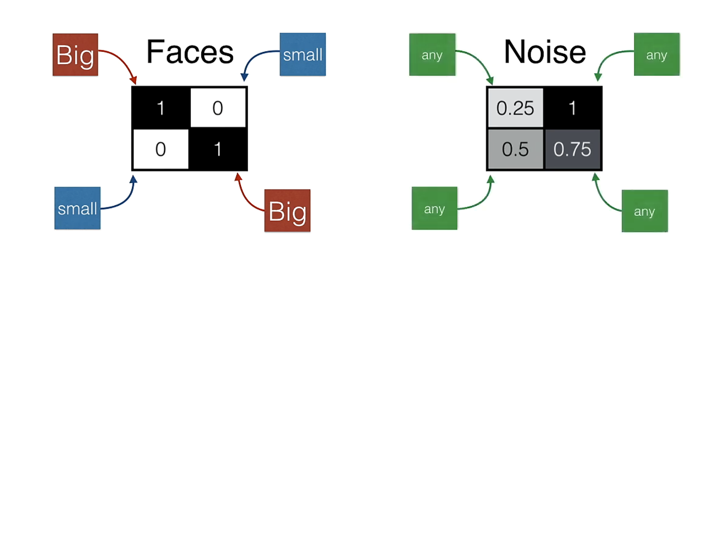

---

## Slide 23 — Construyendo el Discriminador

*Sección: EL EJEMPLO DE SLANTED LAND*

**Calculo del Score**

- El score de una imagen = suma ponderada de sus valores de píxel × pesos aprendidos:

| Cara prototipo | Imagen de ruido |
|---|---|
| 1×(+1) + 0×(−1) + 0×(−1) + 1×(+1) = 2 | 0.25×(+1) + 1×(−1) + 0.5×(−1) + 0.75×(+1) = −0.5 |
| Score > 1 → Real ✓ | Score < 1 → Falsa ✓Score > 1 → Real ✓ |

---

## Slide 24

*Sección: EL EJEMPLO DE SLANTED LAND*

- **Discriminador Como red neuronal**

- Para la cara prototipo: σ(1×(+1) + 0×(−1) + 0×(−1) + 1×(+1) − 1) = σ(1)

| Entradas (z) | Pesos (w) | Bias |
|---|---|---|
| z₁=1, z₂=0, z₃=0, z₄=1 | w₁=+1, w₂=−1, w₃=−1, w₄=+1 | valor fijo = 1, peso = −1 |

| Suma ponderada | Sigmoid |
|---|---|
| 1(+1)+0(−1)+0(−1)+1(+1)+1(−1) = 1 | σ(1) ≈ 0.73 → imagen real |

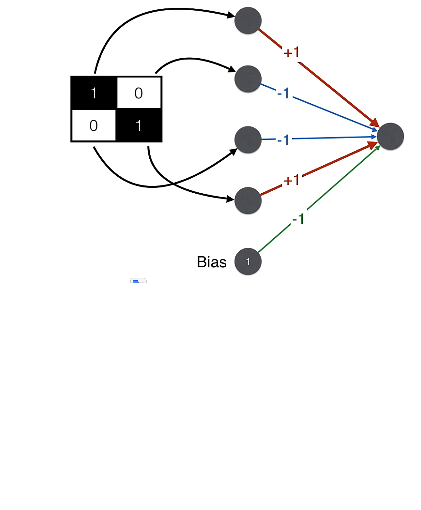

---

## Slide 25 — Función Sigmoid: la activación del Discriminador

*Sección: EL EJEMPLO DE SLANTED LAND*

- **La función sigmoid convierte cualquier número real en una probabilidad entre 0 y 1. Es la función de activación que usa el Discriminador para emitir su veredicto.**

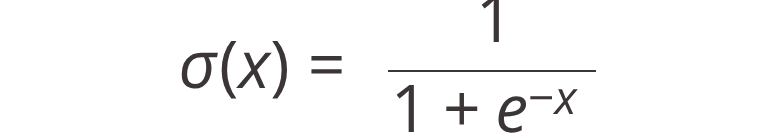

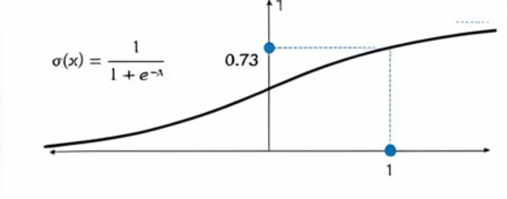

| Rango acotado | Diferenciable | Monótona creciente | Punto medio en 0 |
|---|---|---|---|
| Devuelve valores entre 0 y 1; se lee como probabilidad. | Es suave en todo punto; permite backpropagation. | Si sube la entrada, sube la salida; conserva el orden. | σ(0) = 0.5; umbral natural de decisión. |

---

## Slide 26 — Pongamos todo junto del Discriminador

*Sección: EL EJEMPLO DE SLANTED LAND*

- **Cuando la cara prototipo pasa por la red completa:**
- **σ(1) = 0.73 → "Estoy un 73% seguro de que esto es real"**
- **Como 0.73 > 0.5, clasifica correctamente la imagen como real ✓**

- **Cuando la imagen de ruido pasa por la misma red:**
- **σ(-0.5) = 0.37 → "Estoy solo un 37% seguro de que esto sea real"**
- **Como 0.37 < 0.5, clasifica correctamente la imagen como falsa ✓**

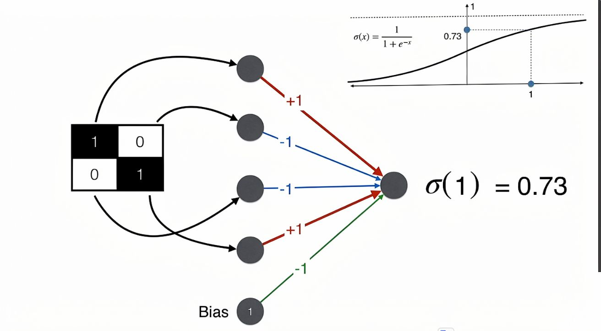

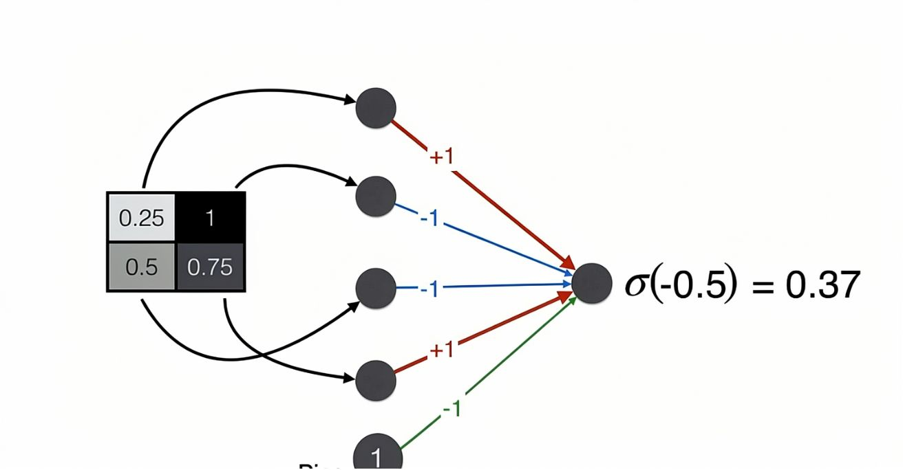

---

## Slide 27

*Sección: EL EJEMPLO DE SLANTED LAND*

**Construyendo el Generador**

**El objetivo opuesto**

- El Generador recibe un número aleatorio z (entre 0 y 1 — el "ruido latente") y tiene que producir una imagen de 2×2 píxeles. Su objetivo: producir imágenes que el Discriminador clasifique como reales (output cercano a 1).
- La estructura es la inversa del Discriminador: de 1 número → 4 píxeles. En redes reales, esto se implementa con capas de upsampling y convoluciones transpuestas.

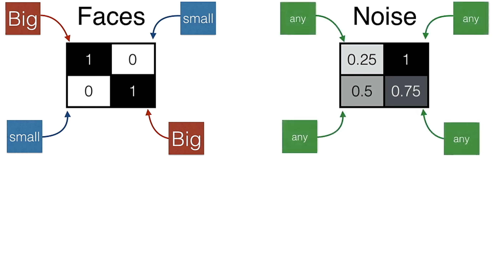

---

## Slide 28 — Construyendo el Generador

*Sección: EL EJEMPLO DE SLANTED LAND*

**El Generador en acción: z = 0.7 → imagen**

- Con z = 0.7 como entrada y los pesos aprendidos, el Generador produce una imagen que reproduce el patrón diagonal de las caras reales. El Generador aprendió a engañar al Discriminador.
- El resultado muestra el patrón diagonal característico de las caras de Slanted Land: valores altos en la diagonal principal, bajos en la secundaria. El Generador internalizó la estructura del dataset real.

---

## Slide 29 — Proceso de Entrenamiento

*Sección: EL EJEMPLO DE SLANTED LAND*

- En los slides anteriores definimos los pesos del Discriminador y el Generador a mano (+1, −1, Bias). En la práctica, la red debe aprender esos pesos sola. Para eso necesitamos una forma de medir cuánto se equivocó — esa es la función de error.
- Para que ambas redes aprendan, necesitamos medir exactamente cuánto se equivocaron. La función que hace eso en las GANs se llama log-loss (binary cross-entropy):

| Cuando queremos que la predicción sea 1 | Cuando queremos que la predicción sea 0 |
|---|---|
| Error = −ln(predicción) Se usa cuando la imagen es real y el Discriminador debe acercarse a 1. | Error = −ln(1 − predicción) Se usa cuando la imagen es falsa y el Discriminador debe acercarse a 0. |

- La propiedad clave: el error es grande cuando la predicción está lejos del objetivo, y pequeño cuando está cerca. Esto guía el aprendizaje en la dirección correcta.

---

## Slide 30 — Log-loss: los dos casos

*Sección: EL EJEMPLO DE SLANTED LAND*

| Label = 1 — Imagen Real | Label = 0 — Imagen Falsa |
|---|---|
| 🔍 Discriminador entrenando con imagen real. Debe acercarse a 1. ✅ Predicción = 0.9 → −ln(0.9) ≈ 0.1 → Error pequeño ❌ Predicción = 0.1 → −ln(0.1) ≈ 2.3 → Error enorme | 🎨 Generador entrenando: el Discriminador debe acercarse a 0 (detectar la imagen como falsa). ✅ Predicción = 0.1 → −ln(0.9) ≈ 0.1 → Error pequeño ❌ Predicción = 0.9 → −ln(0.1) ≈ 2.3 → Error enorme |

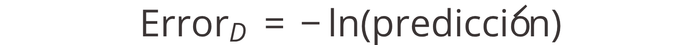

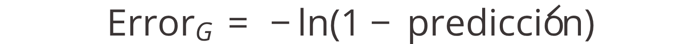

- **La propiedad clave: el error es grande cuando la predicción está lejos del objetivo, y pequeño cuando está cerca. Esto guía el aprendizaje en la dirección correcta.**

---

## Slide 31

*Sección: EL EJEMPLO DE SLANTED LAND*

**Loss Function Visualmente**

- 🔍 Discriminador — imagen real

- 🎨 Generador — imagen falsa

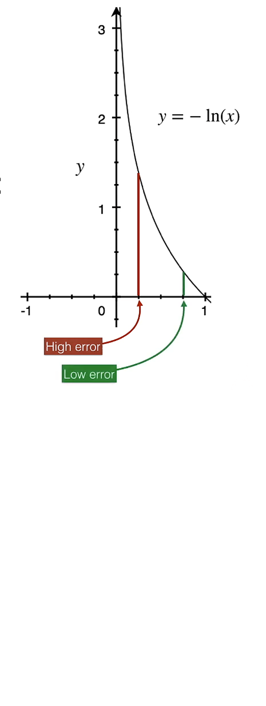

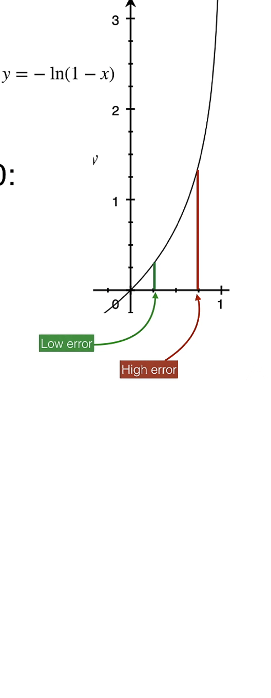

- Predicción = 0 (imagen falsa). Error = −ln(1−predicción). Predicción alta → alto error. El Generador quiere que el Discriminador le asigne score alto (cercano a 1) — lo opuesto al objetivo del Discriminador.

- Predicción = 1 (imagen real). Error = −ln(predicción). Predicción baja → alto error. Predicción alta → bajo error. El Discriminador quiere acercarse a 1 cuando ve imágenes reales.

---

## Slide 32 — Backpropagation: del error al ajuste de pesos

*Sección: EL EJEMPLO DE SLANTED LAND*

- Una vez calculado el error, la red lo "propaga hacia atrás" para ajustar cada peso:

<!-- original vectorial: AIG4B-Clase-8-GANs-media/slide-32-1.svg -->

- Pesos con alta contribución al error → se ajustan más

<!-- original vectorial: AIG4B-Clase-8-GANs-media/slide-32-2.svg -->

- Pesos con baja contribución al error → se ajustan poco

<!-- original vectorial: AIG4B-Clase-8-GANs-media/slide-32-3.svg -->

- La dirección del ajuste apunta siempre a reducir el error

- Este proceso ocurre simultáneamente en el Generador y el Discriminador en cada iteración.

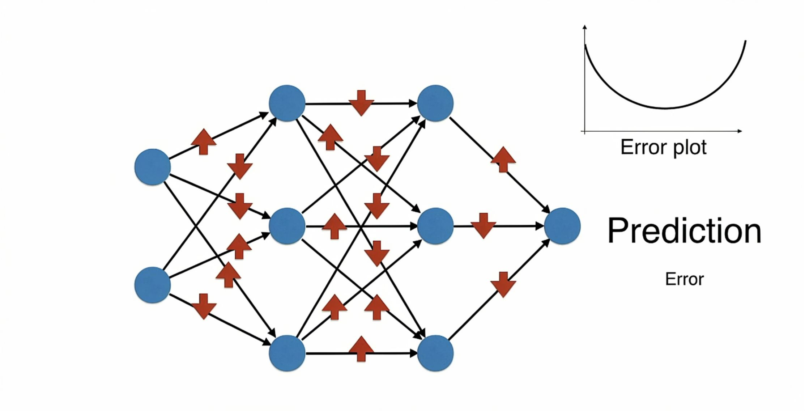

---

## Slide 33 — Backpropagation: el procedimiento paso a paso

*Sección: EL EJEMPLO DE SLANTED LAND*

| 01 | 02 | 03 |
|---|---|---|
| Calcular el error | Derivar la sensibilidad de cada peso | Actualizar en la dirección opuesta al gradiente |

- **La función log-loss da un número que mide qué tan lejos estuvo la red de la respuesta correcta.**

- **Con la regla de la cadena se calcula ∂E/∂w para cada peso: si subo este peso un poco, ¿el error sube o baja?**

- **w_nuevo = w_actual − α · (∂E/∂w) — α (learning rate) controla el tamaño del paso.**

- **04**

**Repetir para todos los pesos, en ambas redes**

- **El cálculo se ejecuta para cada peso del Discriminador y del Generador de forma simultánea.**

---

## Slide 34 — Backpropagation: ejemplo con Slanted Land

*Sección: EL EJEMPLO DE SLANTED LAND*

- **Con el error del Discriminador = 1.14 y output D(G(z)) = 0.68, calculamos el ajuste concreto usando la derivada ∂E/∂wᵢ = −[1 − D(x)] · xᵢ:**

| Píxel | Valor xᵢ | ∂E/∂w | α = 0.1 | w_nuevo |
|---|---|---|---|---|
| Arriba-izq (diagonal) | 0.25 | −0.32 × 0.25 = −0.08 | −0.1 × (−0.08) | 1 + 0.008 = 1.008 ↑ |
| Arriba-der | 1.00 | −0.32 × 1.00 = −0.32 | −0.1 × (−0.32) | −1 + 0.032 = −0.968 ↑ |

- **Los pesos se mueven en la dirección que hace al Discriminador más exigente: en la próxima iteración dará un score más bajo a imágenes similares.**

---

## Slide 35

*Sección: EL EJEMPLO DE SLANTED LAND*

**El ciclo completo: Generador y Discriminador juntos**

- Con z = 0.7, el Generador produce una imagen → el Discriminador la evalúa → output: 0.68. Este único número conecta los dos errores:

| Error del Discriminador | Error del Generador |
|---|---|
| Recibió 0.68 cuando quería dar 0 → se equivocó. Debe ajustar sus pesos para detectar mejor. | Recibió 0.68 cuando quería que diera 1 → casi lo engañó, pero no del todo. Debe ajustar para engañar más. |

---

## Slide 36 — El error del Discriminador

*Sección: EL EJEMPLO DE SLANTED LAND*

- El Discriminador recibió una imagen falsa pero le asignó un score de 0.68 (quería dar 0):

- Un error considerable. El Discriminador va a ajustar sus pesos para clasificar mejor estas imágenes en la próxima iteración — volviéndose más exigente y difícil de engañar.

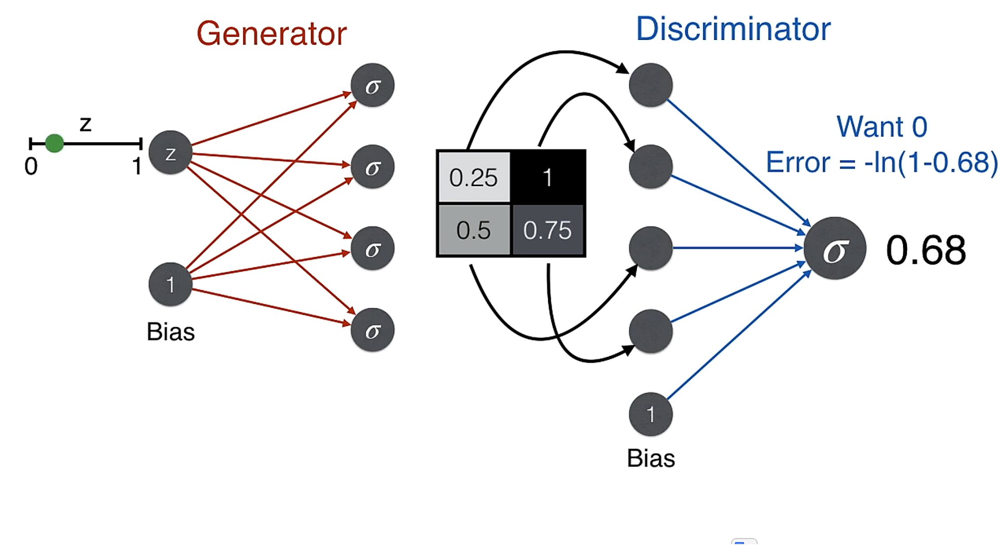

---

## Slide 37

*Sección: EL EJEMPLO DE SLANTED LAND*

**Para los curiosos: la derivada del error**

- La derivada del error del Discriminador respecto a sus pesos permite calcular exactamente cuánto ajustar cada uno:

- Este cálculo es lo que backpropagation ejecuta automáticamente en cada iteración, para todas las capas y todos los pesos de la red. La regla de la cadena lo hace computacionalmente eficiente incluso con millones de parámetros.

- Slide opcional — para quien quiera profundizar en la matemática. Fuente: A Friendly Introduction to Generative Adversarial Networks — Luis Serrano Academy.

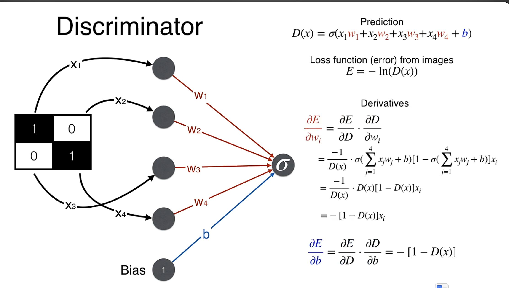

---

## Slide 38 — Tipos de GANs y Aplicaciones en Biomedicina

*Sección: TIPOS DE GANS Y APLICACIONES EN BIOMEDICINA*

**1**

- **Panorama de la IA Generativa de Visión**

- IA discriminativa vs. generativa, línea de tiempo histórica y modelos del curso

**2**

- **Introducción a las GANs**

- Origen (Goodfellow 2014), intuición del falsificador y el detective, arquitectura básica

**3**

- **El Ejemplo de Slanted Land**

- De la intuición a los números: Discriminador, Generador y sus pesos

**4**

- **Tipos de GANs y Aplicaciones en Biomedicina**

- Vanilla GAN, StyleGAN, fortalezas clínicas y generación de datos sintéticos

**5**

- **Limitaciones y Cierre**

- Problemas de entrenamiento, evaluación, sesgo y próximos pasos

---

## Slide 39 — Tipos de GANs: el punto de partida

*Sección: TIPOS DE GANS Y APLICACIONES EN BIOMEDICINA*

- Todo lo que describimos corresponde a la Vanilla GAN — el modelo original de Goodfellow (2014). Pero ese modelo base tiene limitaciones importantes, y surgieron variantes especializadas que resuelven problemas concretos.

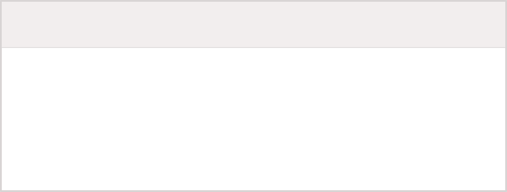
<!-- original vectorial: AIG4B-Clase-8-GANs-media/slide-39-1.svg -->

<!-- original vectorial: AIG4B-Clase-8-GANs-media/slide-39-2.svg -->

**Vanilla GAN · Goodfellow et al. 2014**

**Conditional GAN (cGAN) · Mirza & Osindero, 2014**

- Generador produce imágenes desde ruido aleatorio. Sin control sobre el resultado. Inestable y de baja calidad visual. Uso: punto de partida teórico.

- Generador y Discriminador reciben etiquetas de clase como condición. "Genera una imagen histológica de carcinoma ductal." Uso: síntesis por patología, aumentación controlada.

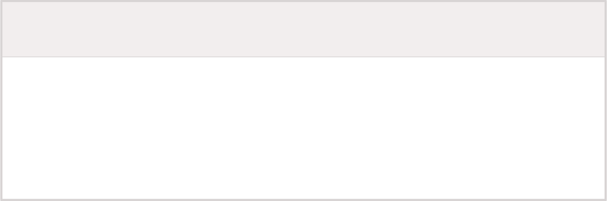
<!-- original vectorial: AIG4B-Clase-8-GANs-media/slide-39-3.svg -->

<!-- original vectorial: AIG4B-Clase-8-GANs-media/slide-39-4.svg -->

| DCGAN · Radford et al., 2015 | SRGAN · Ledig et al., 2017 |
|---|---|
| Reemplaza capas densas con redes convolucionales. Entrenamiento estable, imágenes nítidas. Uso: base estándar para generación de imágenes de calidad. | Especializado en ampliar imágenes de baja a alta resolución. Infiere detalles finos que no estaban en la imagen original. Uso: mejora de imágenes médicas de menor calidad. |

---

## Slide 40 — El salto que lo cambió todo: StyleGAN (2018)

*Sección: TIPOS DE GANS Y APLICACIONES EN BIOMEDICINA*

- El problema que nadie había resuelto en cuatro años: las GANs generaban imágenes, pero no podías pedirle "genera una cara joven, con pelo castaño y expresión neutral". El Generador mezclaba todos los atributos juntos sin control.
- ¿Qué cambió exactamente en StyleGAN? En una GAN clásica, el ruido entra directamente y todo (forma, color, textura) sale del mismo vector mezclado. StyleGAN lo separa en capas independientes:

| Componente | Qué hace | Qué controla |
|---|---|---|
| Red de mapeo (mapping network) | Transforma el ruido en un vector de estilo (w) | Define las características globales de la imagen |
| Síntesis por capas (AdaIN) | Inyecta el estilo en distintas capas de la red | Cada capa controla una escala diferente de detalle |
| Ruido estocástico por capa | Añade variación aleatoria capa a capa | Controla variaciones finas: poros, pelo suelto, arrugas |

- Style mixing: StyleGAN permite tomar la estructura de una cara (pose, forma) y el estilo de otra (color de pelo, edad) para generar una cara completamente nueva con coherencia total. Esto no era posible en ninguna GAN anterior.

---

## Slide 41 — StyleGAN: arquitectura

*Sección: TIPOS DE GANS Y APLICACIONES EN BIOMEDICINA*

**Dos redes en lugar de una**

- Caras fotorrealistas generadas por StyleGAN (NVIDIA, 2019)

- StyleGAN separa el proceso en dos redes:

- 🔀 Mapping Network: transforma el ruido z en un vector de estilo w (512 dimensiones)
- 🎨 Synthesis Network: genera la imagen progresivamente, inyectando el estilo w en cada capa

- Esto permite controlar atributos separados en cada nivel de resolución: pose y forma en capas bajas, textura y color en capas altas.

- La clave: el estilo se inyecta en cada capa mediante AdaIN (Adaptive Instance Normalization), no solo al inicio. Esto da control granular sobre cada aspecto visual.

---

## Slide 42 — StyleGAN: Innovaciones Clave (Resumen)

*Sección: TIPOS DE GANS Y APLICACIONES EN BIOMEDICINA*

- StyleGAN (NVIDIA) redefine la generación de imágenes al modificar únicamente el Generador, manteniendo el Discriminador estándar. Sus tres innovaciones arquitectónicas permiten control fino sobre el estilo y alta calidad visual.

<!-- original vectorial: AIG4B-Clase-8-GANs-media/slide-42-1.svg -->

<!-- original vectorial: AIG4B-Clase-8-GANs-media/slide-42-2.svg -->

<!-- original vectorial: AIG4B-Clase-8-GANs-media/slide-42-3.svg -->

| Progressive Growing | Bi-linear Sampling | Mapping Network + AdaIN |
|---|---|---|
| Entrena comenzando con imágenes de 4×4 píxeles y agrega capas progresivamente hasta 1024×1024. Mejora la estabilidad del entrenamiento y la calidad final. | Reemplaza el muestreo nearest-neighbor por bi-linear sampling en up/downsampling, reduciendo artefactos y logrando transiciones más suaves. | Una red de 8 capas transforma el vector latente z en un vector intermedio w, que modula las características vía AdaIN. Permite controlar textura, iluminación y estilo de forma independiente por nivel. |

- Fuente: GeeksforGeeks — StyleGAN: Style Generative Adversarial Networks

---

## Slide 43 — Fortaleza 1: Generación de imágenes realistas

*Sección: TIPOS DE GANS Y APLICACIONES EN BIOMEDICINA*

- El resultado más sorprendente de las GANs: imágenes que el ojo humano no puede distinguir de las reales. Después de millones de rondas de entrenamiento, el Generador aprendió la estructura profunda de cómo lucen esas imágenes — proporciones, distribución de luz, imperfecciones que hacen que algo parezca real.

<!-- original vectorial: AIG4B-Clase-8-GANs-media/slide-43-2.svg -->

**ThisPersonDoesNotExist.com**

- Cada recarga genera un rostro humano completamente inventado con StyleGAN. Ninguno existe en el mundo real.

<!-- original vectorial: AIG4B-Clase-8-GANs-media/slide-43-3.svg -->

**Imágenes médicas sintéticas**

- GANs entrenadas con resonancias magnéticas generan imágenes de cerebro que neurorradiólogos no pueden distinguir de las reales en estudios ciegos.

<!-- original vectorial: AIG4B-Clase-8-GANs-media/slide-43-4.svg -->

**Videojuegos y entretenimiento**

- Las GANs generan texturas, escenarios y personajes con un nivel de detalle que antes requería artistas trabajando manualmente durante días.

---

## Slide 44 — Fortaleza 2: Transformación de imágenes (Image Translation)

*Sección: TIPOS DE GANS Y APLICACIONES EN BIOMEDICINA*

- Las GANs pueden transformar una imagen en otra preservando la estructura subyacente. Aplicación clínica clave: MRI → CT sin necesitar al mismo paciente escaneado dos veces — reduce costes, tiempo y exposición a radiación.

| Input | Output | Modelo |
|---|---|---|
| Boceto de un edificio | Foto del edificio terminado | Pix2Pix |
| Foto de día | La misma foto de noche | CycleGAN |
| Imagen de un caballo | La misma imagen con una cebra | CycleGAN |
| Imagen de baja resolución | Alta resolución (super-resolución) | SRGAN |
| Imagen en blanco y negro | La misma imagen en color | DeOldify / CycleGAN |
| MRI de cerebro | Imagen equivalente de CT | CycleGAN médico |

---

## Slide 45 — Fortaleza 3: Completado de imágenes (Image Inpainting)

*Sección: TIPOS DE GANS Y APLICACIONES EN BIOMEDICINA*

- Las GANs pueden reconstruir regiones faltantes de forma coherente con el contexto. La red recibe una imagen con una región enmascarada e infiere el contenido más probable basándose en colores, texturas y estructuras adyacentes. No copia píxeles cercanos — entiende el contenido semántico de la escena completa.

| Artefactos de movimiento en MRI | Biopsias con burbujas o pliegues |
|---|---|
| Reconstruye la imagen original estimada eliminando las distorsiones causadas por el movimiento del paciente durante la adquisición. | Completa el tejido faltante en preparaciones histológicas con defectos de proceso o manipulación. |

- **Tomografías con dosis reducida**

- Recupera la información sacrificada en protocolos de baja radiación, protegiendo al paciente sin perder calidad diagnóstica.

---

## Slide 46 — Fortaleza 4: Generación de datos sintéticos para entrenamiento

*Sección: TIPOS DE GANS Y APLICACIONES EN BIOMEDICINA*

**El cuello de botella en IA médica**

**La solución con GANs**

- **Entrenar con las pocas imágenes reales disponibles y generar miles de imágenes sintéticas adicionales para ampliar el dataset.**

- **Enfermedades raras → pocos casos documentados. Datos de pacientes → protegidos por regulaciones estrictas. Etiquetado → requiere especialistas, es caro y lento.**

- **Una GAN entrenada con biopsias histológicas de tumores de mama generó imágenes indistinguibles de las reales para patólogos. Combinando datos reales y sintéticos, la precisión del clasificador mejoró un 30%.**

- **Bonus: los datos sintéticos no corresponden a ningún paciente real → no están sujetos a restricciones de privacidad (HIPAA, GDPR).**

---

## Slide 47 — El dataset importa: lo que le das es lo que obtenés

*Sección: TIPOS DE GANS Y APLICACIONES EN BIOMEDICINA*

- Una GAN solo puede generar lo que aprendió. Si el dataset mezcla clases sin etiquetas, el Generador produce híbridos incoherentes — inútiles para entrenar clasificadores. En Biomedicina, el dataset debe ser homogéneo dentro de cada clase — o usar una Conditional GAN.

| Tipo de dataset | Lo que genera la GAN |
|---|---|
| Solo imágenes de gatos | Gatos variados y realistas ✓ |
| Solo imágenes de perros | Perros variados y realistas ✓ |
| Gatos + perros sin etiqueta | Híbridos incoherentes ✗ |
| Gatos + perros con etiqueta (cGAN) | Puede generar cada clase por separado ✓ |

- En aplicaciones médicas reales, asegurate de que el dataset de entrenamiento esté limpio, bien etiquetado y sea homogéneo dentro de cada clase patológica antes de empezar a entrenar.

---

## Slide 48 — Limitaciones y Cierre

*Sección: LIMITACIONES Y CIERRE*

**1**

**Panorama de la IA Generativa de Visión**

- IA discriminativa vs. generativa, línea de tiempo histórica y modelos del curso

**2**

**Introducción a las GANs**

- Origen (Goodfellow 2014), intuición del falsificador y el detective, arquitectura básica

**3**

**El Ejemplo de Slanted Land**

- De la intuición a los números: Discriminador, Generador y sus pesos

**4**

**Tipos de GANs y Aplicaciones en Biomedicina**

- Vanilla GAN, StyleGAN, fortalezas clínicas y generación de datos sintéticos

**5**

**Limitaciones y Cierre**

- Problemas de entrenamiento, evaluación, sesgo y próximos pasos

---

## Slide 49 — Limitaciones (1 de 2): los problemas de entrenamiento

*Sección: LIMITACIONES Y CIERRE*

<!-- original vectorial: AIG4B-Clase-8-GANs-media/slide-49-2.svg -->

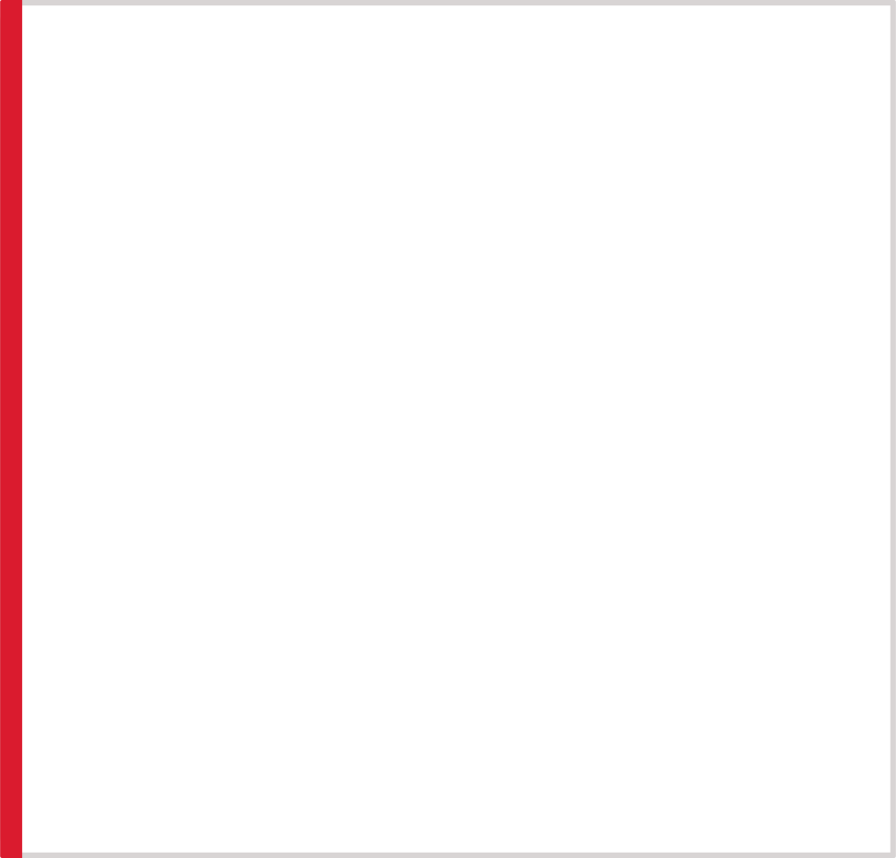
<!-- original vectorial: AIG4B-Clase-8-GANs-media/slide-49-3.svg -->

| Mode Collapse — el más común y frustrante | Inestabilidad en el entrenamiento |
|---|---|
| El Generador descubre un "truco": produce siempre el mismo tipo de imagen que engaña al Discriminador, en lugar de aprender toda la variedad posible. Analogía: el falsificador que solo falsifica un tipo de billete. En medicina: una GAN para síntesis de tumores que solo genera un tipo de morfología produce datos sintéticos inútiles. | El balance entre Generador y Discriminador es frágil. Si el Discriminador es demasiado bueno, el Generador no recibe señal útil y el gradiente "desaparece". Si el Discriminador es demasiado malo, el Generador aprende trucos baratos en lugar de aprender la distribución real. |

---

## Slide 50 — Limitaciones (2 de 2): evaluación, coste y sesgo

*Sección: LIMITACIONES Y CIERRE*

<!-- original vectorial: AIG4B-Clase-8-GANs-media/slide-50-1.svg -->

<!-- original vectorial: AIG4B-Clase-8-GANs-media/slide-50-2.svg -->

<!-- original vectorial: AIG4B-Clase-8-GANs-media/slide-50-3.svg -->

| Dificultad para evaluar la calidad | Alta demanda computacional | Sesgo heredado del dataset |
|---|---|---|
| No existe una métrica universal. Las más usadas — FID e Inception Score (IS) — son aproximaciones imperfectas que no reemplazan la evaluación humana experta. | Entrenar una GAN de calidad requiere GPUs potentes, datasets grandes y horas o días de entrenamiento. Una barrera real para equipos con recursos limitados. | Si los datos tienen sesgos — subrepresentación de grupos demográficos o patologías concretas — las imágenes generadas van a heredar y amplificar esos sesgos. |

---

## Slide 51 — Cierre: lo que aprendimos y lo que sigue

*Sección: LIMITACIONES Y CIERRE*

- **En este capítulo construimos la comprensión de las GANs desde cero, siguiendo una narrativa completa:**

| 01 | 02 | 03 |
|---|---|---|
| La intuición | La arquitectura | El entrenamiento |
| El falsificador y el detective, compitiendo para mejorar mutuamente. | Generador y Discriminador como implementación técnica de esa intuición. | El ciclo de cinco pasos que hace converger al sistema, con el ejemplo de Slanted Land. |

| 04 | 05 |
|---|---|
| La lógica matemática | Fortalezas y limitaciones |
| El juego minimax como marco conceptual, log-loss y backpropagation. | Cuatro capacidades concretas en Biomedicina y los problemas reales antes de usar GANs en producción. |

---
