# Thesis

**Claim:** La U-Net que nació para segmentar células píxel a píxel es la misma pieza que, junto con un VAE y el text encoder de CLIP, le permite a Stable Diffusion generar imágenes a partir de una descripción en texto libre.

**Why it matters:** Con esas tres piezas a la vista, Stable Diffusion deja de ser una caja negra: sabés qué hace cada parte, qué perillas mover y dónde va a fallar, que es lo que el equipo de TilTedTinder necesita antes de abrir el notebook.

---

# Agenda

**Narrative arc:** Arrancamos por la convolución. Una red densa solo acepta entradas de largo fijo y su arquitectura no modela que en un audio o una imagen lo vecino está relacionado; un kernel chico que se desliza sobre la señal resuelve las dos cosas, y su encoder resume la entrada en un embedding, igual que pasa con el texto. Con esa pieza segmentamos: qué significa etiquetar cada píxel y dónde se usa. Construimos la U-Net desde FCN y su problema de bordes borrosos, y la contrastamos con SAM, el modelo grande que segmenta lo que le señalás. Después volvemos a TilTedTinder, que ahora quiere generar caras a partir de descripciones: eso pide condicionar la generación con texto (CLIP). Stable Diffusion junta todo: difusión en un espacio latente, con la U-Net quitando ruido guiada por el prompt. Cerramos con prompts concretos para TilTedTinder y la mitad final de la clase en el notebook (~50 min).

**Sections (in delivery order):**

- 1. Qué es una convolución
- 2. Segmentación: qué es y para qué sirve
- 3. De FCN a U-Net
- 4. SAM: segmentar lo que le señalás
- 5. Generación condicionada por texto
- 6. Stable Diffusion por dentro
- 7. TilTedTinder v2 y notebook

---

# 1. Qué es una convolución

**Goal of this section:** Que la convolución quede entendida como la respuesta a las entradas de tamaño variable: un kernel chico de pesos compartidos que se desliza sobre audio o imágenes, y cuyo encoder resume la entrada en un embedding, igual que con el texto.

---

## 1. Una red neuronal clásica solo acepta entradas de largo fijo

### Content

- Una red densa (MLP) recibe un vector con una cantidad fija de números. Esa cantidad queda fija al definir la primera capa, porque cada entrada tiene sus propios pesos.
- Tareas que una red así resuelve bien:
- **Precio de una casa**: los atributos de la propiedad (metros cuadrados, barrio, ambientes) entran como un vector y sale un número. Es el caso del TP de MLP.
- **Dígitos manuscritos (MNIST)**: la imagen de 28×28 se aplana en 784 números y salen 10 probabilidades, una por dígito.
- **Riesgo crediticio**: los datos de una solicitud entran normalizados y sale la probabilidad de que el cliente no pague.

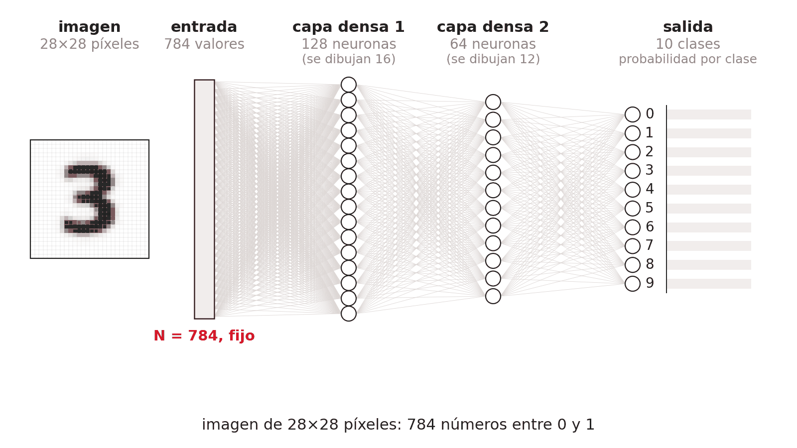
<!-- ascii-source:
   entrada                     red neuronal profunda                      salida
 +---------+
 |   x1    |      +----------+      +----------+      +----------+      +-----------+
 |   x2    |      |  capa    |      |  capa    |      |  capa    |      |  precio,  |
 |   x3    | ---&gt; |  densa 1 | ---&gt; |  densa 2 | ---&gt; |  densa 3 | ---&gt; |  clase o  |
 |   ...   |      +----------+      +----------+      +----------+      |  probab.  |
 |   xN    |                                                            +-----------+
 +---------+
   N fijo
-->
<!-- ascii-note:
intent: una red densa recibe un vector de exactamente N números, lo pasa por capas densas y devuelve una salida
emphasize: la etiqueta "N fijo" debajo del vector de entrada
labels: entrada, red neuronal profunda, salida
-->

### Sources

- `../modelado-redes-neuronales/research/corpus/chat.md.md` (secciones 7 y 9: red densa para precio por barrio y m², scoring crediticio como vector normalizado; "cada x con su peso")
- MNIST 28×28 = 784 entradas: dato del presentador (784 = 28 × 28), sin registro en el corpus.

### Speaker notes

Arrancar por lo que ya saben: el TP de precios de casas fue exactamente esto. La red funciona porque cada fila del dataset trae las mismas columnas. MNIST sirve de puente: es una imagen, pero todas miden 28×28, así que aplanarla a 784 números no rompe nada. La pregunta que abre la sección es qué pasa cuando la entrada no trae siempre la misma cantidad de números.

---

## 2. Cómo se entrena una red densa

### Content

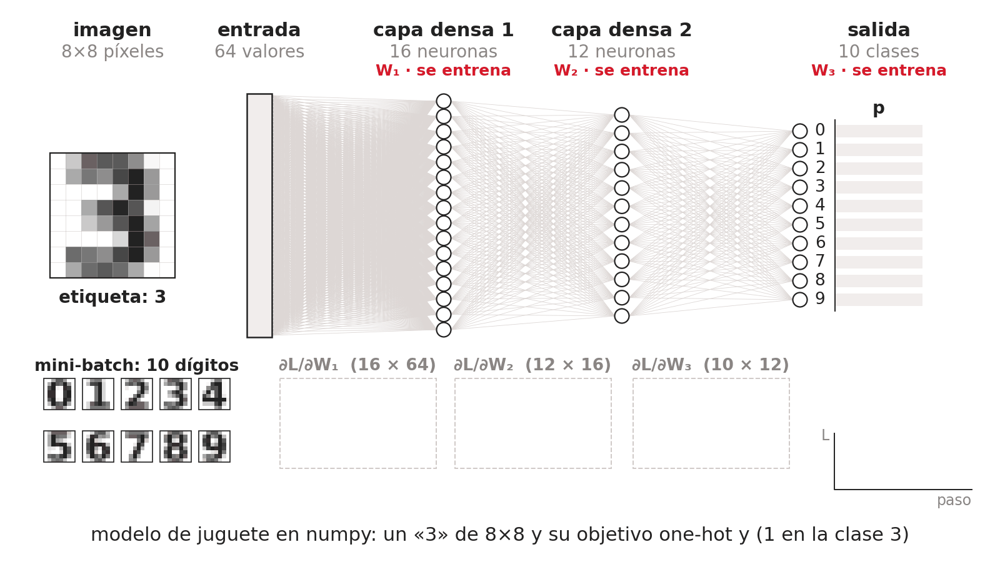

### Sources

- (animación propia)

### Speaker notes

Repaso de la clase de redes neuronales con un MLP de juguete en numpy (64→16→12→10, dígitos sintéticos de 8×8). Forward: el «3» entra y la salida da p(3) = 0,04. Pérdida: L = −log p(3) = 3,12. Backward con la regla de la cadena: δ₃ = p − y en la salida, después δ₂ y δ₁ hacia atrás; cada fila de ∂L/∂W se completa cuando su neurona recibe su δ. Se promedia sobre el mini-batch de 10 dígitos y se actualiza W ← W − η·∂L/∂W con η = 0,2. En 40 pasos la pérdida del mini-batch baja de 3,14 a 0,08 y p(3) sube a 0,92; los mapas de ∂L/∂W usan escala fija y se apagan a medida que baja L. Este mismo ciclo (forward, pérdida, backward, actualización) es el que entrena a todos los modelos de la clase; lo que cambia de uno a otro es la pérdida.

---

## 3. El detector de voz: cada audio dura distinto

### Content

- Querés una red que escuche una grabación y diga si alguien está hablando. Un audio de 5 s tiene más muestras que uno de 2 s, y la red densa espera siempre la misma cantidad.
- Con un MLP tenés que elegir un largo L y forzar todos los audios a ese largo:
- **Recortar** los audios largos: si la voz estaba en el tramo que cortaste, esa parte nunca entra a la red.
- **Rellenar con ceros** los cortos: la red recibe silencio artificial y tiene que aprender a ignorarlo.

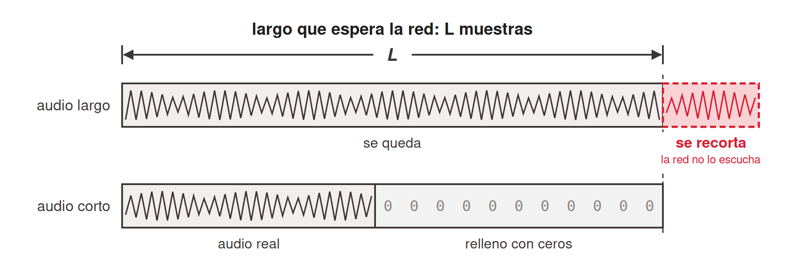
<!-- ascii-source:
 largo que espera la red: L muestras
 |<------------------------- L -------------------------&gt;|

 audio largo  [~~~~~~~~~~~~~~~~~~~~~~~~~~~~~~~~~~~~~~~~~~~~~~~|~~~~~~~~~~~~~]
               se queda                                         se recorta

 audio corto  [~~~~~~~~~~~~~~~~~~~~~~|0 0 0 0 0 0 0 0 0 0 0 0 0]
               audio real              relleno con ceros
-->
<!-- ascii-note:
intent: para usar un MLP hay que recortar el audio largo y rellenar con ceros el corto hasta un largo fijo L
emphasize: el tramo "se recorta" del audio largo, que la red nunca ve
labels: L muestras arriba; audio largo y audio corto como dos filas
-->

### Sources

- `../modelado-redes-neuronales/research/corpus/chat.md.md` (sección 7 y familias de entrada: señal 1D como vector o espectrograma)

### Speaker notes

Funciona en una demo y es poco elegante. Elegir L es una decisión arbitraria: si es corto perdés información, si es largo la mayoría de los audios son relleno. Y aunque se resuelva el largo, queda lo que la arquitectura densa no modela de un audio, que viene en la lámina siguiente.

---

## 4. El sesgo inductivo equivocado

### Content

- Aun con el largo resuelto, una capa densa trata al audio como una lista de números sin orden.
- **Sin vecindad**: cada muestra se conecta con cada neurona con pesos independientes. Si mezclás el orden de las entradas (la misma mezcla en todos los ejemplos) y reentrenás, la red aprende igual de bien. En su arquitectura la muestra t no está al lado de la t+1.
- **Sin invariancia a traslación**: un "hola" al principio del audio y el mismo "hola" al final pasan por pesos distintos. La red tiene que aprender el patrón una vez por cada posición.
- **Demasiados parámetros**: cada entrada suma una fila de pesos. Una imagen RGB de 224×224 son 150.528 números, y una primera capa densa de 256 neuronas ya tiene unos 38,5 millones de pesos.

### Sources

- `../modelado-redes-neuronales/research/corpus/chat.md.md` (sección 7, "Señal/imagen": aplanar destruye la información espacial; RGB 224×224 = 150.528 entradas → 38,5 M en la primera capa; la convolución resuelve parámetros, invarianza traslacional y pesos compartidos). Derivación: 150.528 = 224 × 224 × 3; 150.528 × 256 = 38.535.168 ≈ 38,5 M (el corpus no nombra las 256 neuronas; es el ancho que reproduce su cifra).

### Speaker notes

Sesgo inductivo es lo que la arquitectura asume antes de ver un solo dato. La capa densa no asume nada sobre el orden, y para tablas eso está bien: las columnas de una planilla se pueden reordenar. En audio e imágenes el orden es la información. Lo que queremos es una capa que sepa que lo vecino está relacionado y que un patrón es el mismo esté donde esté.

---

## 5. El problema aparece en cualquier señal, y en las imágenes

### Content

- La limitación no depende de la tarea. Con audio y señales:

| Tarea | Ejemplo | Qué sale |
|---|---|---|
| Clasificación | ¿hay voz en esta grabación? | una etiqueta |
| Regresión | estimar la frecuencia cardíaca desde un ECG | un número |
| Filtrado | sacarle el ruido a una grabación | una señal del mismo largo |
| Upscaling | llevar un audio a una frecuencia de muestreo más alta | una señal con más muestras |
| Generación | sintetizar voz | una señal nueva |

- Las imágenes tienen el mismo problema en dos dimensiones: alto y ancho cambian de una foto a otra, y cada píxel trae sus canales (3 en RGB). Un MLP obliga a llevarlas todas a un tamaño y aplanarlas.

### Sources

- `../modelado-redes-neuronales/research/corpus/chat.md.md` (familias de entrada: señal 1D, imagen como tensor (C,H,W); eje de canales: foto RGB (H,W / 3), ECG de 12 derivaciones (T / 12), audio estéreo (T / 2))

### Speaker notes

En filtrado y upscaling la salida también es una señal, así que el largo variable aparece dos veces: en la entrada y en la salida. Con imágenes, el ejemplo de MNIST funcionaba porque el dataset ya viene con todas las imágenes del mismo tamaño; una foto de celular y una tomografía no.

---

## 6. La solución: un kernel que se desliza

### Content

- Un **kernel** es un vector chico de pesos que recorre la señal. En cada posición multiplica sus pesos por el tramo que tiene debajo, suma y escribe un número en la salida. Después avanza una muestra y repite.
- Usa los mismos pesos en todas las posiciones. Por eso detecta un patrón esté donde esté, y la cantidad de pesos no depende del largo del audio.
- En la animación, un kernel de 9 pesos iguales a 1/9 (un promedio móvil) filtra un audio ruidoso:
- **Arriba**, la ventana del kernel avanza sobre el audio con ruido.
- **Abajo**, cada punto de la salida aparece cuando el kernel pasa por esa posición.
- **Al final**, la salida conserva la forma de la onda con menos ruido.

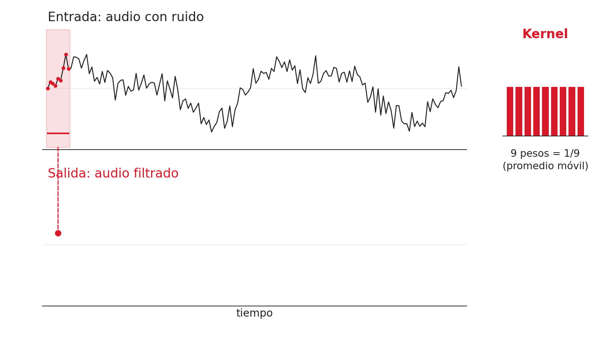

### Sources

- `../modelado-redes-neuronales/research/corpus/chat.md.md` (sección 7: la convolución resuelve parámetros, invarianza traslacional y pesos compartidos)

### Speaker notes

Dejar correr la animación una vez en silencio y después narrarla. La operación es una suma ponderada, la misma que hace una neurona; la diferencia es que la neurona del kernel combina solo los valores de una ventana y se reutiliza en cada posición. Eso le da a la capa justo lo que le faltaba a la densa: vecindad y el mismo patrón en cualquier lugar.

---

## 7. Mismo mecanismo, otra tarea: detectar voz

### Content

- Con otro kernel, una ventana larga sobre la señal al cuadrado, la misma operación mide la energía local del audio: cuánta señal hay alrededor de cada instante. Donde la energía pasa un umbral, el detector marca voz.
- **Tramos con voz**: la salida sube; en los silencios baja.
- **Umbral**: la línea horizontal; lo que queda por encima se marca como voz.
- En una red convolucional nadie elige los pesos del kernel a mano. Los aprende el entrenamiento, igual que los de una capa densa.

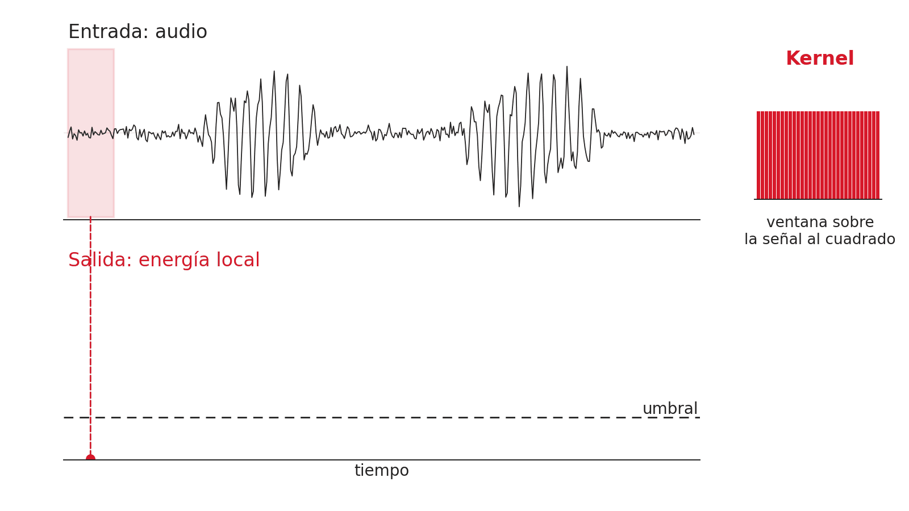

### Sources

- `../modelado-redes-neuronales/research/corpus/chat.md.md` (sección 1: W y b son los parámetros que se entrenan)

### Speaker notes

Los dos ejemplos usan kernels diseñados a mano para que se vea qué hace cada uno. En una CNN real la red arranca con kernels al azar y el descenso por gradiente los ajusta; muchas veces terminan pareciéndose a estos filtros clásicos, pero nadie se los dicta.

---

## 8. El largo variable deja de ser un problema

### Content

- El kernel funciona con cualquier duración de audio: se desliza hasta que la señal se termina. Sobre 2 s produce una salida corta, sobre 5 s una más larga, con los mismos pesos.
- Para clasificar la grabación entera, la red resume esa salida en un vector de largo fijo, por ejemplo con un pooling global que toma el promedio o el máximo. Recién ahí entra una capa densa.
- **En la figura**: los dos audios usan el mismo kernel, y cada salida tiene el largo de su entrada.

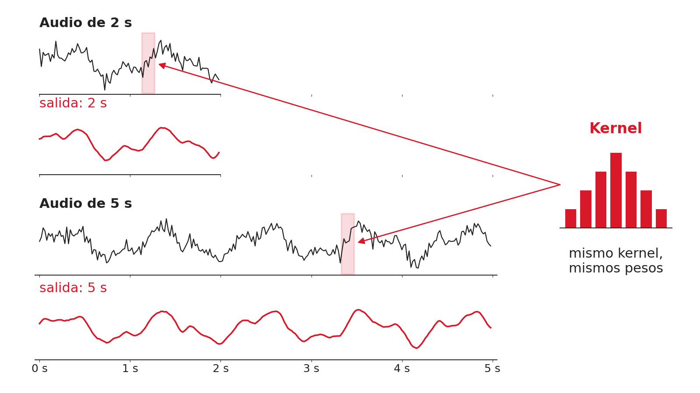

### Sources

- `../modelado-redes-neuronales/research/corpus/chat.md.md` (sección 7, patrón general: arquitectura especializada → vector de tamaño fijo → caso simple)

### Speaker notes

Este es el punto de la sección en una lámina: la cantidad de pesos depende del tamaño del kernel y no del largo de la entrada. El pooling global es lo que conecta la parte convolucional, que acepta cualquier largo, con la parte densa, que requiere uno fijo.

---

## 9. Dos soluciones al largo variable

### Content

- **Convolución**: un kernel chico recorre la entrada con los mismos pesos en cada posición, así que lo que detecta en un lugar lo detecta en cualquier otro (invariancia a traslación). Cada salida combina solo valores cercanos. Ese sesgo inductivo fuerte, la localidad, le permite aprender con menos datos. Para relacionar puntos lejanos hay que apilar capas.
- **Atención (transformer)**: cada posición se combina con todas las demás desde la primera capa, con pesos que calcula la atención. La atención sola no codifica el orden; el orden lo ponen los positional embeddings, que el transformer trae de serie. Su sesgo inductivo es débil, por eso requiere más datos y a cambio captura dependencias lejanas. El costo crece con el cuadrado del largo.
- Elegir una arquitectura es elegir un sesgo inductivo.

### Sources

- `../palabra-al-transformer/final.md` (atención: cada token se combina con todos los demás; "la atención crece cuadráticamente con la longitud"; figura de la arquitectura con la codificación posicional a la entrada)
- `vit-dosovitskiy-2020.web.md` (transformer aplicado a secuencias de parches de imagen)
- Vaswani et al. 2017, "Attention Is All You Need" (paper, no está en el corpus de esta Talk: positional encoding y costo cuadrático de la self-attention)
- `../modelado-redes-neuronales/research/corpus/chat.md.md` (kernel de pesos compartidos)
- Derivación de la nota: con el doble de largo, (2n)² / n² = 4 veces más pares que comparar.

### Speaker notes

En "De la palabra al transformer" vieron la atención con texto: la representación de cada token sale de una suma ponderada de todos los demás, con pesos que dependen de qué tan parecidos son. Esa misma atención acepta cualquier cantidad de posiciones, igual que el kernel, así que también resuelve el largo variable. Lo que cambia es lo que cada arquitectura fija antes del entrenamiento. La convolución solo combina vecinos; en la atención esa estructura no está fijada y los pesos la tienen que capturar del entrenamiento, por eso hacen falta muchos más datos. El costo se siente rápido: con una secuencia del doble de largo, la atención compara cuatro veces más pares. La clase vuelve a cruzar las dos ideas en CLIP, en SAM y en la U-Net de Stable Diffusion.

---

## 10. Convolución en imágenes

### Content

- En una imagen el kernel es una grilla chica, por ejemplo de 3×3, que recorre la imagen a lo alto y a lo ancho. En cada posición multiplica sus 9 pesos por los 9 píxeles que cubre y suma.
- Sobre una imagen RGB el kernel abarca los 3 canales a la vez: 3×3×3 = 27 pesos. Una capa `nn.Conv2d(3, 32, 3)` con 32 kernels tiene 896 parámetros, contra los 38,5 millones de la capa densa.
- **Una celda por posición**: cada lugar donde se apoya el kernel produce una celda del feature map.
- **Tamaño**: sobre una grilla de 7×7, un kernel de 3×3 sin relleno cabe en 5 posiciones por fila y por columna, y la salida es de 5×5.
- **Bordes**: los valores grandes aparecen donde el kernel cruza un borde.

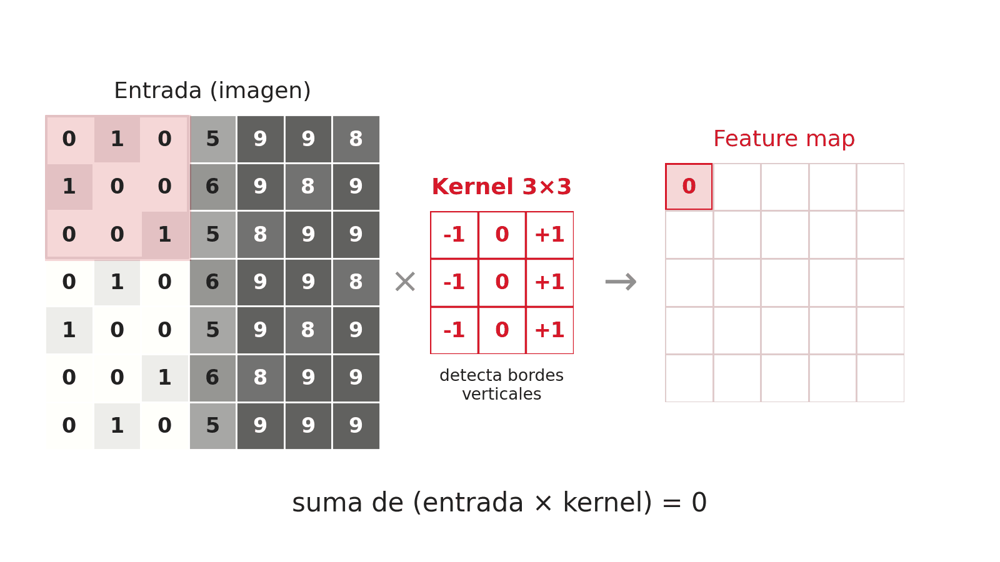

### Sources

- `../modelado-redes-neuronales/research/corpus/chat.md.md` (eje de canales: kernel 3×3 sobre RGB = 27 pesos; `nn.Conv2d(3,32,3)` = 896 params frente a 38,5 M de la capa densa). Derivaciones: 896 = 32 × 27 + 32 (pesos + un bias por kernel); salida 5 = 7 − 3 + 1.

### Speaker notes

"Valores grandes" en valor absoluto: según el lado del borde, el detector da positivo o negativo. El 896 contra 38,5 millones explica por qué las CNN entrenan con imágenes grandes y una red densa no.

---

## 11. Distintos kernels, distintos rasgos

### Content

- Cada kernel detecta un rasgo. En la figura, uno resalta los bordes verticales y otro los horizontales de la misma imagen.
- Una CNN apila capas convolucionales y aprende sus kernels. Las primeras capas detectan bordes, las siguientes texturas, después partes y al final objetos.
- Esa pila es el encoder de FCN y de la U-Net, que aparecen en la sección de segmentación.

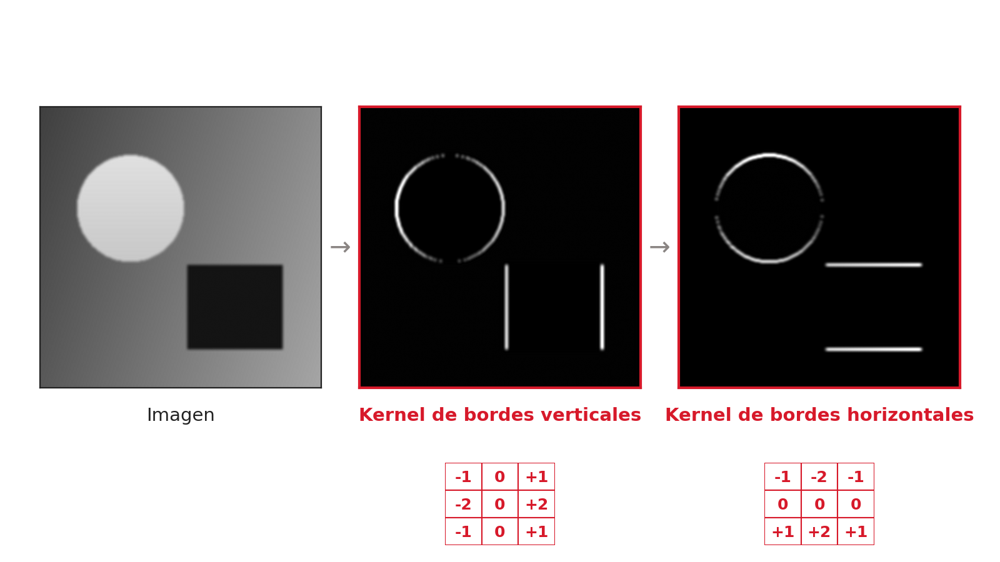

### Sources

- `AIG4B-Clase-9-Segmentacion-y-Stable-Diffusion.md.md` (slide 12: el encoder convolucional detecta patrones cada vez más abstractos, bordes → texturas → estructuras → objetos)

### Speaker notes

Con 32 kernels en una capa salen 32 feature maps, uno por rasgo. La capa siguiente combina esos mapas, y por eso puede detectar algo más complejo que un borde.

---

## 12. Cómo se aprende un kernel

### Content

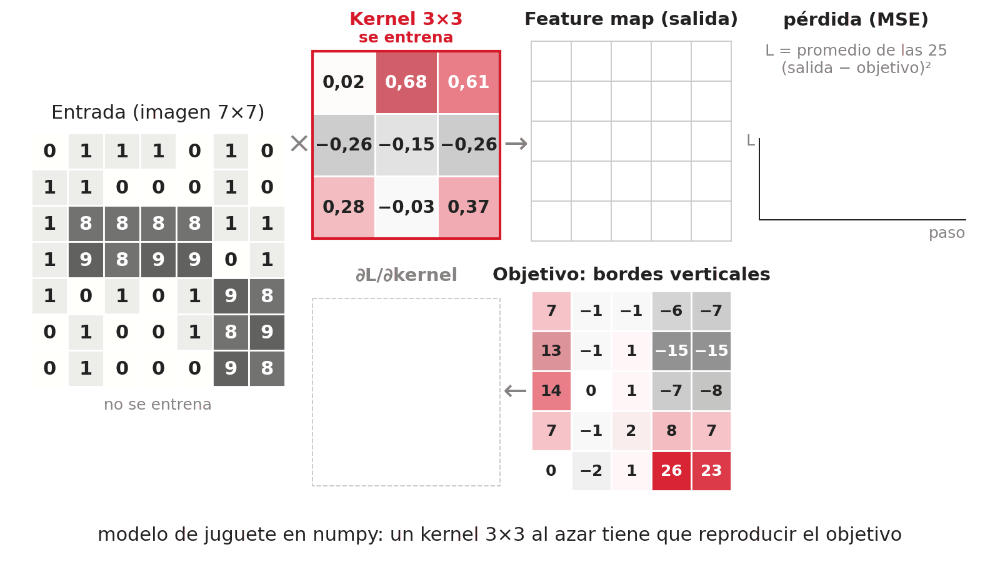

### Sources

- (animación propia)

### Speaker notes

Un kernel 3×3 que arranca con pesos al azar se entrena para que su feature map se parezca a un objetivo: el mapa de bordes verticales de una imagen de 7×7. La pérdida es la MSE entre salida y objetivo (al principio L = 83,93). Lo nuevo frente a una capa densa está en el backward: como el mismo kernel se aplicó en las 25 posiciones, su gradiente es la suma de las contribuciones de cada posición; en cada una se suma (2/25)·(salida − objetivo)·ventana. Después, kernel ← kernel − η·∂L/∂kernel. En 60 pasos el kernel llega a [−1 0 +1] en las tres filas y L baja a 0,01. Modelo de juguete en numpy, gradiente verificado con diferencias finitas. En una CNN nadie diseña los kernels: se aprenden, y una red real aprende miles a la vez.

---

## 13. Embeddings más allá del texto

### Content

- El encoder de una CNN termina en un vector de largo fijo que resume el contenido de la imagen. Un encoder de texto hace lo mismo con una oración, y uno de audio con una grabación.
- Un embedding es una representación densa aprendida donde la geometría del espacio codifica el significado: vectores cercanos, contenidos parecidos. Sirve para cualquier modalidad, con o sin transformers.
- Vuelve dos veces en esta clase: CLIP pone imágenes y textos en el mismo espacio, y el VAE de Stable Diffusion comprime la imagen en un latente donde trabaja la difusión.
- El encoder de texto de CLIP es un transformer, y un ViT trata la imagen como una secuencia de parches.

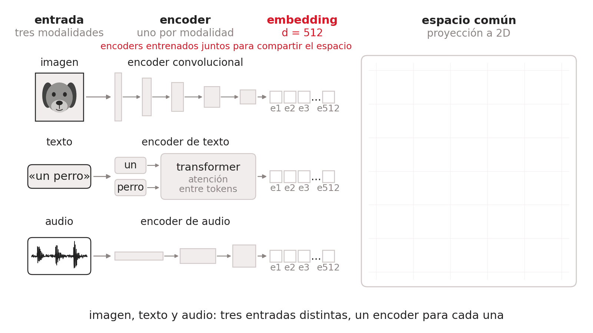
<!-- ascii-source:
 imagen  ---&gt; [ encoder convolucional ] ---&gt;  [ e1  e2  e3  ...  ed ]
 texto   ---&gt; [ encoder de texto      ] ---&gt;  [ e1  e2  e3  ...  ed ]
 audio   ---&gt; [ encoder de audio      ] ---&gt;  [ e1  e2  e3  ...  ed ]
                                                vector de largo fijo
                                                = embedding

 en un espacio compartido (CLIP):
 la foto de un perro  y  el texto "un perro"  ---&gt;  vectores cercanos
-->
<!-- ascii-note:
intent: imagen, texto y audio entran a encoders distintos y todos salen como un vector de largo fijo, el embedding
emphasize: la columna de vectores de salida rotulada "embedding"
labels: encoder convolucional, encoder de texto, encoder de audio; vector de largo fijo
-->

### Sources

- `../modelado-redes-neuronales/research/corpus/chat.md.md` (glosario: "un embedding es una representación densa aprendida donde la geometría del espacio codifica el significado"; patrón arquitectura especializada → embedding de la imagen)
- `clip-radford-2021.web.md` (encoder de texto: transformer de ancho 768; Radford et al. 2021)
- `vit-dosovitskiy-2020.web.md` ("a pure transformer applied directly to sequences of image patches")
- `latent-diffusion-rombach-2022.web.md`

### Speaker notes

Lo vieron con palabras y tokens; acá la idea se generaliza. Cuando lleguemos a CLIP, la novedad va a ser entrenar los dos encoders para que caigan en el mismo espacio. El latente del VAE es un pariente: no está entrenado para que lo cercano signifique lo mismo, pero también comprime la imagen en algo mucho más chico.

---

# 2. Segmentación: qué es y para qué sirve

**Goal of this section:** Que segmentar quede definido como "una etiqueta por píxel", distinguido de clasificar y detectar, y anclado en casos donde la máscara es el resultado que se mide.

---

## 1. ¿Qué es segmentar?

### Content

- En visión por computadora, hay tres preguntas distintas que podemos hacerle a una imagen — y segmentar es la más fina de todas.

| Tarea | Pregunta | Salida |
|---|---|---|
| Clasificación | ¿Qué hay en esta imagen? | Una etiqueta (ej: "perro") |
| Detección | ¿Dónde está y qué es? | Cajas con etiquetas |
| Segmentación | ¿Qué representa cada píxel? | Una etiqueta por píxel — una "máscara" |

- Frase clave: segmentar es darle un significado **pixel por pixel** a la imagen.

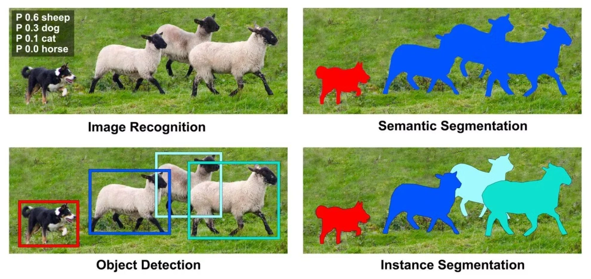

### Sources

- `AIG4B-Clase-9-Segmentacion-y-Stable-Diffusion.md.md` (slide 4)

### Speaker notes

La figura muestra las cuatro salidas sobre la misma foto del perro y las ovejas: en la semántica las tres ovejas comparten color, en la de instancias cada una tiene el suyo. Eso adelanta la lámina siguiente.

---

## 2. Tipos de segmentación

### Content

- Tres niveles de granularidad, según qué tan finamente queramos diferenciar lo que vemos:
- **Semántica**: etiqueta cada píxel con su clase, sin distinguir individuos. Todos los píxeles de "auto" reciben la misma etiqueta, aunque haya cinco autos.
- **De instancias**: distingue cada objeto individual. "Auto 1", "auto 2", "auto 3"... aunque sean de la misma clase.
- **Panóptica**: combina ambas — clasifica cada píxel y distingue instancias. Es la versión más completa.

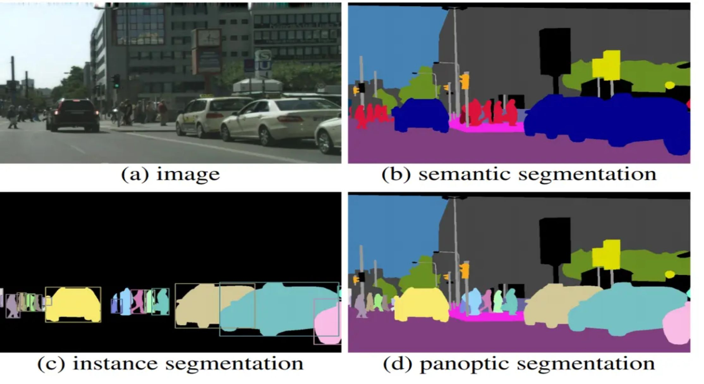

### Sources

- `AIG4B-Clase-9-Segmentacion-y-Stable-Diffusion.md.md` (slide 5)

### Speaker notes

---

## 3. Dónde se usa

### Content

- **Autos autónomos**: separar carretera, peatones, semáforos y otros vehículos.
- **Imagen satelital**: medir cobertura forestal, urbanización y cuerpos de agua.
- **Videoconferencia y edición de fotos**: separar a la persona del fondo en tiempo real; el "Seleccionar sujeto" de Photoshop.
- **Neuroimagen y oncología**: delinear tumores y lesiones; medir volumen tumoral para planificar radioterapia.
- **Cardiología**: delimitar ventrículos para calcular la fracción de eyección.
- **Patología, oftalmología y dermatología**: contar núcleos y mitosis, segmentar vasos retinianos, delimitar lesiones.

- En medicina la máscara es lo que se mide, se documenta y se compara entre estudios.

### Sources

- `AIG4B-Clase-9-Segmentacion-y-Stable-Diffusion.md.md` (slides 6 y 7)

### Speaker notes

Fusión de "Aplicaciones genéricas" y "Aplicaciones en medicina". En biomedicina segmentar suele ser el paso clínico y no un paso intermedio: la máscara final es la respuesta. Agricultura de precisión (plagas, estrés hídrico) quedó fuera de la lámina; se puede mencionar de palabra.

---

## 4. Cómo se ve una salida

### Content

- Visualización típica: imagen original (MRI cardíaca) → **máscara binaria** (blanco = estructura, negro = fondo) → overlay sobre la imagen → mapa de probabilidad por píxel.
- Internamente, la máscara es una **matriz** del mismo tamaño que la imagen, donde cada celda dice a qué clase pertenece ese píxel. Para 2 clases es 0/1; para N clases es 0..N-1.

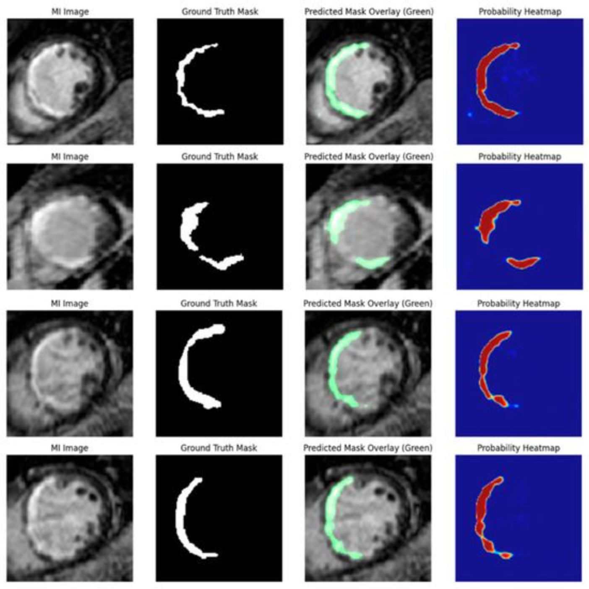

### Sources

- `AIG4B-Clase-9-Segmentacion-y-Stable-Diffusion.md.md` (slides 7 y 9; figura `slide-07-2.jpg`)

### Speaker notes

Cada fila es un paciente: el corte de eje corto del ventrículo izquierdo, la máscara en media luna, la predicción en verde encima de la MRI y el mapa de calor de probabilidad. La figura vieja de esta lámina (cortes de cerebro con cajas rojas) mostraba detección, no segmentación.

---

# 3. De FCN a U-Net

**Goal of this section:** Que entiendan cómo se pasa de un clasificador de imágenes a uno de píxeles (FCN), por qué esa red pierde los bordes y cómo las skip connections de la U-Net los recuperan.

---

## 1. La intuición: clasificar cada píxel

### Content

- Si segmentar es asignar una etiqueta a cada píxel, la idea más directa es: tratá cada píxel como un **mini-problema de clasificación**.
- Ya sabemos clasificar imágenes. Una CNN clásica va comprimiendo la imagen con convoluciones + pooling, hasta que al final una capa densa entrega la clase.
- Idea de **FCN** (Fully Convolutional Network — Long et al., 2015): sacar la capa densa final y reemplazarla por más capas convolucionales que produzcan una salida espacial del mismo tamaño que la entrada.
- Una sola frase: "convertí un clasificador de imágenes en un **clasificador de píxeles**".

### Sources

- `AIG4B-Clase-9-Segmentacion-y-Stable-Diffusion.md.md` (slide 11)
- `fcn-long-2015.web.md`

### Speaker notes

---

## 2. FCN por dentro

### Content

- **Encoder convolucional**: la imagen se comprime capa a capa; cada capa detecta patrones más abstractos (bordes, texturas, estructuras, objetos).
- **Convoluciones 1×1** en lugar de la capa densa: se mantienen las dimensiones espaciales. Sale un mapa chico con probabilidades por clase.
- **Upsampling**: convoluciones traspuestas estiran ese mapa hasta el tamaño original.
- Resultado: una máscara con una etiqueta por píxel. Fue el primer modelo de segmentación end-to-end con deep learning.

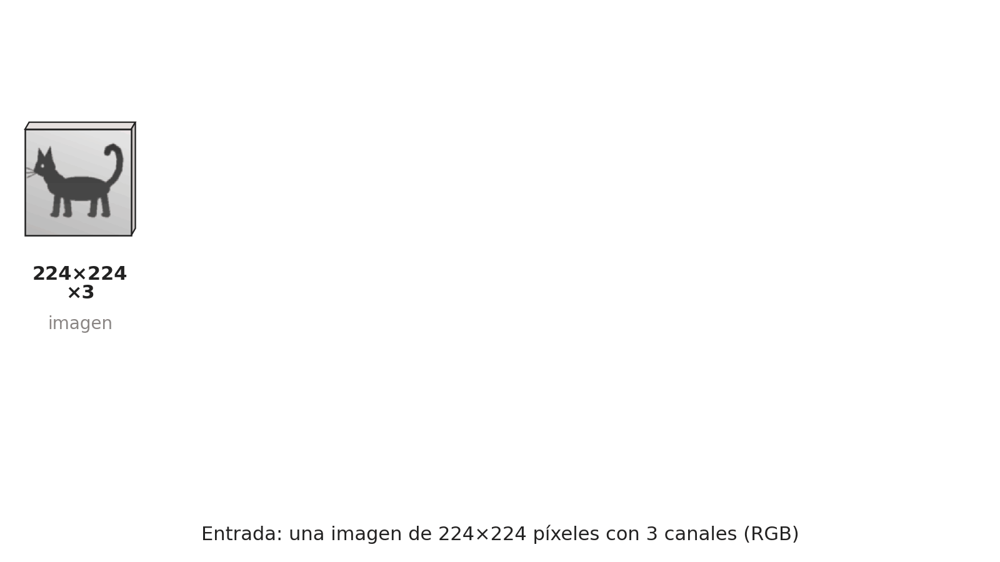
<!-- ascii-source:
 imagen        +-----------+   +-----------+   +-------------+   +-------------+   mascara
 H x W  -----&gt; | conv+pool | ->| conv+pool | ->|  conv 1x1   | ->| upsampling  | ----&gt; H x W
               +-----------+   +-----------+   | (en vez de  |   | conv        |   1 clase
                 se achica       mapa chico    | capa densa) |   | traspuesta  |   por pixel
                                               +-------------+   +-------------+
               |<------- encoder -------&gt;|
-->
<!-- ascii-note:
intent: los tres pasos de FCN, de la imagen a la máscara del mismo tamaño
emphasize: la caja conv 1x1 que reemplaza la capa densa
labels: H x W en la entrada y en la salida
-->

### Sources

- `AIG4B-Clase-9-Segmentacion-y-Stable-Diffusion.md.md` (slide 12)
- `fcn-long-2015.web.md`

### Speaker notes

Diagrama propio en lugar de la figura isométrica del paper de Long, Shelhamer y Darrell (dos gatos en un sofá).

---

## 3. El problema de FCN

### Content

- Durante el encoder, la red comprime mucho: una imagen de **512×512** puede terminar como un mapa de **16×16**. Cuando hacemos upsampling para volver al tamaño original, la información espacial fina ya se perdió.
- Síntoma: los contornos quedan **borrosos** o redondeados. El borde exacto de un tumor o el contorno de un núcleo celular desaparecen.
- En medicina: si estás midiendo el volumen de un tumor para decidir radioterapia, un borde 2 píxeles más adentro o más afuera cambia el cálculo y puede cambiar la decisión clínica.
- La pregunta: ¿cómo recuperamos los detalles finos que el encoder descartó?

### Sources

- `AIG4B-Clase-9-Segmentacion-y-Stable-Diffusion.md.md` (slide 13)

### Speaker notes

---

## 4. U-Net: la U y sus atajos

### Content

- Ronneberger, Fischer y Brox (Universidad de Friburgo, 2015) la diseñaron para segmentar **células en microscopía electrónica**, con muy pocas imágenes etiquetadas.
- **Encoder**: convoluciones + max pooling. En cada nivel la resolución se reduce a la mitad y los canales se duplican. Las features codifican cada vez mejor "qué hay" y pierden "dónde está".
- **Decoder**: convoluciones traspuestas. La resolución se duplica en cada nivel y "dónde" se reconstruye.
- **Skip connections**: la salida de cada nivel del encoder se concatena con la entrada del decoder en el mismo nivel. El decoder recibe qué es (desde abajo) y dónde está exactamente (desde el atajo).

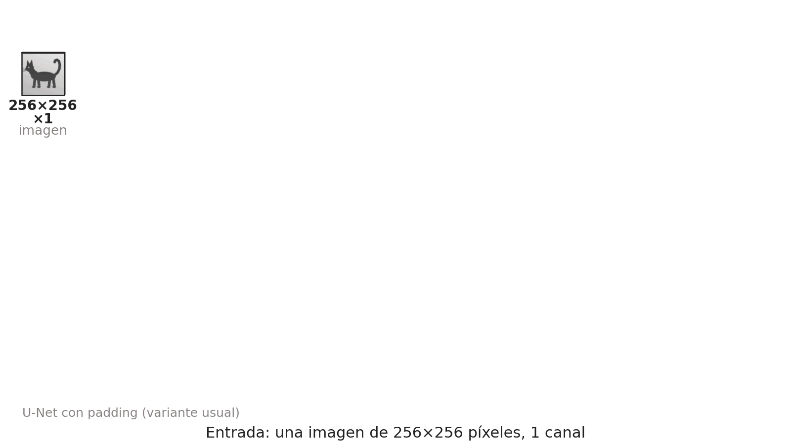
<!-- ascii-source:
 imagen                                                   mascara
   |                                                         ^
 [enc 1] ---------------- skip: concatenar ---------------&gt; [dec 1]
     \                                                     /
    [enc 2] ------------- skip: concatenar ------------&gt; [dec 2]
        \                                               /
       [enc 3] ---------- skip: concatenar ---------&gt; [dec 3]
           \                                         /
            +-------------&gt; [ bottleneck ] ---------+

   bajando: max pooling                  subiendo: conv traspuesta
   resolucion / 2, canales x 2           resolucion x 2, canales / 2
-->
<!-- ascii-note:
intent: la arquitectura en U; las skip connections llevan el detalle del encoder al decoder del mismo nivel
emphasize: las flechas horizontales de skip connection
labels: encoder a la izquierda, decoder a la derecha, bottleneck abajo
terms: skip, bottleneck
-->

### Sources

- `AIG4B-Clase-9-Segmentacion-y-Stable-Diffusion.md.md` (slides 14, 15 y 16)
- `unet-ronneberger-2015.web.md`

### Speaker notes

Fusión de "UNET: nacida en biomedicina", "La arquitectura en U" y "La clave: skip connections". El bottleneck es la representación más comprimida y abstracta. Sin skip connections, U-Net sería un FCN más elegante: los detalles que el encoder vio antes de comprimir viajan por el atajo y el decoder los recupera, y por eso los contornos salen precisos. Es uno de los papers más citados de la última década en visión; diez años después sigue siendo la base por defecto para segmentación médica.

---

## 5. Cómo se entrena un modelo de segmentación

### Content

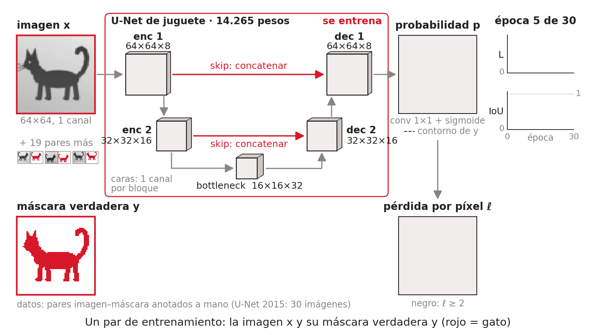

### Sources

- `unet-ronneberger-2015.web.md`
- `fcn-long-2015.web.md`

### Speaker notes

Una U-Net de juguete real en numpy (14.265 pesos, gradiente verificado contra diferencias finitas) sobre el mismo gato a 64×64 con su máscara anotada a mano. Forward: en la época 5 la probabilidad p todavía es una mancha tenue. Pérdida: cross-entropy en cada píxel, ℓ = −[y·log p + (1−y)·log(1−p)]; en un píxel de borde con y = 1 y p = 0,22 da 1,52, en uno de fondo con y = 0 y p = 0,13 da 0,14, y L es el promedio de los 4.096 píxeles (0,264). El mapa de pérdida por píxel muestra dónde se equivoca: en los bordes y en las partes finas. Backward: el gradiente vuelve por el decoder, los skips y el encoder. Actualización con η = 0,05. En las épocas siguientes la máscara pasa de mancha a silueta, L baja de 0,67 a 0,04 y el IoU sube de 0,16 a 0,93; la pérdida que queda se concentra en los bordes. FCN se entrena igual: misma pérdida por píxel, otra arquitectura. La U-Net original se entrenó con apenas 30 imágenes anotadas.

---

## 6. Por qué funciona tan bien en medicina

### Content

- **Funciona con pocos datos**: las skip connections actúan como un regularizador estructural. U-Net puede entrenarse con cientos de imágenes, no miles, y aún así generalizar bien. Crítico cuando etiquetar requiere un radiólogo.
- **Contornos precisos**: los detalles finos sobreviven el viaje por la U. En medicina, el borde es el dato.
- **Es modular y adaptable**: la misma arquitectura funciona para MRI de cerebro, células de patología, retina, ecografía cardíaca... cambia el dataset, no la red.

### Sources

- `AIG4B-Clase-9-Segmentacion-y-Stable-Diffusion.md.md` (slide 17)

### Speaker notes

---

# 4. SAM: segmentar lo que le señalás

**Goal of this section:** Contrastar la U-Net artesanal con SAM, un foundation model que segmenta cualquier objeto a partir de una pista, y ver cómo creció de imagen a video y de clicks a texto.

---

## 1. SAM: segmentación promptable

### Content

- SAM (Segment Anything Model, Meta, 2023) es el opuesto de la U-Net: un **foundation model** masivo que segmenta cualquier cosa en cualquier imagen, sin reentrenamiento.
- Recibe una imagen + una pista (un click, una caja, una máscara aproximada o, desde SAM 3, texto) y devuelve la máscara del objeto que querés.
- El truco: la imagen se codifica **una sola vez**. Después podés probar decenas de prompts sobre esa misma imagen; solo se reejecuta el decoder liviano.
- Su encoder de imagen es un ViT, un transformer sobre parches de imagen.
- **SA-1B**: 1.000 millones de máscaras sobre 11 millones de imágenes, armado con un data engine donde el propio SAM ayudaba a anotar.

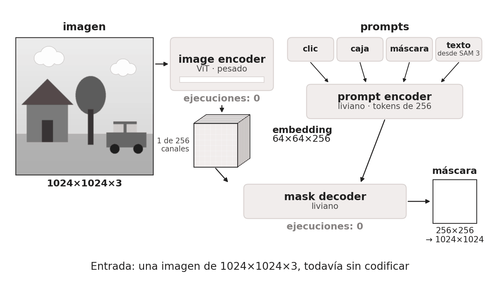
<!-- ascii-source:
 prompt                                     imagen
 +-------+  +-------+  +---------+  +-------+   +----------+
 | click |  |  caja |  | mascara |  | texto |   |  foto    |
 +-------+  +-------+  +---------+  +-------+   +----------+
      \          |          |         /               |
       v         v          v        v                v
      +------------------------------+      +-------------------+
      | prompt encoder (liviano)     |      | image encoder     |
      +------------------------------+      | (ViT, pesado,     |
                     \                      |  corre 1 vez)     |
                      \                     +-------------------+
                       v                          /
                    +---------------------------+
                    | mask decoder (liviano)    |
                    +---------------------------+
                                 |
                                 v
                          mascara valida
-->
<!-- ascii-note:
intent: SAM separa lo caro (codificar la imagen una vez) de lo barato (codificar cada prompt y decodificar la máscara)
emphasize: el image encoder que corre una sola vez
labels: los cuatro tipos de prompt; el texto recién desde SAM 3
terms: prompt, encoder, decoder
-->

### Sources

- `AIG4B-Clase-9-Segmentacion-y-Stable-Diffusion.md.md` (slides 18, 19 y 20)
- `sam-kirillov-2023.web.md` (image encoder ViT-H; Kirillov et al. 2023, preentrenado con MAE)
- `vit-dosovitskiy-2020.web.md`

### Speaker notes

Fusión de "SAM: ¿qué hace y por qué fue revolucionario?" y "mejoras conceptuales internas". SAM trajo a segmentación el paradigma "foundation model + prompt en inferencia" que ya había explotado en NLP con los LLMs. Frase para llevarse: SAM no está entrenado para una tarea sino para separar objetos en general, y vos le indicás con el prompt cuál querés. El reparto de cómputo del deck original (image encoder ~95%) no tiene fuente publicada: decir "la gran mayoría". Sin SA-1B, SAM no funcionaría: el secreto está tanto en el modelo como en los datos.

---

## 2. Cómo se entrena SAM

### Content

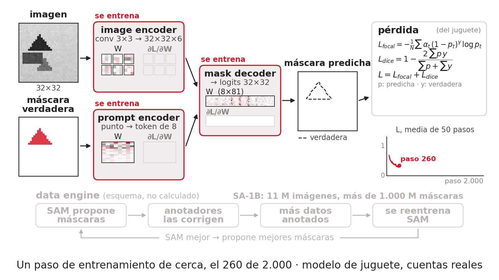

### Sources

- `sam-kirillov-2023.web.md`

### Speaker notes

Un SAM de juguete real (los tres módulos se entrenan juntos, gradientes verificados contra diferencias finitas). El prompt no lo escribe nadie: se sortea un punto adentro de la máscara verdadera. Forward por image encoder, prompt encoder y mask decoder; la pérdida combina focal (castiga más los píxeles difíciles) y dice (mide el solapamiento entre máscara predicha y verdadera): L = 0,37. El gradiente llega a los tres módulos y se actualizan. Después se simula el uso interactivo: se sortea un clic corrector en la zona de error (un falso positivo da un clic negativo) y se repite; la pérdida baja 0,37 → 0,19 → 0,09 en las tres rondas. La parte de abajo es un esquema, no un cálculo: el data engine. SAM propone máscaras, anotadores las corrigen, con más datos se reentrena SAM, que propone mejores máscaras. Así se armó SA-1B: 11 millones de imágenes y más de 1.000 millones de máscaras.

---

## 3. SAM 2: memoria para video

### Content

- SAM 2 (julio 2024) extiende SAM al video con un **módulo de memoria** que mantiene la segmentación coherente entre frames.
- Cada máscara que sale pasa por un memory encoder y se guarda en un **memory bank**.
- En el frame siguiente, la memory attention combina las features del image encoder con lo que quedó guardado. Así la máscara sigue al mismo objeto aunque se mueva.

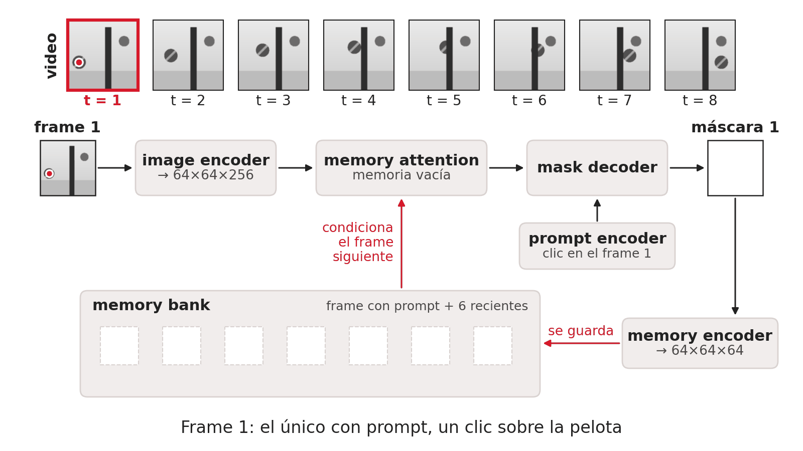
<!-- ascii-source:
 frame t ---&gt; +---------------+    +------------------+    +--------------+
              | image encoder |---&gt;| memory attention |---&gt;| mask decoder |---&gt; mascara t
              +---------------+    +------------------+    +--------------+
                                           ^                  ^       |
                                           |     +----------------+  |
                                           |     | prompt encoder |  |
                                           |     | click/caja/    |  |
                                           |     | mascara        |  |
                                           |     +----------------+  v
                                   +-------------+          +----------------+
                                   | memory bank |<---------| memory encoder |
                                   +-------------+          +----------------+
-->
<!-- ascii-note:
intent: el loop de memoria de SAM 2; la máscara de cada frame se guarda y condiciona el frame siguiente
emphasize: el memory bank que cierra el loop
labels: frame t entra a la izquierda, mascara t sale a la derecha
terms: image encoder, memory attention, mask decoder, prompt encoder, memory encoder, memory bank
-->

### Sources

- `AIG4B-Clase-9-Segmentacion-y-Stable-Diffusion.md.md` (slides 18 y 21; figura `slide-18-1.jpg`)
- `sam2-ravi-2024.web.md`
- `sam31-meta-2026.web.md`

### Speaker notes

La figura vieja de la lámina de SAM 1 era en realidad esta arquitectura de SAM 2; por eso ahora va acá, redibujada. El post de Meta sobre SAM 3 confirma que el memory bank y el memory encoder de SAM 2 son la base del tracker de SAM 3.

---

## 4. SAM 3 y 3.1: texto y muchos objetos

### Content

| Versión | Lanzamiento | Capacidad nueva |
|---|---|---|
| SAM 1 | Abril 2023 | Foundation model para imágenes. Prompts visuales: puntos, cajas, máscaras. |
| SAM 2 | Julio 2024 | Extiende SAM al video — módulo de memoria que mantiene la segmentación coherente entre frames. |
| SAM 3 | Noviembre 2025 | Suma prompts de texto y vocabulario abierto. Permite pedir "todos los hepatocitos" en lenguaje natural. |
| SAM 3.1 | Marzo 2026 | Object Multiplex: tracking conjunto multi-objeto con memoria compartida, sin sacrificar precisión. |

- En la práctica clínica U-Net y SAM conviven. U-Net, cuando la salida tiene que ser **medible y reproducible**. SAM, en **anotación asistida**: un radiólogo clickea, SAM propone la máscara.

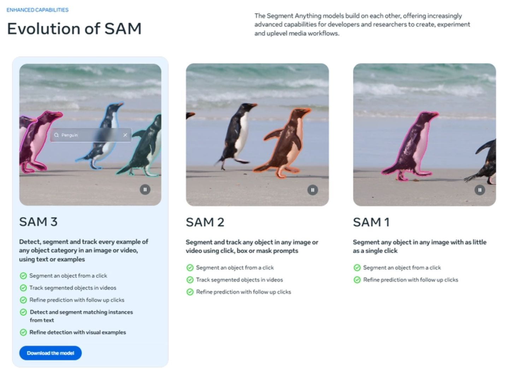

### Sources

- `AIG4B-Clase-9-Segmentacion-y-Stable-Diffusion.md.md` (slide 21)
- `sam3-carion-2025.web.md`
- `sam31-meta-2026.web.md`

### Speaker notes

Patrón: cada versión generaliza más, de imagen a video, de prompts visuales a texto, de un objeto a muchos. Es la misma trayectoria que vivieron los LLMs. La captura de Meta muestra SAM 1 a SAM 3; SAM 3.1 es posterior a esa página. El "10× o más" de aceleración en anotación que traía el deck no tiene fuente: no lo digas como dato.

---

## 5. U-Net es modular: adelanto

### Content

- U-Net no es solo para segmentación. Encoder que comprime + decoder que reconstruye + skip connections sirve para cualquier tarea donde la entrada y la salida tengan el **mismo tamaño espacial** y haya que preservar detalles finos.
- Restauración de imágenes (denoising, deblurring, super-resolución).
- Image-to-image translation (MRI → CT, día → noche).
- El corazón de **Stable Diffusion**: dentro de un rato la vamos a usar para quitar ruido paso a paso de una imagen.

### Sources

- `AIG4B-Clase-9-Segmentacion-y-Stable-Diffusion.md.md` (slide 22)

### Speaker notes

---

# 5. Generación condicionada por texto

**Goal of this section:** Plantear el nuevo problema de TilTedTinder (generar caras a partir de descripciones libres), mostrar por qué las GANs no alcanzan y presentar CLIP como el puente entre texto e imagen que guía la generación.

---

## 1. TilTedTinder: el nuevo desafío

### Content

- En la clase pasada, una **Vanilla GAN** le llenó la base de datos a TilTedTinder, la app de citas de Slanted Land, con rostros inclinados nuevos a partir de solo 4 fotos reales.
- Un año después la app tiene miles de usuarios, y cada uno describe lo que le atrae:
  - "Me atraen las personas inclinadas, altas, con anteojos y pelo rizado."
  - "Prefiero caras inclinadas, jóvenes, con sonrisa y barba corta."
  - "Me gustan las inclinadas, mayores, con expresión seria y rasgos angulosos."
- Pasamos de "generá una persona inclinada cualquiera" a "generá una persona inclinada con **estos atributos descritos en texto libre**".

### Sources

- `AIG4B-Clase-9-Segmentacion-y-Stable-Diffusion.md.md` (slides 24 y 25)

### Speaker notes

Fusión de "Recordando Slanted Land" y "El nuevo desafío". Slanted Land: un mundo donde todo está inclinado y un rostro recto resulta incomprensible. La idea de negocio: que el usuario escriba lo que le atrae en lenguaje natural y la app le muestre candidatos generados a medida.

---

## 2. Por qué la GAN no alcanza

### Content

- **Vanilla GAN**: aprende una única cosa, "producir algo que parezca un rostro inclinado". No tiene ningún canal para recibir descripciones.
- **Conditional GAN**: condiciona por etiquetas predefinidas ("alto", "con anteojos"). Las preferencias reales son frases con matices que no encajan en categorías cerradas.
- **StyleGAN**: da control de estilo, pero no semántico. No podés pedirle "expresión melancólica al atardecer".
- La nueva tarea, **text-to-image**: escribís un prompt en lenguaje natural y el modelo genera una imagen que coincide. Permite combinar conceptos que el modelo nunca vio juntos ("un astronauta montando un caballo").

### Sources

- `AIG4B-Clase-9-Segmentacion-y-Stable-Diffusion.md.md` (slides 26 y 27)
- `stylegan-karras-2019.web.md`

### Speaker notes

Fusión de "¿Por qué la GAN del año pasado no alcanza?" y "Una nueva tarea: del ruido a las palabras". Text-to-image da control expresivo (el lenguaje cubre muchos más matices que una etiqueta) y no hace falta programar para usarlo. La arquitectura que lo resuelve es Stable Diffusion: el resto de la clase es entenderla para que el equipo de TilTedTinder construya su sistema.

---

## 3. Text-to-image en cinco años

### Content

- 2021 · **DALL·E 1** (OpenAI): primera demo viral.
- 2022 · DALL·E 2, Imagen (Google), Midjourney: salto enorme en realismo.
- Agosto 2022 · **Stable Diffusion 1.4**: primer modelo open source serio, con pesos publicados, que corre en una GPU de consumo.
- 2023 · DALL·E 3, SDXL, Midjourney v5/v6: siguen mejor prompts complejos.
- 2024 · FLUX, Stable Diffusion 3, Sora: texto a imagen se vuelve commodity; texto a video empieza a funcionar.
- Hoy vemos las tripas de Stable Diffusion porque abrió el ecosistema y porque su arquitectura ya la conocemos en parte.

### Sources

- `AIG4B-Clase-9-Segmentacion-y-Stable-Diffusion.md.md` (slide 28)
- `imagen-saharia-2022.web.md`

### Speaker notes

2025-2026: modelos más grandes, mejor edición controlada, integración con segmentación (SAM) y 3D (SAM 3D). La infografía del deck original se sacó porque contradecía estas fechas (DALL-E en abril 2022, Midjourney en julio 2023).

---

## 4. CLIP: el puente texto ↔ imagen

### Content

- Una red no procesa palabras: el texto se **tokeniza**, cada token pasa a un vector y un encoder Transformer produce un embedding de la oración completa.
- **CLIP** (OpenAI, 2021) entrena dos encoders en paralelo, uno para imagen y otro para texto, para que sus salidas vivan en el **mismo espacio vectorial**.
- Con 400 millones de pares (imagen, descripción) de internet: los pares reales quedan cerca y los mal apareados, lejos. Es entrenamiento contrastivo.
- Ese embedding de texto es la entrada con la que la U-Net de Stable Diffusion se condiciona.

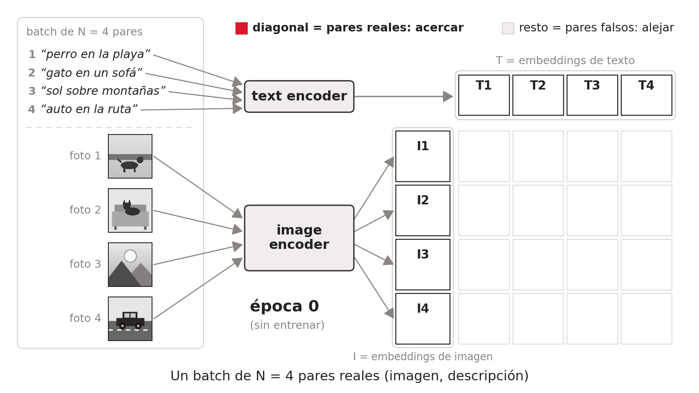
<!-- ascii-source:
 "perro en la playa" --&gt; [ text encoder ]  --&gt; T1   T2   T3  ...  TN
 "gato en un sofa"   --&gt;                        |    |    |        |
  ...                                           v    v    v        v
                                       I1  -> [I1T1] I1T2 I1T3 ... I1TN
 foto 1 --&gt; +---------------+          I2  ->  I2T1 [I2T2] I2T3 ... I2TN
 foto 2 --&gt; | image encoder | --&gt;      I3  ->  I3T1  I3T2 [I3T3] ... I3TN
  ...       +---------------+          ...
                                       IN  ->  INT1  INT2  INT3 ... [INTN]

      [ diagonal ] = pares reales: acercar      resto = pares falsos: alejar
-->
<!-- ascii-note:
intent: entrenamiento contrastivo de CLIP; matriz de similitudes imagen x texto con la diagonal positiva
emphasize: la diagonal de la matriz (pares reales)
labels: T = embeddings de texto, I = embeddings de imagen, celda = similitud
terms: text encoder, image encoder
-->

### Sources

- `AIG4B-Clase-9-Segmentacion-y-Stable-Diffusion.md.md` (slides 29 y 30)
- `clip-radford-2021.web.md`

### Speaker notes

Absorbe lo esencial de la lámina vieja sobre cómo una red neuronal representa texto (tokenización, embeddings, encoder contextual: "banco de plaza" vs "banco financiero"). Resultado del entrenamiento: la frase "una foto de un perro corriendo en la playa" aterriza en el mismo vecindario que una foto real de eso. CLIP proyecta el texto a un espacio que la U-Net usa como entrada.

---

## 5. Cómo se entrena CLIP

### Content

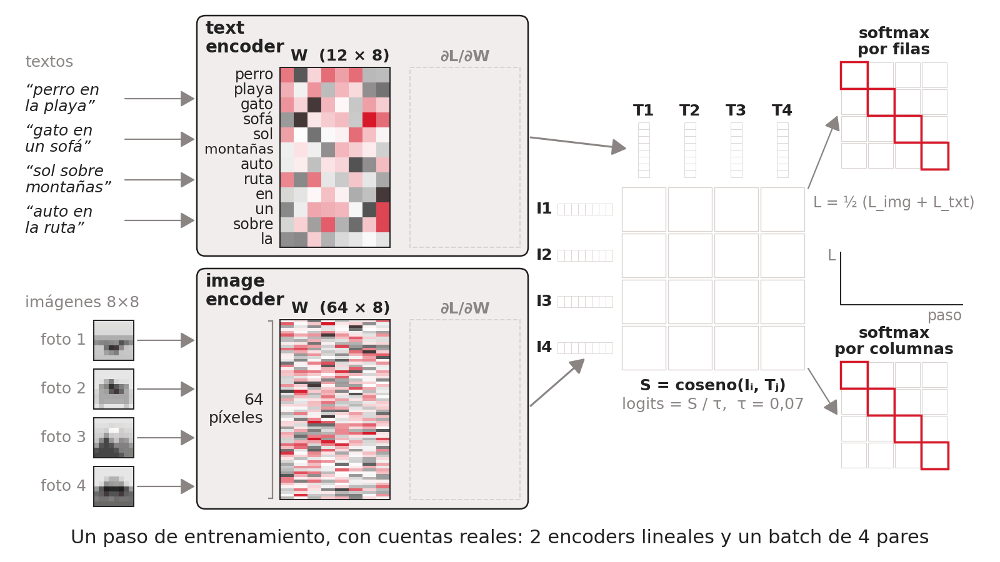

### Sources

- `clip-radford-2021.web.md`

### Speaker notes

Un paso de entrenamiento visto de cerca, con un modelo de juguete en numpy: un encoder de imagen lineal sobre imágenes de 8×8 y un encoder de texto que promedia embeddings de palabras. Forward: el batch de 4 pares pasa por los dos encoders y se arma la matriz S de cosenos. Pérdida: la de CLIP, cross-entropy simétrica (softmax por filas y por columnas, el objetivo es la diagonal), con τ = 0,07 fijo; en CLIP real la temperatura también se aprende. Backward: el gradiente de L llega a los pesos de los DOS encoders, que se entrenan a la vez; CLIP no tiene decoder. Actualización: W ← W − η·∂L/∂W. En 11 pasos L baja de 4,35 a 0,05 mientras la diagonal de cosenos sube solo hasta ~0,5: con τ chica alcanza con separar un poco los cosenos para que el softmax quede casi todo en la diagonal. El mapa de ∂L/∂W se apaga a medida que baja L.

---

## 6. La idea de condición

### Content

| Generación incondicional | Generación condicionada |
|---|---|
| ruido aleatorio → red → imagen. La red genera lo que aprendió, sin guía. | ruido aleatorio + condición → red → imagen que respeta la condición. |

- La condición puede ser una etiqueta de clase (cGAN), una imagen de referencia (Pix2Pix) o un **embedding de texto** (Stable Diffusion).
- La condición dirige **cada paso** de la generación. Si dice "perro en la playa", la red empuja el ruido en cada iteración hacia algo que se parezca a eso.
- En Stable Diffusion, el embedding de CLIP se inyecta en la U-Net mediante **cross-attention**.

### Sources

- `AIG4B-Clase-9-Segmentacion-y-Stable-Diffusion.md.md` (slide 31)
- `pix2pix-isola-2017.web.md`

### Speaker notes

---

# 6. Stable Diffusion por dentro

**Goal of this section:** Armar Stable Diffusion pieza por pieza: la difusión, por qué se hace en un espacio latente, los tres componentes (VAE, U-Net, CLIP), el loop de inferencia y las perillas que van a mover en el notebook.

---

## 1. La idea de difusión: agregar y quitar ruido

### Content

- Difusión viene de la física: una gota de tinta en un vaso de agua se dispersa hasta volverse uniforme.
- **Forward** (entrenamiento): a una imagen real le agregamos un poco de ruido gaussiano en cada paso, durante miles de pasos, hasta que queda ruido puro.
- **Reverse** (inferencia): la red hace el camino inverso. Arranca de ruido puro y quita ruido paso a paso, guiada por la condición c.
- La red aprende una sola cosa: dado un latente ruidoso y un timestep, **predecir qué ruido fue agregado**. Con esa predicción, el ruido se puede restar.

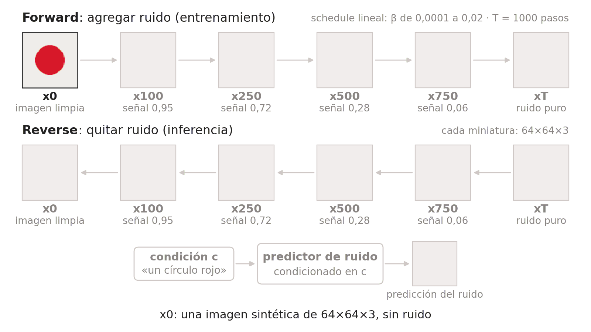
<!-- ascii-source:
 FORWARD: agregar ruido (entrenamiento)
   x0 ------&gt; x1 ------&gt; ... ------&gt; x(t) ------&gt; ... ------&gt; xT
 imagen                                                  ruido puro

 REVERSE: quitar ruido (inferencia)
   x0 <------ x1 <------ ... <------ x(t) <------ ... <------ xT
                                      ^
                          +-------------------------+
                          | predictor de ruido      |
                          | condicionado en c       |
                          +-------------------------+
                                      ^
                                 condicion c
                                (el prompt)
-->
<!-- ascii-note:
intent: las dos direcciones de la difusión; forward agrega ruido, reverse lo quita guiado por la condición
emphasize: el predictor de ruido condicionado en c
labels: x0 = imagen limpia, xT = ruido puro
terms: forward, reverse
-->

### Sources

- `AIG4B-Clase-9-Segmentacion-y-Stable-Diffusion.md.md` (slide 33)
- `latent-diffusion-rombach-2022.web.md`

### Speaker notes

Diferencia con las GANs: no hay dos redes compitiendo. Una sola red aprende a desruidizar, es más estable de entrenar, no tiene mode collapse y da más diversidad. Imagen para decir: Stable Diffusion talla la imagen, arranca de un bloque de ruido y saca lo que sobra hasta dejar la figura.

---

## 2. Del ruido a la imagen

### Content

- El proceso inverso sobre una imagen real: de ruido puro (x_T) a la muestra limpia (x_0).

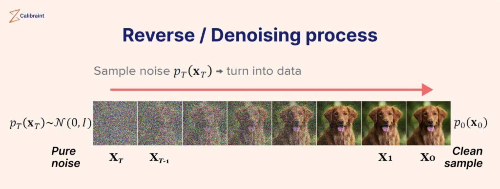

### Sources

- `AIG4B-Clase-9-Segmentacion-y-Stable-Diffusion.md.md` (slide 34; figura `slide-34-1.jpg`)

### Speaker notes

La figura lleva el logo de Calibraint, su autor; el deck original no la atribuía.

---

## 3. Latent diffusion: difundir en un espacio comprimido

### Content

- La difusión directa sobre píxeles (DALL·E 2, Imagen) es cara: una imagen de 512×512 RGB son **786.432 valores**, y cada uno de los 50 a 1000 pasos de denoising los procesa todos.
- Rombach et al. (CompVis, 2021) propusieron difundir en un **espacio latente** comprimido.
- Una imagen de 512×512×3 se comprime a un latente de 64×64×4 = **16.384 valores**: 48× menos por paso.
- Funciona porque las imágenes naturales son redundantes: los píxeles vecinos se parecen. Una compresión 8× por lado preserva la estructura.
- Resultado: Stable Diffusion corre en una GPU de consumo (8-16 GB) en pocos segundos.

### Sources

- `AIG4B-Clase-9-Segmentacion-y-Stable-Diffusion.md.md` (slides 36 y 37)
- `latent-diffusion-rombach-2022.web.md`

### Speaker notes

Fusión de "Por qué la difusión pura es lenta y costosa" y "Latent Diffusion: la idea genial". Cuenta: 786.432 / 16.384 = 48. Sobre píxeles hacían falta GPUs muy grandes y minutos por imagen: inviable para consumo, deployment masivo o un equipo chico que quiere iterar. El paper es "High-Resolution Image Synthesis with Latent Diffusion Models": preprint de diciembre de 2021, publicado en CVPR 2022. Por eso se llama Stable Diffusion.

---

## 4. Las tres piezas de Stable Diffusion

### Content

| Componente | Qué hace | Tamaño aprox. |
|---|---|---|
| VAE (Variational Autoencoder) | Comprime imagen ↔ latente | ~80M params |
| UNET | Denoiser condicional en espacio latente | ~860M params |
| CLIP Text Encoder | Prompt de texto → embedding | ~123M params |

- Dos de estas piezas ya las vimos: la U-Net en segmentación y CLIP en text-to-image. Falta el VAE.

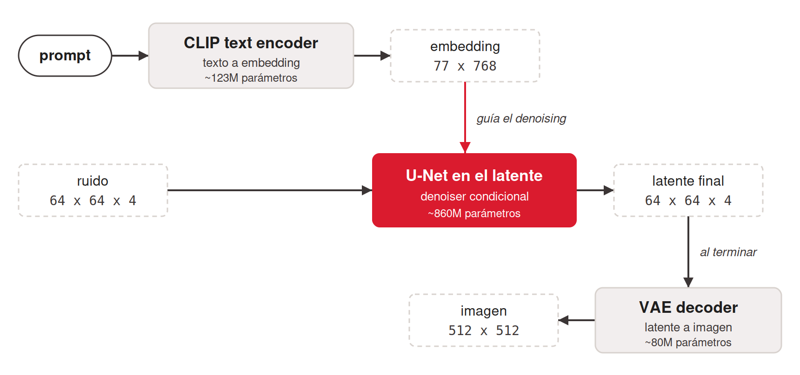
<!-- ascii-source:
 prompt --&gt; [ CLIP text encoder ] --&gt; embedding 77x768
                                            |
                                            v
 ruido 64x64x4 -------------------&gt; [ U-Net en el latente ] --&gt; latente final
                                                                     |
                                                                     v
                                    imagen 512x512 <-- [ VAE decoder ]
-->
<!-- ascii-note:
intent: el mapa de conexiones entre las tres piezas, del prompt a la imagen
emphasize: la U-Net en el latente
labels: dimensiones de cada tensor
terms: prompt, embedding
-->

### Sources

- `AIG4B-Clase-9-Segmentacion-y-Stable-Diffusion.md.md` (slide 38; figura `slide-38-1.jpg`, transcripta)

### Speaker notes

El prompt entra a CLIP, que produce un embedding. La U-Net usa ese embedding para guiar el denoising en el espacio latente. Cuando termina, el decoder del VAE transforma el latente final en una imagen visible. Texto y tabla salen de la captura del deck original.

---

## 5. Componente 1: el VAE

### Content

- **Encoder**: toma la imagen 512×512×3 y la mapea a un latente 64×64×4. Compresión ~48×.
- **Decoder**: toma un latente 64×64×4 y reconstruye una imagen 512×512×3.
- En el entrenamiento de SD se usa el encoder, para llevar las imágenes del dataset al latente. En inferencia **solo se usa el decoder**.
- Se entrena antes y por separado de la U-Net, con un objetivo simple: `decoder(encoder(imagen)) ≈ imagen`. Después sus pesos quedan congelados.

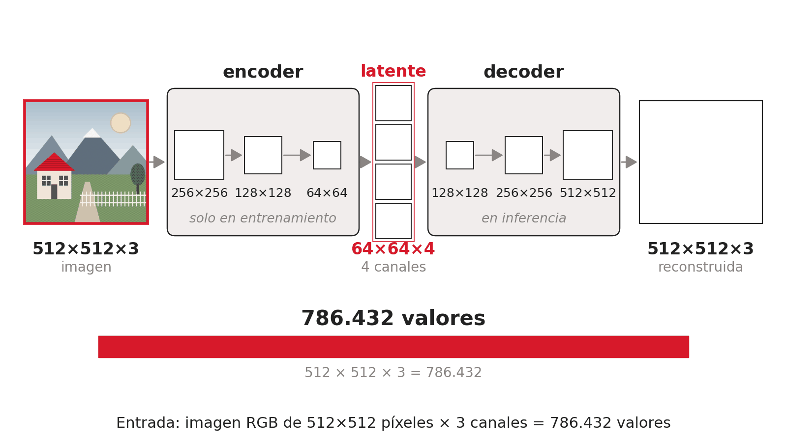
<!-- ascii-source:
 imagen          +---------+      latente       +---------+      imagen
 512x512x3 ----&gt; | encoder | ---&gt; 64x64x4 ----&gt; | decoder | ---&gt; 512x512x3
                 +---------+    (16.384 nums)   +---------+    reconstruida
                 solo en                         en inferencia
                 entrenamiento
-->
<!-- ascii-note:
intent: el VAE comprime a un latente chico y lo reconstruye; en inferencia solo se usa el decoder
emphasize: el latente 64x64x4
labels: dimensiones de entrada, latente y salida
terms: encoder, decoder
-->

### Sources

- `AIG4B-Clase-9-Segmentacion-y-Stable-Diffusion.md.md` (slides 39 y 40; figura `slide-39-1.jpg`, transcripta)

### Speaker notes

El VAE es un compresor inteligente: convierte el problema de "generar 800K píxeles" en el de "generar 16K números latentes". Lo variacional: el latente es una distribución, no un punto fijo (la campana gaussiana de la figura vieja).

---

## 6. Componente 2: la U-Net, de vuelta

### Content

- La misma estructura que vimos en segmentación: encoder + decoder en U + skip connections.
- Cambia la tarea. U-Net de segmentación: entra una imagen, sale una máscara. U-Net de SD: entran **latente ruidoso, timestep y embedding del prompt**; sale la **predicción del ruido** presente en el latente.
- **Cross-attention**: en cada nivel de la U, bajando y subiendo, un bloque calcula pesos entre las features de la imagen y cada token del embedding de CLIP, y suma la información de los tokens ponderada por esos pesos.
- El cross-attention con el prompt es atención de transformer metida dentro de una red convolucional.

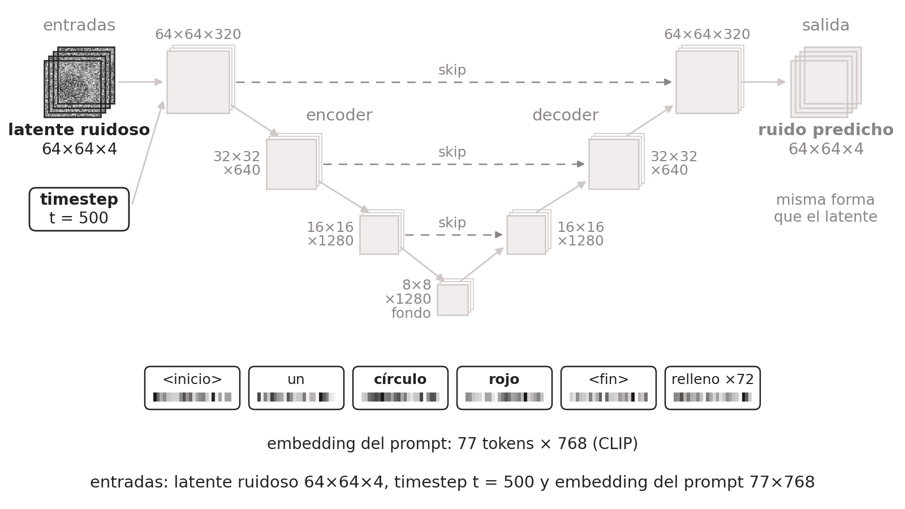
<!-- ascii-source:
 latente ruidoso --+                                        +--&gt; ruido predicho
 timestep t -------+--&gt; [enc] -------- skip ---------&gt; [dec] --+
                         |  \                          /  |
                         |  [enc] ---- skip -----&gt; [dec]  |
                         |     \                   /      |
                         |      +---&gt; [ fondo ] --+       |
                         |               |                |
                         +---------------+----------------+
                                         ^
                                cross-attention en cada nivel
                                         |
                          embedding del prompt (77x768)
-->
<!-- ascii-note:
intent: la U-Net de Stable Diffusion; tres entradas, una salida (el ruido), y el prompt entra por cross-attention en cada nivel
emphasize: la flecha de cross-attention desde el embedding del prompt
labels: entradas a la izquierda, ruido predicho a la derecha
terms: skip, cross-attention, timestep
-->

### Sources

- `AIG4B-Clase-9-Segmentacion-y-Stable-Diffusion.md.md` (slide 41; figura `slide-41-1.jpg`, transcripta)
- `latent-diffusion-rombach-2022.web.md` (capas de cross-attention en la U-Net; Rombach et al. 2022, bloques de transformer con cross-attention)

### Speaker notes

La conexión que cierra el círculo: la arquitectura que en 2015 segmentaba células al microscopio hoy es el corazón de la generación de imágenes más usada. U-Net es un patrón arquitectónico reutilizable. El ciclo de cada paso se ve en el pipeline, dos láminas más adelante.

---

## 7. Componente 3: el CLIP Text Encoder

### Content

- SD 1.x usa el text encoder de **CLIP ViT-L/14** (~123M parámetros), congelado: el equipo de SD no lo reentrena, lo toma prestado de OpenAI.
- Entrada: el prompt (ej: "un astronauta montando un caballo"), tokenizado a **77 tokens** (con padding si la frase es corta, truncado si es larga).
- Salida: una matriz de embeddings de **77 × 768**, que se enchufa a la U-Net en cada bloque de cross-attention.

### Sources

- `AIG4B-Clase-9-Segmentacion-y-Stable-Diffusion.md.md` (slides 38 y 42)
- `clip-radford-2021.web.md`

### Speaker notes

Los 123M son del text encoder, no del CLIP completo (que suma el image encoder ViT-L/14); SD solo usa la parte de texto. Tomarlo ya entrenado ahorra cómputo y aprovecha que CLIP ya relacionaba texto e imagen.

---

## 8. Pipeline completo de inferencia

### Content

1. **Prompt** → tokenizer → CLIP Text Encoder → embedding de texto (77 × 768).
2. **Latente inicial**: un tensor aleatorio de 64×64×4 desde una normal, controlado por la seed. Es el bloque de mármol que vamos a tallar.
3. **Bucle de denoising** (~50 pasos): la U-Net recibe (latente, t, embedding) y predice el ruido; el scheduler lo resta.
4. **Decodificar**: latente final 64×64×4 → VAE Decoder → imagen 512×512×3.

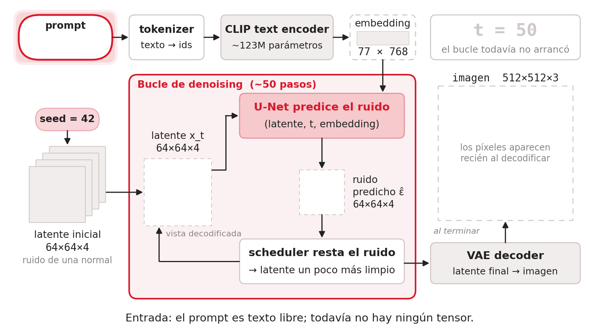
<!-- ascii-source:
 seed --&gt; latente ruidoso 64x64x4
                 |
                 v
        +-------------------------------------+
        |  U-Net predice el ruido             |<--- embedding del prompt
        |  (latente, timestep t, embedding)   |
        +-------------------------------------+
                 |
                 v
        +-------------------------------------+
        |  scheduler resta el ruido           |
        |  -> latente un poco mas limpio      |
        +-------------------------------------+
                 |
                 +----&gt; repetir ~50 veces (t baja) --+
                 |                                   |
                 |<----------------------------------+
                 v
        [ VAE decoder ] --&gt; imagen 512x512x3
-->
<!-- ascii-note:
intent: el loop de inferencia de Stable Diffusion; U-Net predice ruido, el scheduler lo resta, ~50 veces, y el VAE decodifica
emphasize: el loop de ~50 repeticiones
labels: dimensiones del latente y de la imagen
terms: seed, scheduler, timestep
-->

### Sources

- `AIG4B-Clase-9-Segmentacion-y-Stable-Diffusion.md.md` (slides 41 y 43; figura `slide-43-1.jpg`, transcripta)

### Speaker notes

Todo lo que vimos (U-Net, embeddings de texto, condición) confluye en este pipeline. Stable Diffusion no es un modelo monolítico: son tres piezas modulares orquestadas por un loop iterativo.

---

## 9. Cómo se entrena Stable Diffusion

### Content

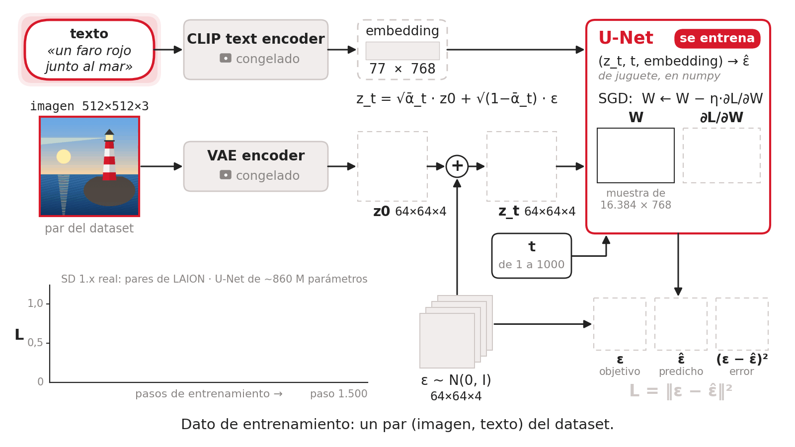

### Sources

- `latent-diffusion-rombach-2022.web.md`
- `laion-5b-schuhmann-2022.web.md`
- `classifier-free-guidance-ho-2022.web.md`

### Speaker notes

Un paso de entrenamiento con un modelo de juguete en numpy (4 pares, entrenado de verdad). El par (imagen, texto) pasa por CLIP y por el VAE encoder, que están congelados: no se entrenan. Se sortean un timestep t (acá t = 517) y un ruido ε, y se arma z_t = √ᾱ_t·z0 + √(1−ᾱ_t)·ε con el schedule real de SD (0,51·z0 + 0,86·ε). La U-Net, la única que se entrena, recibe (z_t, t, embedding) y devuelve ε̂. La pérdida es L = ‖ε − ε̂‖². El gradiente vuelve solo a la U-Net y se corta en CLIP y en el VAE. Después vienen pasos con t chico (casi limpio) y t grande (casi ruido), y un paso con el texto vacío: así aprende también la predicción sin condición, que es lo que usa la classifier-free guidance en inferencia. Al final, el mismo par con el mismo t y el mismo ε da L de 0,81 a 0,014. Escala real: SD 1.x se entrenó sobre pares de LAION y su U-Net tiene ~860 M parámetros.

---

## 10. Los hiperparámetros que importan

### Content

- **num_inference_steps**: cuántos pasos de denoising. Default 50. Por debajo de 20 la calidad se degrada; por encima de 100 las mejoras son marginales.
- **guidance_scale** (classifier-free guidance): qué tan estricto seguir el prompt. Default 7.5. Bajo (1-3) más diverso y menos fiel; medio (7-9) el punto justo; alto (15+) muy fiel pero saturado.
- **seed**: controla el ruido inicial. Misma seed + mismo prompt = misma imagen.
- **height y width**: múltiplos de 8, porque el VAE comprime 8×. Default 512×512.
- Para iterar: fijá la seed y el guidance, y mové el prompt. Así aislás el efecto de cada cambio de texto.

### Sources

- `AIG4B-Clase-9-Segmentacion-y-Stable-Diffusion.md.md` (slide 44)
- `classifier-free-guidance-ho-2022.web.md`

### Speaker notes

---

## 11. Limitaciones de Stable Diffusion

### Content

- **Manos y anatomía**: dedos de más o fundidos, ojos asimétricos, articulaciones raras.
- **Texto dentro de la imagen**: carteles y etiquetas salen como caracteres pseudo-aleatorios. Mejoró en SD 3 y FLUX.
- **Conteo y composición**: "tres manzanas" puede salir con dos o cinco; "un perro a la izquierda y un gato a la derecha" es frágil.
- **Sesgos del dataset**: LAION-5B refleja sesgos demográficos, culturales y estéticos de internet. Importa en aplicaciones médicas y sociales.
- **Costo de inferencia**: sigue siendo caro para deployment masivo en tiempo real.

### Sources

- `AIG4B-Clase-9-Segmentacion-y-Stable-Diffusion.md.md` (slide 45)
- `laion-5b-schuhmann-2022.web.md`

### Speaker notes

Stable Diffusion es una herramienta muy poderosa pero falible. Saber dónde falla es tan importante como saber qué puede hacer.

---

# 7. TilTedTinder v2 y notebook

**Goal of this section:** Volver al caso de TilTedTinder con todas las piezas: convertir preferencias en prompts, anticipar los problemas reales del producto y pasar al notebook.

---

## 1. De preferencias a prompts

### Content

- Ya tenemos las piezas: el usuario escribe un prompt, CLIP lo convierte en un embedding, la U-Net talla la imagen paso a paso y el VAE la decodifica.
- Usuario A: "Me atraen las personas inclinadas, altas, con anteojos y pelo rizado."
- Usuario B: "Prefiero caras inclinadas, jóvenes, con sonrisa y barba corta."
- Usuario C: "Inclinadas, mayores, expresión seria, rasgos angulosos."

```text
A: prompt = "a tilted portrait of a tall person with round glasses and curly hair, soft natural lighting, photorealistic, 4k"
B: prompt = "a tilted portrait of a young person with a warm smile and short beard, soft daylight, candid photo, shallow depth of field"
C: prompt = "a tilted portrait of an older person with a serious expression and angular features, dramatic shadows, black and white photography"
```

- Un buen prompt combina **sujeto + atributos + estilo + luz**.
- Mismo prompt + **misma seed** = mismo perfil estable cuando el usuario vuelve a abrir la app.

### Sources

- `AIG4B-Clase-9-Segmentacion-y-Stable-Diffusion.md.md` (slides 47 y 48; figuras `slide-47-1.jpg` y `slide-48-1.jpg`, transcriptas)

### Speaker notes

Fusión del recap ("El desafío que dejamos pendiente") y "De preferencias a prompts". La imagen final depende de la estructura del prompt tanto como del modelo: escribir prompts es una habilidad propia. Si el usuario "matchea" con un perfil, la seed permite reproducirlo idéntico.

---

## 2. Lo que el equipo va a encontrar

### Content

- **Slanted Land no está en los datos de SD**: LAION-5B no tiene caras inclinadas, así que las primeras generaciones saldrán rectas. Solución: fine-tuning con las 4 fotos reales, con DreamBooth o LoRA.
- **Sesgo demográfico**: hay grupos sobrerrepresentados y otros casi ausentes. El equipo tiene que auditar las generaciones.
- **Control de detalle limitado**: no podés pedir "exactamente esa nariz". Para detalles finos, iterar o usar ControlNet e Inpainting.
- **Costo**: 50 perfiles por usuario en tiempo real es caro. Caché, generación batched offline o modelos rápidos (SDXL Turbo, FLUX Schnell).
- **Ética**: ¿se le avisa al usuario que el perfil es sintético? ¿Hay riesgo de manipulación emocional?

### Sources

- `AIG4B-Clase-9-Segmentacion-y-Stable-Diffusion.md.md` (slide 49; figura `slide-49-1.jpg`, transcripta)
- `laion-5b-schuhmann-2022.web.md`

### Speaker notes

Stable Diffusion les resuelve el motor. El producto requiere muchas decisiones más, sobre datos, ética, cómputo y UX. Las de ética son decisiones de producto, no técnicas, pero alguien las tiene que tomar.

---

## 3. Pasamos al notebook

### Content

- **Stack**: Google Colab con GPU (Tesla T4, 16 GB) · Hugging Face Diffusers · Stable Diffusion v1.4 (CompVis) en `float16`.
1. **Pipeline alto nivel**: `StableDiffusionPipeline.from_pretrained(...)` y generar imágenes en pocas líneas.
2. **Hiperparámetros**: mover `num_inference_steps`, `guidance_scale` y `seed`, y ver qué cambia.
3. **Grids**: varias imágenes de un mismo prompt para ver la variabilidad.
4. **Dimensiones**: imágenes rectangulares (512×768).
5. **Pipeline manual**: desarmar el pipeline en VAE + U-Net + CLIP y reconstruirlo a mano.

### Sources

- `AIG4B-Clase-9-Segmentacion-y-Stable-Diffusion.md.md` (slide 50; figura `slide-50-1.jpg`, transcripta)

### Speaker notes

`float16` para que entre en la GPU gratuita. El último ejercicio es donde la sección de Stable Diffusion se vuelve tangible: ven el bucle de denoising, la cross-attention con el embedding de CLIP y el VAE decodificando al final. Cada bloque de la teoría aparece como código.

---

# Conclusions

## 1. Key takeaways

### Content

- Una **convolución** desliza un kernel chico de pesos compartidos sobre la señal: acepta cualquier largo y detecta un patrón esté donde esté. Su encoder resume la entrada en un embedding.
- **Segmentar** es etiquetar cada píxel; en medicina, la máscara es el dato que se mide.
- La **U-Net** recupera los bordes que FCN pierde gracias a las skip connections, y funciona con pocas imágenes etiquetadas.
- **SAM** segmenta cualquier objeto a partir de una pista: click, caja, máscara o texto.
- **Stable Diffusion** combina tres piezas: CLIP convierte el prompt en un embedding, la U-Net quita ruido en el latente y el VAE lo vuelve imagen.
- La misma U-Net aparece en las dos mitades de la clase: segmenta células y talla imágenes desde ruido.

### Sources

- `AIG4B-Clase-9-Segmentacion-y-Stable-Diffusion.md.md`

### Speaker notes

---

# Open questions

- Ver `research/corpus/AIG4B-Clase-9-Segmentacion-y-Stable-Diffusion.md.md` → *Inconsistencies / open questions* para los problemas detectados en el material original.
- Lámina 1.4: se usó `slide-07-2.jpg` (MRI cardíaca → máscara → overlay → probabilidad), que coincide con el texto, en lugar de `slide-08-1.jpg` (comparación de dos modelos). Confirmar con el presentador.
- Lámina 5.3: "50 a 1000 pasos" sale del deck original sin fuente publicada (corpus, inconsistencia 2).
- Ninguna lámina dice cómo se mide una segmentación (Dice, IoU) ni una imagen generada (FID, CLIP score). Hueco heredado del deck original.
- Sección 1 (convolución): el corpus de esta Talk no tiene un registro sobre convolución básica; las láminas 1.1 a 1.10 citan el corpus de `talks/modelado-redes-neuronales/research/corpus/chat.md.md`. Si se quiere un registro propio, correr el librarian.
- Lámina 1.1: MNIST 28×28 = 784 sale del pedido del presentador, sin registro en el corpus.
- Lámina 1.3: el corpus da 38,5 M de pesos para la primera capa densa sobre RGB 224×224 sin decir el ancho; 256 neuronas es el ancho que reproduce la cifra (150.528 × 256 = 38.535.168). Confirmar.
- Láminas 1.5, 1.6 y 1.8 usan GIF animados. El deck HTML los muestra; si algún día se exporta a .pptx, Keynote/PowerPoint pueden quedarse con el primer cuadro.
- Duración: la sección suma 10 láminas y el frontmatter sigue en 120 min con ~50 para el notebook. Revisar el reparto.

# Cut material

- Portada vieja del pptx ("Inteligencia Artificial Generativa Aplicada en Biomedicina / Clase 9 / Abril 2026"): duplicaba la portada nueva.
- Tabla de contenidos del pptx (01 a 05): la reemplaza la Agenda.
- Láminas divisoras vacías del pptx ("Segmentación: qué es y dónde aparece", "Un modelo básico → UNET", "Generación condicionada por texto", "Stable Diffusion", "TilTedTinder v2, Notebook y Cierre"): el render arma sus propios divisores de sección.
- Íconos de aplicaciones (`slide-06-1..5.png`) y marcadores decorativos (`slide-07-1`, `25-1`, `28-1`, `29-1`, `31-1`, `31-2`, `36-1`, `37-1..3`, `44-1`, `45-1`): sin contenido.
- Marcos de tarjeta vacíos (`slide-13-1..4`, `slide-14-1..4`, `slide-20-1..2`): sin contenido.
- `slide-08-1.jpg` (LGE/SSFP, UNet vs MI-UNet): reemplazada por `slide-07-2.jpg` en "Cómo se ve una salida".
- `slide-09-1.jpg` (MRI cerebral con cajas rojas): muestra detección, no segmentación.
- `slide-12-1.jpg` (FCN de Long et al.), `slide-15-1.jpg` y `slide-16-1.jpg` (U-Net), `slide-18-1.jpg` (SAM 2), `slide-19-1.jpg` (tarea promptable), `slide-30-1.jpg` (CLIP), `slide-33-1.jpg` (difusión), `slide-40-1.jpg` (VAE): reemplazadas por diagramas propios.
- `slide-38-1.jpg`, `slide-39-1.jpg`, `slide-41-1.jpg`, `slide-43-1.jpg`, `slide-47-1.jpg`, `slide-48-1.jpg`, `slide-49-1.jpg`, `slide-50-1.jpg`: capturas de texto, pasadas a texto (transcripción en el corpus).
- `slide-35-1.jpg` (figura de MedDiffusion/Swin): ilegible y sin identificar.
- `slide-28-1.png` y `slide-28-2.jpg` (infografía de línea de tiempo): contradecía las fechas del texto.
- `slide-29-2.jpg` (aritmética de embeddings de word2vec) y la lámina vieja sobre cómo una red neuronal representa texto (tokenización / embeddings / encoder contextual en tres columnas): resumida en una línea de la lámina de CLIP para acortar.
- Lámina "Una nueva tarea: del ruido a las palabras": fusionada en "Por qué la GAN no alcanza"; se cortaron "Accesibilidad" y "matrimonio entre lenguaje y visión".
- Línea de tiempo: se cortaron los detalles por hito ("La era del wow", "Cambia el panorama por completo") y 2025-2026 pasó a notas.
- "Aplicaciones genéricas": agricultura de precisión (plagas, estrés hídrico) pasó a notas.
- Detalles de "El nuevo desafío de TilTedTinder" ("La app creció. Ahora tienen miles de usuarios y un dataset valiosísimo...") y "Resultado: TilTedTinder llenó su base de datos. Los matches florecieron.": recortados por largo.
- Cifra "~95% del cómputo" (image encoder de SAM) y "acelerando 10× o más" (anotación asistida): sin fuente publicada (corpus, inconsistencia 2); pasaron a notas como advertencia.
- Pipeline de inferencia: "Paso 5 — Devolver al usuario. La imagen final." (trivial).
